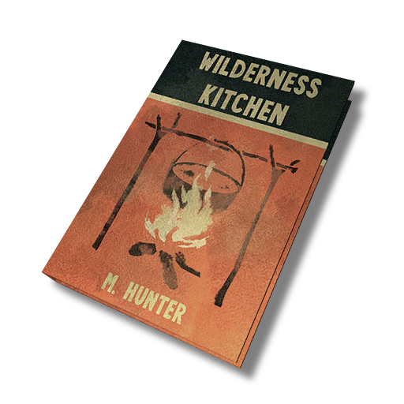
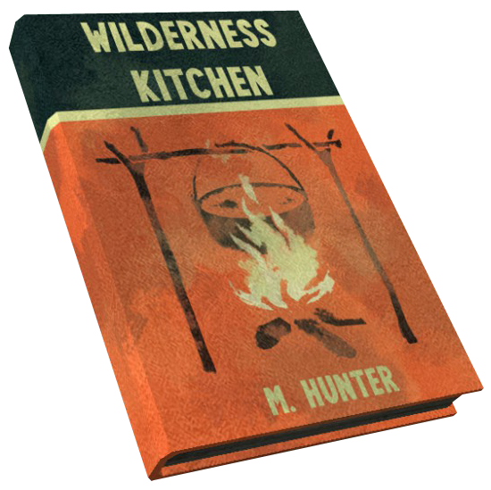
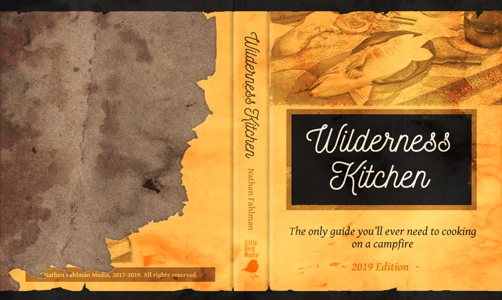

# Wilderness Kitchen

**Contents**

- [Research](#Research)
- [Fire Starting](#Fire_Starting)
- [Location](#Location)
- [Coastal Highway](#Coastal_Highway)
- [Forlorn Muskeg](#Forlorn_Muskeg)
- [Forsaken Airfield](#Forsaken_Airfield)
- [Mountain Town](#Mountain_Town)
- [Mystery Lake](#Mystery_Lake)
- [Pleasant Valley](#Pleasant_Valley)
- [Trivia](#Trivia)
- [Gallery](#Gallery)
- [Update history](#Update_history)

<table class="infobox">
<caption>Wilderness Kitchen</caption>
<colgroup>
<col style="width: 50%" />
<col style="width: 50%" />
</colgroup>
<tbody>
<tr>
<td colspan="2"><figure>

<figcaption>Wilderness_Kitchen_icon.png</figcaption>
</figure></td>
</tr>
<tr>
<td>
Release
</td>
<td>
<a href="./The%20Long%20Dark%20%E2%80%94%20Changelog.md#0.346" class="wikilink" title="23 June 2016">23 June 2016</a>
</td>
</tr>
<tr>
<td>
Wintermute
</td>
<td>
No
</td>
</tr>
<tr>
<td colspan="2" class="section">
<strong>Properties</strong>
</td>
</tr>
<tr>
<td>
Item type
</td>
<td>
<a href="./Fire%20Starting.md" class="wikilink" title="Fire Starting">Fire Starting</a><a href="./Tools.md" class="wikilink" title="Tools">Tools</a>|-
</td>
</tr>
<tr>
<td>
Stackable
</td>
<td>
No
</td>
</tr>
<tr>
<td>
Examine
</td>
<td>
Tips and tricks on how to prepare food in the wilderness. Researching this will improve your Skill.
</td>
</tr>
<tr>
<td colspan="2" class="section">
<strong>Values</strong>
</td>
</tr>
<tr>
<td>
Weight
</td>
<td>
0.50 kg (1.1 lbs)
</td>
</tr>
<tr>
<td colspan="2" class="section">
<strong>Actions</strong>
</td>
</tr>
<tr>
<td>
Backpack
</td>
<td>
Research, Drop
</td>
</tr>
</tbody>
</table>

**Wilderness Kitchen** is a <a href="./Research%20Book.md" class="wikilink" title="Research Book">Research Book</a> used to improve the <a href="./Cooking.md" class="wikilink" title="Cooking">Cooking</a> skill. It can also be used as Fuel when starting a <a href="./Fire.md" class="wikilink" title="Fire">Fire</a>.

## Research

*Wilderness Kitchen* can be researched for 5 hours that can be broken into multiple 1-hour minimum research sessions. 10 <a href="./Cooking.md#Skill_levels" class="wikilink" title="Cooking skill points">Cooking skill points</a> are awarded on completing the research. By selecting the Settled Mind <a href="./Feats.md" class="wikilink" title="Feat">Feat</a>, research time will be reduced by 20%, putting it at 4 hours.

Research can only be performed under the following conditions:

- There is light present to read
- <a href="./Warmth.md" class="wikilink" title="Warmth">Warmth</a>, <a href="./Fatigue.md" class="wikilink" title="Fatigue">Fatigue</a>, <a href="./Thirst.md" class="wikilink" title="Thirst">Thirst</a>, and <a href="./Hunger.md" class="wikilink" title="Hunger">Hunger</a> exceed 0%
- No negative <a href="./Afflictions.md" class="wikilink" title="Afflictions">Afflictions</a>

If the player's fatigue, thirst or hunger meters go down to zero or if the environment becomes dark during a research session, the session will be terminated instantly. The hour of research that was in progress will not be completed and any time that had already been spent will be wasted. For a multiple-hour research session, only the incomplete hour will be lost, all the previous hours will still count towards completion of the book.

## Fire Starting

<table class="infobox">
<caption>Wilderness Kitchen</caption>
<thead>
<tr>
<th>
Type
</th>
<th>
Fuel
</th>
</tr>
</thead>
<tbody>
<tr>
<th colspan="2" class="section">
<strong>Statistics</strong>
</th>
</tr>
&#10;<tr>
<th>
Duration
</th>
<td>
 18 minutes
</td>
</tr>
<tr>
<th>
Start Chance
</th>
<td>
 +35%
</td>
</tr>
<tr>
<th>
Heat
</th>
<td>
 +2°C (+3.6°F)
</td>
</tr>
<tr>
<th>
Burn Density
</th>
<td>
0.6 hr/kg (0.27 hr/lb)
</td>
</tr>
</tbody>
</table>

## Location

#### Coastal Highway

- <a href="./Abandoned%20Lookout.md" class="wikilink" title="Abandoned Lookout">Abandoned Lookout</a>

#### Forlorn Muskeg

- Inside the backpack at the elevated area of the <a href="./Forge.md" class="wikilink" title="Forge">Forge</a> building at <a href="./Old%20Spence%20Family%20Homestead.md" class="wikilink" title="Old Spence Family Homestead">Old Spence Family Homestead</a>
- <a href="./Poacher%27s%20Camp.md" class="wikilink" title="Poacher&#39;s Camp">Poacher's Camp</a>

#### Forsaken Airfield

- Inside <a href="./Bunker%20Omega.md" class="wikilink" title="Bunker Omega">Bunker Omega</a>

#### Mountain Town

- <a href="./Milton%20House.md" class="wikilink" title="Grey Mother&#39;s House">Grey Mother's House</a>

#### Mystery Lake

- <a href="./Trapper%27s%20Homestead.md" class="wikilink" title="Trapper&#39;s Homestead">Trapper's Homestead</a>

#### Pleasant Valley

- Inside the car between the garden beds area and one of the small houses in <a href="./Thomson%27s%20Crossing.md" class="wikilink" title="Thomson&#39;s Crossing">Thomson's Crossing</a>

*Wilderness Kitchen* can also spawn inside the Kitchen variant of the <a href="./Prepper%20Cache.md" class="wikilink" title="Prepper Cache">Prepper Cache</a>.

## Trivia

- Attempting to burn a copy of *Wilderness Kitchen* when it has not been fully read will give a confirmation warning before it can be burned.
- Once a copy of *Wilderness Kitchen* (or any research book) is fully researched, it will no longer appear in the Tools section of the Backpack.

## Gallery

<table class="gallery">
<colgroup>
<col style="width: 50%" />
<col style="width: 50%" />
</colgroup>
<tbody>
<tr>
<td><figure>

<figcaption>3D Model</figcaption>
</figure></td>
<td><figure>

<figcaption>Old model</figcaption>
</figure></td>
</tr>
</tbody>
</table>

## Update history

- UPDATE **23 June 2016 (<a href="./The%20Long%20Dark%20%E2%80%94%20Early%20Access%20Changelog.md#.346" class="wikilink" title="Update">Update</a>):**
  - Added to game.

**Lua execution error in Module:Navbox function navbox** **Lua execution error in Module:Navbox function navbox**

