# Wildlife

**Categories:** Wildlife · **Source:** [Fandom](https://thelongdark.fandom.com/wiki/Wildlife)

**Contents**

- [Animal Species](#animal-species)
- [Prey](#prey)
- [Predators](#predators)
- [Aurora Predators](#aurora-predators)
- [Scavenger Birds](#scavenger-birds)
- [Fish](#fish)
- [Special Animals](#special-animals)
- [Other Animals](#other-animals)
- [The Darkwalker](#the-darkwalker)
- [Animal Spawning](#animal-spawning)
- [Plant and Fungal Species](#plant-and-fungal-species)
- [Plants](#plants)
- [Fungi](#fungi)
- [Other Flora](#other-flora)
- [Gallery](#gallery)
- [Trivia](#trivia)

> “__Mackenzie: "I've had a lot of trouble with wildlife lately. Is it always this dangerous around here?"  
 Methuselah: "I've seen many strange things, of course. But the birds and beasts? Their rhythms are their own."__”
>
> — Mackenzie: "Meaning?" Methuselah: "The patterns of nature have been interrupted. Broken. Even those who once knew how to read them are now confused." [Methuselah](./Methuselah.md) and [Mackenzie](./Will%20Mackenzie.md) discussing the local Island wildlife

In _The Long Dark_, interaction with wildlife is a central part of survival. A wide variety of plants and animals exist on [Great Bear Island](./Great%20Bear%20Island.md), including terrestrial, aquatic, and avian animals, as well as conifers, beech, and fungal species of plants and fungi. Many of the animals' behaviors are unusual or unnatural--possibly due to the [First Flare](./First%20Flare.md) and subsequent [Aurora](./Aurora.md).

<!-- #Prey -->
​

<!-- #prey -->
### Prey

Prey include [Deer](./Deer.md), [Rabbits](./Rabbit.md), [Ptarmigan](./Ptarmigan.md), and [Moose](./Moose.md):

- Rabbits are exclusive to Rabbit Groves at fixed locations, and can be [Trapped](./Trapping.md) with [Snares](./Snare.md).
- Ptarmigan live in relatively higher elevations of Regions, roam in flocks of 4, and stick to Ptarmigan Nests at fixed locations.
- Deer roam between multiple locations in each region, and are a major source of food and hides for crafting items.
- Moose are rare, and usually, but not always, found only at locations with moose markings (scratches on tree trunks).

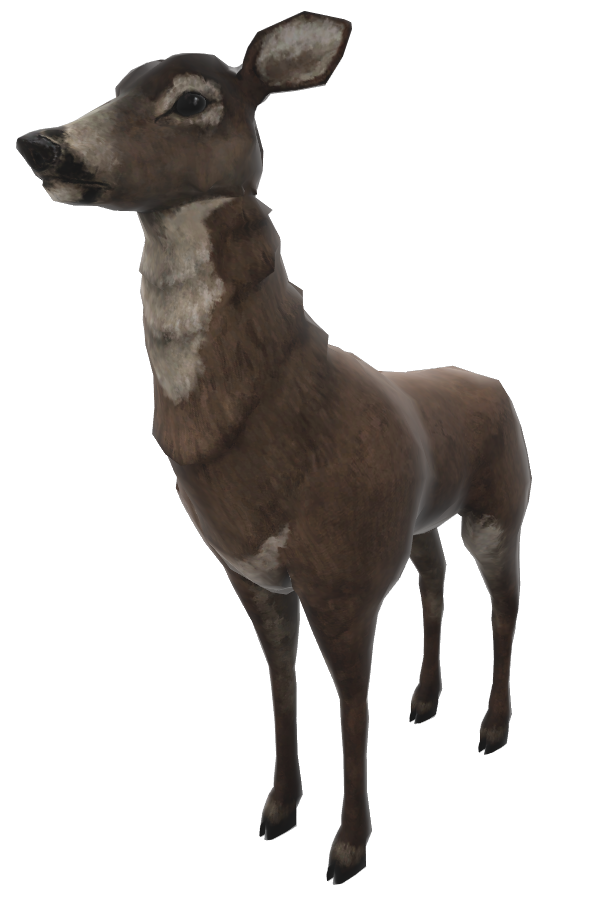

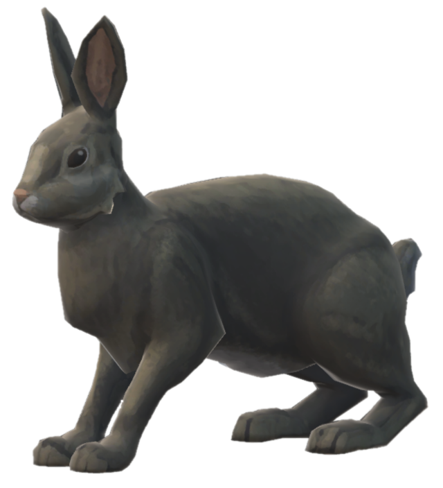

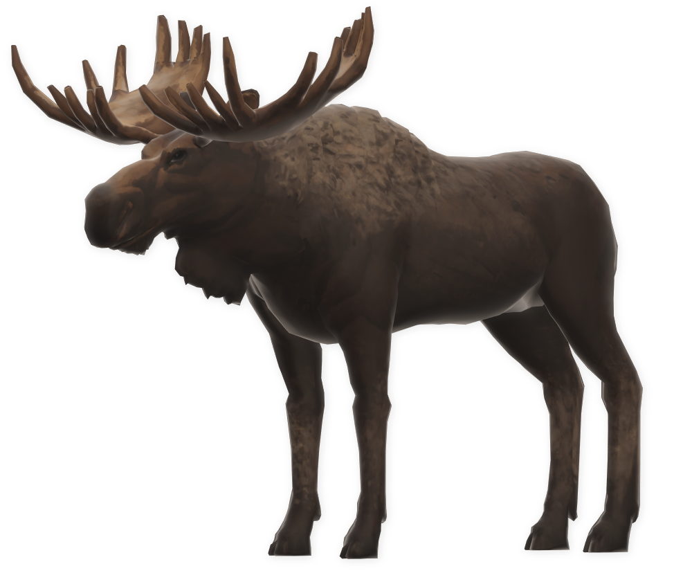

Deer, Ptarmigan, and Rabbits are easily frightened by the player or a predator. Moose however are highly aggressive and territorial, issuing warnings before attacking intruders.

<!-- #Predators -->
​

<!-- #predators -->
### Predators

Predators include [Wolves](./Wolf.md), [Poisoned Wolves](./Poisoned%20Wolf.md), [Timberwolves](./Timberwolf.md), [Cougars](./Cougar.md), and [Bears](./Bear.md):

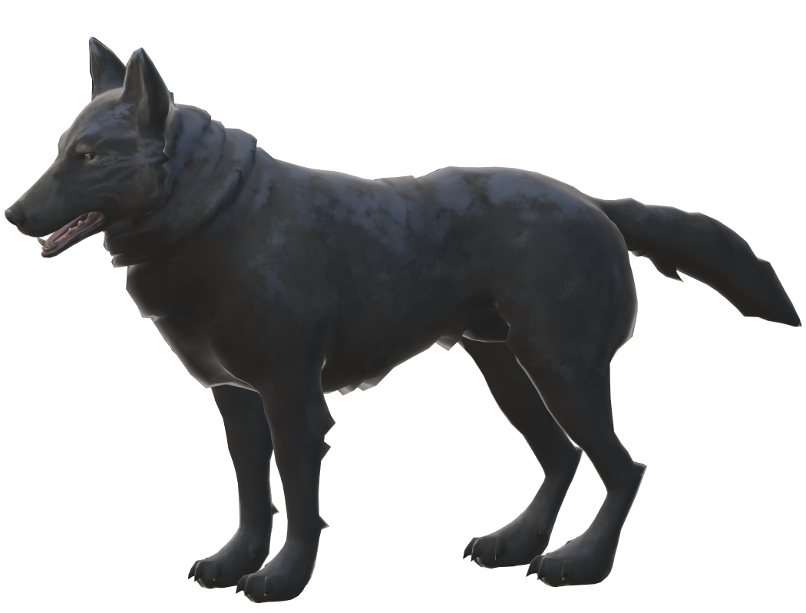

- Bears follow fixed routes to and from their den and typically do not hunt prey wildlife. Multiple dens may be present in a region, however not all may be populated by Bear in a given survival world.
- Cougars are very fast and agile predators, but will only appear if the player enables them. They stick to dedicated "Cougar Territory" areas and attack the player if they wander too close to them.
- Wolves can be found in nearly every region and regularly stalk and kill other prey wildlife. They are considered the player's main active threat next to the weather on the Island.
- Timberwolves hunt in packs but only roam 3 regions, and require a survivor to be very cautious and armed to avoid being attacked.
- Poisoned Wolves inhabit only the [Zone of Contamination](./Zone%20of%20Contamination.md), suffer from malnourishment, and can inflict [Chemical Poisoning](./Chemical%20Poisoning.md) on the player.

All predators will stalk or attack a nearby player, potentially resulting in a [Struggle](./Struggle.md). Predators will not attack the player on the Pilgrim difficulty unless provoked.

All animals can be [Hunted](./Hunting.md) to obtain meat (except for Poisoned Wolves), hides, and Guts, which can be cured for use in crafting. Animals will eventually respawn after being killed. However, the respawn rate can be delayed temporarily if the player aggressively hunts down animals in a certain area. [Trapping](./Trapping.md), on the other hand, does not seem to diminish the number of live rabbits in an area.

<!-- #aurora_predators -->
​

<!-- #Aurora_Predators -->
​

<!-- #Aurora_predators -->
​

<!-- #aurora-predators -->
### Aurora Predators

During an Aurora at night all prey animals will disappear and all predators will be replaced with their aurora counterpart (e.g. wolves are replaced by aurora wolves). Aurora predators are visually distinct (pale green glow on their fur, glowing eyes), act more chaotically (e.g. wolves bark often and run around randomly), are more aggressive (wider detection radius), deadlier (do more damage in [Struggles](./Struggle.md)), take more damage to kill, and are immune to being frightened by [Fire](./Fire.md). Powered streetlamps, vehicle headlights, and the [Flashlight](./Flashlight.md) or [Miner's Flashlight](./Miner%27s%20Flashlight.md) may be used to scare aurora predators, as well as lit [Flares](./Flare.md), [Marine Flares](./Marine%20Flare.md), and firing the [Distress Pistol](./Distress%20Pistol.md).

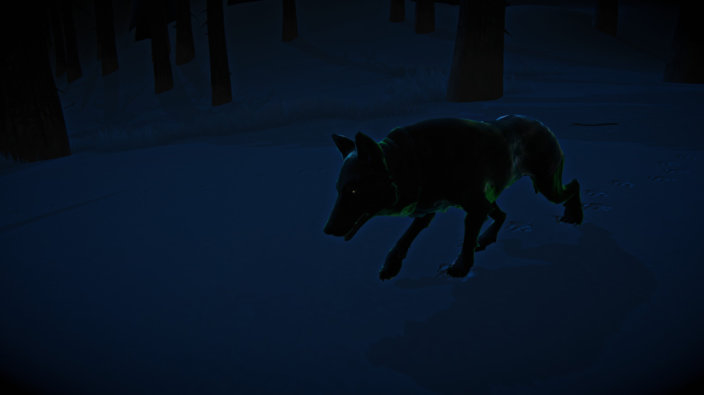

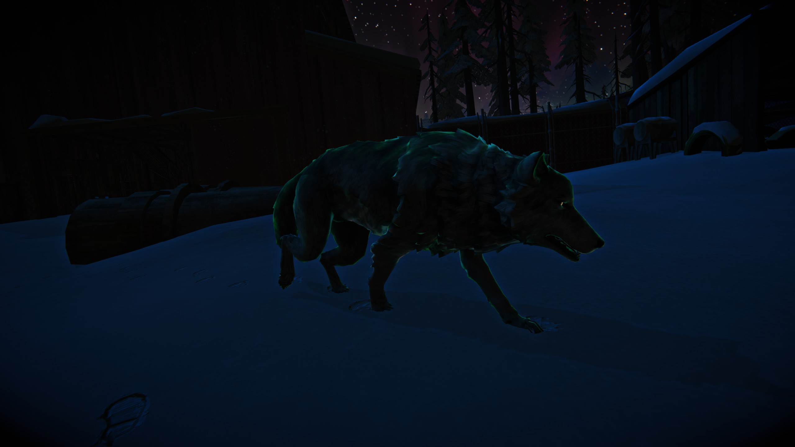

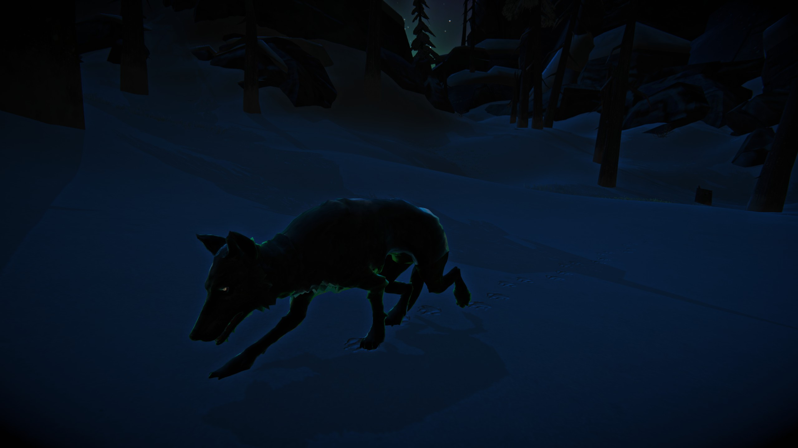

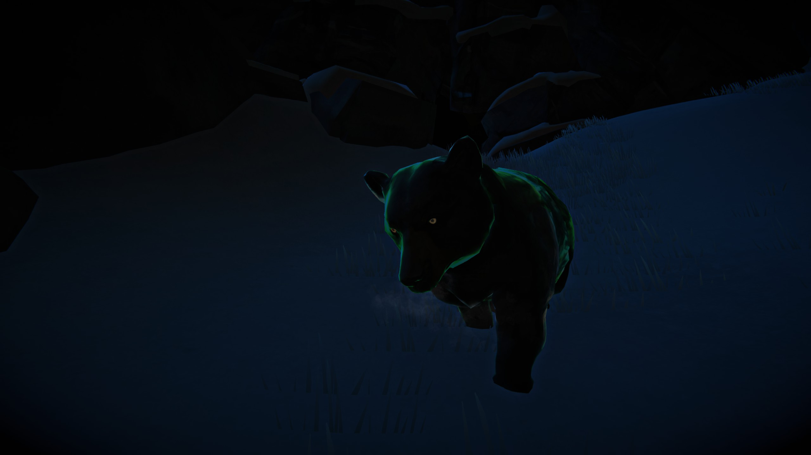

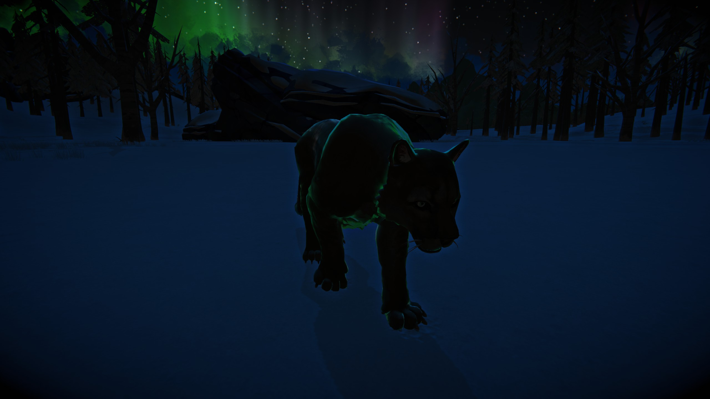

<!-- #scavenger_birds -->
​

<!-- #Scavenger_Birds -->
​

<!-- #Scavenger_birds -->
​

<!-- #scavenger-birds -->
### Scavenger Birds

[Crows](./Crow.md) will circle over [Frozen Corpses](./Frozen%20Corpse.md) and are used to draw attention to certain locations, while dropping [Crow Feathers](./Crow%20Feather.md) around corpses. When the player is near a Bear, crows can be heard aggressively calling with a distinctive "bear call." Crows cannot be harmed.

<!-- #Fish -->
​

<!-- #fish -->
### Fish

Fish inhabit the waters of numerous regions and may encountered by [Ice Fishing](./Ice%20Fishing.md) (either inside of fishing huts or by Free-Form ice holes). Species include [Coho Salmon](./Coho%20Salmon%20%28Raw%29.md), [Rainbow Trout](./Rainbow%20Trout%20%28Raw%29.md), [Rockfish](./Rockfish%20%28Raw%29.md), and [Red Irish Lord](./Red%20Irish%20Lord%20%28Raw%29.md) in coastal saltwater, while inland freshwater hosts [Smallmouth Bass](./Smallmouth%20Bass%20%28Raw%29.md), [Lake Whitefish](./Lake%20Whitefish%20%28Raw%29.md), [Goldeye](./Goldeye%20%28Raw%29.md), and [Burbot](./Burbot%20%28Raw%29.md).

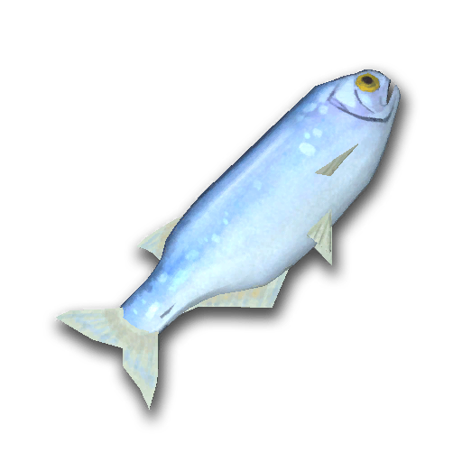

<!-- #special_animals -->
​

<!-- #Special_Animals -->
​

<!-- #Special_animals -->
​

<!-- #special-animals -->
### Special Animals

A few animals unique to Wintermute can be found in various Episodes. These include the [Big Bass](./Big%20Bass%20%28Raw%29.md), an incredibly large fish, the [Ghost Stag](./Ghost%20Stag.md), an albino Deer, and the [Old Bear](./Old%20Bear.md), an unusually tough and aggressive Bear. The Old Bear is the only unique animal found within Survival Mode, specifically in the "The Hunted" series of [Challenges](./Challenge.md).

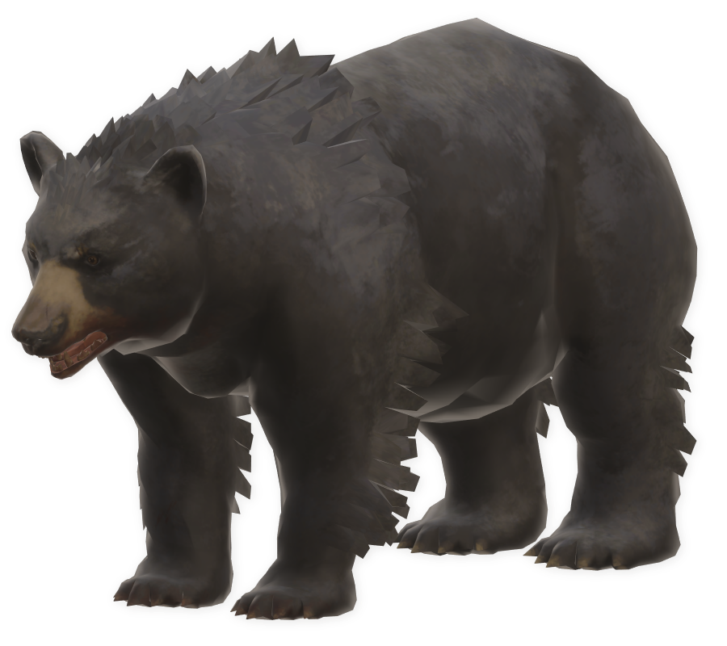

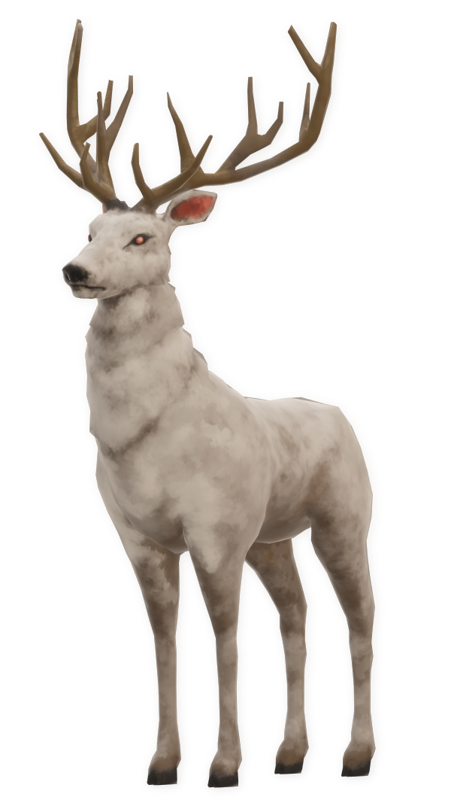

<!-- #other_animals -->
​

<!-- #Other_Animals -->
​

<!-- #Other_animals -->
​

<!-- #other-animals -->
### Other Animals

Other species of animals can be inferred to be in the game world, but are not seen in gameplay:

- loons, great horned owls, and woodpeckers can be heard calling during certain times of day, but do not appear in game as physical models (only as sound effects).
- A fox and owl can be seen when picking the Pilgrim/Voyager difficulties in Survival Mode, but neither can be found in game.
- Killer Whales can be seen in the ending of [Episode 3](./Episode%203%20-%20Crossroads%20Elegy.md) and [Episode 4](./Episode%204%20-%20Fury%2C%20Then%20Silence.md) but only in the ending cutscenes.
- Certain [Food And Drink](./Food%20And%20Drink.md) is made using products from animals not found in game.
- When hungry enough, survivors will claim that they "could eat a horse".
- Mules are mentioned in the [Load Screen](./Load%20Screen.md) description of [Mule Bridge](./Mule%20Bridge.md).
- Dog houses can sometimes be found on the Island, but dogs are never seen.

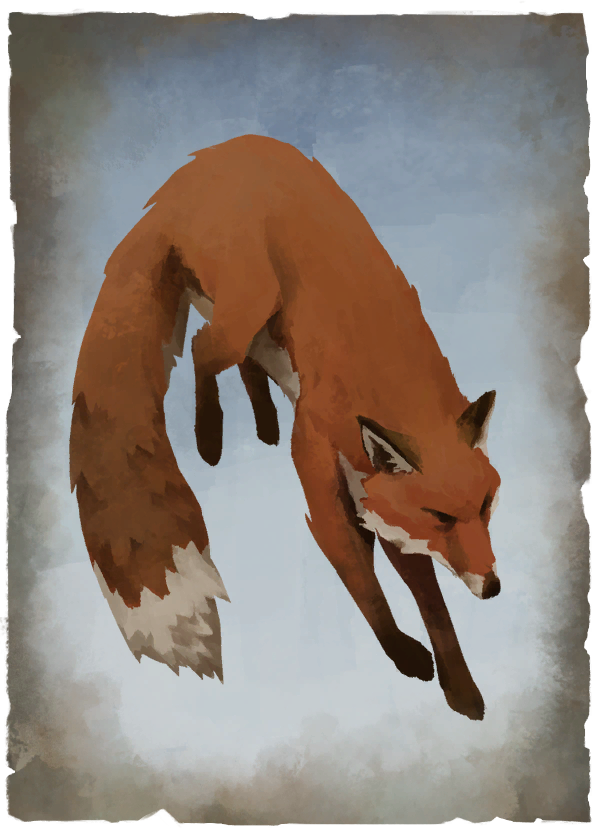

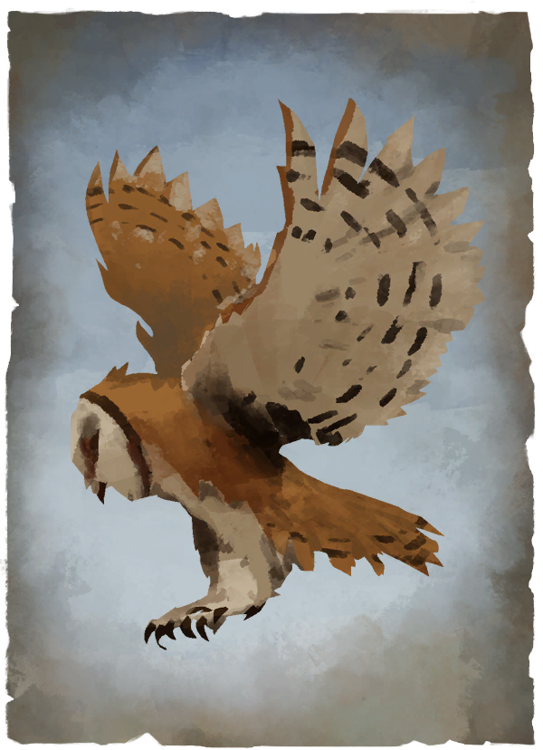

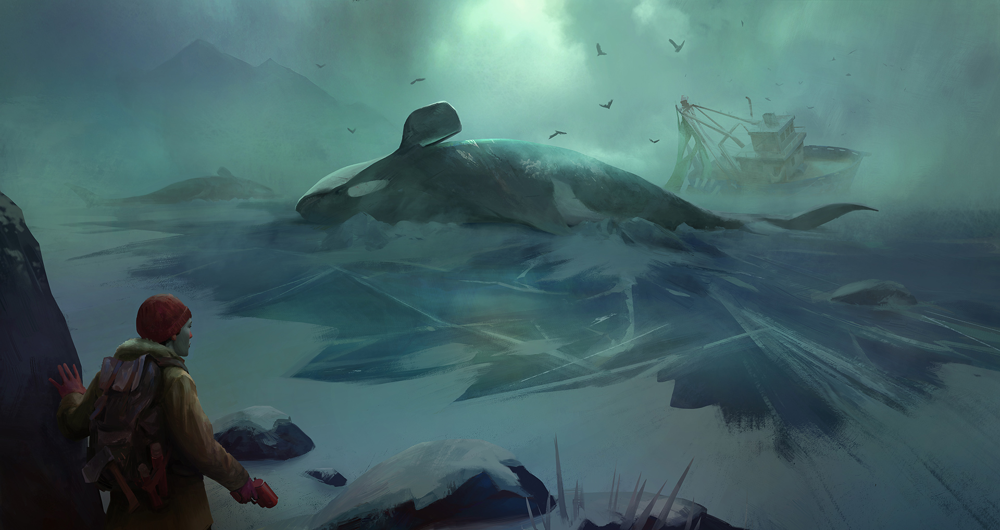

_Concept art of [Astrid Greenwood](./Astrid%20Greenwood.md) finding a dead killer whale_

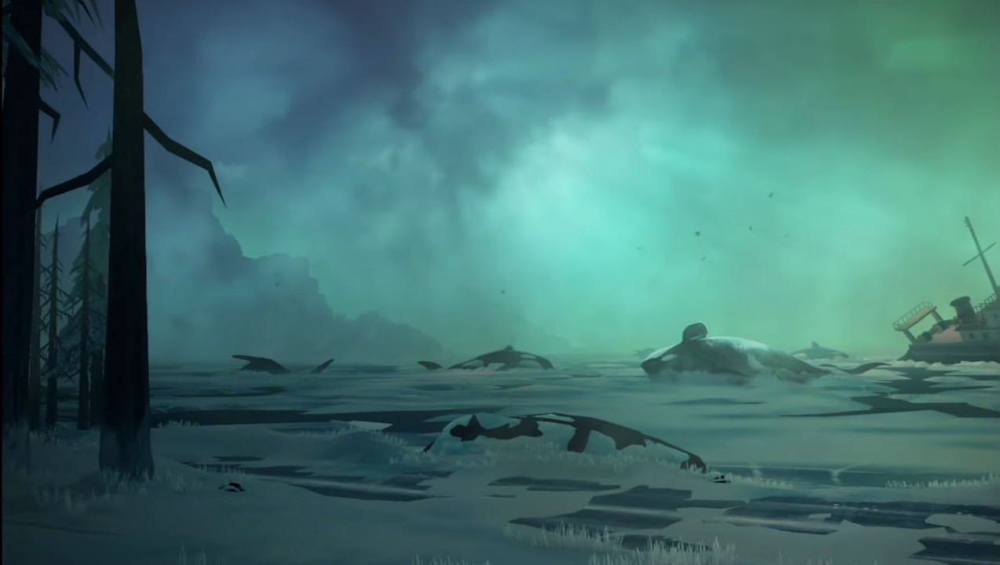

_A pod of beached Killer Whales at the end of [Episode 3](./Episode%203%20-%20Crossroads%20Elegy.md)_

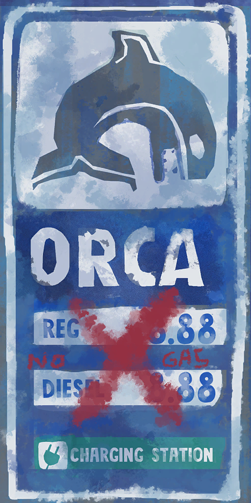

_Orca on [Orca Gas Station](./Orca%20Gas%20Station.md)_

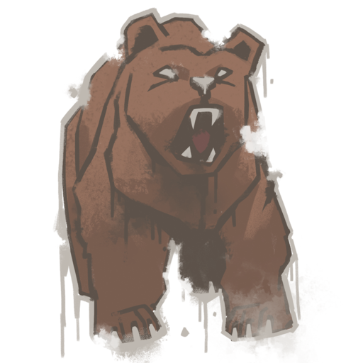

_Graffiti of a Grizzly Bear in [Bleak Inlet](./Bleak%20Inlet.md)_

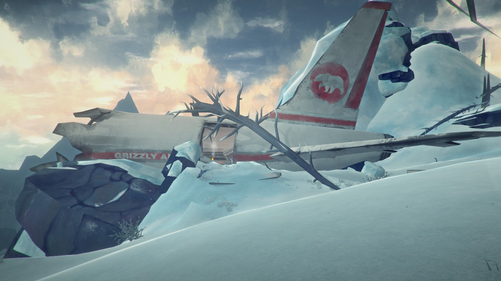

_A Grizzly Bear on the [Tail Section](./Tail%20Section.md)_

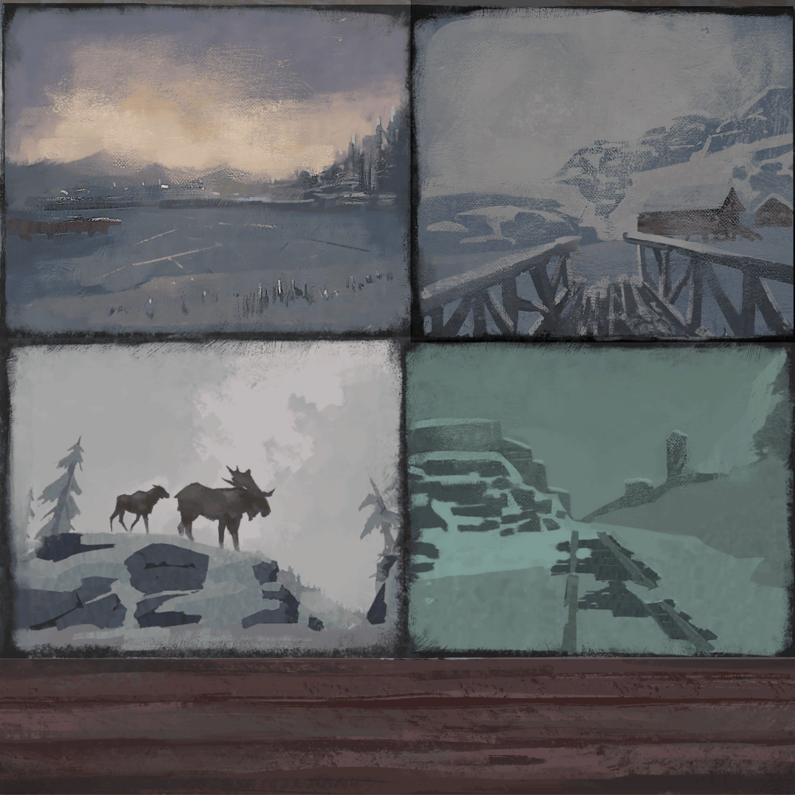

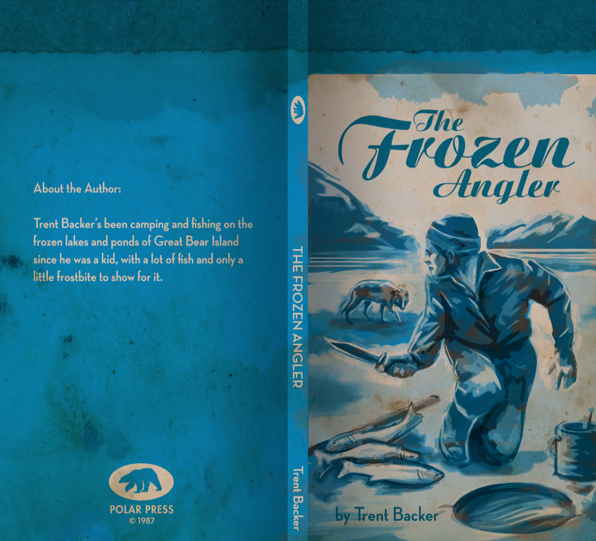

_Sardines on [Tin of Sardines](./Tin%20of%20Sardines.md)_

_Bull on [Beef Jerky](./Beef%20Jerky.md)_

_Calf Cow on [Condensed Milk](./Condensed%20Milk.md)_

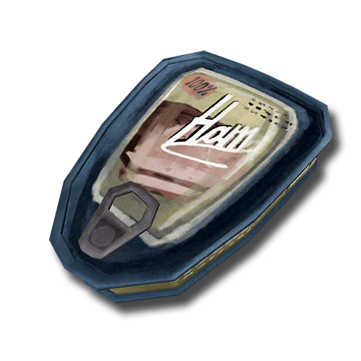

_Pork in [Canned Ham](./Canned%20Ham.md)_

_Squirrel on [Chocolate Bar](./Chocolate%20Bar.md)_

_Dogs and [Dog Food](./Dog%20Food.md)_

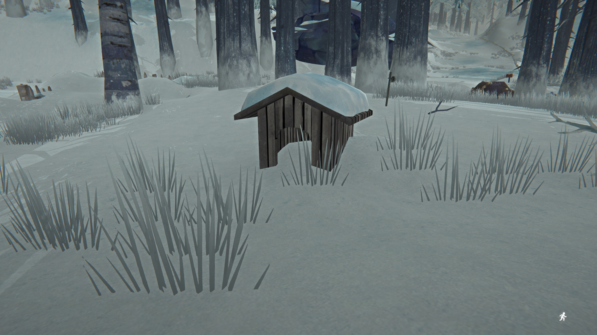

<!-- #the_darkwalker -->
​

<!-- #The_Darkwalker -->
​

<!-- #The_darkwalker -->
​

<!-- #the-darkwalker -->
### The Darkwalker

While not considered wildlife (being treated more as a kind of sapient, eldritch creature that simply hunts the player), the Darkwalker is an "animal" with pathfinding A.I. that appears during the challenge [Escape the Darkwalker](./Escape%20the%20Darkwalker.md). It does not have a physical model, only producing footsteps in the snow and roaring as it grows closer, following the player with the sole purpose of killing them. It cannot be killed or harmed by normal means, only avoided or banished by completing the challenge.

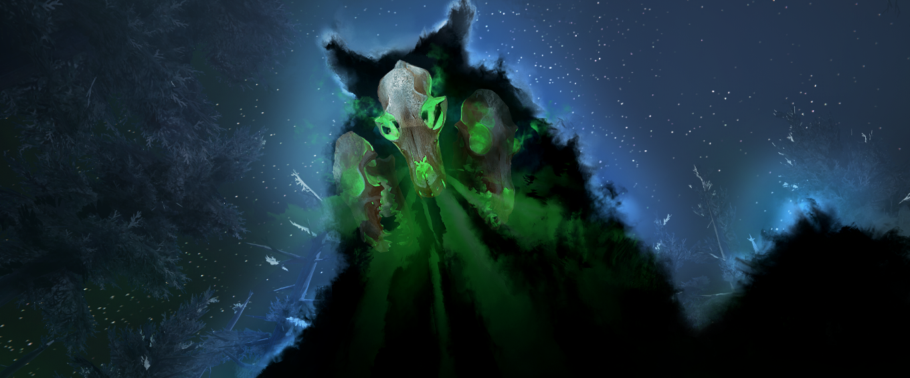

<!-- #animal_spawning -->
​

<!-- #Animal_Spawning -->
​

<!-- #Animal_spawning -->
​

<!-- #animal-spawning -->
## Animal Spawning

With the exception of fish and Crows, when the player first starts up a world, animals will spawn in at the same time the player does. These animals will wander around the region for however long the player stays outside. Some Survival Modes and Challenges offer a "grace period" before predators can spawn at the very start of a sandbox. On Interloper mode, all fish and prey animals will become rarer over time (to a limit).

When the player enters an indoor location, or leaves a [Region](./Region.md), the game saves the position of all the animals. If an animal is bleeding, the game will track it. This game state is valid for about one in-game hour, during which time the animals will move around as if the player were present. If the player does not re-enter the region within this time, all the animals will despawn. When the player enters the region once more, all animals will be spawned in as if the player entered the region for the first time. If an animal was bleeding and the player re-enters the region before the bleed-out timer has expired, the animal will not die and will respawn, unharmed. If the player stays inside longer than the animal's bleed-out timer, the animal will spawn into the region, dead, but any arrows in its body will be lost.

When an animal is killed, it will be removed from the respawn list for a few days after killing, depending the frequency of deaths and game difficulty. More deaths = longer respawn time. The respawn timer starts immediately on killing the animal. Leaving parts unharvested on the carcass (ex. leaving the guts) does not delay this timer.

All animals will remain outdoors during a blizzard, but despawn when a player goes indoors.

<!-- #plant_and_fungal_species -->
​

<!-- #Plant_and_Fungal_Species -->
​

<!-- #Plant_and_fungal_species -->
​

<!-- #Plant_And_Fungal_Species -->
​

<!-- #plant-and-fungal-species -->
## Plant and Fungal Species

While containing no AI, interactions with plants and fungi are an equally important aspect of surviving on Great Bear Island. Many Afflictions created by predator animals can only be cured by harvesting and cooking certain species of plants and fungi, while others can be prepared and eaten in meals. Some plants can be harvested and cured to craft weapons and tools for survival, and many species of trees also drop branches that can be used as fuel for fires.

<!-- #Plants -->
​

<!-- #plants -->
### Plants

- [Burdock](./Burdock.md) can be dug out of the ground for [Burdock Root](./Burdock%20Root.md), and these roots can be [prepared](./Prepared%20Burdock.md).
- Birch trees occasionally shed [Birch Bark](./Birch%20Bark.md) that can be used as tinder or prepared and brewed into a tea. [Green Birch Saplings](./Green%20Birch%20Sapling.md) can be harvested and cured to create [Arrow Shafts](./Arrow%20Shaft.md) for Arrows.
- [Green Maple Saplings](./Green%20Maple%20Sapling.md) can be harvested to create [Travois](./Travois.md) and [Survival Bows](./Survival%20Bow.md).
- Hardwood beech trees and softwood conifers often drop [Sticks](./Stick.md), [Cedar Firewood](./Cedar%20Firewood.md), and [Fir Firewood](./Fir%20Firewood.md) for fuel. Certain fallen trees are also used as natural footbridges, or can be used as makeshift shelters if a player finds one that is hallowed out.
- The ground around [Oak Trees](./Oak%20Tree.md) can be searched for [Acorns](./Acorns.md) that can be prepared, cooked, and eaten as is or crushed into [Acorn Grounds](./Acorn%20Grounds.md) to create various recipes or even [Cups of Acorn Coffee](./Cup%20of%20Acorn%20Coffee.md).
- Rose Bushes provide [Rose Hips](./Rose%20Hip.md) that can be prepared to create a natural painkiller tea, and are often used to mark [Rock Climbs](./Rock%20Climb.md).
- [Cat Tails](./Cat%20Tail.md) are found all across the Island around many fresh water lakes, streams, and ponds. [Cat Tail Heads](./Cat%20Tail%20Head.md) can be used as tinder to start fires and their [Stalks](./Cat%20Tail%20Stalk.md) can serve as an easy to find, though not very filling, food source.
- [Scrub Brush](./Scrub%20Brush.md) can be found in various regions and can be harvested to obtain large amounts of Sticks for fires, and can sometimes be found in patches that block a player's progress.

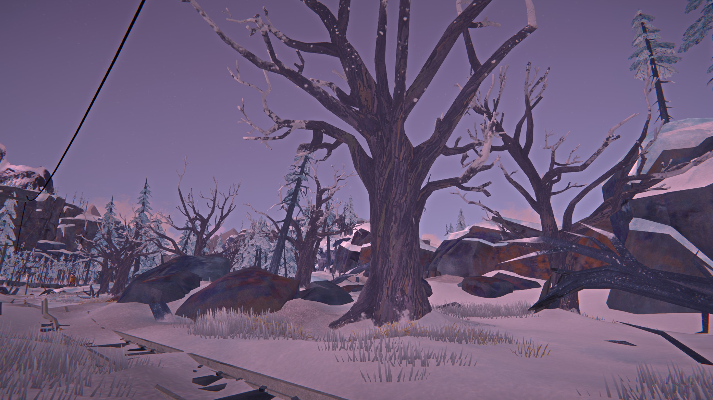

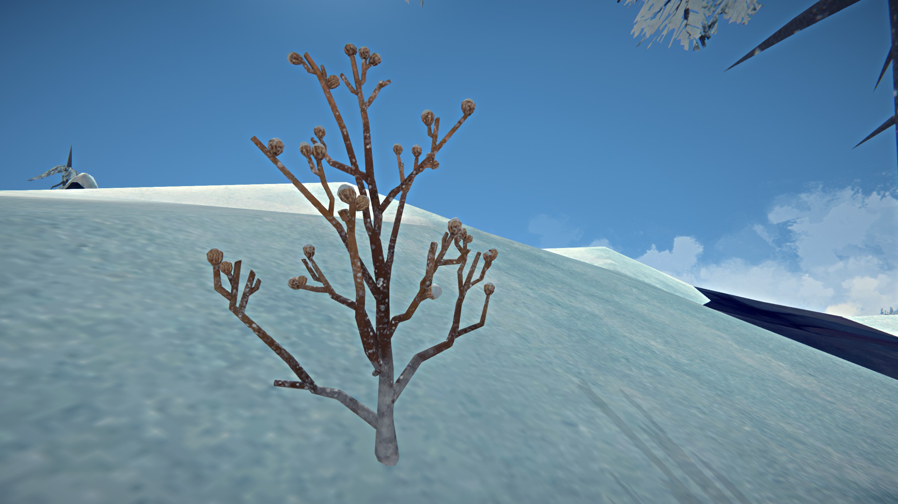

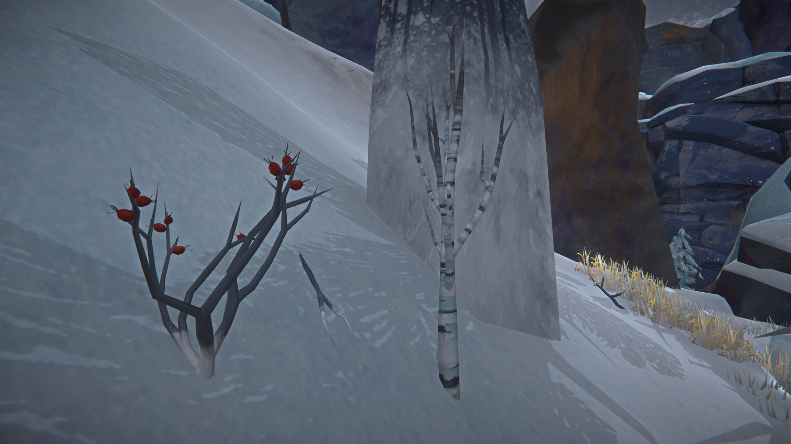

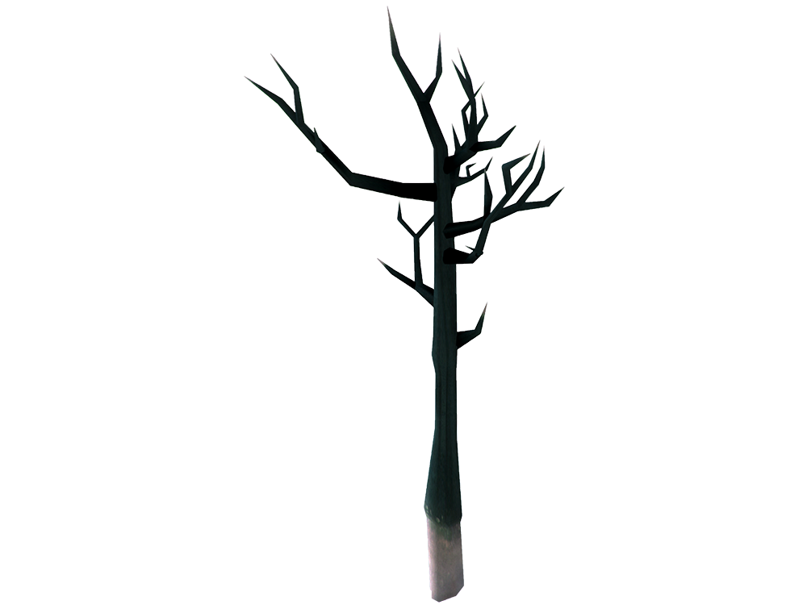

[Missing image: Cat\_Tail\_plant.png]

_Cat Tail_

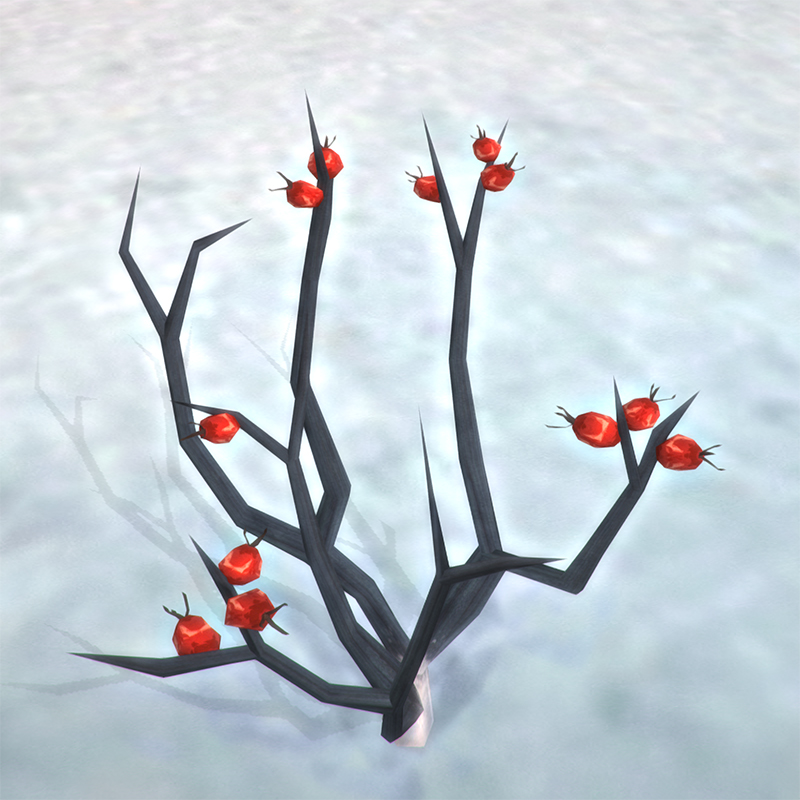

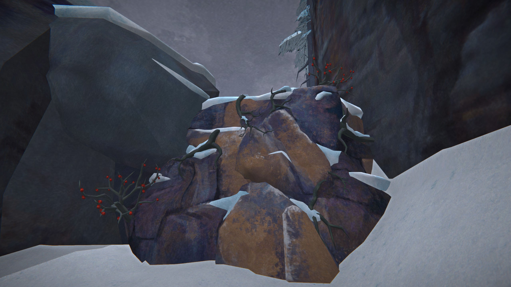

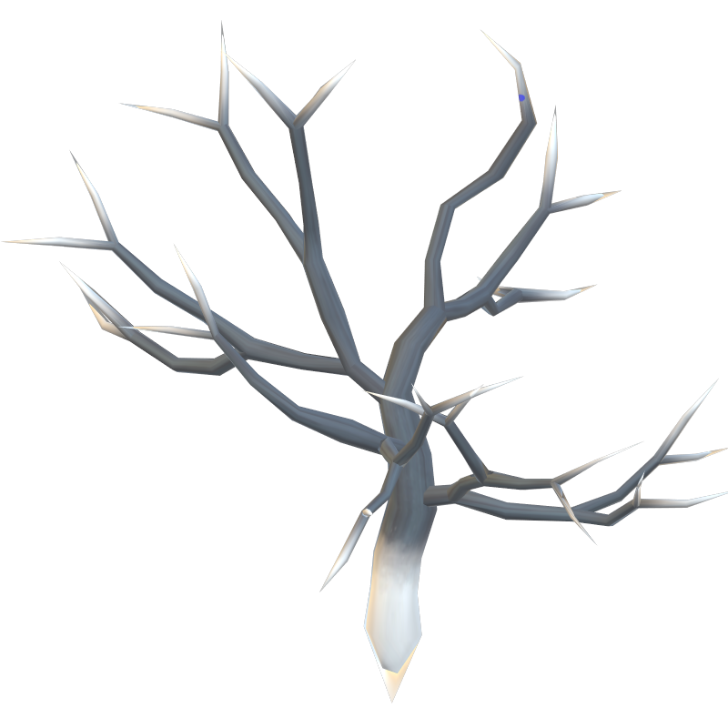

<!-- #Fungi -->
​

<!-- #fungi -->
### Fungi

- [Reishi Mushroom](./Reishi%20Mushroom.md) are found around rotting tree stumps, and can be prepared to create [Reishi Tea](./Reishi%20Tea.md) or be used in Recipes.
- [Old Man's Beard Lichen](./Old%20Man%27s%20Beard%20Lichen.md) can be found hanging from many trees, and can be used as a natural antiseptic.

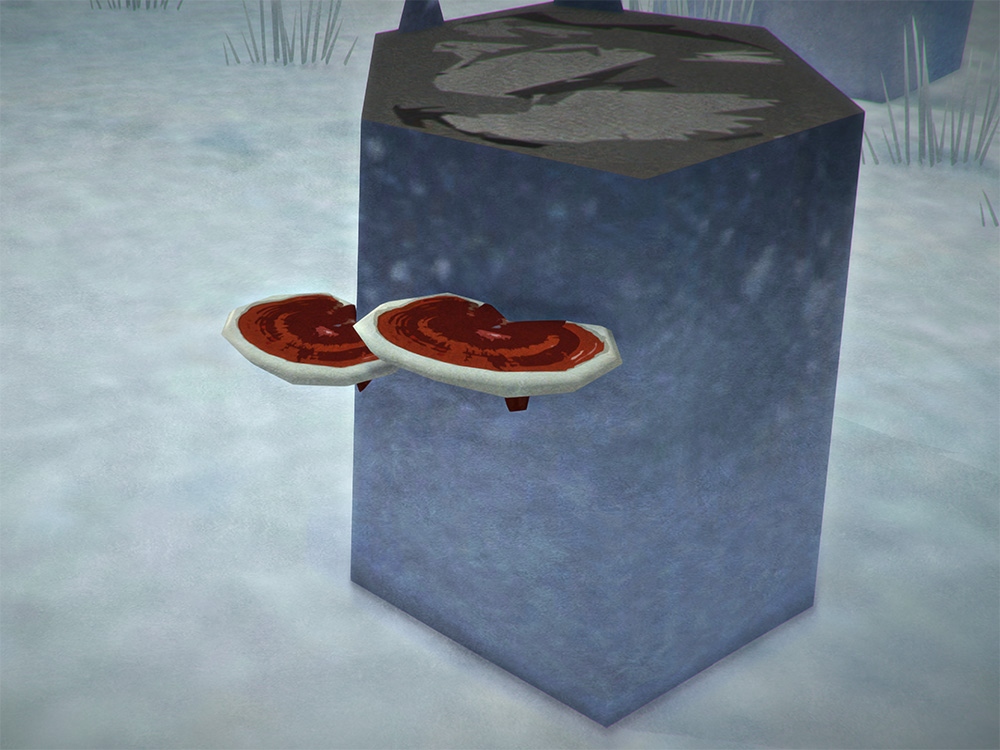

<!-- #other_flora -->
​

<!-- #Other_Flora -->
​

<!-- #Other_flora -->
​

<!-- #other-flora -->
### Other Flora

Other examples of Flora include Bioluminescent Moss in [Ice Caves](./Ice%20Cave.md) and various grasses occasionally found on the Island. Certain packaged foods show images of plants not found in game.

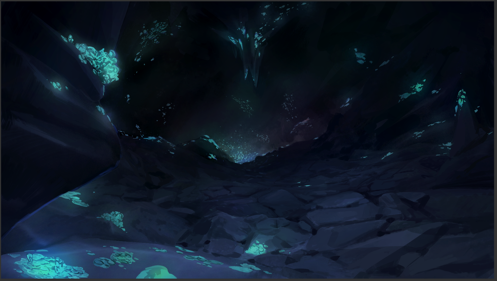

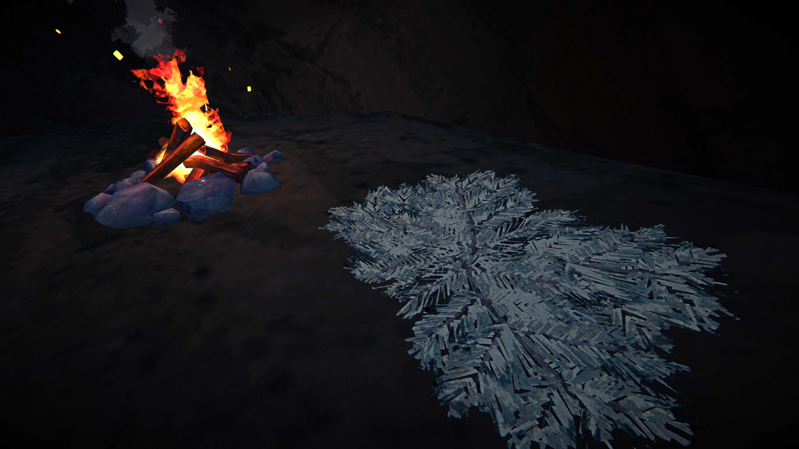

_Grapes on [Stacy's Grape Soda](./Stacy%27s%20Grape%20Soda.md)_

_Orange on [Orange Soda](./Orange%20Soda.md)_

_Acorns and leaves on a [Granola Bar](./Granola%20Bar.md)_

_Peanuts on [Peanut Butter](./Peanut%20Butter.md)_

<!-- #Gallery -->
​

<!-- #gallery -->
## Gallery

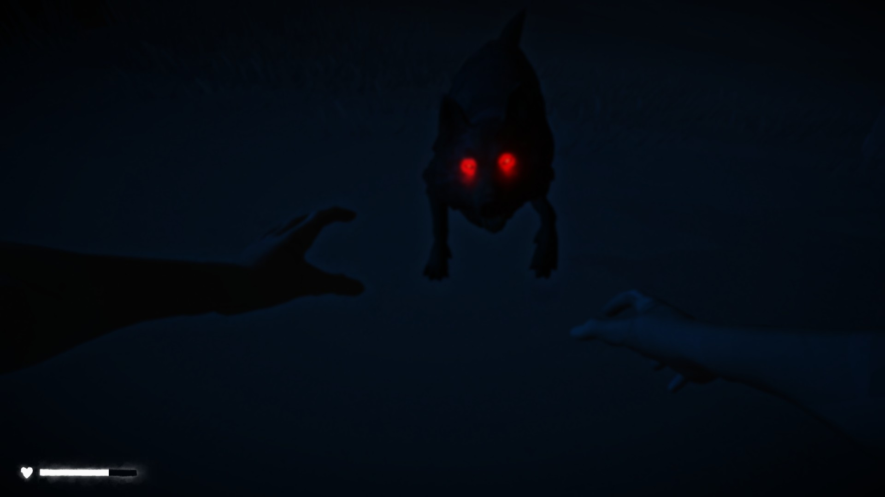

_"Demon Wolves" in the [4 Days of Night Event](./4%20Days%20of%20Night%20Event.md)_

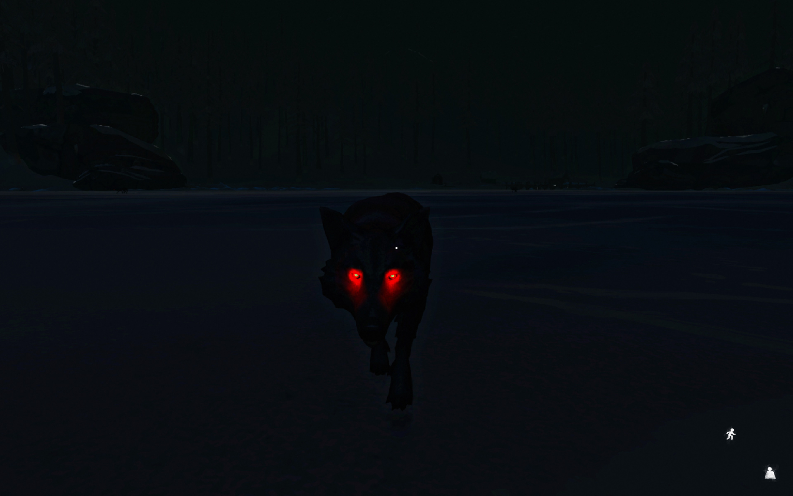

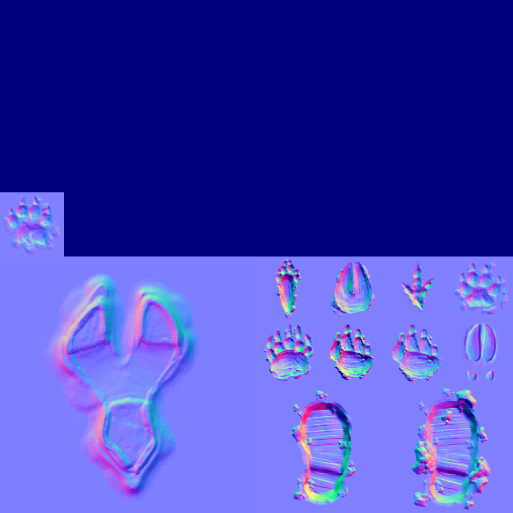

<!-- #Trivia -->
​

<!-- #trivia -->
## Trivia

- Animals never appear indoors across the Island except for 5 special animals, many of whom are given unofficial names by The Long Dark community:
  - Fluffy - A Wolf that originally appeared inside [Carter Hydro Dam](./Carter%20Hydro%20Dam.md) but was moved to the [Workshop](./Workshop.md) (This is the only animal officially acknowledged by [Hinterland Studio Inc.](./Hinterland%20Studio%20Inc..md))
  - "Scruffy" - A Wolf that appears inside the [Cave](./Cave%20%28Desolation%20Point%20location%29.md) in [Desolation Point](./Desolation%20Point.md).
  - "Sketchy" - A Wolf that appears inside the [Ice Caves](./Ice%20Cave.md) of [Hushed River Valley](./Hushed%20River%20Valley.md).
  - "Mazey" - A Wolf that appears inside the [Cave (Transition Zone)](./Cave%20%28Transition%20Zone%29.md) close to a frozen waterfall near [Sundered Pass](./Sundered%20Pass.md).
  - "Larry" - A Rabbit that appears inside the [Cave (Transition Zone)](./Cave%20%28Transition%20Zone%29.md) between [Pleasant Valley](./Pleasant%20Valley.md) and [Winding River](./Winding%20River.md).
- In older versions, animals' pathfinding AI could not navigate obstacles such as fallen tree bridges, staircases, doorways of fishing huts. This has been (mostly) fixed, but animals still have trouble navigating stairs, mazes, and fallen tree bridges on occasion.
- Animals can't enter locations only accessible by crouching. Animals also cannot enter buildings with outside interiors, even when the doorways are open.
- Animals will never jump down embankments, even from heights that would not damage the player.
- During [Escape the Darkwalker](./Escape%20the%20Darkwalker.md), the [Toxic Fog](./Toxic%20Fog.md) will immediately kill all prey and predator type animals when it descends. Crows and plants will not be affected.

[es:Fauna local](https://es.wikipedia.org/wiki/Fauna_local) [fr:Animaux](https://fr.wikipedia.org/wiki/Animaux)
