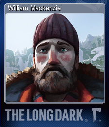
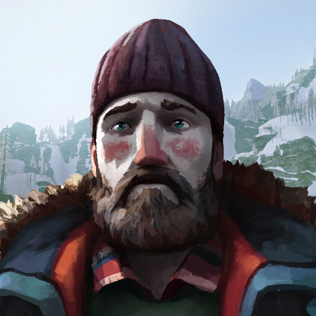
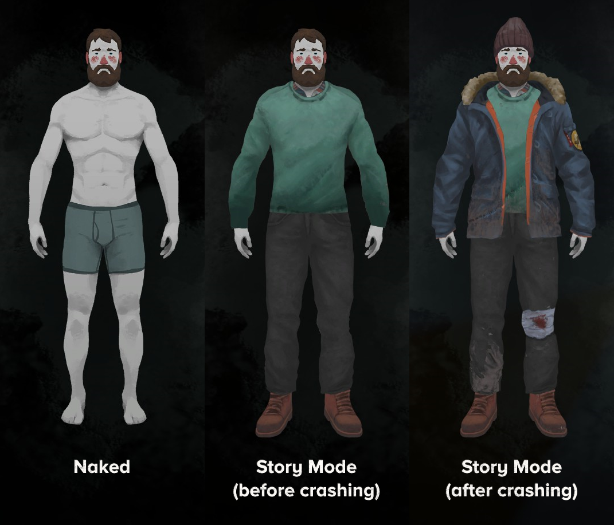

# Will Mackenzie

**Contents**

- [Overview](#Overview)
- [Description](#Description)
- [Background](#Background)
- [Episode 1](#Episode_1)
- [Episode 2](#Episode_2)
- [Episode 4](#Episode_4)
- [Belongings](#Belongings)
- [Gallery](#Gallery)
- [Notes](#Notes)

<table class="infobox">
<caption>Will Mackenzie</caption>
<colgroup>
<col style="width: 50%" />
<col style="width: 50%" />
</colgroup>
<tbody>
<tr>
<td colspan="2"><figure>
[Missing image: Will_Episode_5.jpg]
<figcaption>Will_Episode_5.jpg</figcaption>
</figure></td>
</tr>
<tr>
<td>
Release
</td>
<td>
<a href="./The%20Long%20Dark%20%E2%80%94%20Changelog.md#1.00" class="wikilink" title="Wintermute Launch (v1.0)">Wintermute Launch (v1.0)</a>
</td>
</tr>
<tr>
<td>
Date
</td>
<td>
1 August 2017
</td>
</tr>
<tr>
<td>
Wintermute
</td>
<td>
<strong>•</strong> <a href="./Episode%201%20-%20Do%20Not%20Go%20Gentle.md" class="wikilink" title="Episode 1">Episode 1</a> 
<strong>•</strong> <a href="./Episode%202%20-%20Luminance%20Fugue.md" class="wikilink" title="Episode 2">Episode 2</a> 
<strong>•</strong> <a href="./Episode%204%20-%20Fury%2C%20Then%20Silence.md" class="wikilink" title="Episode 4">Episode 4</a> Episode 5
</td>
</tr>
<tr>
<td>
Mission
</td>
<td>
<strong>•</strong> <a href="./Memories.md" class="wikilink" title="Memories">Memories</a> 
<strong>•</strong> <a href="./The%20Crash.md" class="wikilink" title="The Crash">The Crash</a> 
<strong>•</strong> <a href="./The%20Grey%20Mother.md" class="wikilink" title="The Grey Mother">The Grey Mother</a> 
<strong>•</strong> <a href="./Paradise%20Lost.md" class="wikilink" title="Paradise Lost">Paradise Lost</a> 
<strong>•</strong> <a href="./The%20Wounded%20Trapper.md" class="wikilink" title="The Wounded Trapper">The Wounded Trapper</a> 
<strong>•</strong> <a href="./The%20Best%20Defense.md" class="wikilink" title="The Best Defense">The Best Defense</a> 
<strong>•</strong> <a href="./Signal%20to%20Noise.md" class="wikilink" title="Signal to Noise">Signal to Noise</a> 
<strong>•</strong> <a href="./What%20One%20Man%20Can%20Do.md" class="wikilink" title="What One Man Can Do">What One Man Can Do</a> 
<strong>•</strong> <a href="./Renewed%20Hope.md" class="wikilink" title="Renewed Hope">Renewed Hope</a> 
<strong>•</strong> <a href="./Prologue.md" class="wikilink" title="Prologue">Prologue</a> 
<strong>•</strong> <a href="./Blackrock%20Blues.md" class="wikilink" title="Blackrock Blues">Blackrock Blues</a> 
<strong>•</strong> <a href="./The%20Power%20Plant.md" class="wikilink" title="The Power Plant">The Power Plant</a> 
<strong>•</strong> <a href="./The%20Detonators.md" class="wikilink" title="The Detonators">The Detonators</a> 
<strong>•</strong> <a href="./Donner%20%28mission%29.md" class="wikilink" title="Donner (mission)">Donner (mission)</a>
</td>
</tr>
<tr>
<td colspan="2" class="section">
<strong>Biographical Information</strong>
</td>
</tr>
<tr>
<td>
Age
</td>
<td>
44
</td>
</tr>
<tr>
<td>
Status
</td>
<td>
Alive
</td>
</tr>
<tr>
<td>
Hometown
</td>
<td>
Black Creek, BC, Canada.
</td>
</tr>
<tr>
<td>
Relatives
</td>
<td>
<strong>•</strong> <a href="./Astrid%20Greenwood.md" class="wikilink" title="Astrid Greenwood">Astrid Greenwood</a> (Ex-Wife) 
<strong>•</strong> Jack (Son) - Deceased Unnamed Father - Deceased
</td>
</tr>
<tr>
<td>
Occupation
</td>
<td>
Bush Pilot
</td>
</tr>
<tr>
<td colspan="2" class="section">
<strong>Physical Information</strong>
</td>
</tr>
<tr>
<td>
Hair
</td>
<td>
Brown
</td>
</tr>
<tr>
<td>
Eyes
</td>
<td>
Blue
</td>
</tr>
<tr>
<td colspan="2" class="section">
<strong>Game Information</strong>
</td>
</tr>
<tr>
<td>
Voiced by
</td>
<td>
<a href="wikipedia:Mark_Meer" class="wikilink" title="Mark Meer">Mark Meer</a>
</td>
</tr>
</tbody>
</table>

|  |  |  |
|----|----|----|
| “ | What do I have to worry about? I have a legendary 150 year old demon bear hungry for my blood. Bullets don't stop him, but I'm armed with basically a medieval weapon which I'm sure will do the trick. I'm stuck in this winter wasteland where lights in the sky make the power flicker and electronics explode, and the only people I seem to meet are all slightly crazy. And this is all after I crashed my plane deep in the wilderness and somehow lost my ex-wife along the way, and I'd really kind of like to find her back. | ” |

**William "Will" Mackenzie** is one of two playable protagonists in *<a href="./The%20Long%20Dark.md" class="wikilink" title="The Long Dark">The Long Dark</a>*.

Will Mackenzie works as a pilot for <a href="./Jackrabbit%20Hangar.md" class="wikilink" title="Jackrabbit Remote Transport">Jackrabbit Remote Transport</a> prior to the First Flare event. He is the ex-husband of <a href="./Astrid%20Greenwood.md" class="wikilink" title="Dr. Astrid Greenwood">Dr. Astrid Greenwood</a>.

When Astrid approaches him as her last hope of reaching a patient in an isolated region of northern Canada, he hesitantly accepts and agrees to fly Astrid to Great Bear Island.

After a tense conversation between Will and Astrid about a shared, traumatizing loss, the plane goes crashing down into the northern Canadian wilderness of Great Bear Island after a mysterious geomagnetic storm knocks out all power to his instrument panel.

Stranded far from the closest human civilization while being lost, wounded and alone, Mackenzie must quickly master basic wilderness survival skills if he's to last long enough to find Astrid and understand how his world has just changed forever.

## Overview

Will Mackenzie was a bush pilot prior to the "First Flare" event, a geomagnetic disaster that brought modern civilization to its knees.

Players experience <a href="./Wintermute.md" class="wikilink" title="Story mode">Story mode</a> through both <a href="./Astrid%20Greenwood.md" class="wikilink" title="Astrid Greenwood">Astrid Greenwood</a>'s and Will's point of view.

## Description

Will has short, brown hair and blue eyes. He also sports a relatively unkept beard and a faded red toque. He wears a light green sweater underneath an orange and blue parka, he has greyish black pants and brown leather boots.

## Background

Through the course of <a href="./Episode%201%20-%20Do%20Not%20Go%20Gentle.md" class="wikilink" title="Episode 1">Episode 1</a>, we learn that Mackenzie was married to <a href="./Astrid%20Greenwood.md" class="wikilink" title="Astrid Greenwood">Astrid Greenwood</a>. The two separated some time ago, but both still wear their wedding rings. It is implied that they had a child together who passed away. His drinking is a source of disagreement; Astrid implies that it is excessive while Mackenzie himself states that it is under control.

## Episode 1

After waking up and recovering from the plane crash a day after the First Flare occurred, Mackenzie makes his way out of the ravine he was stuck in, looking for Astrid along the way. He finds his way to a road leading him to the Town of Milton.

He arrives to find the town abandoned. Only one structure show signs of life.

He meets <a href="./Grey%20Mother.md" class="wikilink" title="Grey Mother">Grey Mother</a>, an elderly, seemingly blind woman, in her home after she fires a warning shot at him. She explains to him how all the residents have fled after the storm, fearing they might become trapped in the town after the First Flare and a serious storm hit the town.

After she tasks Mackenzie with fetching her firewood and food, she explains to him how the power went out and people started to get cold, hungry, and scared, and, how, eventually, the few remaining fled. She mentions how a stranger (suggested to be Astrid) passed through the town with "angry voices" trailing her. Grey Mother tells Mackenzie to go investigate the tunnel at the end of the road.

Mackenzie arrives at the tunnel to find it collapsed. A crashed prison transport bus shows signs that Astrid may have passed through. In the bus the word "Perseverance" is written on the floor is what is presumed to be blood.

Mackenzie goes back to Grey Mother, and she gives him one final task, to visit the old farmhouse and retrieve a key to her lockbox in the bank. After Mackenzie retrieves her safety deposit box he finds out it was all for a piece of jewelry special to Grey Mother.

She tells him to bring the pearls to "Lily" at the graveyard. At first, Mackenzie is confused, but eventually realizes that Lily was Grey Mother's daughter.

Upon returning, she tells him the story of how her daughter died. Grey Mother gives Mackenzie the key to her daughter's trunk, where he finds climbing equipment. She tells him how to leave the area and to leave her behind, as she cannot escape the town, even if she wanted to.

Mackenzie bids farewell to Grey Mother and leaves Milton through the back mountains. His rope snaps on the way down, but he recovers and continues on to a cave. Upon entering and going through the cave he finds his way to <a href="./Mystery%20Lake%20%28region%29.md" class="wikilink" title="Mystery Lake">Mystery Lake</a>, where he encounters <a href="./Jeremiah.md" class="wikilink" title="Jeremiah">Jeremiah</a>, the old Trapper, being attacked by the Old Bear. He grabs the Trapper's rifle and fires at the Old Bear, ending the episode.

## Episode 2

After helping Jeremiah to his cabin and healing him up. Mackenzie awaits the Old Trapper's awakening. After Jeremiah wakes up, he tells Mackenzie to go search for better medication at the <a href="./Carter%20Hydro%20Dam.md" class="wikilink" title="Carter Hydro Dam">Carter Hydro Dam</a>.

Mackenzie makes his way to old Carter Dam where he learns that it's been abandoned for a while. He finds the Control Room to be locked and that it needs power to be turned on. Mackenzie finds the meds and returns to Jeremiah.

Jeremiah awakens once again, after Mackenzie gives him the meds he assures Will that the only way they'll survive is if they kill the <a href="./Old%20Bear.md" class="wikilink" title="Old Bear">Old Bear</a>. Mackenzie then asks him if he saw the Aurora when the First Flare event happened. Jeremiah says he has never seen anything like it before and that the wildlife has been acting strangely. Jeremiah proposes that the two help each other survive.

After that, Jeremiah tells the tale of the <a href="./Old%20Bear.md" class="wikilink" title="Old Bear">Old Bear</a>. We get to know, that the bear can only be killed by a spear, which has been used by the Spencer family. By the legend, the <a href="./Bear%20Spear.md" class="wikilink" title="Bear Spear">Bear Spear</a> is still in the Spencer family <a href="./Hunting%20Lodge.md" class="wikilink" title="Hunting Lodge">Hunting Lodge</a>. On the way to the other side of <a href="./Broken%20Railroad.md" class="wikilink" title="Broken Railroad">Broken Railroad</a> Mackenzie encounters the bear twice.

Mackenzie travels to the Lodge and finds the spear, then goes back to the <a href="./Maintenance%20Yard.md" class="wikilink" title="Maintenance Shed">Maintenance Shed</a> to repair it. After accidentally falling over a dead survivor he finds a note from a group called the <a href="./Forest%20Talkers.md" class="wikilink" title="Forest Talkers">Forest Talkers</a>.

Mackenzie then travels back to Jeremiah. Jeremiah declines Mackenzie offer to leave and suggest <a href="./Survival%20School.md" class="wikilink" title="Jeremiah&#39;s Survival School">Jeremiah's Survival School</a> as a means to help Mackenzie learn to survive. This is currently a side quest in Episode 2.

When we get back to Jeremiah, he tells Will, that he could turn on the radio, but couldn't get any useful informations, the old device is barely caught a bit of music and talking. We have to get some radio parts, from the signal towers in <a href="./Forlorn%20Muskeg.md" class="wikilink" title="Forlorn Muskeg">Forlorn Muskeg</a>. The 3 towers are marked on the map. 2 of the 3 towers are guarded by the Old Bear.

On the way back to Jeremiah Mackenzie gets attacked by the bear at the tunnel between <a href="./Mystery%20Lake%20%28region%29.md" class="wikilink" title="Mystery Lake">Mystery Lake</a> and <a href="./Forlorn%20Muskeg.md" class="wikilink" title="Forlorn Muskeg">Forlorn Muskeg</a>. (This is a scripted part, can not be avoided) The Bear attacks Will, knocking him unconscious, and then drags him to his den, which can be found at the top region of Forlorn Muskeg (yes, the map is still available). This interrupts the quest <a href="./Signal%20to%20Noise.md" class="wikilink" title="Signal to Noise">Signal to Noise</a> and starts the quest <a href="./What%20One%20Man%20Can%20Do.md" class="wikilink" title="What One Man Can Do">What One Man Can Do</a>. Will has to navigate trough the labyrinth-like den, to find his spear, and kill the bear finally.

Then Mackenzie gets back to Jeremiah, and gets immediately unconscious again. When wakes up, an <a href="./Aurora.md" class="wikilink" title="Aurora">Aurora</a> is in progress, and the radio seems to work. Will sits down to the radio, and starts finding a frequency to communicate. During his tries, the radio breaks, and cannot be used again. Jeremiah of course, gets mad, but then reveals the sad truth: the radio is unusable, Mackenzie has to deliver the message. Relay a message. Jeremiah tells Mackenzie about a person, who lives near Perseverance Mills and an important message that he needs to receive. That message is Wintermute. Soon after they say their goodbyes and Mackenzie is on his way to the Dam.

When Mackenzie reaches the Dam when the Aurora in the sky he encounters <a href="./Methuselah.md" class="wikilink" title="Methuselah">Methuselah</a> who invites him to sit by the fire and talk a bit. He warns Mackenzie about the changes the world is going through and how humanity is paying the price. Mackenzie is confused but soon realizes the answer to the question "How Far Will You Go to Survive?"

He leaves Methuselah behind and enters the Dam. He makes his way through the Dam into the back room where he is hit on the head and knocked out. He awakens to find <a href="./Mathis.md" class="wikilink" title="Mathis">Mathis</a> standing there, he begins to interrogate and punch Mackenzie, questioning him about Astrid's locked case. Mackenzie responds with some snarky comments just before Mathis reveals he may have encountered Astrid. After responding with desperation, Mathis picks up a hatchet and knocks him out. Ending Episode 2.

## Episode 4

At the start of <a href="./Episode%204%20-%20Fury%2C%20Then%20Silence.md" class="wikilink" title="Episode 4: Fury, then Silence">Episode 4: Fury, then Silence</a>, Will awakens on a stretcher being carried by two convicts, <a href="./Heller.md" class="wikilink" title="Heller">Heller</a> and <a href="./Vachon.md" class="wikilink" title="Vachon">Vachon</a>. Led by <a href="./Mathis.md" class="wikilink" title="Mathis">Mathis</a>, the gang makes their way to <a href="./Blackrock%20Prison.md" class="wikilink" title="Blackrock Prison">Blackrock Prison</a> before being ambushed by <a href="./Timberwolf.md" class="wikilink" title="timber wolves.">timber wolves.</a> During the scuffle, Will falls down a cliff, and manages to escape the convicts temporarily, before being caught by Mathis to end the <a href="./Prologue.md" class="wikilink" title="prologue">prologue</a>.

The <a href="./Blackrock%20Blues.md" class="wikilink" title="first chapter">first chapter</a> finds Will locked up inside the prison in a cell. When he wakes up, the man in the cell next to Will reveals himself to be <a href="./Franklin.md" class="wikilink" title="Franklin">Franklin</a>, the warden of the prison. He tells Will about the history of the prison and its notoriety, before telling Will that the reason <a href="./Mathis.md" class="wikilink" title="Mathis">Mathis</a> has come here is to free his son Donner, a psychotic criminal who wants nothing more than to kill everyone on <a href="./Great%20Bear%20Island.md" class="wikilink" title="Great Bear Island.">Great Bear Island.</a> Mathis then returns with Heller and Vachon, and beats Franklin within an inch of his life. As Franklin lays on the verge of death, Will strikes a deal with Heller and Vachon to go retrieve the prison infirmary's emergency medkit, which contains strong enough medicine to save the warden. Will then leaves the main prison building, and upon arriving at the infirmary talks with a <a href="./Jace.md" class="wikilink" title="mysterious stranger">mysterious stranger</a> over the landline phone. He then retrieves the emergency kit from a dead guard near <a href="./Cutty%27s%20Cave.md" class="wikilink" title="Cutty&#39;s Cave">Cutty's Cave</a>, returning to the prison to save the warden.

The <a href="./The%20Power%20Plant.md" class="wikilink" title="second chapter">second chapter</a> starts with <a href="./Mathis.md" class="wikilink" title="Mathis">Mathis</a> threatening to kill Franklin unless Will does his bidding. He then sends Will through the western part of <a href="./Blackrock.md" class="wikilink" title="Blackrock">Blackrock</a> in order to reach the power plant, so that power can be returned to the prison to free Donner. Once Will arrives at the plant, the <a href="./Jace.md" class="wikilink" title="mysterious stranger">mysterious stranger</a> directs him over the phone to destroy the mechanism that provides power to the solitary confinement wing. Will does so, seemingly thwarting Donner's release.

The <a href="./The%20Detonators.md" class="wikilink" title="third chapter">third chapter</a> begins yet again in Will's cell, with <a href="./Mathis.md" class="wikilink" title="Mathis">Mathis</a> revealing that he found out about Will's sabotage, and is now aware of the <a href="./Jace.md" class="wikilink" title="stranger">stranger</a> directing Will. His new plan to free his son is to use dynamite taken from the Last Prospect mine. He sends Will to retrieve the <a href="./Detonators.md" class="wikilink" title="detonators">detonators</a> needed to utilize the dynamite, under threat of the warden's death. As Will makes his way through the mine and retrieves the detonators, the mysterious stranger calls again, now revealed to be <a href="./Jace.md" class="wikilink" title="Jace">Jace</a>, a grad student who was caught out on the roads by the <a href="./First%20Flare.md" class="wikilink" title="First Flare">First Flare</a> and is now holed up in one of the prison watchtowers. She tells Will that she is now going to pursue the "Nuclear" option, before Will returns with the detonators to the prison.

The <a href="./Donner.md" class="wikilink" title="final chapter">final chapter</a> of the episode begins with <a href="./Franklin.md" class="wikilink" title="Franklin&#39;s">Franklin's</a> corpse being wheeled past Will's cell, as <a href="./Mathis.md" class="wikilink" title="Mathis">Mathis</a> reveals that Franklin told him everything that Will had done and how <a href="./Jace.md" class="wikilink" title="Jace">Jace</a> had guided him the entire way. Before Mathis can execute Will, however, the detonators set the dynamite off prematurely, engulfing much of the prison in flames. Will escapes his cell, and Jace blocks Mathis from getting to Will via manipulating the prison doors, as an <a href="./Aurora.md" class="wikilink" title="Aurora">Aurora</a> has provided temporary electricity to the prison again. Will then runs through the prison, retrieves the <a href="./Astrid%27s%20Hardcase.md" class="wikilink" title="hardcase">hardcase</a> from the warden's office, and escapes into <a href="./The%20Power%20Plant.md" class="wikilink" title="the steam tunnels">the steam tunnels</a> from earlier. He then meets with Jace at the power plant, before they are cornered by Mathis and his gang. After a struggle with Mathis, Will and Jace dive into the river running through the plant, and wash ashore downstream. Will offers to start a fire to warm the half-frozen Jace before the episode ends.

## Belongings

-  <a href="./Mackenzie%27s%20Toque.md" class="wikilink" title="Mackenzie&#39;s Toque">Mackenzie's Toque</a>
-  <a href="./Mackenzie%27s%20Sweater.md" class="wikilink" title="Mackenzie&#39;s Sweater">Mackenzie's Sweater</a>
-  <a href="./Mackenzie%27s%20Shirt.md" class="wikilink" title="Mackenzie&#39;s Shirt">Mackenzie's Shirt</a>
-  <a href="./Mackenzie%27s%20Parka.md" class="wikilink" title="Mackenzie&#39;s Parka">Mackenzie's Parka</a>
-  <a href="./Mackenzie%27s%20Pants.md" class="wikilink" title="Mackenzie&#39;s Pants">Mackenzie's Pants</a>
-  <a href="./Mackenzie%27s%20Boots.md" class="wikilink" title="Mackenzie&#39;s Boots">Mackenzie's Boots</a>

## Gallery

<table class="gallery">
<colgroup>
<col style="width: 25%" />
<col style="width: 25%" />
<col style="width: 25%" />
<col style="width: 25%" />
</colgroup>
<tbody>
<tr>
<td><figure>

<figcaption>Steam Trading Card</figcaption>
</figure></td>
<td><figure>

<figcaption>Will.png</figcaption>
</figure></td>
<td><figure>
[Missing image: William_Mackenzie_Steam_Card.jpg]
<figcaption>Ditto, full screen</figcaption>
</figure></td>
<td><figure>

<figcaption>Will from the Story Trailer</figcaption>
</figure></td>
</tr>
<tr>
<td><figure>
[Missing image: Astrid_and_Will_photo.jpg]
<figcaption>A smashed photo of Astrid and Will</figcaption>
</figure></td>
<td><figure>
[Missing image: Will_Mackenzie_-_concept_art_-_close.jpg]
<figcaption>Will close-up</figcaption>
</figure></td>
<td><figure>
[Missing image: Poster.jpg]
<figcaption>Poster featuring Will.</figcaption>
</figure></td>
<td><figure>
[Missing image: Will_headshot.jpg]
<figcaption>Concept art headshot of Will.</figcaption>
</figure></td>
</tr>
<tr>
<td><figure>
[Missing image: Will_Mackenzie_-_concept_art.jpg]
<figcaption>Will Mackenzie concept art.</figcaption>
</figure></td>
<td><figure>

<figcaption>Will Mackenzie's paperdoll (Wintermute clothes are on 100% condition)</figcaption>
</figure></td>
<td></td>
<td></td>
</tr>
</tbody>
</table>

## Notes

- Will Mackenzie is voiced by <a href="Wikipedia:Mark_Meer" class="wikilink" title="Mark Meer">Mark Meer</a>. Meer's most notable voice work include <a href="W:c:masseffect:Commander_Shepard" class="wikilink" title="Commander Shepard">Commander Shepard</a> (male) in the *<a href="W:c:masseffect:Category:Games" class="wikilink" title="Mass Effect">Mass Effect</a>* series.

**Lua execution error in Module:Navbox function navbox** <a href="fr:William_Mackenzie" class="wikilink" title="fr:William_Mackenzie">fr:William_Mackenzie</a> <a href="ru:%D0%A3%D0%B8%D0%BB%D0%BB_%D0%9C%D0%B0%D0%BA%D0%BA%D0%B5%D0%BD%D0%B7%D0%B8" class="wikilink" title="ru:Уилл Маккензи">ru:Уилл Маккензи</a>

