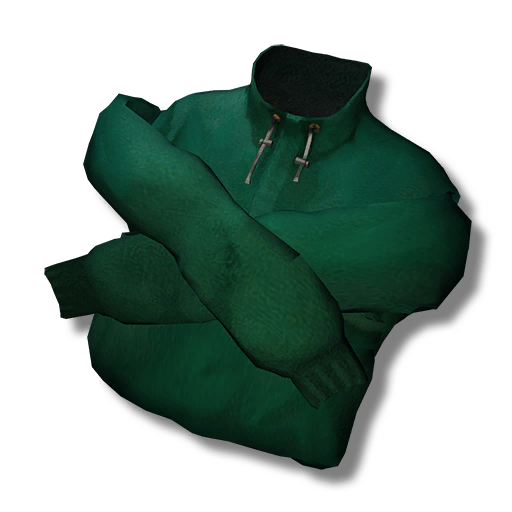
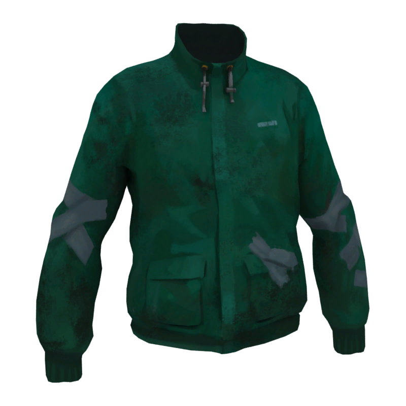

# Windbreaker

**Categories:** Clothing, Pages with update history · **Source:** [Fandom](https://thelongdark.fandom.com/wiki/Windbreaker)

**Windbreaker**

_Windbreaker\_icon.png_

**General**

**Item Type:** Clothing

**Clothing Slot:** Outer torso

**Statistics**

**Weight:** 0.50 kg(1.1 lbs)

**Warmth bonus:** 0.5 °C(0.9 °F)

**Windproof bonus:** 3.0 °C(5.4 °F)

**Waterproof bonus:** 50%

**Protection:** 1%

**Mobility:** 0%

**Harvest:** 2 × [Cloth](./Cloth.md) / 20 minutes

**Repair:** 1 × [Cloth](./Cloth.md) / 30 minutes / 25% condition

> “**Cheap nylon outer layer that's good for blocking wind and that's about it.**”
>
> — In-game description

The **Windbreaker** is a type of [clothing](./Clothing.md) in _The Long Dark_.

## Overview

Low-tier outer layer. It grants highly windproof and light, but offers almost no warmth. It should be worn as an outer layer to make use of it's windproofing.

_Clothing model icon_

_Clothing model icon damaged_

## Update history

- UPDATE **19 December 2016 ([Update](./The%20Long%20Dark%20%E2%80%94%20Early%20Access%20Changelog.md#0.386)):**
  - Added to game
