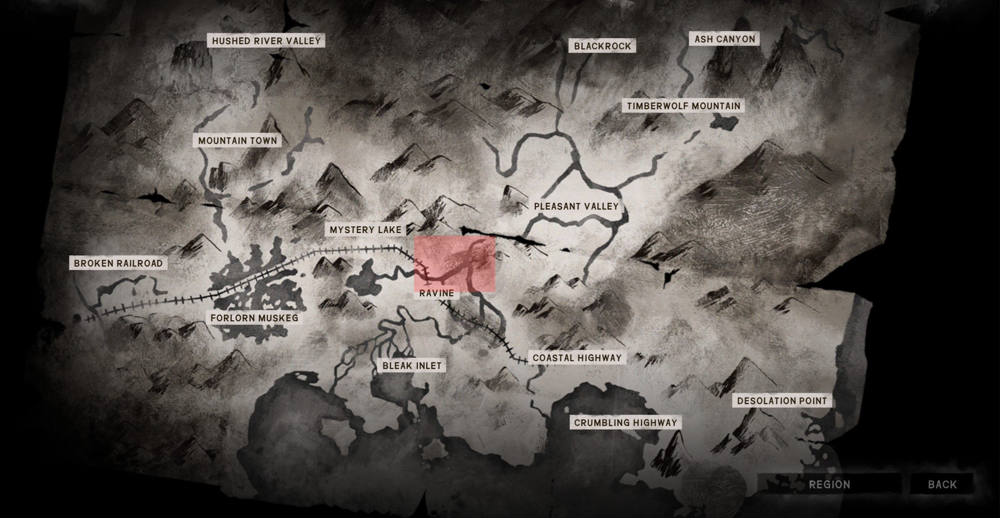
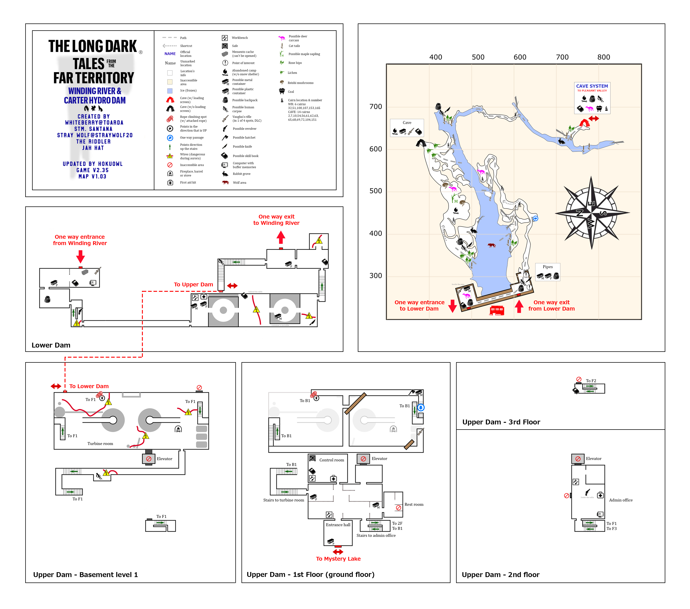
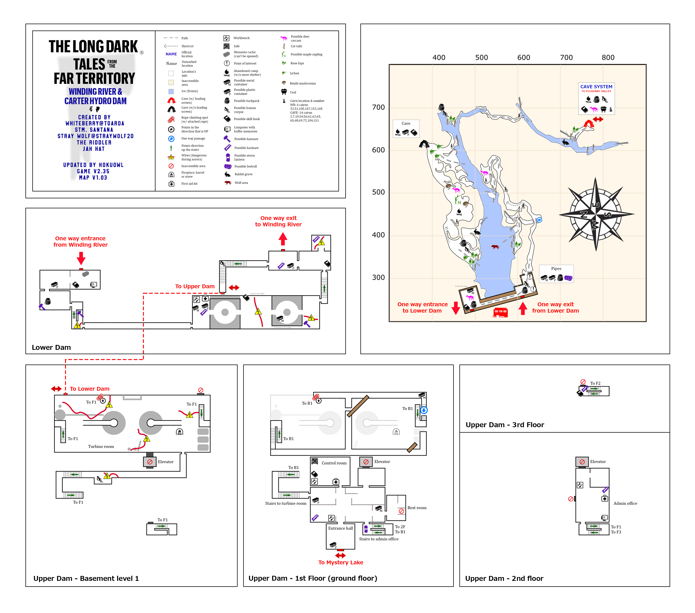
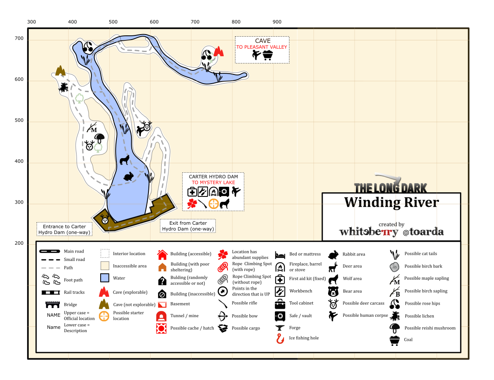
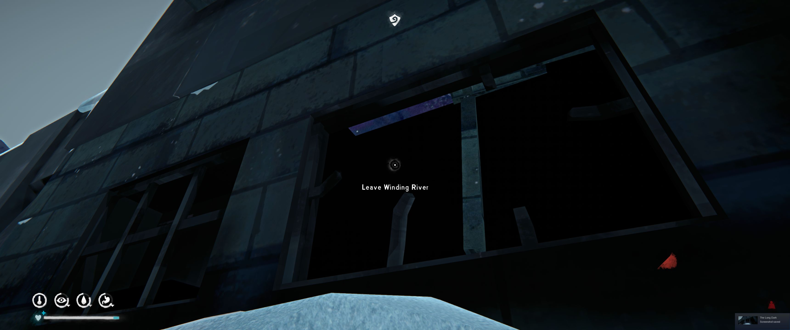

# Winding River

**Categories:** Transition zones · **Source:** [Fandom](https://thelongdark.fandom.com/wiki/Winding_River)

**Contents**

- [Overview](#overview)
- [Wildlife Availability](#wildlife-availability)
- [Locations](#locations)
- [Gallery](#gallery)

**Winding River**

| Property | Details |
| --- | --- |
|  |  / _RegionAtlas-resources.assets-562\_(5).png_ |
| **Location on [Great Bear Island](./Great%20Bear%20Island.md)** |  |
|  |  / _Winding\_River\_Location.png_ |
|  |  / _Winding\_River\_map.png_ |
| **Details** |  |
| Description | An unremarkable valley located on the other side of the [Carter Hydro Dam](./Carter%20Hydro%20Dam.md) |
| Connecting Regions | [Mystery Lake](./Mystery%20Lake%20%28region%29.md), / [Pleasant Valley](./Pleasant%20Valley.md) |
| Locations | 2 |
| Date Added | May 21 2015 |

**Winding River** (also known in-lore as the **Carter River**) is a Transition Zone [Region](./Region.md) behind [Carter Hydro Dam](./Carter%20Hydro%20Dam.md) that connects [Mystery Lake](./Mystery%20Lake%20%28region%29.md) to a [Cave](./Cave%20%28Transition%20Zone%29.md) and then subsequently to [Pleasant Valley](./Pleasant%20Valley.md). It was the 2nd Transition Zone to be released in _[The Long Dark](./The%20Long%20Dark.md)_.

## Overview

Resident wildlife consists of [Rabbits](./Rabbit.md) and occasionally a [Wolf](./Wolf.md) patrol is often found near the base of the Dam itself. [Reishi Mushrooms](./Reishi%20Mushroom.md) and other plants can be harvested in the area near the banks of the river. [Ice Fishing](./Ice%20Fishing.md) is possible on the ice below the Dam using Free Form Ice Holes.

The area has few notable locations, aside from a [Warm Cave](./Warm%20Cave.md) that often has a [Research Book](./Research%20Book.md). A nearby hill can often contain [Green Birch Sapling](./Green%20Birch%20Sapling.md) and [Green Maple Sapling](./Green%20Maple%20Sapling.md).

The Carter Hydro Dam can not be re-entered by walking back into the push door if exited from inside the Dam, nor can it be propped open as the door automatically closes and locks behind you. A broken window across from the dam exit can be used to regain entry into the Dam, doing so requires walking across the other side of the Dam by via a ledge.

## Wildlife Availability

Only 2 animals are found in this region.

- [Rabbit](./Rabbit.md) can occasionally be found south of the Dam.
- [Wolves](./Wolf.md) often spawn in the area directly below the Dam spillway.
- 2 [Deer Carcasses](./Deer%20Carcass.md) can sometimes spawn.

## Locations

Despite having no marked locations, 2 Region Transition icons can be found:

- The Cave System Leading to Pleasant Valley
- The broken window leading back into the Hydro Dam

The exit door to the dam does not count as a Region Transition icon.

## Gallery

_A detailed map of Winding River v2.35 (includes spoilers)_

_A detailed map of Winding River v2.35 (Interloper/Misery edition, includes spoilers)_

_An outdated map of Winding River_

_An outdated map of Winding River v1.93_

_The\_Carter\_Hydro\_Dam\_one-way\_entrance.jpg_

[es:Río sinuoso](es:R%C3%ADo_sinuoso) [ru:Извилистая река](ru:%D0%98%D0%B7%D0%B2%D0%B8%D0%BB%D0%B8%D1%81%D1%82%D0%B0%D1%8F_%D1%80%D0%B5%D0%BA%D0%B0)
