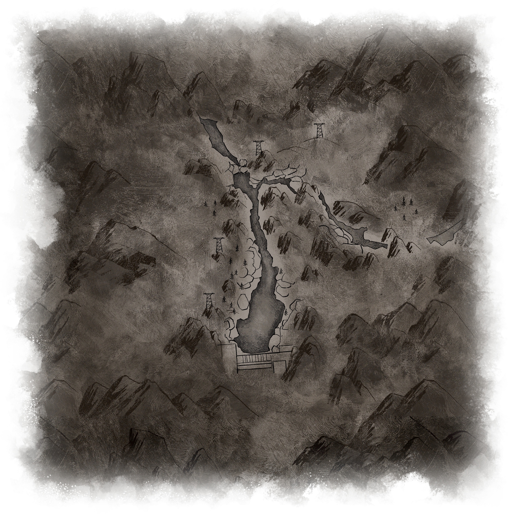
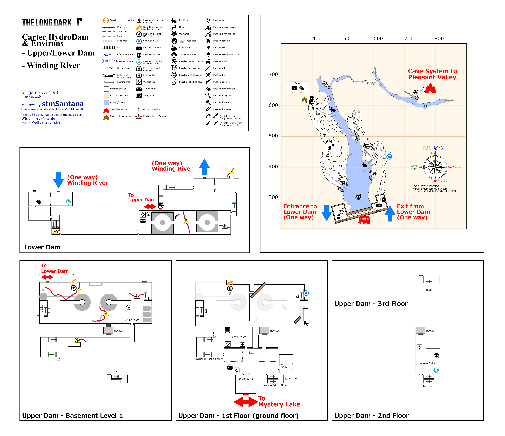

# Winding River

**Contents**

- [Overview](#Overview)
- [Wildlife Availability](#Wildlife_Availability)
- [Locations](#Locations)
- [Gallery](#Gallery)

<table class="infobox">
<caption>Winding River</caption>
<colgroup>
<col style="width: 50%" />
<col style="width: 50%" />
</colgroup>
<tbody>
<tr>
<td colspan="2"><figure>

<figcaption>RegionAtlas-resources.assets-562_(5).png</figcaption>
</figure></td>
</tr>
<tr>
<td colspan="2" class="section">
<strong>Location on <a href="./Great%20Bear%20Island.md" class="wikilink" title="Great Bear Island">Great Bear Island</a></strong>
</td>
</tr>
<tr>
<td colspan="2"><figure>
[Missing image: Winding_River_Location.png]
<figcaption>Winding_River_Location.png</figcaption>
</figure></td>
</tr>
<tr>
<td colspan="2"><figure>

<figcaption>Winding_River_map.png</figcaption>
</figure></td>
</tr>
<tr>
<td colspan="2" class="section">
<strong>Details</strong>
</td>
</tr>
<tr>
<td>
Description
</td>
<td>
An unremarkable valley located on the other side of the <a href="./Carter%20Hydro%20Dam.md" class="wikilink" title="Carter Hydro Dam">Carter Hydro Dam</a>
</td>
</tr>
<tr>
<td>
Connecting Regions
</td>
<td>
<a href="./Mystery%20Lake%20%28region%29.md" class="wikilink" title="Mystery Lake">Mystery Lake</a>, 
<a href="./Pleasant%20Valley.md" class="wikilink" title="Pleasant Valley">Pleasant Valley</a>
</td>
</tr>
<tr>
<td>
Locations
</td>
<td>
2
</td>
</tr>
<tr>
<td>
Date Added
</td>
<td>
May 21 2015
</td>
</tr>
</tbody>
</table>

**Winding River** (also known in-lore as the **Carter River**) is a Transition Zone <a href="./Region.md" class="wikilink" title="Region">Region</a> behind <a href="./Carter%20Hydro%20Dam.md" class="wikilink" title="Carter Hydro Dam">Carter Hydro Dam</a> that connects <a href="./Mystery%20Lake%20%28region%29.md" class="wikilink" title="Mystery Lake">Mystery Lake</a> to a <a href="./Cave%20%28Transition%20Zone%29.md" class="wikilink" title="Cave">Cave</a> and then subsequently to <a href="./Pleasant%20Valley.md" class="wikilink" title="Pleasant Valley">Pleasant Valley</a>. It was the 2nd Transition Zone to be released in *<a href="./The%20Long%20Dark.md" class="wikilink" title="The Long Dark">The Long Dark</a>*.

## Overview

Resident wildlife consists of <a href="./Rabbit.md" class="wikilink" title="Rabbit">Rabbits</a> and occasionally a <a href="./Wolf.md" class="wikilink" title="Wolf">Wolf</a> patrol is often found near the base of the Dam itself. <a href="./Reishi%20Mushroom.md" class="wikilink" title="Reishi Mushrooms">Reishi Mushrooms</a> and other plants can be harvested in the area near the banks of the river. <a href="./Ice%20Fishing.md" class="wikilink" title="Ice Fishing">Ice Fishing</a> is possible on the ice below the Dam using Free Form Ice Holes.

The area has few notable locations, aside from a <a href="./Warm%20Cave.md" class="wikilink" title="Warm Cave">Warm Cave</a> that often has a <a href="./Research%20Book.md" class="wikilink" title="Research Book">Research Book</a>. A nearby hill can often contain <a href="./Green%20Birch%20Sapling.md" class="wikilink" title="Green Birch Sapling">Green Birch Sapling</a> and <a href="./Green%20Maple%20Sapling.md" class="wikilink" title="Green Maple Sapling">Green Maple Sapling</a>.

The Carter Hydro Dam can not be re-entered by walking back into the push door if exited from inside the Dam, nor can it be propped open as the door automatically closes and locks behind you. A broken window across from the dam exit can be used to regain entry into the Dam, doing so requires walking across the other side of the Dam by via a ledge.

## Wildlife Availability

Only 2 animals are found in this region.

- <a href="./Rabbit.md" class="wikilink" title="Rabbit">Rabbit</a> can occasionally be found south of the Dam.
- <a href="./Wolf.md" class="wikilink" title="Wolves">Wolves</a> often spawn in the area directly below the Dam spillway.
- 2 <a href="./Deer%20Carcass.md" class="wikilink" title="Deer Carcasses">Deer Carcasses</a> can sometimes spawn.

## Locations

Despite having no marked locations, 2 Region Transition icons can be found:

- The Cave System Leading to Pleasant Valley
- The broken window leading back into the Hydro Dam

The exit door to the dam does not count as a Region Transition icon.

## Gallery

<table class="gallery">
<colgroup>
<col style="width: 25%" />
<col style="width: 25%" />
<col style="width: 25%" />
<col style="width: 25%" />
</colgroup>
<tbody>
<tr>
<td><figure>
[Missing image: WR_map.png]
<figcaption>A detailed map of Winding River v2.35 (includes spoilers)</figcaption>
</figure></td>
<td><figure>
[Missing image: WR_map_loper.png]
<figcaption>A detailed map of Winding River v2.35 (Interloper/Misery edition, includes spoilers)</figcaption>
</figure></td>
<td><figure>
[Missing image: Winding_River_map_by_whiteberry-toarda.png]
<figcaption>An outdated map of Winding River</figcaption>
</figure></td>
<td><figure>

<figcaption>An outdated map of Winding River v1.93</figcaption>
</figure></td>
</tr>
<tr>
<td><figure>
[Missing image: The_Carter_Hydro_Dam_one-way_entrance.jpg]
<figcaption>The_Carter_Hydro_Dam_one-way_entrance.jpg</figcaption>
</figure></td>
<td></td>
<td></td>
<td></td>
</tr>
</tbody>
</table>

**Lua execution error in Module:Navbox function navbox** **Lua execution error in Module:Navbox function navbox**

<a href="es:R%C3%ADo_sinuoso" class="wikilink" title="es:Río sinuoso">es:Río sinuoso</a> <a href="ru:%D0%98%D0%B7%D0%B2%D0%B8%D0%BB%D0%B8%D1%81%D1%82%D0%B0%D1%8F_%D1%80%D0%B5%D0%BA%D0%B0" class="wikilink" title="ru:Извилистая река">ru:Извилистая река</a>

