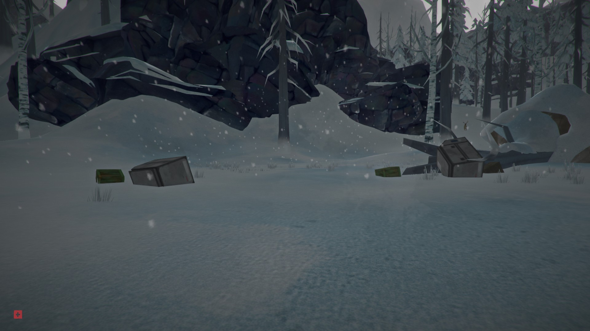

# Wing

**Categories:** Locations, Locations in Timberwolf Mountain, Outdoor locations · **Source:** [Fandom](https://thelongdark.fandom.com/wiki/Wing)

**Wing**

| Property | Details |
| --- | --- |
| | [Wing Timberwolf Mountain location](../assets/Wing_-_Timberwolf_Mountain_location.jpg) |
| **Location** | |
| | [Wing Location](../assets/Wing_Location.png) |
| Region | [Timberwolf Mountain](./Timberwolf%20Mountain.md) |
| Location | Between [Forest Cave (Timberwolf Mountain location)](./Forest%20Cave%20%28Timberwolf%20Mountain%20location%29.md) and [Echo Peak West](./Echo%20Peak%20West.md) |
| Description | A wing from the crashed aircraft |
| **General** | |
| Type | Outdoors |
| | Has no shelter |

**Wing** is a part of a wrecked plane that crashed on the summit of [Timberwolf Mountain](./Timberwolf%20Mountain.md).

There are two locations with the same name: one on the [summit](./Summit.md) and the other one is roughly between [Echo Peak West](./Echo%20Peak%20West.md) and [Forest Cave](./Forest%20Cave%20%28Timberwolf%20Mountain%20location%29.md).

## Overview

In the location between [Echo Peak West](./Echo%20Peak%20West.md) and [Forest Cave](./Forest%20Cave%20%28Timberwolf%20Mountain%20location%29.md) there are two [Cargo Containers](./Cargo%20Container.md), some crates, and even cardboard boxes can be found scattered about the area. The most obvious landmark is the huge aircraft wing lying half buried in the snow.

The [Cargo Container](./Cargo%20Container.md) near the fallen tree (which does not spawn on Interloper difficulty) contains:

- Left door (as you look towards the fallen tree): [antibiotics](./Antibiotics.md), [antiseptics](./Antiseptic.md), [bandages](./Bandage.md) and [painkillers](./Painkillers.md)
- Right door: [flares](./Flare.md), [lantern fuel](./Lantern%20Fuel.md) and [revolver ammo](./Revolver%20Ammunition.md)

The [Cargo Container](./Cargo%20Container.md) between the fallen tree and the wing contains:

- Upper door: [Go! Energy Drink](./Go!%20Energy%20Drink.md), [summit sodas](./Summit%20Soda.md), [orange sodas](./Orange%20Soda.md), and [Stacy's grape sodas](./Stacy%27s%20Grape%20Soda.md)
  - In Interloper: 1 [herbal tea](./Herbal%20Tea.md) and 1 [coffee](./Tin%20of%20Coffee.md).
- Lower door: [Airline Food - Chicken](./Airline%20Food%20-%20Chicken.md), [Airline Food - Vegetarian](./Airline%20Food%20-%20Vegetarian.md) and [pinnacle peaches](./Pinnacle%20Peaches.md)
  - In Interloper: 0-2 [pinnacle peaches](./Pinnacle%20Peaches.md) and 1-2 [pork and beans](./Pork%20and%20Beans.md)

The [crates](./Crate.md) and cardboard box contain nothing (Stalker).

[Wild animals](./Wildlife.md) such as [deer](./Deer.md), [wolves](./Wolf.md), a [bear](./Bear.md), a [cougar](./Cougar.md), and even [timberwolves](./Timberwolf.md) and a [moose](./Moose.md) may be found in the area as well as [birch bark](./Birch%20Bark.md) and [saplings](./Green%20Birch%20Sapling.md).

## Gallery

