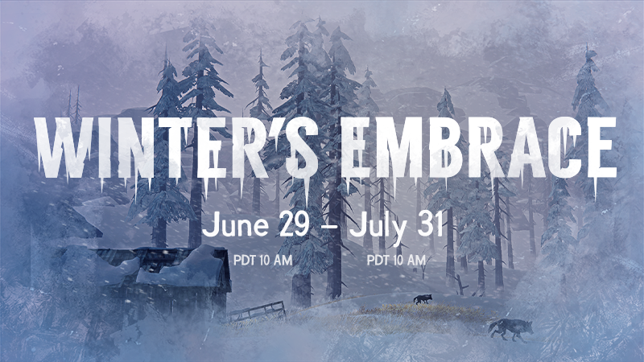

# Winter's Embrace

<table class="infobox">
<caption>Winter's Embrace</caption>
<colgroup>
<col style="width: 50%" />
<col style="width: 50%" />
</colgroup>
<tbody>
<tr>
<td colspan="2"><figure>

<figcaption>Winters_embrace_poster.png</figcaption>
</figure></td>
</tr>
<tr>
<td colspan="2" class="section">
<strong>Details</strong>
</td>
</tr>
<tr>
<td>
Description
</td>
<td>
Survive an ever increasing freezing world will hunting for the new Maple Syrup and Ketchup Chip items
</td>
</tr>
<tr>
<td>
Difficulty
</td>
<td>
Voyager
</td>
</tr>
</tbody>
</table>

|  |  |  |
|----|----|----|
| “ | Surviving in the cold Canadian winter on Great Bear Island has never been easy. This Summer, however, it's going to be even harder with our first summer seasonal event Winter's Embrace. The temperature is dropping even lower and surviving will be even more of a struggle. But survive you must if you want to earn two all-new limited-time Badges in the game. These exclusive rewards are only available during Winter's Embrace which runs from June 29th through to July 31st. There will also be all-new features and in-game items added to the game to give you a new experience, and a touch of Canadiana as you venture out into the snowy wilds. | ” |

Winter's Embrace was an event <a href="./Challenge.md" class="wikilink" title="Challenge">Challenge</a> that previously ran throughout the month of July 2020.

This update includes the addition of <a href="./Maple%20Syrup.md" class="wikilink" title="Maple Syrup">Maple Syrup</a> and <a href="./Ketchup%20Chips.md" class="wikilink" title="Ketchup Chips">Ketchup Chips</a> as food items. Most of the game settings appear to be around Voyageur-level difficulty, though <a href="./Weather.md" class="wikilink" title="storms and blizzards">storms and blizzards</a> are much more frequent than normal and all temperatures are -10 C lower than normal, even inside houses and shelters.

The two limited-time <a href="./Badges.md" class="wikilink" title="Badges">Badges</a> were earned by finding and consuming 25 bottles of Syrup and 25 bags of Ketchup Chips (can be done across any number of saves), and for surviving 25 in-game days under the Winter's Embrace conditions.

**Lua execution error in Module:Navbox function navbox**

