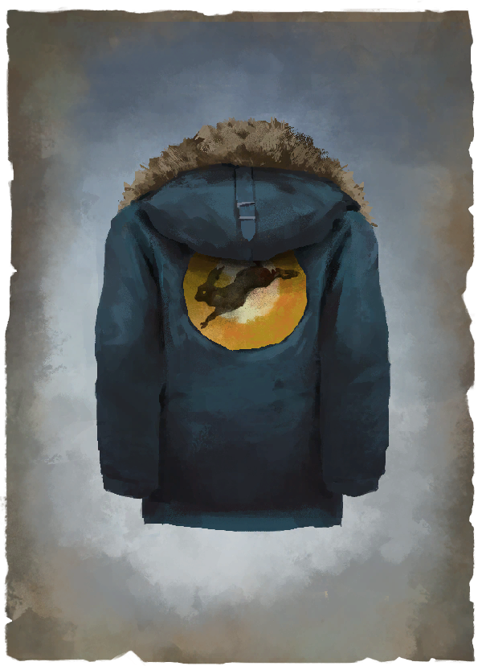
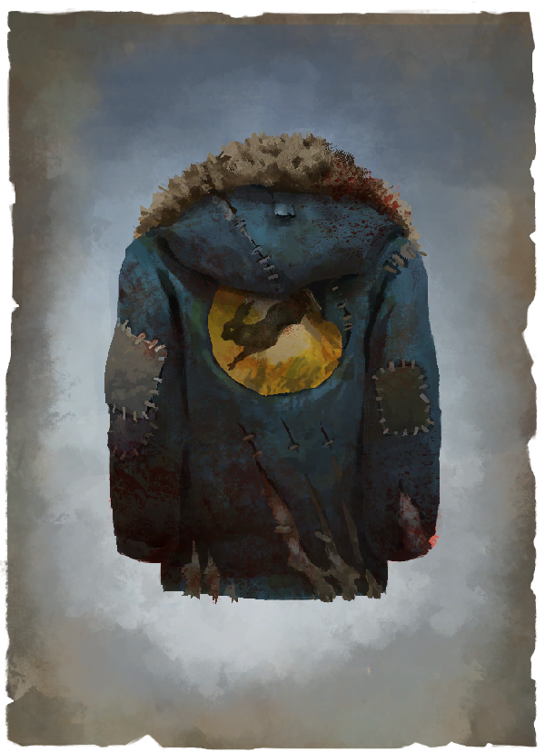
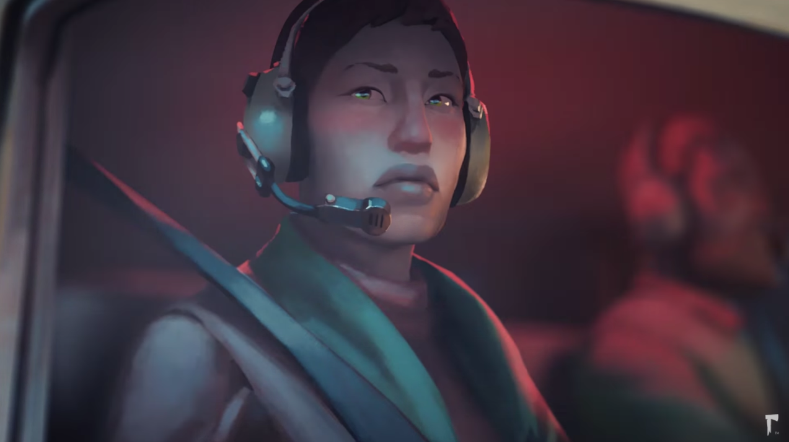

# Wintermute

**Contents**

- [Premise](#Premise)
- [Episodic structure](#Episodic_structure)
- [Episode 1](#Episode_1)
- [Episode 2](#Episode_2)
- [Episode 3](#Episode_3)
- [Episode 4](#Episode_4)
- [Episode 5](#Episode_5)
- [Difficulty](#Difficulty)
- [Green Survivor](#Green_Survivor)
- [Capable Survivor](#Capable_Survivor)
- [Hardened Survivor](#Hardened_Survivor)
- [Media](#Media)
- [Images](#Images)
- [Videos](#Videos)
- [References](#References)

\[Missing image: the_long_dark_poster2.jpg\] Official release poster for Season 1: Wintermute ***Wintermute*** is the story mode edition of *<a href="./The%20Long%20Dark.md" class="wikilink" title="The Long Dark">The Long Dark</a>* and is <a href="./The%20Long%20Dark.md#Downloadable_Addon_Content" class="wikilink" title="downloadable content">downloadable content</a>*.* Originally launching on August 1, 2017 with 2 episodes, the story contains 5 episodes that concluded on March 31, 2026. The game mode was originally a part of the core game, but has since become Downloadable Content (but is free to players that owned *The Long Dark* before 2022).

Unlike <a href="./Survival%20Mode.md" class="wikilink" title="Survival Mode">Survival Mode</a>, Wintermute is primarily targeted towards players who want to experience a more campaign-like experience; focusing on the worldbuilding and lore of <a href="./Great%20Bear%20Island.md" class="wikilink" title="Great Bear Island">Great Bear Island</a> and *The Long Dark's* universe outside of the Island.

## Premise

Wintermute centers around the relationship between <a href="./Astrid%20Greenwood.md" class="wikilink" title="Dr. Astrid Greenwood">Dr. Astrid Greenwood</a> and a bush pilot named <a href="./Will%20Mackenzie.md" class="wikilink" title="Will Mackenzie">Will Mackenzie</a>, whom she hires to fly herself and her <a href="./Astrid%27s%20Hardcase.md" class="wikilink" title="mysterious hardcase">mysterious hardcase</a> to a remote location in the Canadian wilderness of <a href="./Great%20Bear%20Island.md" class="wikilink" title="Great Bear Island">Great Bear Island</a>. After a <a href="./First%20Flare.md" class="wikilink" title="mysterious geomagnetic disaster">mysterious geomagnetic disaster</a> causes their plane to crash land, Astrid and Will become separated. Now the two must survive this cold and unforgiving landscape they find themselves stranded in while doing whatever it takes to reunite safely. Experience the story from their perspectives, and survive while interacting with the other surviving denizens of Great Bear Island.

## Episodic structure

*The Long Dark's* episodic structure borrows from TV to deliver a well-paced narrative experience that is advanced by player action in the world. Similar to open-world games like *Red Dead Redemption* and *Fallout 3*, *The Long Dark* offers both a large open-world simulation space that encourages free-form gameplay and a story-driven mission structure that draws players deeper into the fiction of the game world. This structure means that, whether you have 20 minutes or 2 hours to play, you can jump in and make meaningful progress towards an in-game goal. Each episode takes an average of 3-5 hours to complete.

Gameplay tends to be more structured than <a href="./Survival%20Mode.md" class="wikilink" title="Survival Mode">Survival Mode</a>, with scripted narrative events being more present, new dialogue and music, and the inability to explore certain areas of the local region until certain chapters are completed. The game will also deny entry certain transition zones to other regions, making it impossible to fully explore Great Bear Island. (Ex. Can't leave <a href="./Mystery%20Lake%20%28region%29.md" class="wikilink" title="Mystery Lake">Mystery Lake</a> to go to <a href="./The%20Ravine.md" class="wikilink" title="The Ravine">The Ravine</a> in Episode 2). Items also cannot be taken between Episodes (save for Episode 1 and 2) due to story reasons.

### Episode 1

<a href="./Episode%201%20-%20Do%20Not%20Go%20Gentle.md" class="wikilink" title="Do Not Go Gentle">Do Not Go Gentle</a> launched August 1, 2017.

Will Mackenzie's plane has crashed due to a mysterious geomagnetic event. He and his fellow passenger <a href="./Astrid%20Greenwood.md" class="wikilink" title="Astrid Greenwood">Astrid Greenwood</a> are now separated after Will becomes stranded at the bottom of a nearby ravine over the course of one night. Finding nothing but Astrid's hardcase the next morning, Will must now do his best to survive in the wilderness while trying to find any trace of the doctor, assuming that she is even still alive. His journey takes him to the small forgotten Town of <a href="./Milton.md" class="wikilink" title="Milton">Milton</a>, where he starts to understand the extent of the Quiet Apocalypse that sent his plane crashing down into this new world.

### Episode 2

<a href="./Episode%202%20-%20Luminance%20Fugue.md" class="wikilink" title="Luminance Fugue">Luminance Fugue</a> launched August 1, 2017.

Mackenzie continues his search for Astrid after traveling to the <a href="./Mystery%20Lake%20%28region%29.md" class="wikilink" title="Mystery Lake">Mystery Lake</a> region, but only now does he fully realize the depth of the situation he has found himself in after saving a <a href="./Jeremiah.md" class="wikilink" title="local trapper">local trapper</a> from being nearly mauled to death by a <a href="./Old%20Bear.md" class="wikilink" title="bear">bear</a>. During his journey that takes him across multiple nearby regions, he must make difficult, yet critical life altering decisions-- which will ultimately determine just how far he is willing to go to survive in this harsh new world. After proving that he is tough enough to survive in this harsh new reality, Mackenzie now finds himself with two objectives: reunite with Astrid with the hardcase in tow, and survive long enough to deliver the message "Wintermute" to someone on the other side of the Island.

### Episode 3

<a href="./Episode%203%20-%20Crossroads%20Elegy.md" class="wikilink" title="Crossroads Elegy">Crossroads Elegy</a> launched on October 22, 2019.

After surviving the plane crash and escaping the Town of Milton, Astrid finds herself facing the rather ironic harsh blizzards of <a href="./Pleasant%20Valley.md" class="wikilink" title="Pleasant Valley">Pleasant Valley</a>. Searching for Mackenzie, her skills as a doctor come to bear as she encounters other survivors that have also found their plane grounded by the dancing lights in the sky. As the central mystery of the hardcase draws the plot closer to <a href="./Perseverance%20Mills.md" class="wikilink" title="Perseverance Mills">Perseverance Mills</a>, how far is Astrid willing to go to find Mackenzie?

### Episode 4

<a href="./Episode%204%20-%20Fury%2C%20Then%20Silence.md" class="wikilink" title="Fury, Then Silence">Fury, Then Silence</a> launched on October 6th, 2021.

Mackenzie’s story continues after his ill-fated meeting with the convict <a href="./Mathis.md" class="wikilink" title="Mathis">Mathis</a> inside the <a href="./Carter%20Hydro%20Dam.md" class="wikilink" title="Carter Hydro Dam">Carter Hydro Dam</a>. His abduction lands him in the far reaches of <a href="./Blackrock.md" class="wikilink" title="Blackrock">Blackrock</a>, as he tangles to appease the very <a href="./Convicts.md" class="wikilink" title="Convicts">Convicts</a> of the <a href="./Blackrock%20Prison.md" class="wikilink" title="local prison complex">local prison complex</a> that kidnapped him while also following the instructions of a <a href="./Jace.md" class="wikilink" title="mysterious new benefactor">mysterious new benefactor</a> aiming to free them both.

### Episode 5

<a href="./Episode%205%20-%20The%20Light%20At%20The%20End%20Of%20All%20Things.md" class="wikilink" title="The Light At The End Of All Things">The Light At The End Of All Things</a> launched on March 31, 2026.

The episode starts out with Astrid arriving in <a href="./Perseverance%20Mills.md" class="wikilink" title="Perseverance Mills">Perseverance Mills</a> and continues into 4 parts where you play as Will and Astrid. Both trying to save the people of Perseverance Mills. With the apperance of both old and new faces. Can they manage to find eachother trough alot of struggle and hardship?

## Difficulty

There are three gameplay difficulty options for Wintermute.

### Green Survivor

- For new players most interested in pensive exploration and storytelling.
  - Equivalent to the <a href="./Pilgrim.md" class="wikilink" title="Pilgrim">Pilgrim</a> difficulty in <a href="./Survival%20Mode.md" class="wikilink" title="Survival Mode">Survival Mode</a>.
- Most survival elements are tuned to be very forgiving.
  - <a href="./Needs.md" class="wikilink" title="Needs">Needs</a> decrease slowly.
- Wildlife may attack, but are less aggressive.
  - <a href="./Wolf.md" class="wikilink" title="Wolves">Wolves</a> are scared by the player, like in Pilgrim.

### Capable Survivor

- For players with some experience, and those looking for a balance between exploration and survival.
  - Equivalent to the <a href="./Voyageur.md" class="wikilink" title="Voyageur">Voyageur</a> difficulty in Survival Mode.
- Wildlife is sparse, but can seek you out.
- Survival elements are challenging but resources are plentiful.

### Hardened Survivor

- For veteran players looking for a punishing survival experience.
  - Equivalent to the <a href="./Stalker.md" class="wikilink" title="Stalker">Stalker</a> difficulty in Survival Mode.
- Hostile wildlife is common, and will hunt you down.
- All survival elements are tuned to be particularly challenging.
- <a href="./Intestinal%20Parasites.md" class="wikilink" title="Intestinal Parasites">Intestinal Parasites</a> is present.
- Some notes needed to start side missions are moved to different locations.

<table class="gallery">
<colgroup>
<col style="width: 33%" />
<col style="width: 33%" />
<col style="width: 33%" />
</colgroup>
<tbody>
<tr>
<td><figure>

<figcaption>Green Survivor</figcaption>
</figure></td>
<td><figure>

<figcaption>Capable Survivor</figcaption>
</figure></td>
<td><figure>

<figcaption>Hardened Survivor</figcaption>
</figure></td>
</tr>
</tbody>
</table>

## Media

### Images

<table class="gallery">
<colgroup>
<col style="width: 25%" />
<col style="width: 25%" />
<col style="width: 25%" />
<col style="width: 25%" />
</colgroup>
<tbody>
<tr>
<td><figure>

<figcaption>The_Long_Dark_-_Story_Mode_image1.png</figcaption>
</figure></td>
<td><figure>

<figcaption>The_Long_Dark_-_Story_Mode_image2.png</figcaption>
</figure></td>
<td><figure>

<figcaption>The_Long_Dark_-_Story_Mode_image3.png</figcaption>
</figure></td>
<td><figure>
[Missing image: Intro_cutscene_1.jpg]
<figcaption>Intro_cutscene_1.jpg</figcaption>
</figure></td>
</tr>
<tr>
<td><figure>
[Missing image: Intro_cutscene_2.jpg]
<figcaption>Intro_cutscene_2.jpg</figcaption>
</figure></td>
<td><figure>
[Missing image: Intro_cutscene_3.jpg]
<figcaption>Intro_cutscene_3.jpg</figcaption>
</figure></td>
<td><figure>
[Missing image: Intro_cutscene_4.jpg]
<figcaption>Intro_cutscene_4.jpg</figcaption>
</figure></td>
<td><figure>
[Missing image: Intro_cutscene_5.jpg]
<figcaption>Intro_cutscene_5.jpg</figcaption>
</figure></td>
</tr>
<tr>
<td><figure>
[Missing image: Intro_cutscene_6.jpg]
<figcaption>Intro_cutscene_6.jpg</figcaption>
</figure></td>
<td><figure>
[Missing image: Intro_cutscene_7.jpg]
<figcaption>Intro_cutscene_7.jpg</figcaption>
</figure></td>
<td><figure>
[Missing image: The_long_dark_poster2.jpg]
<figcaption>The_long_dark_poster2.jpg</figcaption>
</figure></td>
<td><figure>
[Missing image: The_long_dark_poster_no_text.jpg]
<figcaption>The_long_dark_poster_no_text.jpg</figcaption>
</figure></td>
</tr>
<tr>
<td><figure>
[Missing image: The_Long_Dark_Poster.jpg]
<figcaption>The_Long_Dark_Poster.jpg</figcaption>
</figure></td>
<td><figure>
[Missing image: Aurora_mainpage.jpg]
<figcaption>Aurora_mainpage.jpg</figcaption>
</figure></td>
<td><figure>
[Missing image: The_Long_Dark_Steam_header.jpg]
<figcaption>The_Long_Dark_Steam_header.jpg</figcaption>
</figure></td>
<td><figure>
[Missing image: December_update_2018.jpg]
<figcaption>December_update_2018.jpg</figcaption>
</figure></td>
</tr>
<tr>
<td><figure>
[Missing image: December_update_2018_notext.jpg]
<figcaption>December_update_2018_notext.jpg</figcaption>
</figure></td>
<td></td>
<td></td>
<td></td>
</tr>
</tbody>
</table>

### Videos

<table class="gallery">
<colgroup>
<col style="width: 25%" />
<col style="width: 25%" />
<col style="width: 25%" />
<col style="width: 25%" />
</colgroup>
<tbody>
<tr>
<td><figure>

<figcaption>The_Long_Dark_-_Episode_2_(Luminance_Fugue)_Opening_Credits</figcaption>
</figure></td>
<td><figure>
[Missing image: The_Long_Dark_--_WINTERMUTE_REDUX_--_Launch_Trailer_(2018)]
<figcaption>The_Long_Dark_--_WINTERMUTE_REDUX_--_Launch_Trailer_(2018)</figcaption>
</figure></td>
<td><figure>

<figcaption>The_Long_Dark_--_"Make_It_Right"_--_WINTERMUTE_LAUNCH_TRAILER</figcaption>
</figure></td>
<td><figure>
[Missing image: The_Long_Dark_--_Episode_Three_CROSSROADS_ELEGY_--_Launch_Trailer]
<figcaption>The_Long_Dark_--_Episode_Three_CROSSROADS_ELEGY_--_Launch_Trailer</figcaption>
</figure></td>
</tr>
<tr>
<td><figure>
[Missing image: The_Long_Dark_--_Episode_Four_--_FURY,_THEN_SILENCE_--_Teaser]
<figcaption>The_Long_Dark_--_Episode_Four_--_FURY,_THEN_SILENCE_--_Teaser</figcaption>
</figure></td>
<td></td>
<td></td>
<td></td>
</tr>
</tbody>
</table>

## References

\

**Lua execution error in Module:Navbox function navbox** <a href="ru:Wintermute" class="wikilink" title="ru:Wintermute">ru:Wintermute</a> <a href="fr:Mode_Histoire" class="wikilink" title="fr:Mode Histoire">fr:Mode Histoire</a>

