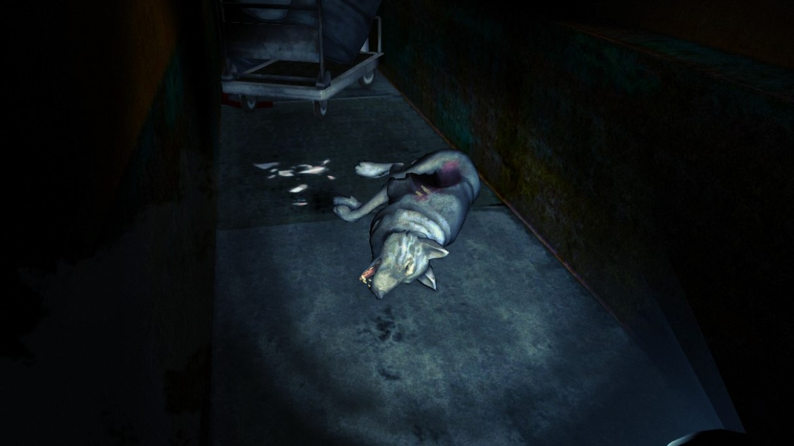
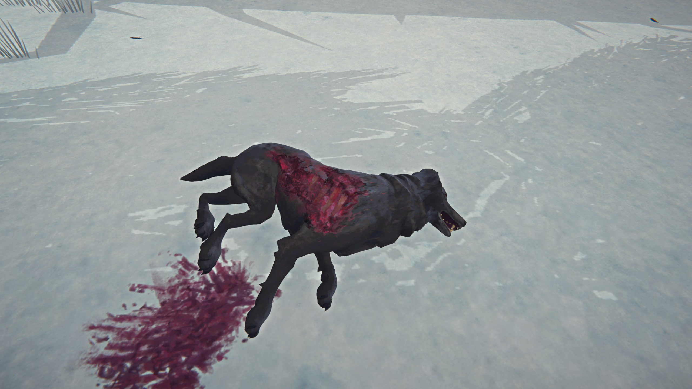

# Wolf Carcass

**Categories:** Interactable Objects, Story items · **Source:** [Fandom](https://thelongdark.fandom.com/wiki/Wolf_Carcass)

**Contents**

- [Drops](#drops)
- [Preplaced Locations](#preplaced-locations)
- [Zone of Contamination](#zone-of-contamination)
- [Gallery](#gallery)

**Wolf Carcass**

| Property | Details |
| --- | --- |
|  |  / _Wolf\_carcass\_icon.png_ |
| **General** |  |
| Item Type | Item |

|  | Item / Quantity / Rarity |
|  / _Wolf\_Meat\_(Raw)\_icon.png_ | [Wolf Meat (Raw)](./Wolf%20Meat%20%28Raw%29.md) / 3 - 6 / Always[¹](#fn1) |
|  / _Wolf\_Quarter\_icon.png_ | [Wolf Quarter](./Wolf%20Quarter.md) / 2 - 3 / Always[²](#fn2) |
|  / _Fresh\_Wolf\_Pelt\_icon.png_ | [Fresh Wolf Pelt](./Fresh%20Wolf%20Pelt.md) / 1 / Always |
| \[Missing image: Gut\_icon.png\] / _Gut\_icon.png_ | [Fresh Gut](./Fresh%20Gut.md) / 2 / Always |
|  |  |
|  / _The ravaged carcass of "Fluffy" in the [Carter Hydro Dam](./Carter%20Hydro%20Dam.md) in [Episode 2](./Episode%202%20-%20Luminance%20Fugue.md)_ |  / _A dead wolf next to a dead [Frozen Corpse](./Frozen%20Corpse.md)_ /  / _A wolf carcass as seen in the [Escape the Darkwalker](./Escape%20the%20Darkwalker.md) concept art_ /  / _A Fresh Wolf Carcass_ |
|  / _A harvested fresh wolf carcass_ |  |

## Notes

---

1. If carcass is harvested[↩︎](#fnref1)
2. If carcass is quartered.[↩︎](#fnref2)
