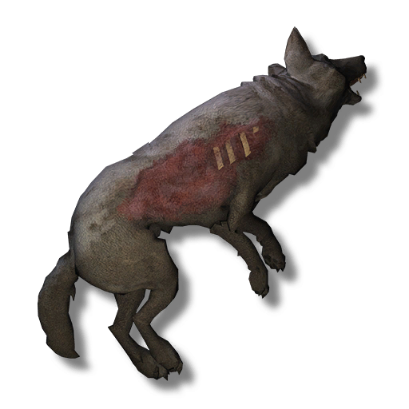
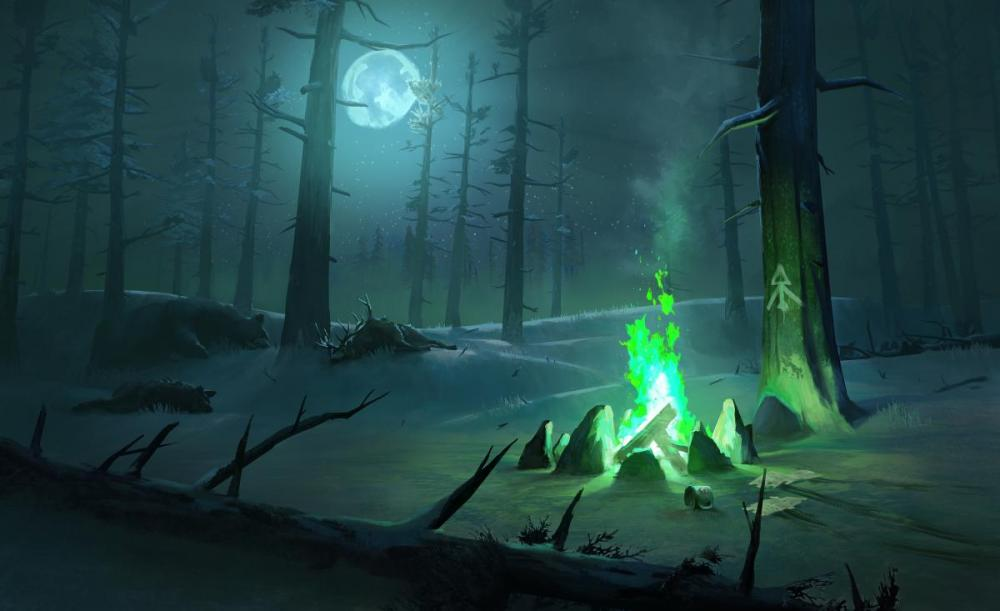
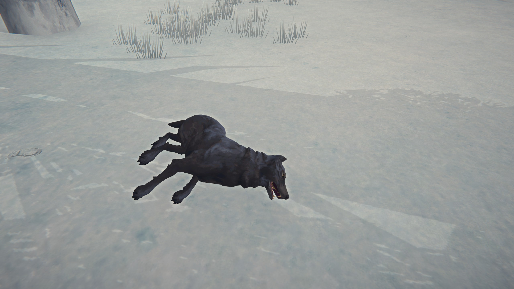

# Wolf Carcass

**Contents**

- [Drops](#drops)
- [Preplaced Locations](#preplaced-locations)
- [Zone of Contamination](#zone-of-contamination)
- [Gallery](#gallery)

**Wolf Carcass**

| Property | Details |
| --- | --- |
|  |  / *Wolf\_carcass\_icon.png* |
| **General** |  |
| Item Type | Item |
| Wintermute | Yes\|} A **Wolf Carcass** is a harvestable "object" found after [Hunting](./Hunting.md) a [Wolf](./Wolf.md). They can occasionally be found as ravaged carcasses preplaced across [Great Bear Island](./Great%20Bear%20Island.md). [Crows](./Crow.md) will fly around a Wolf Carcass and always drop 3 [Crow Feathers](./Crow%20Feather.md) around the carcass at a time. / ## Drops / A Wolf Carcass may be harvested for 3.00-6.00 kg of [raw meat](./Wolf%20Meat%20%28Raw%29.md), 1 [Fresh Wolf Pelt](./Fresh%20Wolf%20Pelt.md) and 2 guts. Wolf hides can be cured to craft [Wolfskin Coat](./Wolfskin%20Coat.md). On Stalker and Interloper modes, wolf meat carries the risk of [Intestinal Parasites](./Intestinal%20Parasites.md). / \|  \| Item \| Quantity \| Rarity \| / \| --- \| --- \| --- \| --- \| / \|  / *Wolf\_Meat\_(Raw)\_icon.png* \| [Wolf Meat (Raw)](./Wolf%20Meat%20%28Raw%29.md) \| 3 - 6 \| Always[¹](#fn1) \| / \|  / *Wolf\_Quarter\_icon.png* \| [Wolf Quarter](./Wolf%20Quarter.md) \| 2 - 3 \| Always[²](#fn2) \| / \|  / *Fresh\_Wolf\_Pelt\_icon.png* \| [Fresh Wolf Pelt](./Fresh%20Wolf%20Pelt.md) \| 1 \| Always \| / \| \[Missing image: Gut\_icon.png\] / *Gut\_icon.png* \| [Fresh Gut](./Fresh%20Gut.md) \| 2 \| Always \| / \|  \|  \|  \|  \| / ## Preplaced Locations / Wolf Carcasses are very rarely found placed in the world, often only being found in regions that [Timberwolf](./Timberwolf.md) packs frequent, serving as early warning signs for the region. Meat on a Ravaged Carcass will always be Mouldy (60% Condition). / - Outside the Transition Cave between [Bleak Inlet](./Bleak%20Inlet.md) and [Forlorn Muskeg](./Forlorn%20Muskeg.md), in Bleak Inlet's west side. / - A ravaged corpse can be found inside the [Carter Hydro Dam](./Carter%20Hydro%20Dam.md) in [Episode 2: Luminance Fugue](./Episode%202%20-%20Luminance%20Fugue.md) (Fluffy). / - Rarely inside caves (such as [Lake Cave](./Lake%20Cave.md)). / - At the bottom of the ravine below [Broken Bridge](./Broken%20Bridge%20%28Broken%20Railroad%20location%29.md) in [Broken Railroad](./Broken%20Railroad.md). / - [Along the coastline](./Beachcombing.md) in applicable regions. / ### [Zone of Contamination](./Zone%20of%20Contamination.md) / - On a hill behind the Mess Hall in [Idle Camp](./Idle%20Camp.md) in [Zone of Contamination](./Zone%20of%20Contamination.md). / - In the hills near [Indolent Hoppers](./Indolent%20Hoppers.md) (farthest most maintenance shed has a [Rock Climb](./Rock%20Climb.md)) with a dead hunter [Frozen Corpse](./Frozen%20Corpse.md) in [Zone of Contamination](./Zone%20of%20Contamination.md). / - On a ridge north of [Smoker's Cave](./Smoker%27s%20Cave.md), surrounding by Simple Arrows. / ## Gallery / \| Column 1 \| Column 2 \| Column 3 \| Column 4 \| / \| --- \| --- \| --- \| --- \| / \|  / *The ravaged carcass of "Fluffy" in the [Carter Hydro Dam](./Carter%20Hydro%20Dam.md) in [Episode 2](./Episode%202%20-%20Luminance%20Fugue.md)* \|  / *A dead wolf next to a dead [Frozen Corpse](./Frozen%20Corpse.md)* \|  / *A wolf carcass as seen in the [Escape the Darkwalker](./Escape%20the%20Darkwalker.md) concept art* \|  / *A Fresh Wolf Carcass* \| / \|  / *A harvested fresh wolf carcass* \|  \|  \|  \| / **Lua execution error in Module:Navbox function navbox** [ru:Туша волка](ru:%D0%A2%D1%83%D1%88%D0%B0_%D0%B2%D0%BE%D0%BB%D0%BA%D0%B0) |
|  | Item / Quantity / Rarity |
|  / *Wolf\_Meat\_(Raw)\_icon.png* | [Wolf Meat (Raw)](./Wolf%20Meat%20%28Raw%29.md) / 3 - 6 / Always[¹](#fn1) |
|  / *Wolf\_Quarter\_icon.png* | [Wolf Quarter](./Wolf%20Quarter.md) / 2 - 3 / Always[²](#fn2) |
|  / *Fresh\_Wolf\_Pelt\_icon.png* | [Fresh Wolf Pelt](./Fresh%20Wolf%20Pelt.md) / 1 / Always |
| \[Missing image: Gut\_icon.png\] / *Gut\_icon.png* | [Fresh Gut](./Fresh%20Gut.md) / 2 / Always |
|  |  |
|  / *The ravaged carcass of "Fluffy" in the [Carter Hydro Dam](./Carter%20Hydro%20Dam.md) in [Episode 2](./Episode%202%20-%20Luminance%20Fugue.md)* |  / *A dead wolf next to a dead [Frozen Corpse](./Frozen%20Corpse.md)* /  / *A wolf carcass as seen in the [Escape the Darkwalker](./Escape%20the%20Darkwalker.md) concept art* /  / *A Fresh Wolf Carcass* |
|  / *A harvested fresh wolf carcass* |  |

## Notes

---

1. If carcass is harvested[↩︎](#fnref1)
2. If carcass is quartered.[↩︎](#fnref2)
