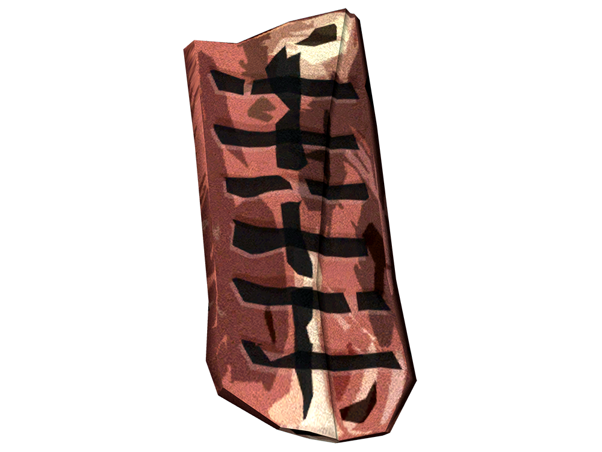

# Wolf Meat \(Cooked\)

**Categories:** Food And Drink, Pages with update history · **Source:** [Fandom](https://thelongdark.fandom.com/wiki/Wolf_Meat_%28Cooked%29)

**Contents**

- [Overview](#overview)
- [Recipe](#recipe)
- [Gallery](#gallery)
- [Update history](#update-history)

**Wolf Meat (Cooked)**

[Wolf Meat (Cooked) icon](../assets/Wolf_Meat_%28Cooked%29_icon.png)

**Release:** [22 September 2014](./The%20Long%20Dark%20%E2%80%94%20Early%20Access%20Changelog.md#0.117)

**Wintermute:** No

**Properties**

**Item type:** [Food And Drink](./Food%20And%20Drink.md)

**Stackable:** No

**Examine:** Cooked flesh from a wolf.

**Values**

**Calories:** 700 kcal

**Hydration:** -10%

**Weight:** 1.00 kg (2.2 lbs)

**Advanced data**

**Item key:** GAMEPLAY\_WolfMeatCooked

_For the raw version, see [Wolf Meat (Raw)](./Wolf%20Meat%20%28Raw%29.md)._

**Wolf Meat** is a cooked [food](./Food%20And%20Drink.md) item in _The Long Dark_.

## Overview

Cooked Wolf Meat is obtained by using a lit [fire](./Fire.md) and improves the [Cooking](./Cooking.md) skill. Cooking increases its condition by 50%, decays 4 times slower than raw meat, and has a reduced chance of [food poisoning](./Afflictions.md) over raw meat.

Using a [Cooking Pot](./Cooking%20Pot.md) reduces cooking time by 25%. Cooked food on an active fire for too long will burn (twice it's 'Ready' cooking time), destroying the item and damaging a Cooking Pot if used.

## Recipe

**Wolf Meat (Cooked)**

68.75 minutes (1 hour 8.75 minutes)

**Requirements**

**Item:** [Wolf Meat (Raw)](./Wolf%20Meat%20%28Raw%29.md)

**Quantity:** 1.00 kg

## Gallery

## Update history

- UPDATE **22 September 2014 ([Update](./The%20Long%20Dark%20%E2%80%94%20Early%20Access%20Changelog.md#0.117)):**
  - Added to game.
