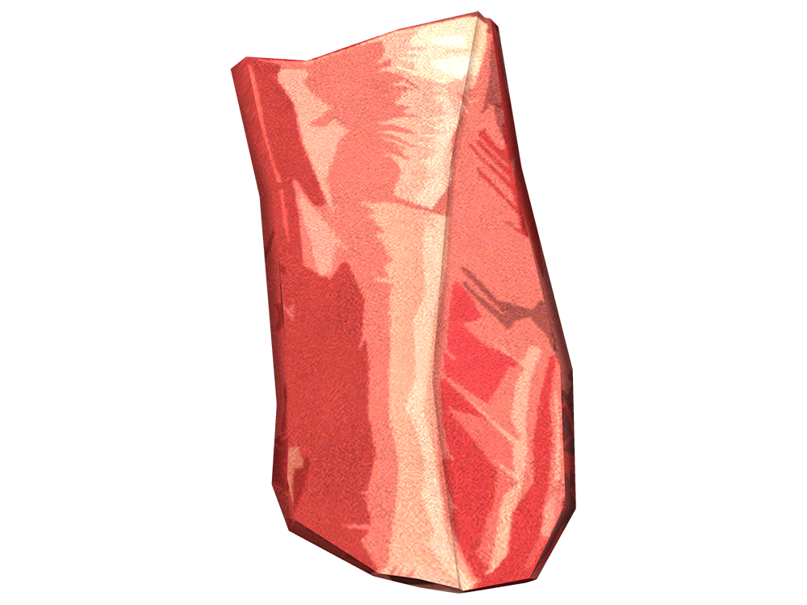

# Wolf Meat \(Raw\)

**Contents**

- [Overview](#overview)
- [Products](#products)
- [Gallery](#gallery)
- [Update history](#update-history)

**Wolf Meat (Raw)**

| Property | Details |
| --- | --- |
|  |  / *Wolf\_Meat\_(Raw)\_icon.png* |
| Release | [22 September 2014](./The%20Long%20Dark%20%E2%80%94%20Changelog.md#0.117) |
| Wintermute | Yes |
| Renewable | Yes |
| **Properties** |  |
| Item type | [Food And Drink](./Food%20And%20Drink.md)\|- |
| Stackable | No |
| Examine | Flesh from a wolf. Cook to eat safely. |
| **Values** |  |
| Calories | 800 kcal |
| Hydration | 0% |
| Weight | 1.00 kg (2.2 lbs) |
| **Advanced data** |  |
| Item key | GAMEPLAY\_WolfMeatRaw |

*For the cooked version, see [Wolf Meat (Cooked)](./Wolf%20Meat%20%28Cooked%29.md).*

**Wolf Meat (Raw)** is a raw [food](./Food%20And%20Drink.md) item in *The Long Dark*.

## Overview

Wolf Meat is harvested from [Wolf](./Wolf.md) and [Timberwolf](./Timberwolf.md) carcasses, which contain between 3.0 and 6.0 kg of raw meat. Consuming raw meat carries a high chance of contracting [Food Poisoning](./Food%20Poisoning.md). Wolf Meat **cannot** be harvested from [Poisoned Wolf](./Poisoned%20Wolf.md) carcasses.

- On Stalker and Interloper mode, consuming predator meat has a chance of contracting [Intestinal Parasites](./Intestinal%20Parasites.md).
  - This risk can be avoided by [curing](./Cured%20Meat.md) the meat inside a [Meat Curing Box](./Meat%20Curing%20Box.md), instead of cooking it.
- At 0% condition food disappears if inside of a container, but not outside of containers or in the player's inventory.
- Meat decays slower outdoors than indoors.

## Products

## Gallery

| Column 1 | Column 2 | Column 3 | Column 4 |
| --- | --- | --- | --- |
|  / *Fresh* |  / *Gamey* |  / *Mouldy* |  / *Rancid* |
|  / *Ruined* |  / *Old model* |  |  |

## Update history

- UPDATE **22 September 2014 ([Update](./The%20Long%20Dark%20%E2%80%94%20Early%20Access%20Changelog.md#0.117)):**
  - Added to game.

**Lua execution error in Module:Navbox function navbox** [ru:Волчатина (сырая)](ru:%D0%92%D0%BE%D0%BB%D1%87%D0%B0%D1%82%D0%B8%D0%BD%D0%B0_%28%D1%81%D1%8B%D1%80%D0%B0%D1%8F%29)
