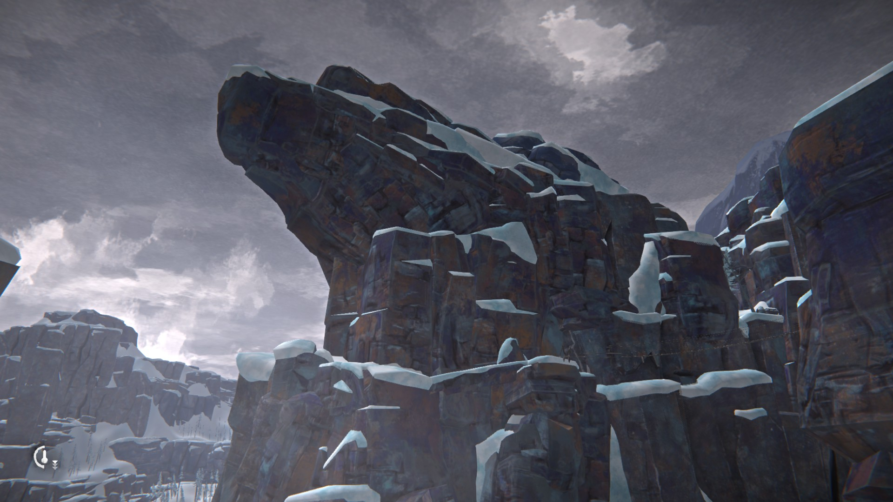
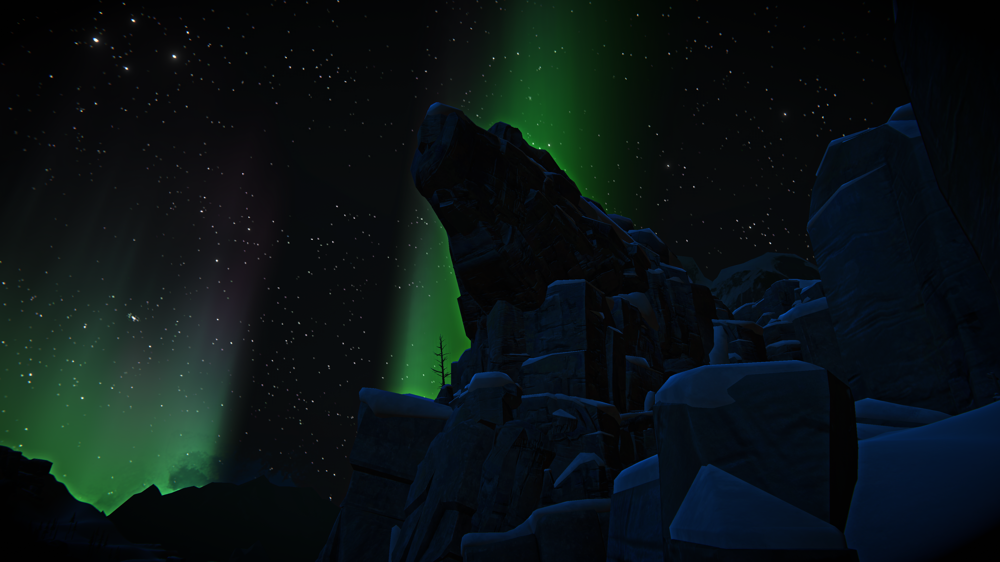
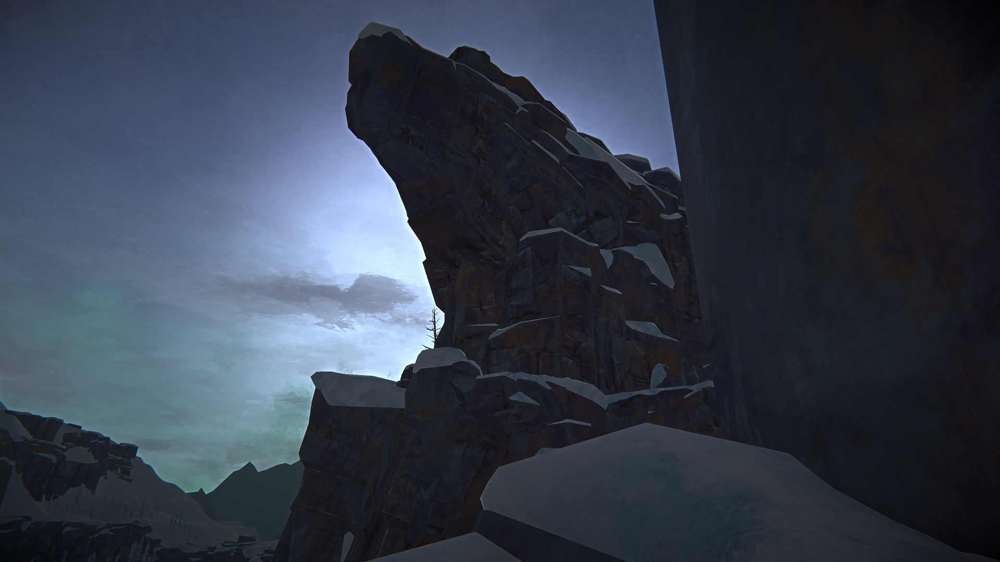
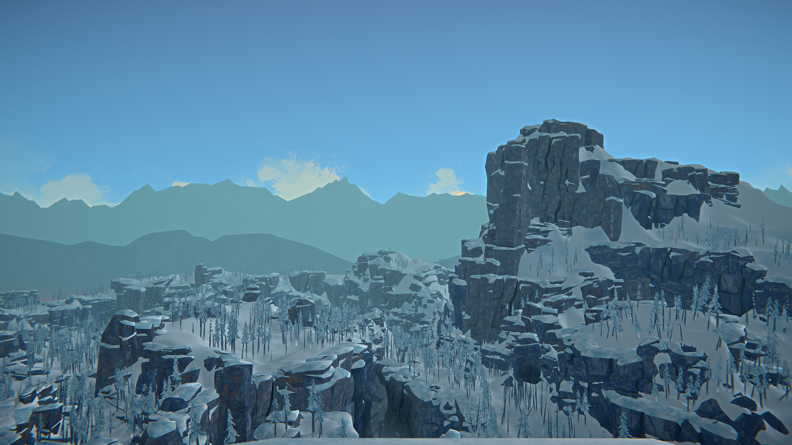
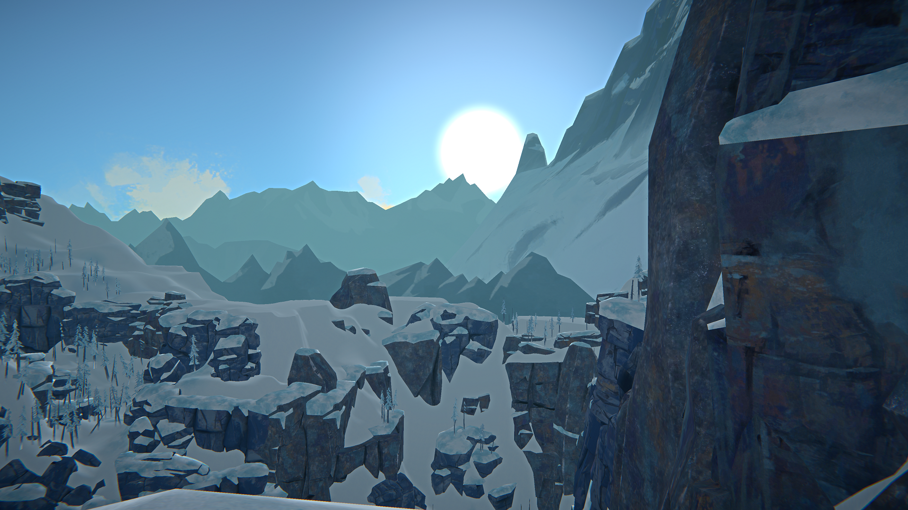
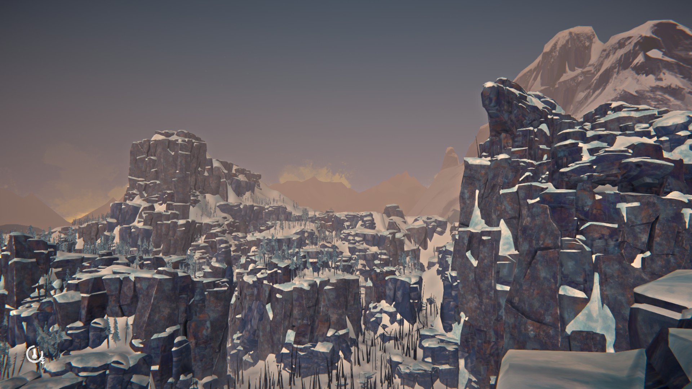
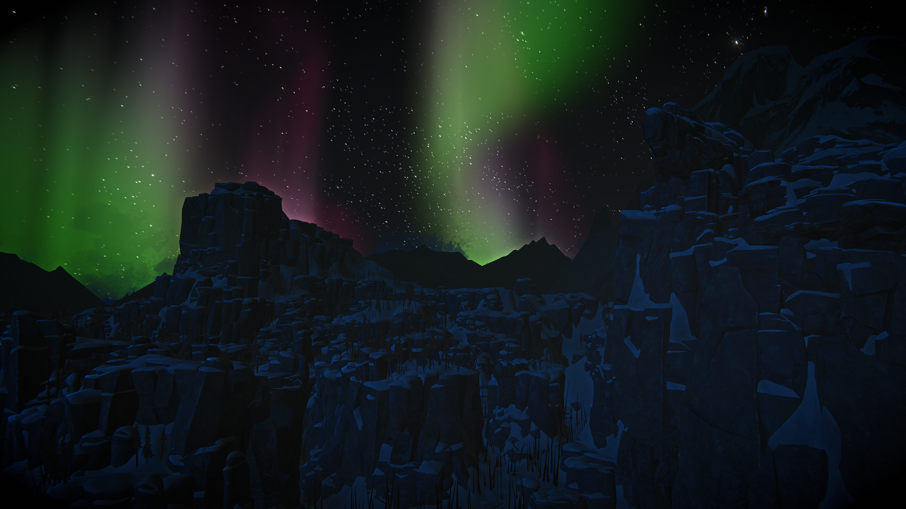
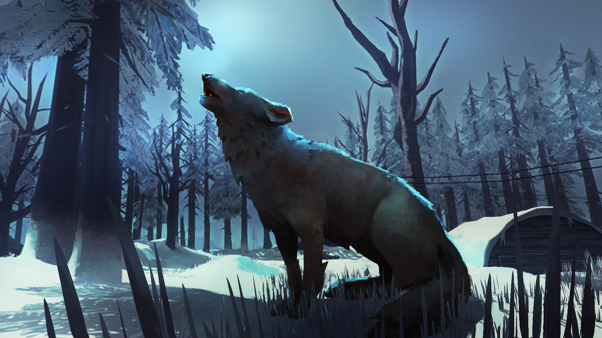

# Wolf's Jaw Overlook

**Categories:** Landmarks, Locations, Locations in Ash Canyon, Outdoor locations · **Source:** [Fandom](https://thelongdark.fandom.com/wiki/Wolf's_Jaw_Overlook)

**Wolf's Jaw Overlook**

[20201209231328 1](../assets/20201209231328_1.jpg)

**Location**

[Wolf's Jaw Overlook Location](../assets/Wolf%27s_Jaw_Overlook_Location.png)

**Region:** [Ash Canyon](./Ash%20Canyon.md)

**General**

**Type:** Landmark

## Overview

There isn't really much of note about this location, but it is one of two vista locations in the region; weather permitting, it provides a great view of much of the region. Sometimes, a few leftover supplies can spawn here, and there's the possibility of a [Mountaineering Rope](./Mountaineering%20Rope.md) and a [Bearskin Coat](./Bearskin%20Coat.md) to spawn nearby. This rope can be used to rappel down to the gold mine, farther along the path from the overlook. A frozen corpse on a ledge nearby is also a possible spawn location for the [Curator's Rifle](./Curator%27s%20Rifle.md).

A handwritten note from a mountain dweller also speaks of this summit, which was one of the main interests of the region before the gold mine was discovered.

The nearby rope bridge has up to 40 [Cardboard Matches](./Cardboard%20Matches.md) lying on the side farther from the Overlook (on the wooden ramp leading up to it).

## Gallery

_The [Pillar](./Pillar%27s%20Footrest.md) and the [Wolf's Jaw](./Wolf%27s%20Jaw%20Overlook.md) seen by [Foreman's Retreat](./Foreman%27s%20Retreat.md)_

_[Pillar's Footrest](./Pillar%27s%20Footrest.md) and Wolf's Jaw Overlook from the [Foreman's Retreat](./Foreman%27s%20Retreat.md) during the aurora._

