# Wolf

**Categories:** Pages with update history, Wildlife · **Source:** [Fandom](https://thelongdark.fandom.com/wiki/Wolf)

**Contents**

- [Overview](#overview)
- [Drops](#drops)
- [Behaviour](#behaviour)
- [As hunters](#as-hunters)
- [Howling](#howling)
- [Interaction](#interaction)
- [Aurora wolves](#aurora-wolves)
- [Defending kills](#defending-kills)
- [Decoys](#decoys)
- [Fire](#fire)
- [Gunshots](#gunshots)
- [Stones](#stones)
- [Noisemakers](#noisemakers)
- [Struggle](#struggle)
- [Tools](#tools)
- [Preparation](#preparation)
- [Weakness](#weakness)
- [Hunting](#hunting)
- [Critical hits](#critical-hits)
- [Bleeding wounds](#bleeding-wounds)
- [Bleed Out](#bleed-out)
- [Strategies](#strategies)
- [Spawning and Behavior](#spawning-and-behavior)
- [Spawning](#spawning)
- [Detection](#detection)
- [Behavior](#behavior)
- [Unique Wolves](#unique-wolves)
- [Fluffy](#fluffy)
- [Other Unique Wolves](#other-unique-wolves)
- ["Demon" Wolves](#demon-wolves)
- [Trivia](#trivia)
- [Gallery](#gallery)
- [Update history](#update-history)

**Wolf**

| Property | Details |
| --- | --- |
|  | [Wolf](../assets/Wolf.png) |
| **Basic Information** |  |
| Release | [12 June 2014](./The%20Long%20Dark%20%E2%80%94%20Early%20Access%20Changelog.md) |
| Role | Predator |
| **Physical Information** |  |
| Color | Black |
| Size | Medium |

  **Wolves** are iconic [Wildlife](./Wildlife.md) in _[The Long Dark](./The%20Long%20Dark.md)._ In [Survival Mode](./Survival%20Mode.md) and [Wintermute](./Wintermute.md) they are a primary threat to survival on [Great Bear Island](./Great%20Bear%20Island.md) and can be found in all major [regions](./Region.md).

## Overview

Wolves are a common predatory animal found on Great Bear Island; they may appear alone or in packs of up to four:

- They hunt [Rabbit](./Rabbit.md), [Deer](./Deer.md), and [Ptarmigan](./Ptarmigan.md) and stalk the survivor.
- Wolves flee from [Bear](./Bear.md) and [Moose](./Moose.md).
- Despite not showing any fear of [Timberwolves](./Timberwolf.md), Wolves do not interact with Timberwolf packs.

When a wolf detects the survivor they will stalk and attack them, potentially resulting in a [Struggle](./Struggle.md): resulting in [Condition](./Condition.md) loss, [Blood Loss](./Blood%20Loss.md) and [Infection Risk](./Infection%20Risk.md), or damage to [Clothing](./Clothing.md). A wolf attack is typically not fatal at high condition, even if lost.

Wolves can be avoided by keeping distance, sneaking (crouching) and not carrying smelly items (raw meat, cooked meat, raw guts). These smelly items can be dropped ("3") as bait to distract a wolf. Unalerted Wolves will also investigate thrown [stones](./Stone.md) which land nearby.

At night, Wolves can easily be spotted if they are facing your direction by the green shimmer in their eyes (Red in [4 Days of Night Event](./4%20Days%20of%20Night%20Event.md)).

## Drops

A [Wolf Carcass](./Wolf%20Carcass.md) may be harvested for 3.0-6.0 kg of [raw meat](./Wolf%20Meat%20%28Raw%29.md), 1 [Fresh Wolf Pelt](./Fresh%20Wolf%20Pelt.md) and 2 guts. Wolf hides can be cured to craft [Wolfskin Coat](./Wolfskin%20Coat.md), [Wolfskin Pants](./Wolfskin%20Pants.md), or a [Wolfskin Hat](./Wolfskin%20Hat.md).

|  | Item | Quantity | Rarity |
| --- | --- | --- | --- |
| [Wolf Meat (Raw) icon](../assets/Wolf_Meat_%28Raw%29_icon.png) | [Wolf Meat (Raw)](./Wolf%20Meat%20%28Raw%29.md)* | 3 - 6 | Always (1) |
| [Wolf Quarter icon](../assets/Wolf_Quarter_icon.png) | [Wolf Quarter](./Wolf%20Quarter.md) | 2 - 3 | Always (2) |
| [Fresh Wolf Pelt icon](../assets/Fresh_Wolf_Pelt_icon.png) | [Fresh Wolf Pelt](./Fresh%20Wolf%20Pelt.md) | 1 | Always |
| [Fresh Gut icon](../assets/Fresh_Gut_icon.png) | [Fresh Gut](./Fresh%20Gut.md) | 2 | Always |

*Note: Wolf Meat has a [Risk of Intestinal Parasites](./Risk%20of%20Intestinal%20Parasites.md) on higher difficulties.

Animal Fat is produced automatically when harvesting raw meat. It cannot be harvested separately and does not appear when Harvesting a Carcass.

|  | Item | Quantity | Rarity |
| --- | --- | --- | --- |
| [Animal Fat icon](../assets/Animal_Fat_icon.png) | [Animal Fat](./Animal%20Fat.md) | 0.10 per kg of meat | Always |

## Behaviour

Wolves feature the most complex and varied behavior of all [Wildlife](./Wildlife.md) in The Long Dark.

### As hunters

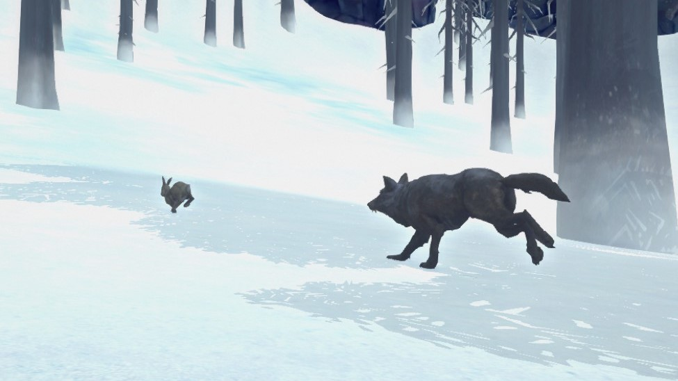_A wolf chasing a rabbit_ Wolves hunt Rabbit, Deer, and Ptarmigan they detect, and stalk the survivor. Wolves will 'bark' when they see a target and slowly stalk it to get closer. When close enough they will start chasing it, sprinting at close distances and killing prey animals on contact. After a kill, wolves will feed on the animal's carcass until no harvestable yield remains ("Ravaged"). Wolves making contact with the survivor will start a [Struggle](./Struggle.md).

Breaking a wolf's line of sight, keeping scent low and running may help lose a stalking wolf. Wolves will not approach lit [campfires](./Campfire.md) or flares, and cannot travel indoors or inside vehicles. If multiple wolves detect the player, one of them will take the lead to attack while the others stand back and growl at the player while keeping up with the approaching alpha Wolf.

Climbing felled trees, some boulders or rock ledges outside of a Wolf's pathfinding will cause it to stand in a defensive stance and growl in place at the player, in which wolves lose interest over time. If a weapon of any kind is brandished while a Wolf is hold its ground, they will always run away in fear.

A Wolf that has been shot by the player will retreat to a great distance away from the player until it cannot detect them anymore, and will begin to bleed out. Once their health is low enough then they will noticeably slow down, pulling their front left leg off the ground and limping as they move. They will will refuse to attack animals or the player in this state and eventually fall over dead once they fully bleed out.

### Howling

Idle wolves will periodically and howl to one another, which may result in other nearby wolves replying. This can be useful to detect the presence of unseen wolves in areas with low visibility, or count the amount of nearby wolves.

## Interaction

> “**Wolves - - they hate fire, like most wildlife. Campfire'll keep them away from you at night, most of the time. Improvise a torch if you have to. Flare will work too, you know one of those emergency ones for road accidents. Sometimes, if you get lucky, a stone to the head will scare them off.**”
>
> — [Jeremiah](./Jeremiah.md)

Wolves are hostile wildlife found in all major regions of Great Bear Island wandering or hunting prey when not stalking the survivor. Prolonged stalking may result in a wolf giving up or charging the survivor or prey.

_For detailed information on wolf behavior see: "Spawning and Behavior" below._

### Aurora wolves

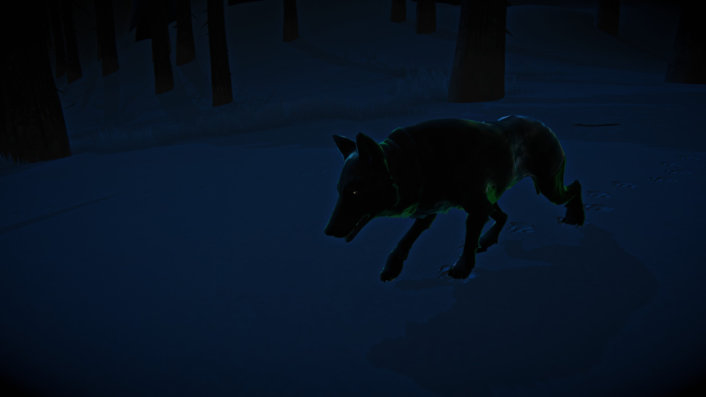_An Aurora Wolf on the prowl_ When an [Aurora](./Aurora.md) begins all wolves temporarily flee and before becoming aurora wolves: which glow green and are more aggressive, deal more damage and have more health. Aurora wolves often behave erratically: barking and running in circles almost constantly.

- Aurora Wolves do not fear [Flares](./Flare.md), [Marine Flares](./Marine%20Flare.md), or lit [Torches](./Torch.md).
- They fear active street lights, and will stand and growl at the player if they pass near the boundary of one. After enough time, they will run away in fear if they cannot reach the player.
- They will also charge the survivor at longer distances.
- They fear [Flashlight](./Flashlight.md) high beams and will temporarily stop a charge as long as they are on.
- They will stay away from lit [Campfires](./Campfire.md), but will still stay close by and stalk to the player.
- Gunshots are still effective at frightening aurora wolves, provided they are not charging.

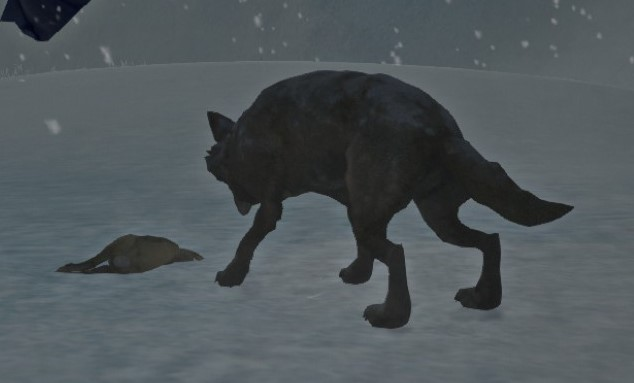

### Defending kills

A wolf that has recently killed an animal will begin to eat its carcass, reducing yields until nothing remains. While the wolf feeds, its senses are greatly reduced (-75%). Scaring a wolf away from its kill will cause it to flee for a time, potentially allowing the survivor to harvest the carcass. Feeding wolves which are defending their kill may attack a survivor even on [Pilgrim](./Survival%20Mode.md) mode.

### Decoys

Most products harvested from animals produce [Scent](./Scent.md) when carried by the survivor; while carried Scented items increases the radius at which wolves (and other predators) can smell the survivor, affected by wind (positively or negatively). While carried these items may be dropped ("3") as a Decoy to distract nearby predators, if a wolf detects a nearby Decoy (and the survivor is adequately far enough from it) they will pursue and eat the Decoy (destroying it), remaining distracted for a few seconds.

Additionally if a wolf detects a prey animal while stalking the survivor it may pursue the animal instead. This can allow the survivor to distract wolves pursuing them by traveling past [herds of deer](./Deer.md), [rabbit groves](./Rabbit%20Grove.md), or [ptarmigan nests](./Ptarmigan.md).

### [Fire](./Fire.md)

 Wolves are afraid of [fire](./Fire.md) and generally avoid it if the survivor is nearby (~5m): making lit campfires, torches and flares powerful wolf deterrents. If the survivor is within range of a light source wolves respect (e.g. lit torch dropped at their feet) and aiming any weapon (e.g. [Stone](./Stone.md)) a stalking wolf will flee. Fires should be between the survivor and the wolf for maximum safety. If a wolf is charging the survivor, throwing a lit torch or flares may interrupt it.

- Lit Campfires will deter wolves**, but lit fire barrels, stoves, etc will not.** Being heavily Scented will not deter wolves from attacking despite a fire being present.
- Lit [Torch](./Torch.md) and especially [Flares](./Flare.md) are effective at deterring wolves (unless the player is Weak or heavily Scented (see below)).
- **Aurora wolves do not fear fires.**
- Accelerating Time (sleep, reading, crafting, harvesting etc.) while relying on a lit campfire to deter wolves may be dangerous: either with the wolf moving around the fire to attack, or the fire extinguishing (consuming its fuel, or blown out by wind).

### Gunshots

Wolves flee from the report of a [Hunting Rifle](./Hunting%20Rifle.md), [Revolver](./Revolver.md) or [Distress Pistol](./Distress%20Pistol.md) and the impact of nearby bullets and arrows.

### [Stones](./Stone.md)

Wolves investigate thrown stones landing nearby if the survivor is not detected. This can allow an undetected survivor to temporarily distract wolves from an area. If a stone stone lands very close to a wolf (undetected) or hits them directly (detected) they may flee. After investigating a stone wolves will return to their original position.

### [Noisemakers](./Noisemaker.md)

Exploding Noisemakers cause all nearby wolves to flee (including aurora wolves) at moderate range (~20m), and can wound or kill wolves at short range (~5m). **Note: at very close range (or if the survivor fails to throw a lit Noisemaker in time) Noisemaker explosions will damage the survivor.**

## Struggle

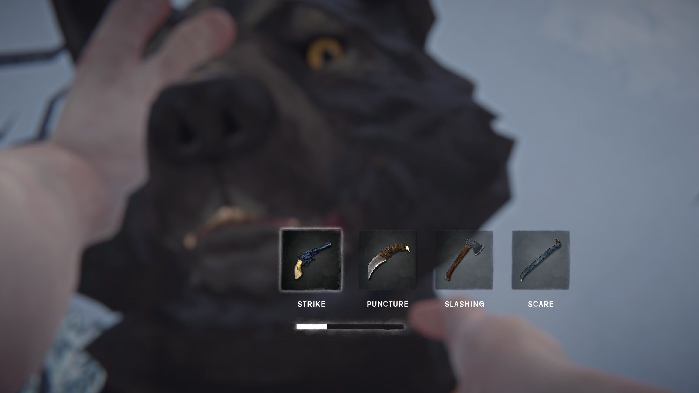 Wolves within 15 meters who detect the survivor charge them, attempting to make contact and start a [Struggle](./Struggle.md). At the start of a struggle the survivor will have several seconds to select a [tool](./Tools.md) from their inventory to defend themselves. Over the following seconds the survivor and wolf will attack one another: taking [Condition](./Condition.md) and [Clothing](./Clothing.md) damage with chances to incur [Afflictions](./Afflictions.md) until either side wins, or dies, or the struggle ends (after 10 seconds).

- The Struggle Meter will appear at the bottom of the screen.
- Left-Clicking after selecting a weapon results in the survivor attacking the wolf and filling the Struggle Meter.
- Each time the wolf will take damage and there is a chance the struggle ends. Clicking faster yields better results during a struggle; **for players with issues clicking rapidly the "Hold to Struggle" option may be enabled in-game under "Accessibility Settings"**, this setting requires fewer player inputs during struggles but yields inferior results to rapid clicking.
- Failing to end the struggle within 10 seconds results in the wolf "winning", causing the survivor to temporarily faint, but possibly survive the encounter. Afterwards some items from their inventory may be on ground nearby, while the wolf temporarily walks away.
- Wolves require contact (~1m) to begin a struggle, making struggles avoidable by fire, impassible terrain or doodads (e.g. trees). **Failing to light a [campfire](./Campfire.md) while a nearby wolf is nearby may allow it to charge.**
- Entering a vehicle, structure or transition regions will abort a wolf's charge, though the wolf remain nearby.
- Wolves charge as fast as a sprinting player when unencumbered, and charge for up to 10 seconds (real-time), before fleeing if unable to reach the make contact. It is possible but unlikely to outrun a charging wolf, usually requiring a [Emergency Stim](./Emergency%20Stim.md) or [Go! Energy Drink](./Go!%20Energy%20Drink.md) and favorable terrain.
- Wolves are unaffected by movement speed bonuses/maluses (wind speed/direction, slopes, roads, etc).

### Tools

When a Wolf struggle begins the survivor is prompted to defend themselves with a tool(s) or Revolver from their inventory:

- [Hatchet](./Hatchet.md) / [Improvised Hatchet](./Improvised%20Hatchet.md): high damage and moderate Struggle Progress at all Fatigue levels and Survival Modes, with moderate chance to inflict bleed on the wolf, killing it over time. **Note: Improvised Hatchet is slightly inferior to Hatchet.**
- [Hunting Knife](./Hunting%20Knife.md), [Improvised Knife](./Improvised%20Knife.md): high Struggle Progress (if at high [Fatigue](./Fatigue.md)) and high Bleed chance, but low damage. Almost guaranteed to kill the wolf over time (from Bleeding), but unlikely at killing during struggles. Very effective at filling the Struggle Meter with high clicks-per-second if at high [Fatigue](./Fatigue.md), ineffective at low Fatigue, low clicks-per-second, or with Accessibility Settings for Struggles enabled. **Note: Improvised Knife is slightly inferior to Hunting Knife.**
- [Cougar Claw Knife](./Cougar%20Claw%20Knife.md): Similar to Hunting/Improvised Knife, but with even higher Struggle Progress. Extremely powerful at ending Struggles quickly by filling the Progress Meter, especially with high clicks-per-second. Requires [Cougar Claw](./Cougar%20Claw.md) to [Forge](./Forge.md).
- [Revolver](./Revolver.md): moderate Struggle Progress and low damage. As [Revolver Firearm skill](./Revolver%20Firearm.md) increases so does Progress rate and chance to "Take The Shot" option mid-Struggle (if loaded) to fire 1 Revolver round and ending the struggle immediately and potentially killing the wolf instantly. Functionally similar to Hunting Knife without Bleed chance.
- [Heavy Hammer](./Heavy%20Hammer.md): moderate progress, low damage, no bleed chance but consistent across all [Survival Modes](./Survival%20Mode.md) (except [Misery](./Misery.md) with [Diminished Form](./Diminished%20Form.md)). with a ~15% chance per hit to end the struggle. Less effective on average than Hatchet (resulting in more condition/clothing damage), but less susceptible to poor RNG (resulting in rare poor-RNG struggles where e.g. survivor dies from high Condition). Unlikely to ending Struggles quickly (e.g. if already at low Condition).
- [Prybar](./Prybar.md): moderate progress, low damage, no bleed chance, with a low (~5% per hit) chance to cause the wolf to flee. Generally inferior to Heavy Hammer except in carry weight.
- Desperation: (aka "Unarmed" or punching) minimal progress and almost no damage and low (~2.5%) chance to end the struggle per hit. Likely to result in a struggle-loss (maximum struggle duration and Condition and clothing damage), likely (but not guaranteed) to result in death on most [Survival Modes](./Sundered%20Pass.md).

1. Note: any the tool/weapon selected for use during a Struggle will take a small amount of condition damage (~1-3%).
2. Note: Not all "Tools" category items may be selected for use during a wolf struggle (e.g. [Simple Tools](./Simple%20Tools.md), [Quality Tools](./Quality%20Tools.md), [Hacksaw](./Hacksaw.md), [Storm Lantern](./Storm%20Lantern.md), [Flashlight](./Flashlight.md) cannot be used).

### Preparation

Struggles are best avoided, but are sometimes inevitable:

- Carry [Bandage(s)](./Bandage.md): Blood Loss is common and deadly (30% [Condition](./Condition.md) loss per hour until treated). Wolf Struggles frequently (but not always) result in one Blood Loss, rarely yield two (~5% chance based on Struggle duration), and very rarely three (~0.5%).
- Carry [Antiseptic](./Antiseptic.md)/[Old Man's Beard](./Old%20Man%27s%20Beard%20Lichen.md): [Infection Risk](./Infection%20Risk.md) is common from wolf struggles if Blood Loss occurs. **Note: Infection Risk does not require immediate treatment** (e.g. crafting Old Man's Beard into Old Man's Beard Bandage) but should be treated before several hours pass.
- [Fatigue](./Fatigue.md), [Survival Mode](./Survival%20Mode.md), and the Tool selected for the Struggle affect Struggle progress.
- [Clothing](./Clothing.md) can offer Protection from struggles in its item statistics. Each point of Protection reduces incoming wildlife damage by 1%. **Only the 'outer layer' of worn clothing provides protection (further from the player, on the 'paper doll' UI).**
- Remove fragile clothing before a struggle: wolves can damage or destroy low condition or fragile clothing like [Wool Ear Wraps.](./Wool%20Ear%20Wrap.md)

### Weakness

If the survivor is weak due to low [Condition](./Condition.md) or some [Afflictions](./Afflictions.md) then wolves will act more aggressively towards them: charging from ~50% greater distance (<15m normally to <21m if Weak). **This particularly dangerous since allow wolves to charge in situations where they would normally flee** (e.g. survivor is holding a lit [Torch](./Torch.md) and sprints towards a wolf). These effects are binary (the survivor is either Weak or not) and do not stack, they are:

- <20% [Condition](./Condition.md) (aka the Condition meter is red, 'low Condition' music plays, survivor may start 'wobbling' their movement)
- 0% [Fatigue](./Fatigue.md) ("Exhausted")
- Overencumbered (aka "Sprain Risk", carrying weight exceeds current maximum)
- [Blood Loss](./Blood%20Loss.md) **(Note: Blood Loss also increases the surivor's [Scent](./Scent.md))**
- [Sprained Wrist](./Sprained%20Wrist.md)/[Ankle](./Sprained%20Ankle.md)

## [Hunting](./Hunting.md)

Wolf can be killed at range with any weapon (except [Stone](./Stone.md) and [Fire Hardened Arrow](./Fire%20Hardened%20Arrow.md)), or from melee during a struggle with any struggle-selectable tool (e.g. [Hatchet](./Hatchet.md)). All weapons cause bleeding, which is certain death for the animal over time; however injured wolves may still attack. If not killed during a struggle a wounded wolf flees at a sprint for several seconds, before slowing to a walk (and being able to attack again).

- Note: wolves only bleed on the ground while fleeing. Once slowing back to a walk they will cease bleeding on the ground, but will continue taking damage and eventually die. Blood Drops will again appear if the wolf resumes fleeing (e.g. a new gunshot, thrown lit flare, etc).

### Critical hits

Critical hits cause the animal to instantly die after being hit by a shot. The following table contains the critical hit chance based on the location that was shot on the animal.

| Weapon — Head | Weapon — Neck | Critical Hit Chance — Torso | Critical Hit Chance — Hips | Critical Hit Chance — Limb | Critical Hit Chance | Critical Hit Chance |
| --- | --- | --- | --- | --- | --- | --- |
| [Hunting Rifle icon](../assets/Hunting_Rifle_icon.png) | [Hunting Rifle](./Hunting%20Rifle.md) | Guaranteed | Guaranteed | 33% | 10% | 10% |
| [Distress Pistol icon](../assets/Distress_Pistol_icon.png) | [Distress Pistol](./Distress%20Pistol.md) | Guaranteed | Guaranteed | 33% | 10% | 10% |
| [Survival Bow icon](../assets/Survival_Bow_icon.png) | [Survival Bow](./Survival%20Bow.md) | Guaranteed | Guaranteed | 33% | 10% | 10% |
| [Revolver icon](../assets/Revolver_icon.png) | [Revolver](./Revolver.md) | 40% | 20% | 15% | 5% | 5% |

### Bleeding wounds

All shots from weapons which hit a wolf cause blood loss; or a chance after a struggle if the player used a knife or hatchet. Wolves lose condition at a rate based on where they were shot. Multiple shots cause additional condition damage from impact, but do not bleed out any faster. A wolf bleeding from multiple wounds will use the highest bleed out value.

### Bleed Out

| Weapon — Head | Weapon — Neck | Bleed Out — Torso | Bleed Out — Hips | Bleed Out — Limb | Bleed Out | Bleed Out |
| --- | --- | --- | --- | --- | --- | --- |
| [Hunting Rifle icon](../assets/Hunting_Rifle_icon.png) | [Hunting Rifle](./Hunting%20Rifle.md) | Instant | 20 min | 60 min | 90 min | 120 min |
| [Survival Bow icon](../assets/Survival_Bow_icon.png) | [Survival Bow](./Survival%20Bow.md) | Instant | 15 min | 40 min | 45 min | 60 min |
| [Revolver icon](../assets/Revolver_icon.png) | [Revolver](./Revolver.md) | 60 min | 30 min | 60 min | 120 min | 150 min |
| [Distress Pistol icon](../assets/Distress_Pistol_icon.png) | [Distress Pistol](./Distress%20Pistol.md) | Instant | 12 min | 30 min | 35 min | 40 min |

### Strategies

- A simple strategy wolf killing is to shoot its head with a ranged weapon. This is made easier by first distracting the wolf so it will stand still for a clean shot:
  - Baiting: dropped smelly items with attract nearby wolves, who will try to reach the bait.
  - Firetrap: while the wolf is trapped by a fire, line up a clean shot. Such as dropping a lit torch while a wolf is following the player.
  - Hunt the hunter: Scare deer/rabbits towards a wolf, or lure a following wolf to one. Dispatching the wolf after it kills the prey results in two animal carcasses for only one shot.
  - Ambush: crouch to sneak into the path of an approaching wolf.
- Wolves may also be engaged in struggles, though this is far more dangerous than using ranged weapons. See Struggles (above).

## Spawning and Behavior

### Spawning

[Region](./Region.md) and [Survival Mode](./Survival%20Mode.md) determine how many wolves may spawn. Wolves spawn at active spawn points in the same region as the survivor within rendering distance and roam the surrounding area. As in-game time progresses these spawn points may change, resulting in wolf(s) moving between points. The number and the availability of wolf spawn points increases based on the "WOLF SPAWN CHANCE" Wildlife Spawns setting.

- Grace Period: wolves and other hostile wildlife cannot spawn during the first 12 hours of Pilgrim mode.
- Aurora: all wolves flee and despawn when an [Aurora](./Aurora.md) begins or ends (even if during a [Struggle](./Struggle.md)), being replaced with more dangerous Aurora Wolves.
- Blizzard: spawned wolves will remain active, but unloaded wolf spawns will not

### Detection

- Sight: Wolves can see in a 30m 45° frontal cone from the center of their head, reduced to 15m if the player crouching. Line of sight blockers (trees, hills, structures) may reduce this further, but not by time of day or [weather](./Weather.md) (fog or blizzards).
- Smell: Wolves smell regardless of terrain in a 45m radius from the player or dropped smelly item. The "[Scent](./Scent.md) Indicator" UI element shows an estimate of current player scent, increased by carrying more smelly items (raw or cooked [meat](./Food%20And%20Drink.md), fresh hides, [fresh guts](./Fresh%20Gut.md), rabbit carcasses). The player has a minimum smell radius of 5m which increases up to 75m; strong winds can increase or decrease this radius +/-15m.
- Sound: Wolves can hear nearby [rifle](./Hunting%20Rifle.md)/[revolver](./Revolver.md)/[distress pistol](./Distress%20Pistol.md) reports (75m) and projectile weapon impacts (20m), which cause them to flee (except stones), unless charging.

Note:

1. [Survival Mode](./Survival%20Mode.md) affects wildlife detection ranges.
2. The active [Feat "Big Cat Killer"](./Feats.md) reduces Wolf (and other wildlife) Sight and Smell by 50%.

### Behavior

Wolves exhibit complex behavior based on what they detect, it's type and distance, and wolf's status. Wolf behavior changes based on "Wildlife Behavior" and "Wildlife Struggle" settings.

Wolves will actively pursue or flee from targets they detect or situations, ordered from highest to lowest priority:

1. _Die:_ the wolf immediately dies from direct damage, bleeding, or [Toxic Fog](./Toxic%20Fog.md) (during [Escape The Darkwalker](./Escape%20the%20Darkwalker.md)), becoming a harvestable [wolf carcass](./Wolf%20Carcass.md).
2. _Flee:_ Wolves flee for ~15 real-time seconds at full speed in semi-random directions when:
  1. [Weather](./Weather.md) transitions to/from [Aurora](./Aurora.md) (overrides everything: including mid-charge or [Struggle](./Struggle.md))
  2. Detected [Bear](./Bear.md) or [Moose](./Moose.md).
  3. Lost Struggle with survivor.
  4. Random chance per suvivor hit during a Struggle.
  5. See survivor (5% base, 20% if **wearing** [Wolfskin Coat](./Wolfskin%20Coat.md), [Bearskin Coat](./Bearskin%20Coat.md) or **carrying** [Bearskin Bedroll](./Bear%20Skin%20Bedroll.md). Does not stack, layer does not matter).
  6. Heard weapon report (Rifle, Revolver, Distress Pistol) or nearby projectile impact.
  7. Struck by projectile (100% for Rifle, Revolver, Bow; 25% for Stone).
  8. Charged but unable to initiate Struggle/Prey Kill after ~10 real-time seconds.
  9. Thrown lit [Flare](./Flare.md)/[Marine Flare](./Marine%20Flare.md) (~20m) (50% chance), or lit [Torch](./Torch.md) (33% chance)
  10. Hold Ground for ~10 in-game minutes
3. _[Struggle](./Struggle.md)/Kill Prey:_ Wolves will enter a struggles or kill prey they are actively hunting (<1m) survivor detected (<1m). Only one wolf may be in a struggle with the survivor at a time.
4. _Hold Ground:_ While holding ground wolves will spread their forelegs and ears, lower their heads and growl at the survivor and will not move. e.g. Survivor detected but wolf is unable to move (e.g. Eating Prey, survivor is in a non-pathable location, Stalking survivor at 10m away but survivor is <5m of a respected [light source](./Torch.md) (e.g. non-aurora wolf and player is near lit [campfire](./Campfire.md)). **Note: Wolves will "Hold Ground" only temporarily if charging the survivor and they are holding a respected light source (e.g. survivor is 10m from wolf stalking them while holding lit [torch](./Torch.md)).**
5. _Eat Prey:_ The wolf will consume prey ([Rabbit](./Rabbit.md), [Ptarmigan](./Ptarmigan.md) or [Deer](./Deer.md)) they have personally hunted until there is nothing left to harvest or the wolf flees. Whole Eating Prey the wolf's detection radius is reduced (-75%). Only one wolf will hunt/eat a prey animal.'s yields are depleted if the wolf flees.
6. _Charge:_ detected survivor or hunted prey (<10m, <21m if survivor is Weak), **or if the survivor any weapon wh**A wolf will stalk the survivor if they detect them (>10m) at **walking speed if within 10-20m**, and will **sprint if beyond 20m until they are 20m away**.**g them.**
7. _Stalk:_ detect survivor (>10m). **Only one** If**f**multiple wolves **k the survivor at on**,**e**the wolf with the closest spawn point to the survivor's current coordinates will Stalk while all other wolf(s) will Hold Ground.**20m until they are 20m from the survivor**.
8. _Hunt:_ see live prey wildlife not being hunted by any wolf.
9. _Investigate Smell:_ dropped [Decoy](./Scent.md#baiting-decoys) or [Survivor Scent](./Scent.md). Note: wolves detect dropped Decoy based on distance regardless terrain or line-of-sight blockers, and investigate the **initial coordinates** of a smelly survivor **not the survivor's current coordinates.**
10. _Wander:_ return to spawn point and wande
11. Smell: Wolves smell regardless of terrain in a 45m radius from the player or dropped smelly item. The "[Scent](./Scent.md) Indicator" UI element shows an estimate of current player scent, increased by carrying more smelly items (raw or cooked [meat](./Food%20And%20Drink.md), fresh hides, [fresh guts](./Fresh%20Gut.md), rabbit carcasses). The player has a minimum smell radius of 5m which increases up to 75m; strong winds can increase or decrease this radius +/-15m.
12. Sound: Wolves can hear nearby [rifle](./Hunting%20Rifle.md)/[revolver](./Revolver.md)/[distress pistol](./Distress%20Pistol.md) reports (75m) and projectile weapon impacts (20m), which cause them to flee (except stones), unless charging.

## Unique Wolves

Most wildlife in The Long Dark cannot enter indoors locations (thought transition screens) or spawn inside indoors structures and caverns, making thes locations 'safe' for the survivor, at least from wildlife; 'unique wolves' break this location by being wolves which can only spawn inside fixed indoors locations, break this convention and often ambushing unsuspecting players. Because of this these wolves have garnered a reputation for being particularly memorable and dangerous The Long Dark survivors who encounter them, often becoming named by _The Long Dark_ community.

Unique wolves:

- Spawn at a specific **indoors locations**, and do not respawn once killed.
- Statistically and visually are identical to normal wolves.
- May become Aurora Wolves during [Aurora](./Aurora.md) weather.
- Do not spawn in Pilgrim mode, or the first 12 hours of Voyageur ('Grace Period').

### Fluffy

Fluffy is a wolf which can spawn inside of the [Last Resort Cannery](./Last%20Resort%20Cannery.md) workshop in [Bleak Inlet](./Bleak%20Inlet.md). To encounter Fluffy the electronic door must be unlocked and opened: this requires reading (touching or picking up) the key-code Note inside [Echo One Radio Tower](./Echo%20One%20Radio%20Tower.md), and then activating the keypad at Last Resort Cannery during an [Aurora](./Aurora.md) at night. Due the Cannery requiring an active Aurora to unlock, Fluffy is often encountered in her more dangerous 'aurora wolf' form and typically ambushes unsuspecting players with her unusual indoors location, driven by the importance of the location for [Gunsmithing](./Gunsmithing.md) and [Milling](./Milling%20Machine.md). Additionally the interior of the Last Resort Cannery features many [electrified wires](./Burns.md) during an Aurora, making evading Fluffy even more dangerous.

In early versions of _The Long Dark_ (0.124) Fluffy was found inside of the turbine room of the [Carter Hydro Dam](./Winding%20River.md). Players initially reported her presence as a bug due to this unexpected location; however, she quickly developed a cult following on the [Official Hinterlands Forums](./Hinterland%20Studio%20Inc..md) for her reputation of murdering unsuspecting new players. "Fluffy" was not officially named or mentioned in the changelog when added, but after being named by the community she was officially mentioned in changelog 0.127. She appears to have gained access to the dam's interior through a broken window from the [Winding River](./Winding%20River.md). Fluffy was removed from [Carter Hydro Dam](./Winding%20River.md) in Survival Mode in version 1.00 (August 1, 2017) during the [Wintermute](./Wintermute.md) release, as her AI could not pathfind the new interior. In [Story Mode](./Wintermute.md): [Episode Two](./Episode%202%20-%20Luminance%20Fugue.md) her corpse can be found inside the Carter Hydro Dam. The November 2019 developer diary stated that Fluffy would return, and as of the [Errant Pilgrim](./The%20Long%20Dark%20%E2%80%94%20Changelog.md) update Fluffy resides in the [Last Resort Cannery](./Last%20Resort%20Cannery.md).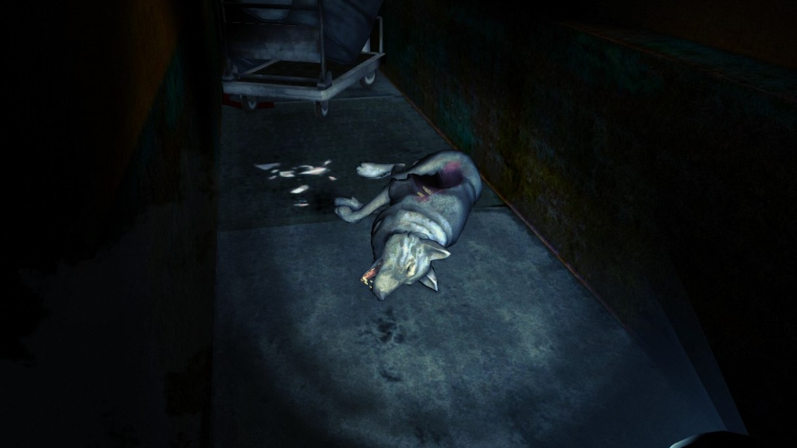_Fluffy in the story mode_

### Other Unique Wolves

[Desolation Point](./Desolation%20Point.md) inside the north-eastern [cave](./Cave%20%28Desolation%20Point%20location%29.md) near the waterfall has a unique wolf, along with with multiple deer carcasses and potentially a [frozen corpse](./Frozen%20Corpse.md). This wolf can be particularly effective at ambushing survivors, since the cave is dark and has numerous side tunnels and stalactites.

[Hushed River Valley](./Hushed%20River%20Valley.md) inside the southern [Ice Cave](./Ice%20Cave.md) (Note: Prior to the "Tales From The Far Territory" DLC (December 5, 2022) it was randomized (based on Save) which ice cavern this wolf spawned in). This wolf features multiple spawn points within the ice cave and can be difficult to avoid, especially if spawning in Hushed River Valley on Interloper mode.

The [Sundered Pass](./Sundered%20Pass.md) wing of the massive cavern which connects Sundered Pass, [Forsaken Airfield](./Forsaken%20Airfield.md) and [Zone of Contamination](./Zone%20of%20Contamination.md) in [The Far Territory](./Tales%20from%20the%20Far%20Territory.md). The wolf spawns in the circular chamber dominated with an ice stalactite, but may roam to any location within the wing between the indoors [rope climb](./Rope%20Climbing.md) and [rock climb](./Rock%20Climb.md).

### "Demon" Wolves

"Demon" Wolves were a Halloween-themed variant in "[4 Days of Night](./4%20Days%20of%20Night%20Event.md)" (4DON) a discontinued game mode from 2016-2019. They were distinct in having glowing red eyes and fleeing from survivors who consumed n [Pumpkin Pies](./Pumpkin%20Pie.md), but otherwise behaved like typical Wolves. When a Demon Wolf died their eyes lose the glow effect, making their appearance identical to regular wolves.

## Trivia

- The Wolf is based off the well known [Gray Wolf](https://en.wikipedia.org/wiki/Wolf) (**_Canis lupus_**), specifically the [Black Wolf](https://en.wikipedia.org/wiki/Black_wolf) a darkly color variant found rarely throughout the world most commonly in Southern Canada.
- Wolves are deadliest and most abundant in [Misery mode](./Misery.md). Stalker features wolves nearly as abundant (though less dangerous), and Interloper features wolves as deadly as Misery but less frequent.
- In-Game loading Screens sometimes feature an stylized 2D sprite of a wolf walking.
- The Wolf model, animation and AI rig have undergone numerous updates and overhauls since Early Access.

## Gallery

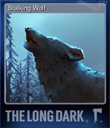

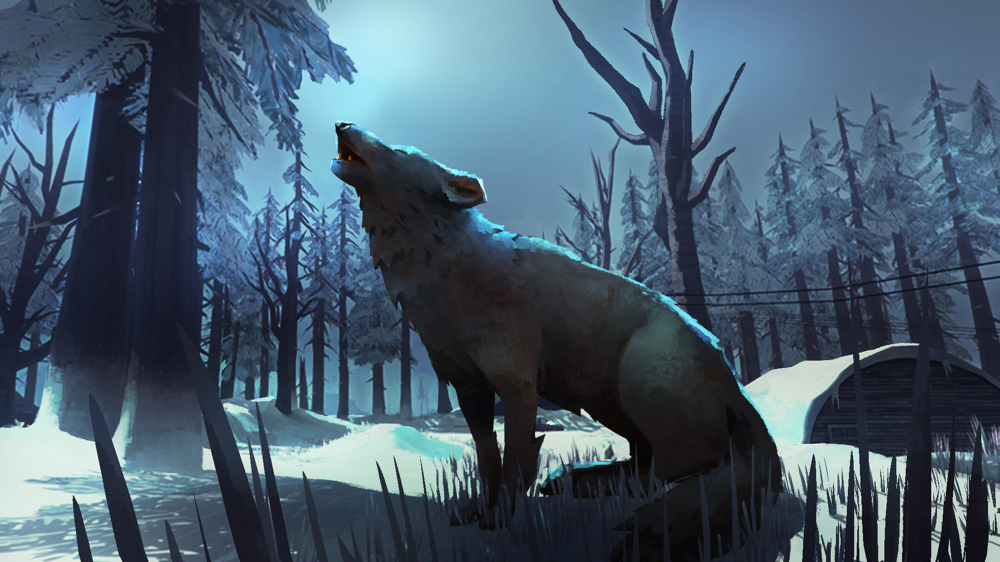

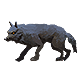

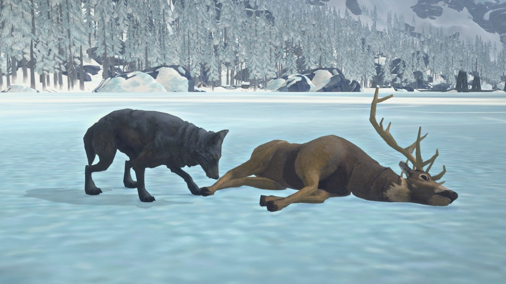

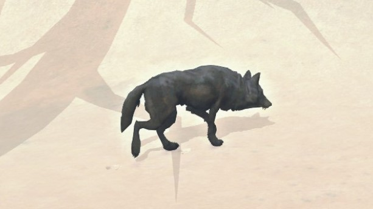

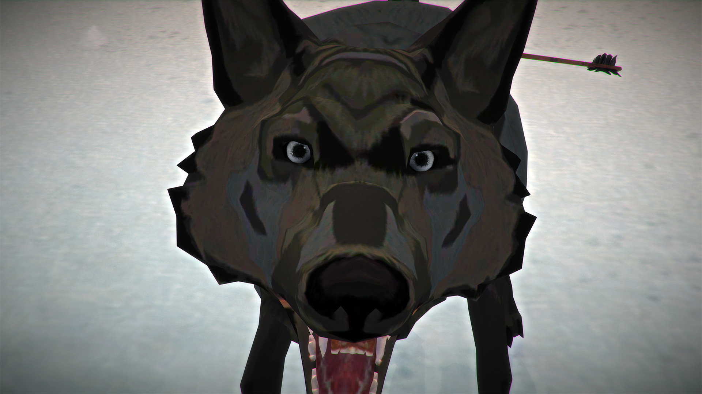

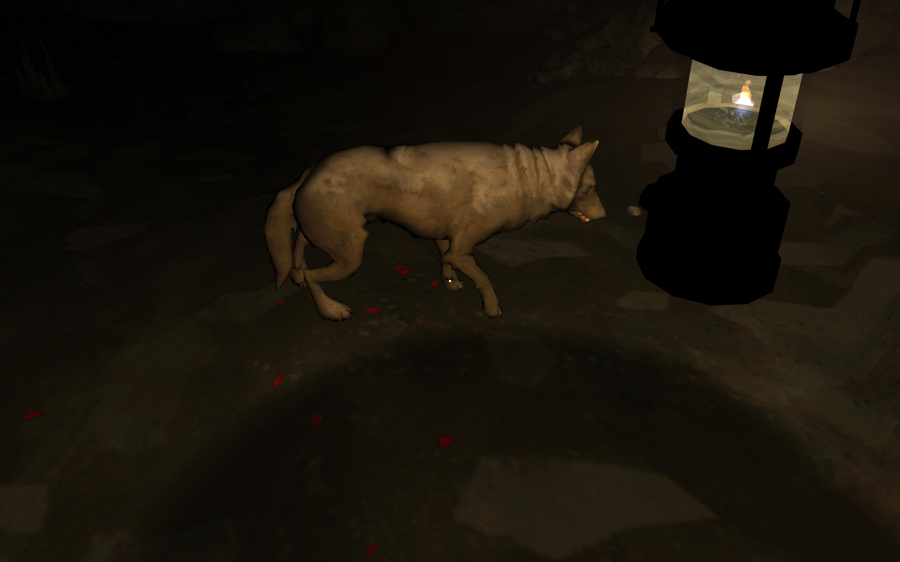

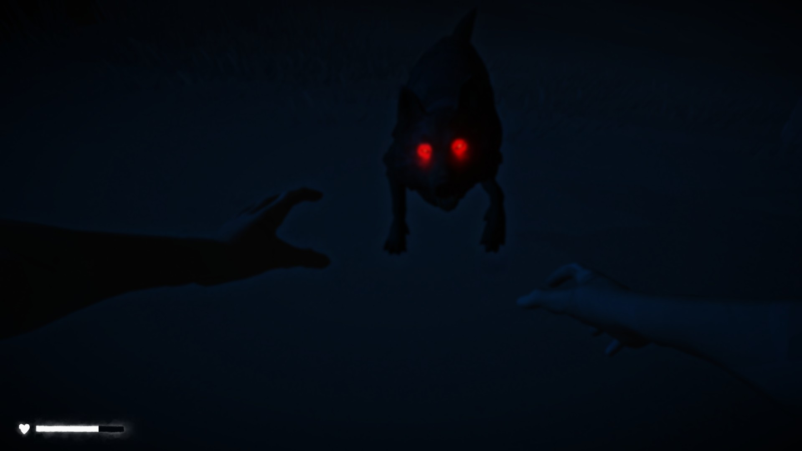

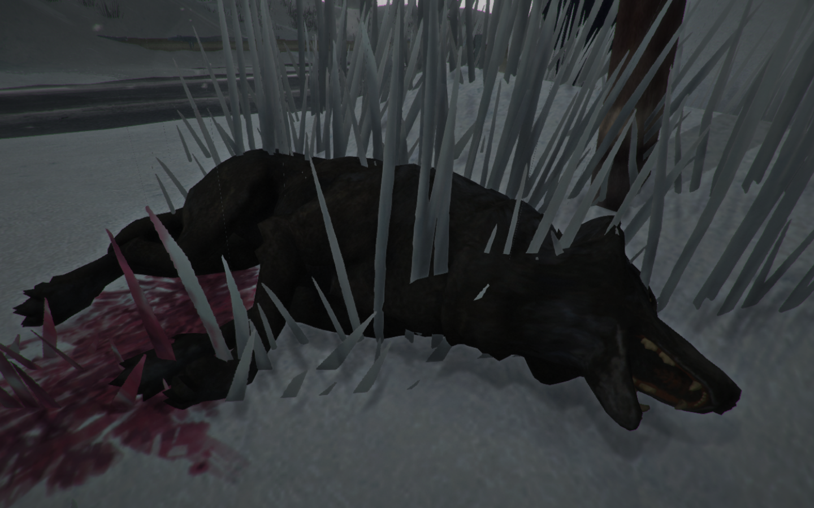

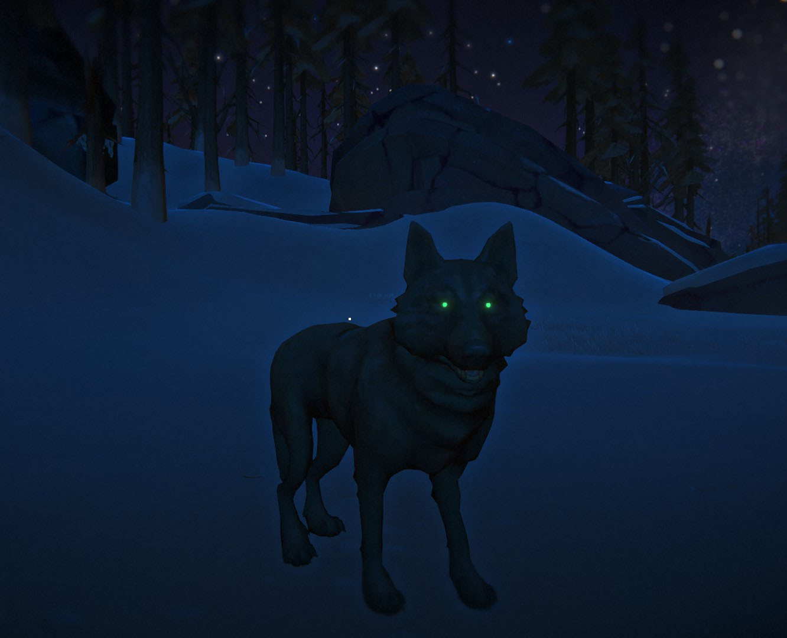

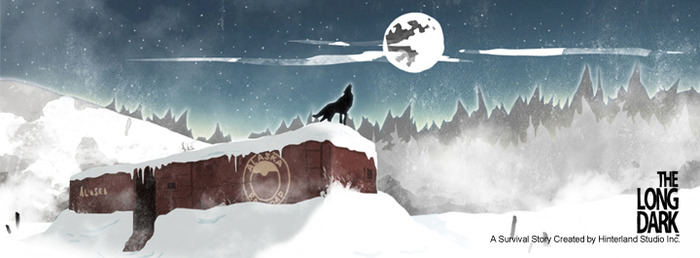

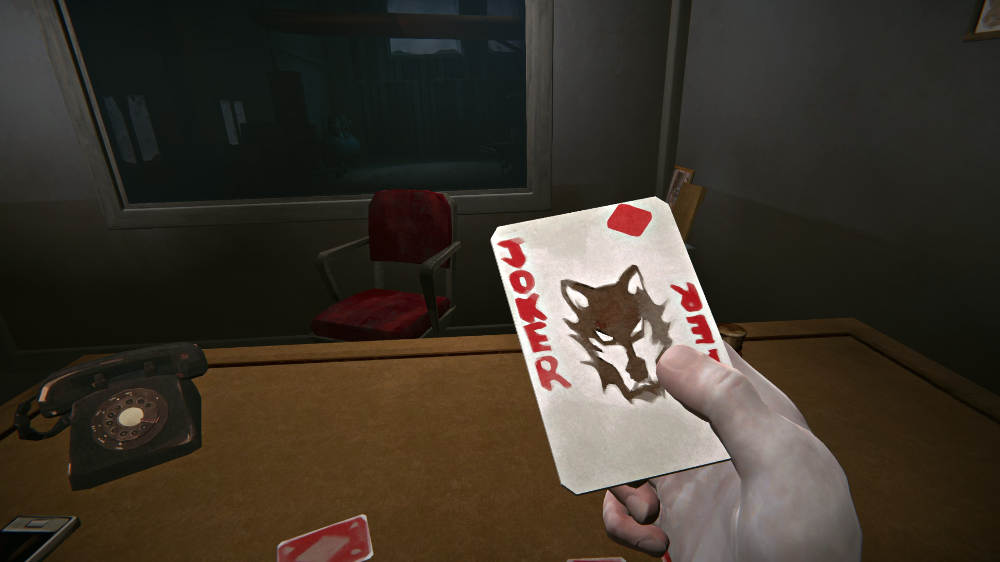

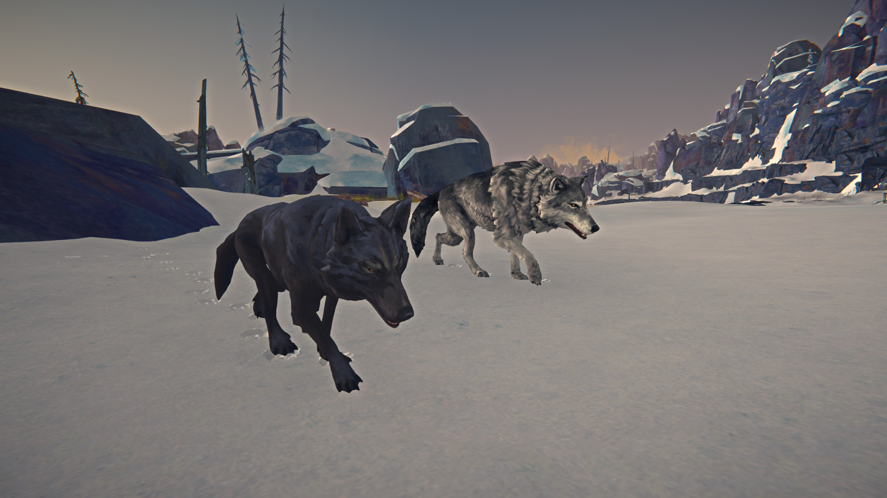

_A Wolf compared to a [Timberwolf](./Timberwolf.md)_

## Update history

- HOTFIX **20 January 2020 ([Update](./The%20Long%20Dark%20%E2%80%94%20Changelog%20%E2%80%94%20Archive%202.md#1-71)):**
  - [AI] Stags now animate correctly after being felled by a Wolf.
  - [AI] Polished Stag and Wolf animations and transitions.

- HOTFIX **30 October 2014 ([Update](./The%20Long%20Dark%20%E2%80%94%20Early%20Access%20Changelog.md#0-152)):**
  - All wildlife spawns are now more dynamic, and will change over the course of a game. Wolves, Deer, and Rabbits all refresh on different intervals, reflecting their relative mobility and travel/migration patterns.

- HOTFIX **2 October 2014 ([Update](./The%20Long%20Dark%20%E2%80%94%20Early%20Access%20Changelog.md#0-136)):**
  - Wolves no longer run from deer.

- HOTFIX **5 September 2014 ([Update](./The%20Long%20Dark%20%E2%80%94%20Early%20Access%20Changelog.md#0-103)):**
  - Wolf feeding animation alignment improved.
  - A Wolf Attack now results in Blood Loss and Infection Risk (vs. immediate Infection, as before). Infection Risk is reduced by applying Antiseptic. Wounds can become Infected up to 24 hours after they have been inflicted.

- HOTFIX **22 August 2014 ([Update](./The%20Long%20Dark%20%E2%80%94%20Early%20Access%20Changelog.md#0-094)):**
  - Wolves will now stop to feed on fresh Deer kill. The amount of meat that can be retrieved from a carcass is affected by how long a Wolf feeds on it.

- HOTFIX **13 August 2014 ([Update](./The%20Long%20Dark%20%E2%80%94%20Early%20Access%20Changelog.md#0-083)):**
  - Added new Wolf turning animations.
  - Complete overhaul of Wildlife Spawning system. Wildlife will now spawn only if there is valid population remaining per a 24-hour period. Fresh carcasses (ex. Wolf kill) will decay (due to predation and the elements). It is now possible for a spawn region to become depopulated.

- HOTFIX **31 July 2014 ([Update](./The%20Long%20Dark%20%E2%80%94%20Early%20Access%20Changelog.md#0-073)):**
  - Fixed problem with wolf sliding while playing its howl animation.
  - Wolf Struggle: Non-critical VO will not play during the struggle.
  - Wolves: Fixed some unreported issues related to wolf attacks interrupting gear inspection, eating, drinking, and fire starting.

- HOTFIX **9 July 2014 ([Update](./The%20Long%20Dark%20%E2%80%94%20Early%20Access%20Changelog.md)):**
  - Tuned the Wolf struggle to make it a bit more challenging.
  - Updated all Wolf spawn regions, and added new Wolf and Deer spawn regions to the world.
  - Added NoSpawn trigger zones around in-world locations that should be safe from Wolves. You will no longer wake up to a wolf attack in the Hunter’s Blind.

- HOTFIX **2 July 2014 ([Update](./The%20Long%20Dark%20%E2%80%94%20Early%20Access%20Changelog.md)):**
  - Updated the Wolf model (for real this time).
  - Significant overhaul of Wolf attack interactions. Added Struggle gameplay.

- HOTFIX **20 June 2014 ([Update](./The%20Long%20Dark%20%E2%80%94%20Early%20Access%20Changelog.md)):**
  - Updated the Wolf model.

- UPDATE **12 June 2014 ([Update](./The%20Long%20Dark%20%E2%80%94%20Early%20Access%20Changelog.md)):**
  - Added to game

## Notes

---

[^1]: If carcass is harvested
[^2]: If carcass is quartered.
