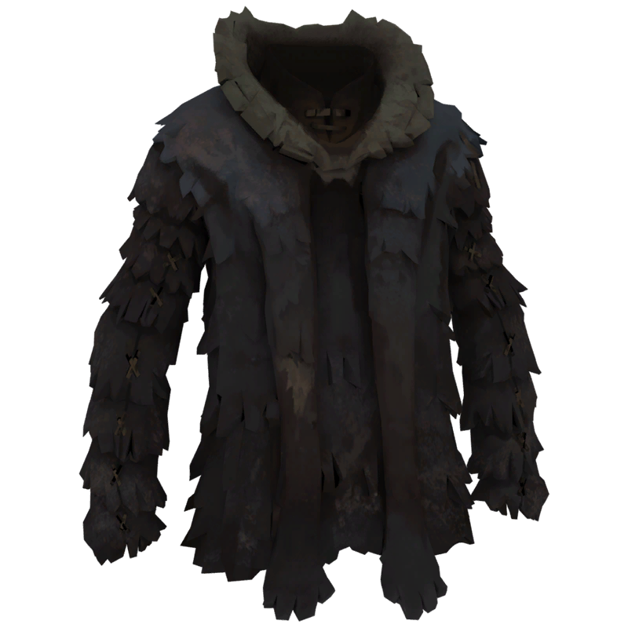

# Wolfskin Coat

**Contents**

- [Overview](#Overview)
- [Crafting](#Crafting)
- [Gallery](#Gallery)
- [Update history](#Update_history)

<table class="infobox">
<caption>Wolfskin Coat</caption>
<colgroup>
<col style="width: 50%" />
<col style="width: 50%" />
</colgroup>
<tbody>
<tr>
<td colspan="2"><figure>

<figcaption>Wolfskin_Coat_icon.png</figcaption>
</figure></td>
</tr>
<tr>
<td colspan="2" class="section">
<strong>General</strong>
</td>
</tr>
<tr>
<td>
Item Type
</td>
<td>
Clothing|-
</td>
</tr>
<tr>
<td colspan="2" class="section">
<strong>Statistics</strong>
</td>
</tr>
<tr>
<td>
Weight
</td>
<td>
3.00 kg(6.6 lbs)
</td>
</tr>
<tr>
<td>
Warmth bonus
</td>
<td>
4.0 °C(7.2 °F)
</td>
</tr>
<tr>
<td>
Windproof bonus
</td>
<td>
4.0 °C(7.2 °F)
</td>
</tr>
<tr>
<td>
Waterproof bonus
</td>
<td>
60%
</td>
</tr>
<tr>
<td>
Protection
</td>
<td>
12%
</td>
</tr>
<tr>
<td>
Mobility
</td>
<td>
-15%
</td>
</tr>
<tr>
<td>
Harvest
</td>
<td>
1 × <a href="./Cured%20Wolf%20Pelt.md" class="wikilink" title="Cured Wolf Pelt">Cured Wolf Pelt</a> 
90 minutes
</td>
</tr>
<tr>
<td>
Repair
</td>
<td>
1 × <a href="./Cured%20Wolf%20Pelt.md" class="wikilink" title="Cured Wolf Pelt">Cured Wolf Pelt</a>, 
1 × <a href="./Cured%20Gut.md" class="wikilink" title="Cured Gut">Cured Gut</a> 
120 minutes 
30% condition
</td>
</tr>
</tbody>
</table>

<table>
<colgroup>
<col style="width: 33%" />
<col style="width: 33%" />
<col style="width: 33%" />
</colgroup>
<tbody>
<tr>
<td style="vertical-align: top; font-size: 3em; color: #5d5980; padding-right: 10px">
“
</td>
<td>
Handcrafted fur and skin outer layer will keep you warm and remind Wolves that they should keep their distance. Not the way the Wolf expected to end up.

&#10;

In-game description

</td>
<td style="vertical-align: bottom; font-size: 3em; color: #5d5980; padding-left: 10px">
”
</td>
</tr>
</tbody>
</table>

The **Wolfskin Coat** is a type of craftable clothing in *The Long Dark*.

## Overview

Wolfskin Coats have high warmth, windproof, protection, waterproof and durability along with a chance to frighten nearby wolves when worn; however they also have relatively high weight and mobility penalty. They are comparable in stats to the rare <a href="./Expedition%20Parka.md" class="wikilink" title="Expedition Parka">Expedition Parka</a>, but can be crafted making them more accessible (such as on Interloper, where parkas cannot spawn). It is produced from cured wolf pelts.

When worn (in either clothing slot) the Wolfskin Coat has a chance to scare nearby <a href="./Wolf.md" class="wikilink" title="wolves">wolves</a> when they detect the player, (like on Pilgrim). Be careful, because if a wolf that was scared away returns to their area and the player is still there, it is reported they cannot be scared a second time - this information, if true, also proves that the effect stacks in some way when two coats are worn, as the same wolf can be frightened twice with no bear or moose gear in inventory and no such animals spawning in that area when wearing two coats. Further testing is required, and while that shows the ability to roll twice, it does not prove that the chances are doubled for the first roll. Please conduct and report testing here, if able.

The coat is the third-warmest torso clothing (after <a href="./Bearskin%20Coat.md" class="wikilink" title="Bearskin Coat">Bearskin Coat</a> and Expedition Parka). Its protection is much higher than that of any non-craftable outer torso options, but is less than that of <a href="./Moose-Hide%20Cloak.md" class="wikilink" title="Moose-Hide Cloak">Moose-Hide Cloak</a> or the Bearskin Coat. A strategy is to wear a wolfskin coat as the outer layer (left), and a lighter, warmth focused jacket on the inner layer (windproof and protection of inner clothing items are disregarded). As with other crafted clothing the wolfskin coat is repairable with renewable resources, making it a useful endgame item.

Since <a href="./Wolf.md" class="wikilink" title="wolves">wolves</a> are less dangerous than <a href="./Bear.md" class="wikilink" title="bear">bears</a> or <a href="./Moose.md" class="wikilink" title="moose">moose</a>, and are more common, the wolfskin coat can be acquired with arguably less risk, and possibly earlier in the game. Crafting the coat will likely require hunting wolves or killing them in a struggle since there are few naturally spawning <a href="./Wolf%20Carcass.md" class="wikilink" title="wolf carcasses">wolf carcasses</a>. In fact, the only <a href="./Region.md" class="wikilink" title="region">regions</a> in which a naturally spawned wolf carcass may be found are the <a href="./Hushed%20River%20Valley.md" class="wikilink" title="Hushed River Valley">Hushed River Valley</a> (up to four), <a href="./Mountain%20Town.md" class="wikilink" title="Mountain Town">Mountain Town</a> (up to one), <a href="./Broken%20Railroad.md" class="wikilink" title="Broken Railroad">Broken Railroad</a> (one), <a href="./Bleak%20Inlet.md" class="wikilink" title="Bleak Inlet">Bleak Inlet</a> (one), <a href="./Ash%20Canyon.md" class="wikilink" title="Ash Canyon">Ash Canyon</a> (up to one), <a href="./Pleasant%20Valley.md" class="wikilink" title="Pleasant Valley">Pleasant Valley</a> (up to two), and <a href="./Zone%20of%20Contamination.md" class="wikilink" title="Zone of Contamination">Zone of Contamination</a> (three). 2 cured wolf pelts may spawn in a cargo container in the tail section of the crashed plane on the Timberwolf Mountain summit.

In <a href="./Wintermute.md" class="wikilink" title="Wintermute">Wintermute</a>, its blueprint is unlocked by preserving nature's balance in the <a href="./Survival%20School.md" class="wikilink" title="Survival School">Survival School</a> quest.

## Crafting

<table class="infobox">
<caption>Wolfskin Coat</caption>
<tbody>
<tr>
<td colspan="2">
-
</td>
</tr>
<tr>
<td colspan="2">
-
</td>
</tr>
<tr>
<td colspan="2">
1500 minutes (25 hour 0 minutes)
</td>
</tr>
<tr>
<td colspan="2" class="section">
<strong>Requirements</strong>
</td>
</tr>
<tr>
<td>
Facility
</td>
<td>
<strong>Template:iconlink</strong>
</td>
</tr>
<tr>
<td>
Tool
</td>
<td>
<strong>Template:iconlink</strong>
</td>
</tr>
<tr>
<td colspan="2" class="section">
<strong>Materials</strong>
</td>
</tr>
<tr>
<td colspan="2" class="section">
<strong>Template:iconlink plain</strong>
</td>
</tr>
<tr>
<td>
Item
</td>
<td>
<a href="./Cured%20Wolf%20Pelt.md" class="wikilink" title="Cured Wolf Pelt">Cured Wolf Pelt</a>
</td>
</tr>
<tr>
<td>
Quantity
</td>
<td>
4
</td>
</tr>
<tr>
<td colspan="2" class="section">
<strong>Template:iconlink plain</strong>
</td>
</tr>
<tr>
<td colspan="2">
<a href="./Cured%20Gut.md" class="wikilink" title="Cured Gut">Cured Gut</a>
</td>
</tr>
<tr>
<td colspan="2">
4
</td>
</tr>
</tbody>
</table>

## Gallery

<table class="gallery">
<colgroup>
<col style="width: 33%" />
<col style="width: 33%" />
<col style="width: 33%" />
</colgroup>
<tbody>
<tr>
<td><figure>

<figcaption>Clothing model icon</figcaption>
</figure></td>
<td><figure>

<figcaption>Clothing model icon damaged</figcaption>
</figure></td>
<td><figure>
[Missing image: Wolfskin_Coat_-_back.png]
<figcaption>Old model.</figcaption>
</figure></td>
</tr>
</tbody>
</table>

## Update history

- UPDATE **17 December 2014 (<a href="./The%20Long%20Dark%20%E2%80%94%20Early%20Access%20Changelog.md#0.181" class="wikilink" title="Update">Update</a>):**
  - Added to game

**Lua execution error in Module:Navbox function navbox** <a href="ru:%D0%92%D0%BE%D0%BB%D1%87%D1%8C%D1%8F_%D1%88%D1%83%D0%B1%D0%B0" class="wikilink" title="ru:Волчья шуба">ru:Волчья шуба</a>

