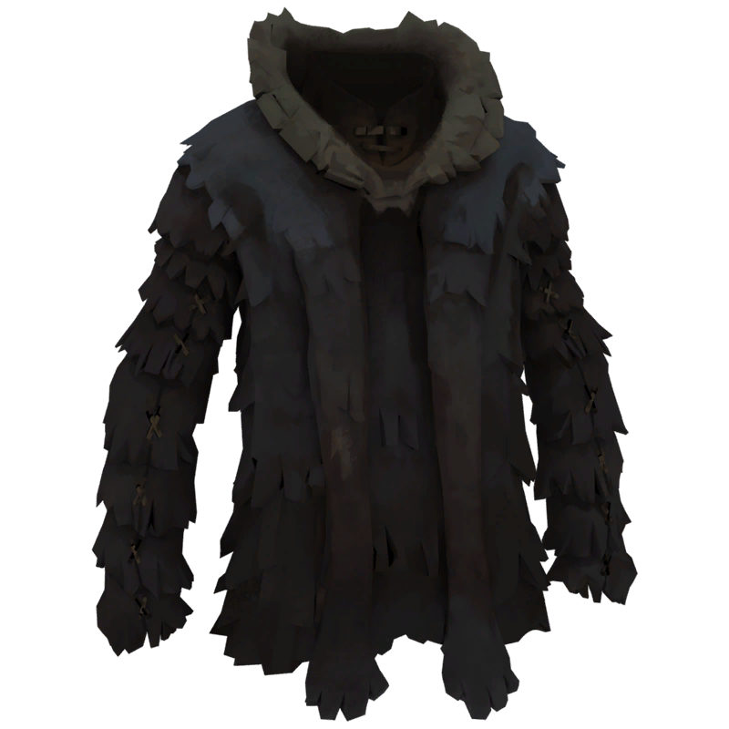

# Wolfskin Coat

**Categories:** Clothing, Craftable clothing, Pages with update history, Story items · **Source:** [Fandom](https://thelongdark.fandom.com/wiki/Wolfskin_Coat)

**Contents**

- [Overview](#overview)
- [Crafting](#crafting)
- [Gallery](#gallery)
- [Update history](#update-history)

**Wolfskin Coat**

[Wolfskin Coat icon](../assets/Wolfskin_Coat_icon.png)

**General**

**Item Type:** Clothing

**Statistics**

**Weight:** [Weight icon](../assets/Weight_icon.png)3.00 kg(6.6 lbs)

**Warmth bonus:** [Temp icon](../assets/Temp_icon.png)4.0 °C(7.2 °F)

**Windproof bonus:** [Windproofness icon](../assets/Windproofness_icon.png)4.0 °C(7.2 °F)

**Waterproof bonus:** [Waterproofness icon](../assets/Waterproofness_icon.png)60%

**Protection:** [Protection icon](../assets/Protection_icon.png)12%

**Mobility:** [Mobility icon](../assets/Mobility_icon.png)-15%

**Harvest:** 1 × [Cured Wolf Pelt](./Cured%20Wolf%20Pelt.md) 90 minutes

**Repair:** 1 × [Cured Wolf Pelt](./Cured%20Wolf%20Pelt.md), 1 × [Cured Gut](./Cured%20Gut.md) 120 minutes 30% condition

> “**Handcrafted fur and skin outer layer will keep you warm and remind Wolves that they should keep their distance. Not the way the Wolf expected to end up.**”
>
> — In-game description

The **Wolfskin Coat** is a type of craftable clothing in _The Long Dark_.

<!-- #Overview -->
​

<!-- #overview -->
## Overview

Wolfskin Coats have high warmth, windproof, protection, waterproof and durability along with a chance to frighten nearby wolves when worn; however they also have relatively high weight and mobility penalty. They are comparable in stats to the rare [Expedition Parka](./Expedition%20Parka.md), but can be crafted making them more accessible (such as on Interloper, where parkas cannot spawn). It is produced from cured wolf pelts.

When worn (in either clothing slot) the Wolfskin Coat has a chance to scare nearby [wolves](./Wolf.md) when they detect the player, (like on Pilgrim). Be careful, because if a wolf that was scared away returns to their area and the player is still there, it is reported they cannot be scared a second time - this information, if true, also proves that the effect stacks in some way when two coats are worn, as the same wolf can be frightened twice with no bear or moose gear in inventory and no such animals spawning in that area when wearing two coats. Further testing is required, and while that shows the ability to roll twice, it does not prove that the chances are doubled for the first roll. Please conduct and report testing here, if able.

The coat is the third-warmest torso clothing (after [Bearskin Coat](./Bearskin%20Coat.md) and Expedition Parka). Its protection is much higher than that of any non-craftable outer torso options, but is less than that of [Moose-Hide Cloak](./Moose-Hide%20Cloak.md) or the Bearskin Coat. A strategy is to wear a wolfskin coat as the outer layer (left), and a lighter, warmth focused jacket on the inner layer (windproof and protection of inner clothing items are disregarded). As with other crafted clothing the wolfskin coat is repairable with renewable resources, making it a useful endgame item.

Since [wolves](./Wolf.md) are less dangerous than [bears](./Bear.md) or [moose](./Moose.md), and are more common, the wolfskin coat can be acquired with arguably less risk, and possibly earlier in the game. Crafting the coat will likely require hunting wolves or killing them in a struggle since there are few naturally spawning [wolf carcasses](./Wolf%20Carcass.md). In fact, the only [regions](./Region.md) in which a naturally spawned wolf carcass may be found are the [Hushed River Valley](./Hushed%20River%20Valley.md) (up to four), [Mountain Town](./Mountain%20Town.md) (up to one), [Broken Railroad](./Broken%20Railroad.md) (one), [Bleak Inlet](./Bleak%20Inlet.md) (one), [Ash Canyon](./Ash%20Canyon.md) (up to one), [Pleasant Valley](./Pleasant%20Valley.md) (up to two), and [Zone of Contamination](./Zone%20of%20Contamination.md) (three). 2 cured wolf pelts may spawn in a cargo container in the tail section of the crashed plane on the Timberwolf Mountain summit.

In [Wintermute](./Wintermute.md), its blueprint is unlocked by preserving nature's balance in the [Survival School](./Survival%20School.md) quest.

<!-- #Crafting -->
​

<!-- #crafting -->
## Crafting

**Wolfskin Coat**

1500 minutes (25 hour 0 minutes)

[Cured Gut](./Cured%20Gut.md)

4

**Requirements**

**Item:** [Cured Wolf Pelt](./Cured%20Wolf%20Pelt.md)

**Quantity:** 4

<!-- #Gallery -->
​

<!-- #gallery -->
## Gallery

<!-- #update_history -->
​

<!-- #Update_history -->
​

<!-- #Update_History -->
​

<!-- #update-history -->
## Update history

- UPDATE **17 December 2014 ([Update](./The%20Long%20Dark%20%E2%80%94%20Early%20Access%20Changelog.md#0.181)):**
  - Added to game
