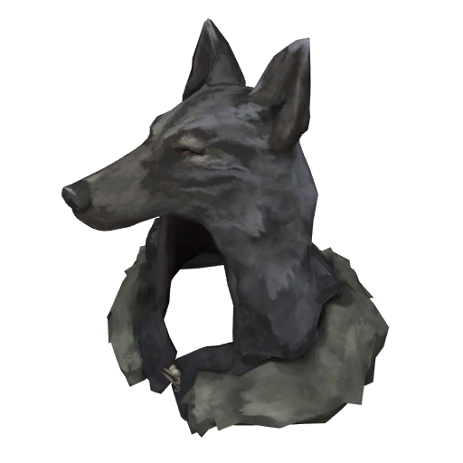
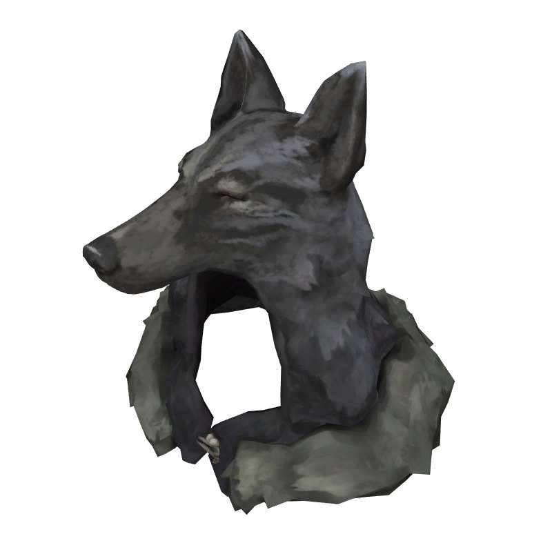
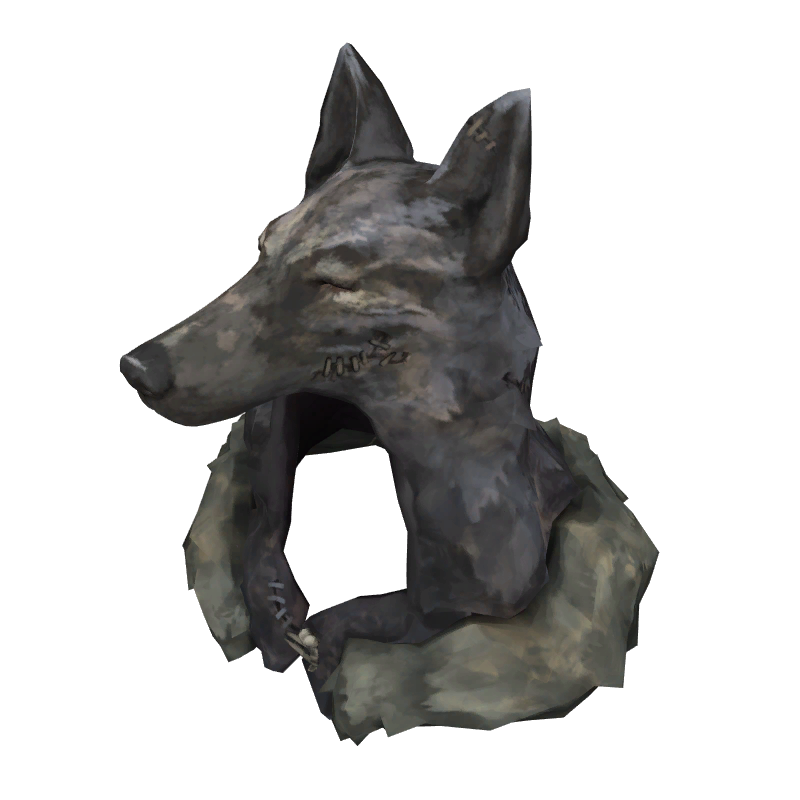

# Wolfskin Hat

**Categories:** Clothing, Craftable clothing, DLC Content · **Source:** [Fandom](https://thelongdark.fandom.com/wiki/Wolfskin_Hat)

**Contents**

- [Overview](#overview)
- [Crafting](#crafting)
- [Gallery](#gallery)
- [Trivia](#trivia)
- [Update history](#update-history)

**Wolfskin Hat**

| Property | Details |
| --- | --- |
|  |  / _Wolfskin\_Hat\_icon.png_ |
| **General** |  |
| Item Type | Clothing\|- |
| Clothing Slot | Head |
| **Statistics** |  |
| Weight | 1.00 kg(2.2 lbs) |
| Warmth bonus | 3.0 °C(5.4 °F) |
| Windproof bonus | 2.0 °C(3.6 °F) |
| Waterproof bonus | 30% |
| Protection | 4% |
| Mobility | 0% |
| Harvest | 1 × [Cured Wolf Pelt](./Cured%20Wolf%20Pelt.md) / 20 minutes |
| Repair | 1 × [Cured Wolf Pelt](./Cured%20Wolf%20Pelt.md) / 125 minutes / 50% condition |

> “__A head covering crafted from a Wolf hide. Warm and imposing headgear.__”
>
> — In-game description

| Column 1 | Column 2 | Column 3 |
| --- | --- | --- |

| - |  |  |
| - |  |  |
| 1000 minutes (16 hour 40 minutes) |  |  |
| **Requirements** |  |  |
| Facility | **Template:iconlink** |  |
| Tool | **Template:iconlink** |  |
| **Materials** |  |  |
| **Template:iconlink plain** |  |  |
| Item | [Cured Wolf Pelt](./Cured%20Wolf%20Pelt.md) |  |
| Quantity | 1 |  |
| **Template:iconlink plain** |  |  |
| [Cured Gut](./Cured%20Gut.md) |  |  |
| 2 |  |  |
|  / _3d model_ |  / _3d model damaged_ |  |
