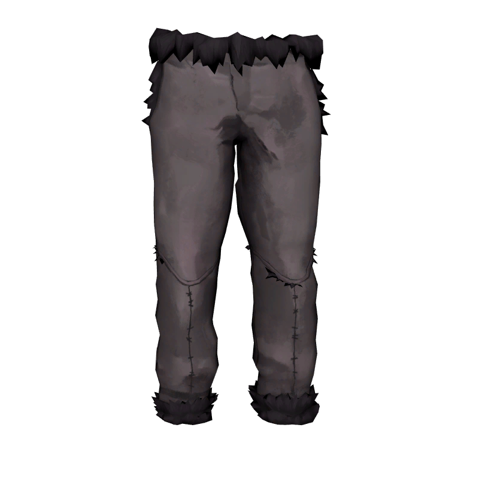
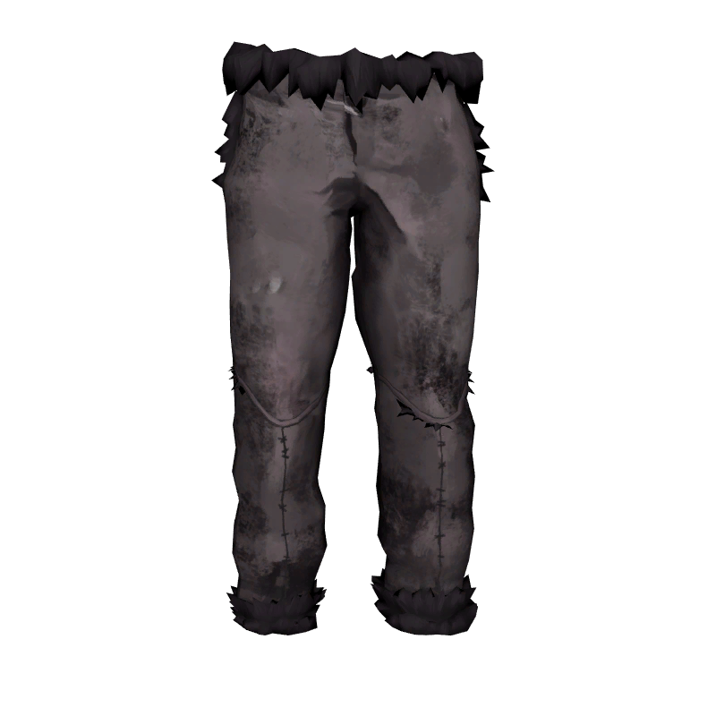

# Wolfskin Pants

**Categories:** Clothing, Craftable clothing, DLC Content · **Source:** [Fandom](https://thelongdark.fandom.com/wiki/Wolfskin_Pants)

**Contents**

- [Overview](#overview)
- [Crafting](#crafting)
- [Gallery](#gallery)
- [Update history](#update-history)

**Wolfskin Pants**

[Wolfskin Pants icon](../assets/Wolfskin_Pants_icon.png)

**General**

**Item Type:** Clothing

Clothing Slot

**Statistics**

**Weight:** [Weight icon](../assets/Weight_icon.png)2.50 kg(5.5 lbs)

**Warmth bonus:** [Temp icon](../assets/Temp_icon.png)3.0 °C(5.4 °F)

**Windproof bonus:** [Windproofness icon](../assets/Windproofness_icon.png)1.5 °C(2.7 °F)

**Waterproof bonus:** [Waterproofness icon](../assets/Waterproofness_icon.png)50%

**Protection:** [Protection icon](../assets/Protection_icon.png)10%

**Mobility:** [Mobility icon](../assets/Mobility_icon.png)-5%

**Harvest:** 1 × [Cured Wolf Pelt](./Cured%20Wolf%20Pelt.md) 40 minutes

**Repair:** 1 × [Cured Wolf Pelt](./Cured%20Wolf%20Pelt.md), 1 × [Cured Gut](./Cured%20Gut.md) 125 minutes 50% condition

[Ptarmigan icon](../assets/Ptarmigan_icon.png)

**DLC-Exclusive content.** This content requires the [Tales from the Far Territory](./Tales%20from%20the%20Far%20Territory.md) addon to be installed before it can be seen or used in regular gameplay.

“

**Pants crafted from a Wolf hide. Warm and extremely durable.** In-game description

”

The **Wolfskin Pants** is an article of [Clothing](./Clothing.md) that can be [Crafted](./Crafting.md) in _[The Long Dark](./The%20Long%20Dark.md)_.

## Overview

The Blueprint for crafting these pants must first be obtained by trading for the [Wolfskin Pants Blueprint Card](./Wolfskin%20Pants%20Blueprint%20Card.md) from the [Trader](./Trader.md).

They are the warmest pants in the game, tied for total warmth with [Snow Pants](./Snow%20Pants.md) (+0.5C warmth, -0.5C windproof).

They are also more effective than other pants when wet, due to having higher warmth rather than windproofing.

They are warmer and heavier than the [Deerskin Pants](./Deerskin%20Pants.md), and are most useful on [Interloper](./Interloper.md) or [Misery](./Misery.md) given that they outperform [Deerskin pants](./Deerskin%20Pants.md) for warmth, and [Snow Pants](./Snow%20Pants.md) do not spawn.

## Crafting

**Wolfskin Pants**

1750 minutes (29 hour 10 minutes)

[Cured Gut](./Cured%20Gut.md)

3

**Requirements**

**Item:** [Cured Wolf Pelt](./Cured%20Wolf%20Pelt.md)

**Quantity:** 4

## Gallery

## Update history
