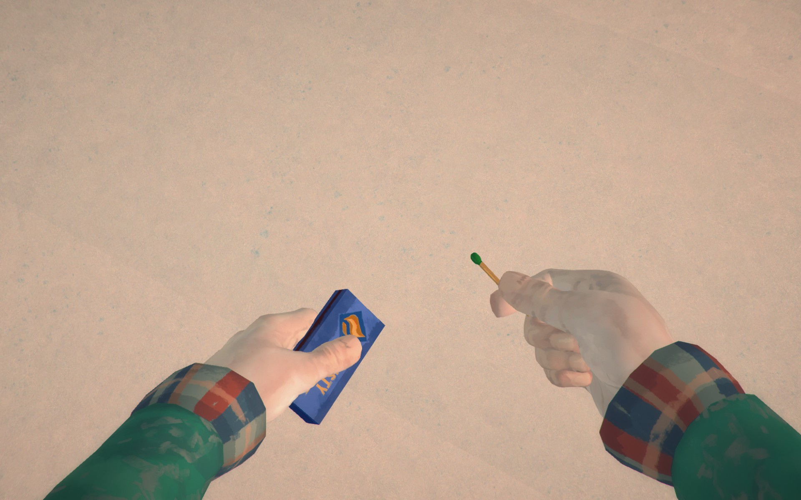
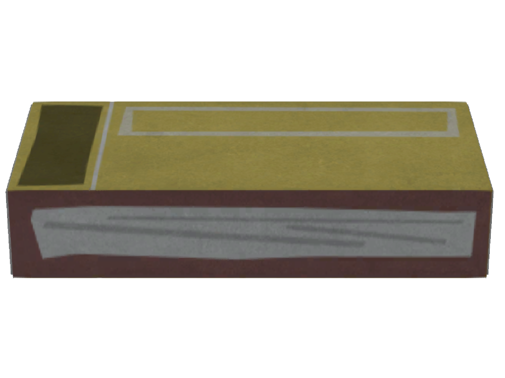
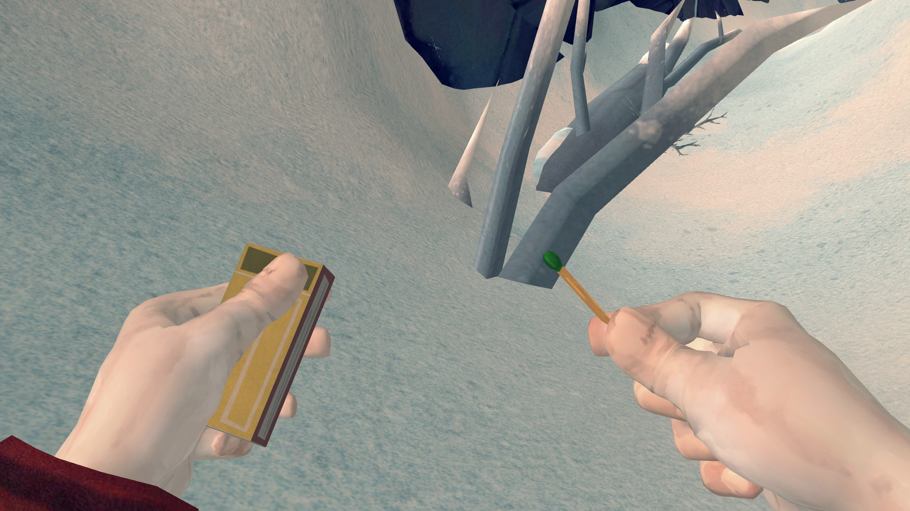

# Wood Matches

**Contents**

- [Overview](#overview)
- [Tips](#tips)
- [Trivia](#trivia)
- [Gallery](#gallery)

**Wood Matches**

| Property | Details |
| --- | --- |
|  |  / *Wood\_Matches\_icon.png* |
| **General** |  |
| Item Type | Fire Starting\|- |
| Renewable | Yes |
| Firestarting Slot | Starter |
| **Statistics** |  |
| Weight | 0.008 kg(0.02 lbs) |
| Bonus chance | +5% |
| Unit count | 12match |

> “**Wooden strike-anywhere matches.**”
>
> — In-game description

**Wood Matches** are a [Fire Starting](./Fire%20Starting.md) Tools and a small light source in *The Long Dark*.

## Overview

Each match weighs a mere 0.008 of a kilogram, but there are always 12 found together in one box. Using a wood match increases the base chance of successfully lighting a fire by five percent.

Light sources are equipped with the '1' key by default. Hold the left mouse button to strike the match for a small light source that lasts for a few seconds. While a lit match is held, your "Feels Like" temperature will rise by a few degrees. Sadly, such a small fire will not deter [Wolves](./Wolf.md).

Lighting a match will cause the survivor to hold it closely in their hand, where it will create light for 13 seconds until the fire travels down the stem and reaches the survivor's fingers, where they drop it in pain. Running with a lit match will cause the flame to grow brighter, causing it to burn out faster.

Pressing H with a lit match will cause the survivor to flick the match into the distance, where it disappears and the light is extinguished.

## Tips

- [Firestrikers](./Firestriker.md) and Wood Matches are preferable to [Cardboard Matches](./Cardboard%20Matches.md) at low firestarting skill. This will likely save matches from failed fires, thanks to the firestrikers higher Bonus Chance.
- Using a lit [Torch](./Torch.md) to start campfires is an effective way to save matches/firestriker durability.
- New matches can be acquired from [Beachcombing](./Beachcombing.md) or from the [Trader](./Trader.md) (even on [Interloper](./Interloper.md)).

## Trivia

- Wood Matches are branded as the product "*Trusty Matches"*.
- Despite being contained inside a cardboard box, no tinder is given or harvestable when wooden matches are used up unlike cardboard boxes present across [Great Bear Island](./Great%20Bear%20Island.md).
- If a player lights a match and holds onto it for too long, the match will burn their fingers, but will not result in any condition loss
- When dropped on the ground, the box appears upside-down, obscuring the logo.

## Gallery

| Column 1 | Column 2 | Column 3 |
| --- | --- | --- |
|  / *Wood matches' viewmodel* |  / *old model* |  / *Pre Alpha model* |

**Lua execution error in Module:Navbox function navbox** [ru:Деревянные спички](ru:%D0%94%D0%B5%D1%80%D0%B5%D0%B2%D1%8F%D0%BD%D0%BD%D1%8B%D0%B5_%D1%81%D0%BF%D0%B8%D1%87%D0%BA%D0%B8)
