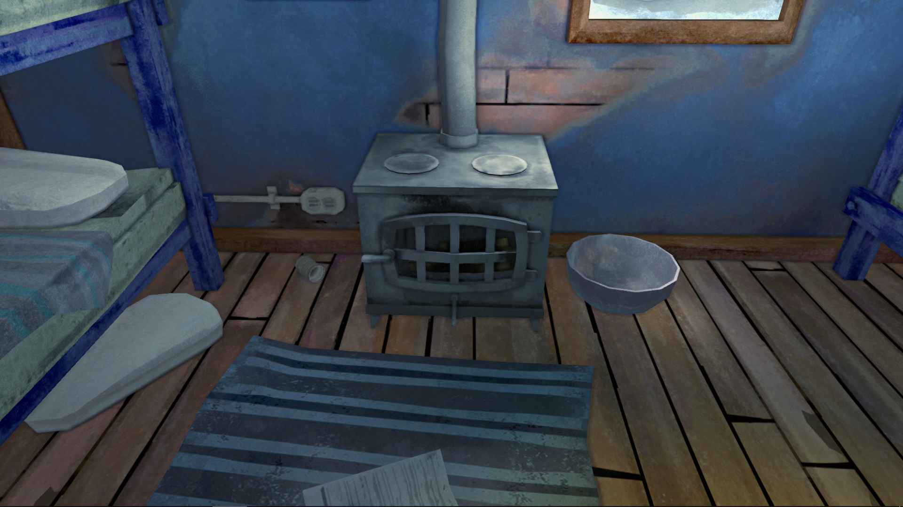

# Wood Stove

**Wood Stove**

| Property | Details |
| --- | --- |
|  |  / *Wood\_stove.png* |
| **General** |  |
| Type | Fire Starting\|- |
| Max temperature | 80 °C / *(144 °F)* |
| Cooking slots | 2 |

A **Wood Stove** is an immovable [contained fire](./Fire.md#Contained_fires). The wood stove functions identically to other contained fires and player-made [campfire](./Campfire.md). The wood stove provides no advantage over other contained fires, but it does allow protection against wind, unlike the player-made campfire. It has two [cooking](./Cooking.md) slots.

The wood stove can be re-lit indefinitely, though it requires fresh starter, tinder, and fuel each time.

## Location

Wood stoves have fixed locations that do not change between games. They are found in many indoor locations in *The Long Dark*, including houses, trailers, and huts.

**Lua execution error in Module:Navbox function navbox** **Lua execution error in Module:Navbox function navbox** [ru:Печь для дров](ru:%D0%9F%D0%B5%D1%87%D1%8C_%D0%B4%D0%BB%D1%8F_%D0%B4%D1%80%D0%BE%D0%B2)
