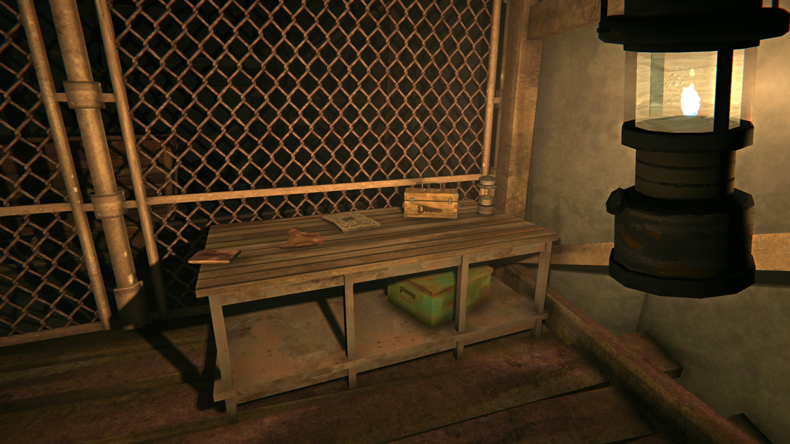
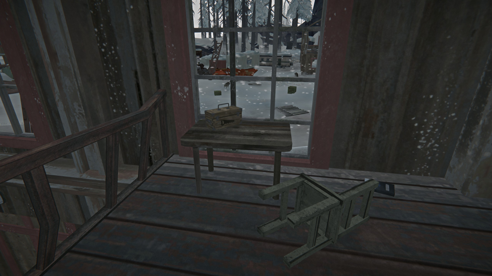
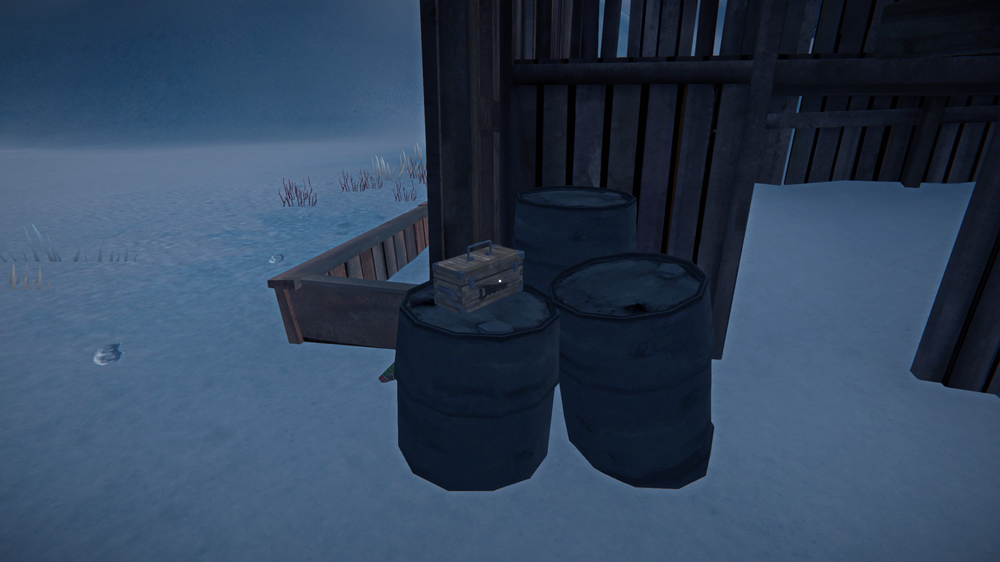

# Woodworking Tools

**Categories:** Tools · **Source:** [Fandom](https://thelongdark.fandom.com/wiki/Woodworking_Tools)

**Contents**

- [Overview](#overview)
- [Locations](#locations)
- [Bleak Inlet](#bleak-inlet)
- [Ash Canyon](#ash-canyon)
- [Zone of Contamination](#zone-of-contamination)
- [Gallery](#gallery)
- [Game History](#game-history)

**Woodworking Tools**

[Woodworking Tools icon](../assets/Woodworking_Tools_icon.png)

**Release:** [TFTFT Part 6 Broken Silence](./The%20Long%20Dark%20%E2%80%94%20Changelog.md#2.33)

**Properties**

**Item type:** [Tools](./Tools.md)

**Values**

**Weight:** 1.50 kg (3.3 lbs)

**Actions**

**Backpack:** Examine, Drop, Pick up

**Woodworking Tools** is a tool used to craft furniture for the [Safehouse Customization](./Safehouse%20Customization.md) feature.

## Overview

An already rare item on Great Bear Island, finding a set of Woodworking Tools is invaluable if the player expects to heavily invest in crafting furniture. They should be carried everywhere due to their rarity if the player wishes to create multiple safehouses with furniture.

All items at a [Furniture Workbench](./Furniture%20Workbench.md) require these tools to craft various [Decorations](./Decorations.md) for Safehouses (including the creation of the Workbench itself).

They are needed to create the powerful [Meat Curing Box](./Meat%20Curing%20Box.md), useful for storing large amounts of meat over long periods of time, and the [Work Bench](./Work%20Bench.md), making using one more convenient, albeit at a cost of a pre-existing one.

Despite having Condition, Woodworking Tools do not [Decay](./Decay.md) when used.

## Locations

These tools are a very rare find, with only 4 appearing on the whole island in the following set locations.

### [Bleak Inlet](./Bleak%20Inlet.md)

- [Last Resort Cannery](./Last%20Resort%20Cannery.md), in the second building of the "Rope Climbing obstacle course." After crossing The Harbinger (moored trawler), walk across the pier into the second building. The tools are on the upper floor across the damaged catwalk, on a table.

### [Ash Canyon](./Ash%20Canyon.md)

- In the shed at [Miner's Folly](./Miner%27s%20Folly.md).

### [Zone of Contamination](./Zone%20of%20Contamination.md)

- Sixth Floor, [Concentrator](./Concentrator.md): the floor that leads to the mountain entrance to the [Langston Mine](./Langston%20Mine.md) has a table with tools, near the main ramp leading back down to the First Floor.
- Mountain entrance, Langston Mine: in the storage area at the entrance (requires obtaining the [Mine Gate Key](./Mine%20Gate%20Key.md) to unlock as part of [Buried Echoes](./Buried%20Echoes.md)). On the table with [Security Chief's Log 32](./Security%20Chief%27s%20Log%2032.md).

## Gallery

## Game History
