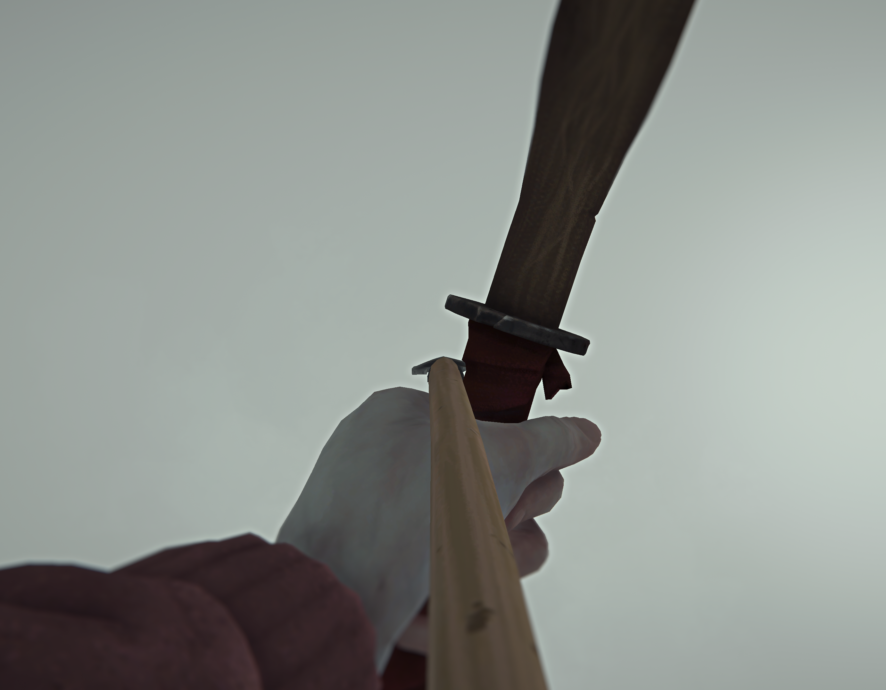
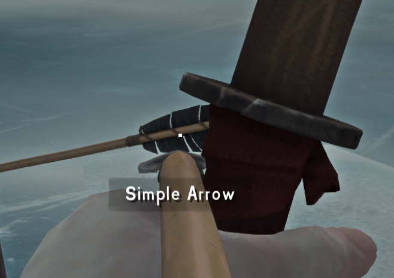

# Woodwright's Bow

**Categories:** DLC Content, Pages with update history, Tools · **Source:** [Fandom](https://thelongdark.fandom.com/wiki/Woodwright's_Bow)

**Contents**

- [Overview](#overview)
- [Differences from Survival Bow](#differences-from-survival-bow)
- [Locations](#locations)
- [Tips](#tips)
- [Gallery](#gallery)
- [Update history](#update-history)

_Ptarmigan\_icon.png_

**DLC-Exclusive content.** / This content requires the [Tales from the Far Territory](./Tales%20from%20the%20Far%20Territory.md) addon to be installed before it can be seen or used in regular gameplay.

_Woodwright's\_Bow\_icon.png_

**Release:** [5 December 2022](./The%20Long%20Dark%20%E2%80%94%20Changelog.md#2.03)

**Wintermute:** No

**Properties**

**Item type:** [Tools](./Tools.md)

**Stackable:** No

**Examine:** Crafted at a master's Work Bench. Every shape and angle reflects a careful and knowing touch. / A more durable and agile Survival Bow.

**Values**

**Weight:** 0.75 kg (1.65 lbs)

**Actions**

**Backpack:** Use, Drop

**On ground:** Take It, Equip It, Leave It

**Advanced data**

**Item key:** GAMEPLAY\_Bow\_Woodwrights

_The Woodright's bow as seen in the survivors hands._

_The Woodright's bow when drawn and aiming._

_The bow found near Offset Falls._

_The edge of the handle's ring make a good reference point when aiming, the white reticle is the point where the arrow will fire from regardless of the sway._

_Woodwright's\_Bow\_corpse.jpg_

_Woodwrights bow in-game ground model_
