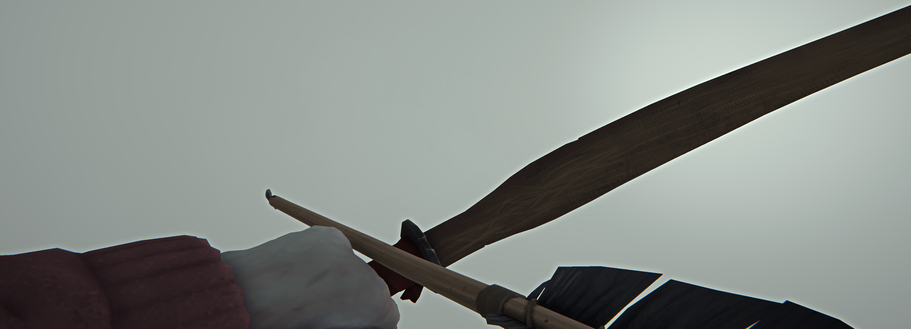

# Woodwright's Bow

**Contents**

- [Overview](#Overview)
- [Differences from Survival Bow](#Differences_from_Survival_Bow)
- [Locations](#Locations)
- [Tips](#Tips)
- [Gallery](#Gallery)
- [Update history](#Update_history)

<table>
<colgroup>
<col style="width: 33%" />
<col style="width: 33%" />
<col style="width: 33%" />
</colgroup>
<tbody>
<tr>
<td width="40px"><figure>
[Missing image: Ptarmigan_icon.png]
<figcaption>Ptarmigan_icon.png</figcaption>
</figure></td>
<td>
<strong>DLC-Exclusive content.</strong> 

This content requires the <a href="./Tales%20from%20the%20Far%20Territory.md" class="wikilink" title="Tales from the Far Territory">Tales from the Far Territory</a> addon to be installed before it can be seen or used in regular gameplay.

</td>
<td>
|}

<table class="infobox">
<caption>Woodwright's Bow</caption>
<colgroup>
<col style="width: 50%" />
<col style="width: 50%" />
</colgroup>
<tbody>
<tr>
<td colspan="2"><figure>

<figcaption>Woodwright's_Bow_icon.png</figcaption>
</figure></td>
</tr>
<tr>
<td>
Release
</td>
<td>
<a href="./The%20Long%20Dark%20%E2%80%94%20Changelog.md#2.03" class="wikilink" title="5 December 2022">5 December 2022</a>
</td>
</tr>
<tr>
<td>
Wintermute
</td>
<td>
No
</td>
</tr>
<tr>
<td colspan="2" class="section">
<strong>Properties</strong>
</td>
</tr>
<tr>
<td>
Item type
</td>
<td>
<a href="./Tools.md" class="wikilink" title="Tools">Tools</a>|-
</td>
</tr>
<tr>
<td>
Stackable
</td>
<td>
No
</td>
</tr>
<tr>
<td>
Examine
</td>
<td>
Crafted at a master's Work Bench. Every shape and angle reflects a careful and knowing touch. 
 
A more durable and agile Survival Bow.
</td>
</tr>
<tr>
<td colspan="2" class="section">
<strong>Values</strong>
</td>
</tr>
<tr>
<td>
Weight
</td>
<td>
0.75 kg (1.65 lbs)
</td>
</tr>
<tr>
<td colspan="2" class="section">
<strong>Actions</strong>
</td>
</tr>
<tr>
<td>
Backpack
</td>
<td>
Use, Drop
</td>
</tr>
<tr>
<td>
On ground
</td>
<td>
Take It, Equip It, Leave It
</td>
</tr>
<tr>
<td colspan="2" class="section">
<strong>Advanced data</strong>
</td>
</tr>
<tr>
<td>
Item key
</td>
<td>
GAMEPLAY_Bow_Woodwrights
</td>
</tr>
</tbody>
</table>

<strong>Woodwright's Bow</strong> is a unique variant of the <a href="./Survival%20Bow.md" class="wikilink" title="Survival Bow">Survival Bow</a> in <em>The Long Dark</em>, added by the <em><a href="./Tales%20from%20the%20Far%20Territory.md" class="wikilink" title="Tales from the Far Territory">Tales from the Far Territory</a></em> expansion.

<h2 id="Overview">Overview</h2>

The Woodwright's bow is a hand-carved hardwood bow with a red cloth wrapped handle, red stripes painted on the tips, and a metal arrow rest. It functions like the normal Survival Bow, but has double durability, less sway, and the downside of weighing an additional 0.25 kg more than its Survival counterpart.

Like other bows, the Woodwright's Bow cannot be repaired.

<h2 id="Differences_from_Survival_Bow">Differences from Survival Bow</h2>
<ul>
<li>Base weight is 0.25kg more than the Survival Bow</li>
<li>Sway is 30% less than Survival Bow</li>
<li>Total durability is 100% more than Survival Bow (uses 1%-0.5% condition per shot based on <a href="./Archery.md" class="wikilink" title="archery skill">archery skill</a>)</li>
</ul>
<h2 id="Locations">Locations</h2>

The bow will spawn a single time per world at 100% condition in one of several random <a href="./Hushed%20River%20Valley.md" class="wikilink" title="Hushed River Valley">Hushed River Valley</a> locations including:

<ul>
<li>At a camp located near <a href="./Offset%20Falls.md" class="wikilink" title="Offset Falls">Offset Falls</a> on the southern side of <a href="./Hushed%20River.md" class="wikilink" title="Hushed River">Hushed River</a> next to a frozen corpse on the top of the hill after a rose hip bush climb. Near the <a href="./Ice%20Cave.md" class="wikilink" title="Ice Cave">Ice Cave</a>.</li>
<li>At <a href="./Moose%20Overlook.md" class="wikilink" title="Moose Overlook">Moose Overlook</a>.</li>
<li>Next to a frozen corpse to the west of <a href="./Valley%20View%20Point.md" class="wikilink" title="Valley View Point">Valley View Point</a> on the small pond south of <a href="./Hushed%20River.md" class="wikilink" title="Hushed River">Hushed River</a>.</li>
<li>Just outside the ice cave under a rock overhang, at the top of <a href="./Long%20Shot%20Falls.md" class="wikilink" title="Long Shot Falls">Long Shot Falls</a>.</li>
</ul>
<h2 id="Tips">Tips</h2>
<ul>
<li>The Woodright's bow will not spawn on <a href="./Interloper.md" class="wikilink" title="Interloper">Interloper</a> or <a href="./Misery.md" class="wikilink" title="Misery">Misery</a> difficulty.</li>
<li>At base archery skill the bow can fire a total of 85 times before the risk of breaking starts at the 15% condition threshold.</li>
<li>At Archery skill level 4 and above, the survivor can fire the Woodright's bow a total of 170 times before reaching the 15% condition breaking threshold at which the bow will have the chance to break with each shot; starting at a 4% break chance at 12% condition, and increasing to 16% break chance at 9% condition, then to 64% break chance at 3% condition. Because only one spawns per world, it may be wise to attain archery skill level 4 or above before using it to get the most potential shots out of the bow.</li>
</ul>
<h2 id="Gallery">Gallery</h2>
<table class="gallery">
<colgroup>
<col style="width: 25%" />
<col style="width: 25%" />
<col style="width: 25%" />
<col style="width: 25%" />
</colgroup>
<tbody>
<tr>
<td><figure>

<figcaption>The Woodright's bow as seen in the survivors hands.</figcaption>
</figure></td>
<td><figure>

<figcaption>The Woodright's bow when drawn and aiming.</figcaption>
</figure></td>
<td><figure>

<figcaption>The bow found near Offset Falls.</figcaption>
</figure></td>
<td><figure>

<figcaption>The edge of the handle's ring make a good reference point when aiming, the white reticle is the point where the arrow will fire from regardless of the sway.</figcaption>
</figure></td>
</tr>
<tr>
<td><figure>
[Missing image: Woodwright's_Bow_corpse.jpg]
<figcaption>Woodwright's_Bow_corpse.jpg</figcaption>
</figure></td>
<td><figure>

<figcaption>Woodwrights bow in-game ground model</figcaption>
</figure></td>
<td></td>
<td></td>
</tr>
</tbody>
</table>
<h2 id="Update_history">Update history</h2>

<ul>
<li>UPDATE <strong>5 December 2022 (<a href="./The%20Long%20Dark%20%E2%80%94%20Changelog.md#2.03" class="wikilink" title="Update">Update</a>):</strong>
<ul>
<li>Added to game.</li>
</ul></li>
</ul>

<strong>Lua execution error in Module:Navbox function navbox</strong> <a href="ru:%D0%9B%D1%83%D0%BA_%D0%BF%D0%BB%D0%BE%D1%82%D0%BD%D0%B8%D0%BA%D0%B0" class="wikilink" title="ru:Лук плотника">ru:Лук плотника</a>
</td>
</tr>
</tbody>
</table>

