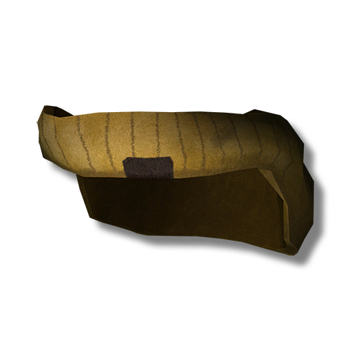
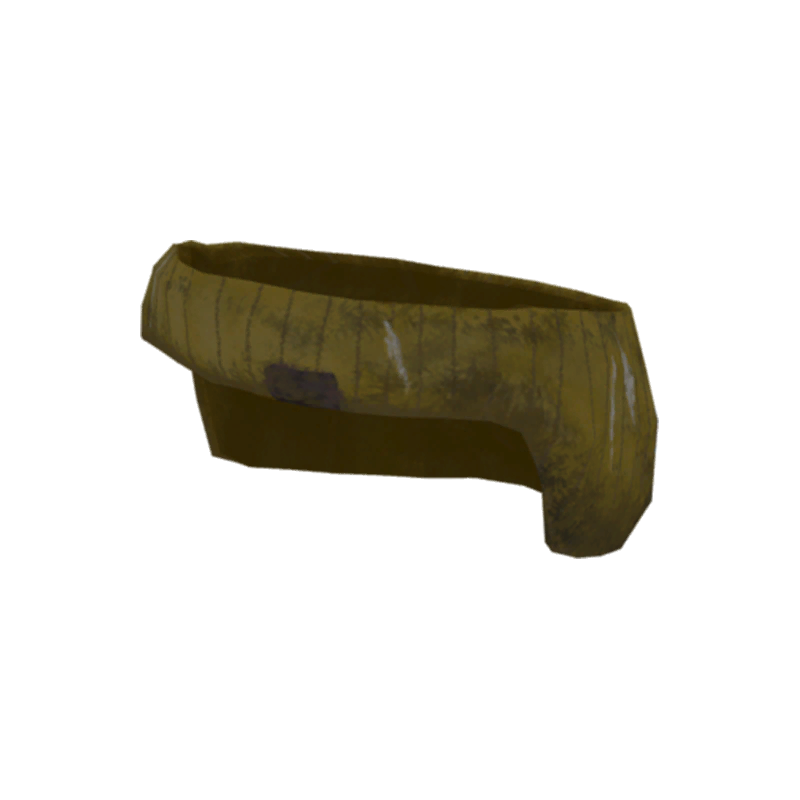

# Wool Ear Wrap

<table class="infobox">
<caption>Wool Ear Wrap</caption>
<colgroup>
<col style="width: 50%" />
<col style="width: 50%" />
</colgroup>
<tbody>
<tr>
<td colspan="2"><figure>

<figcaption>Wool_Ear_Wrap_icon.png</figcaption>
</figure></td>
</tr>
<tr>
<td colspan="2" class="section">
<strong>General</strong>
</td>
</tr>
<tr>
<td>
Item Type
</td>
<td>
Clothing|-
</td>
</tr>
<tr>
<td>
Clothing Slot
</td>
<td>
Accessory
</td>
</tr>
<tr>
<td colspan="2" class="section">
<strong>Statistics</strong>
</td>
</tr>
<tr>
<td>
Weight
</td>
<td>
0.25 kg(0.55 lbs)
</td>
</tr>
<tr>
<td>
Warmth bonus
</td>
<td>
1.0 °C(1.8 °F)
</td>
</tr>
<tr>
<td>
Windproof bonus
</td>
<td>
0.5 °C(0.9 °F)
</td>
</tr>
<tr>
<td>
Waterproof bonus
</td>
<td>
20%
</td>
</tr>
<tr>
<td>
Protection
</td>
<td>
1%
</td>
</tr>
<tr>
<td>
Mobility
</td>
<td>
0%
</td>
</tr>
<tr>
<td>
Harvest
</td>
<td>
1 × <a href="./Cloth.md" class="wikilink" title="Cloth">Cloth</a> 
10 minutes
</td>
</tr>
<tr>
<td>
Repair
</td>
<td>
1 × <a href="./Cloth.md" class="wikilink" title="Cloth">Cloth</a> 
30 minutes 
75% condition
</td>
</tr>
</tbody>
</table>

<table>
<colgroup>
<col style="width: 33%" />
<col style="width: 33%" />
<col style="width: 33%" />
</colgroup>
<tbody>
<tr>
<td style="vertical-align: top; font-size: 3em; color: #5d5980; padding-right: 10px">
“
</td>
<td>
Covers your ears with an extra layer of Wool.

&#10;

In-game description

</td>
<td style="vertical-align: bottom; font-size: 3em; color: #5d5980; padding-left: 10px">
”
</td>
</tr>
</tbody>
</table>

**Wool Ear Wrap** is a type of accessory <a href="./Clothing.md" class="wikilink" title="Clothing">Clothing</a> in *The Long Dark*.

## Overview

The Wool Ear Wrap is a rare clothing item worn in the accessory slot and gives a warmth and windproof bonus.

## Tips

Considering how rare they are, and as they offer only minimal protection but cannot withstand a lot of damage, it is advised to take wool ear wraps off when there is a high chance of encountering a predator.

- Wool Ear Wraps are fragile and decay relatively quickly for clothing.
- The Wrap must be worn in the outer layer (2nd accessory slot, on the right) for its windproof to have effect, in the inner slot (left slot) it only provides warmth. When in the outer slot the Wool Ear Wrap is extremely vulnerable to <a href="./Struggle.md" class="wikilink" title="Struggles">Struggles</a>, and is easily destroyed in a single attack (particularly from a <a href="./Bear.md" class="wikilink" title="Bear">Bear</a>).
- Wearing a <a href="./Moose-Hide%20Satchel.md" class="wikilink" title="Moose-Hide Satchel">Moose-Hide Satchel</a> or other accessory as an outer accessory (right) and Wool Ear Wrap in the inner (left) will protect the ear wrap from wildlife until the satchel/other accessory is destroyed. Moose-Hide Satchels are far more durable than Wool Ear Wraps, and often survive wildlife attacks if initially above 50% condition. A <a href="./Ballistic%20Vest.md" class="wikilink" title="Ballistic Vest">Ballistic Vest</a> should always be worn over a Wool Ear Wrap as another alternative.
- Due to their rarity, fragility and the lack of crafting options for Accessory Slots, spare Wool Ear Wraps should be saved as possible replacements.
- If a player can't find Wool Ear Wraps, <a href="./Improvised%20Insulation.md" class="wikilink" title="Improvised Insulation">Improvised Insulation</a> is a craftable alternative that provides even more warmth.

<table class="gallery">
<colgroup>
<col style="width: 50%" />
<col style="width: 50%" />
</colgroup>
<tbody>
<tr>
<td><figure>

<figcaption>Clothing model icon</figcaption>
</figure></td>
<td><figure>

<figcaption>Clothing model icon damaged</figcaption>
</figure></td>
</tr>
</tbody>
</table>

## Update history

- UPDATE **19 December 2016 (<a href="./The%20Long%20Dark%20%E2%80%94%20Early%20Access%20Changelog.md#0.386" class="wikilink" title="Update">Update</a>):**
  - Added to game

**Lua execution error in Module:Navbox function navbox** <a href="ru:%D0%A8%D0%B5%D1%80%D1%81%D1%82%D1%8F%D0%BD%D0%B0%D1%8F_%D0%BF%D0%BE%D0%B2%D1%8F%D0%B7%D0%BA%D0%B0" class="wikilink" title="ru:Шерстяная повязка">ru:Шерстяная повязка</a>

