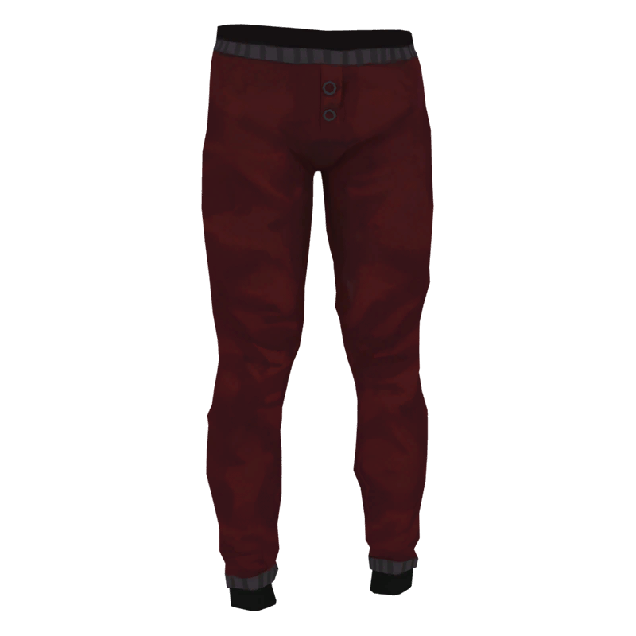

# Wool Longjohns

**Contents**

- [Overview](#Overview)
- [Location](#Location)
- [Gallery](#Gallery)
- [Update history](#Update_history)

<table class="infobox">
<caption>Wool Longjohns</caption>
<colgroup>
<col style="width: 50%" />
<col style="width: 50%" />
</colgroup>
<tbody>
<tr>
<td colspan="2"><figure>

<figcaption>Wool_Longjohns_icon.png</figcaption>
</figure></td>
</tr>
<tr>
<td colspan="2" class="section">
<strong>General</strong>
</td>
</tr>
<tr>
<td>
Item Type
</td>
<td>
Clothing|-
</td>
</tr>
<tr>
<td>
Clothing Slot
</td>
<td>
Inner legs
</td>
</tr>
<tr>
<td colspan="2" class="section">
<strong>Statistics</strong>
</td>
</tr>
<tr>
<td>
Weight
</td>
<td>
0.50 kg(1.1 lbs)
</td>
</tr>
<tr>
<td>
Warmth bonus
</td>
<td>
2.0 °C(3.6 °F)
</td>
</tr>
<tr>
<td>
Windproof bonus
</td>
<td>
0.0 °C(0 °F)
</td>
</tr>
<tr>
<td>
Waterproof bonus
</td>
<td>
35%
</td>
</tr>
<tr>
<td>
Protection
</td>
<td>
1%
</td>
</tr>
<tr>
<td>
Mobility
</td>
<td>
0%
</td>
</tr>
<tr>
<td>
Harvest
</td>
<td>
1 × <a href="./Cloth.md" class="wikilink" title="Cloth">Cloth</a> 
20 minutes
</td>
</tr>
<tr>
<td>
Repair
</td>
<td>
1 × <a href="./Cloth.md" class="wikilink" title="Cloth">Cloth</a> 
45 minutes 
50% condition
</td>
</tr>
</tbody>
</table>

<table>
<colgroup>
<col style="width: 33%" />
<col style="width: 33%" />
<col style="width: 33%" />
</colgroup>
<tbody>
<tr>
<td style="vertical-align: top; font-size: 3em; color: #5d5980; padding-right: 10px">
“
</td>
<td>
Wool longjohns make a great underlayer for your legs. Warm but not very sturdy.

&#10;

In-game description

</td>
<td style="vertical-align: bottom; font-size: 3em; color: #5d5980; padding-left: 10px">
”
</td>
</tr>
</tbody>
</table>

**Wool Longjohns** are a type of <a href="./Clothing.md" class="wikilink" title="clothing">clothing</a> worn in the inner legs slot.

## Overview

Wool Longjohns are best-in-slot underwear, being superior to <a href="./Thermal%20Underwear.md" class="wikilink" title="Thermal Underwear">Thermal Underwear</a> in most regards. Compared to Thermal Underwear, Longjohns are 1.0°C warmer, 15% more waterproof, and give a slight protection bonus (only if not wearing any pants). They also <a href="./Decay.md" class="wikilink" title="decay">decay</a> at half the rate Thermal Underwear does, and give more condition per repair. The only disadvantage of Wool Longjohns that they are twice as heavy as Thermal Underwear.

## Location

Longjohns can be found at the <a href="./Summit.md" class="wikilink" title="Summit">Summit</a> in one of the <a href="./Cargo%20Container.md" class="wikilink" title="Cargo Container">Cargo Container</a> in <a href="./Timberwolf%20Mountain.md" class="wikilink" title="Timberwolf Mountain">Timberwolf Mountain</a>.

Longjohns are not available on <a href="./Survival%20Mode.md" class="wikilink" title="Interloper mode">Interloper mode</a>.

## Gallery

<table class="gallery">
<colgroup>
<col style="width: 33%" />
<col style="width: 33%" />
<col style="width: 33%" />
</colgroup>
<tbody>
<tr>
<td><figure>

<figcaption>Old model.</figcaption>
</figure></td>
<td><figure>

<figcaption>Clothing model icon</figcaption>
</figure></td>
<td><figure>

<figcaption>Clothing model icon damaged</figcaption>
</figure></td>
</tr>
</tbody>
</table>

## Update history

- UPDATE **19 December 2016 (<a href="./The%20Long%20Dark%20%E2%80%94%20Early%20Access%20Changelog.md#0.386" class="wikilink" title="Update">Update</a>):**
  - Renamed from *Wool Long Underwear* to *Wool Longjohns*

**Lua execution error in Module:Navbox function navbox** <a href="ru:%D0%A8%D0%B5%D1%80%D1%81%D1%82%D1%8F%D0%BD%D1%8B%D0%B5_%D0%BA%D0%B0%D0%BB%D1%8C%D1%81%D0%BE%D0%BD%D1%8B" class="wikilink" title="ru:Шерстяные_кальсоны">ru:Шерстяные_кальсоны</a>

