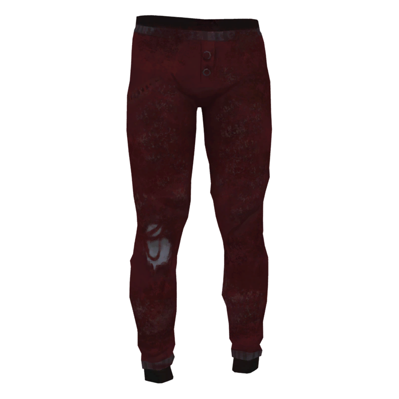

# Wool Longjohns

**Contents**

- [Overview](#overview)
- [Location](#location)
- [Gallery](#gallery)
- [Update history](#update-history)

**Wool Longjohns**

| Property | Details |
| --- | --- |
|  |  / *Wool\_Longjohns\_icon.png* |
| **General** |  |
| Item Type | Clothing\|- |
| Clothing Slot | Inner legs |
| **Statistics** |  |
| Weight | 0.50 kg(1.1 lbs) |
| Warmth bonus | 2.0 °C(3.6 °F) |
| Windproof bonus | 0.0 °C(0 °F) |
| Waterproof bonus | 35% |
| Protection | 1% |
| Mobility | 0% |
| Harvest | 1 × [Cloth](./Cloth.md) / 20 minutes |
| Repair | 1 × [Cloth](./Cloth.md) / 45 minutes / 50% condition |

> “**Wool longjohns make a great underlayer for your legs. Warm but not very sturdy.**”
>
> — In-game description

**Wool Longjohns** are a type of [clothing](./Clothing.md) worn in the inner legs slot.

## Overview

Wool Longjohns are best-in-slot underwear, being superior to [Thermal Underwear](./Thermal%20Underwear.md) in most regards. Compared to Thermal Underwear, Longjohns are 1.0°C warmer, 15% more waterproof, and give a slight protection bonus (only if not wearing any pants). They also [decay](./Decay.md) at half the rate Thermal Underwear does, and give more condition per repair. The only disadvantage of Wool Longjohns that they are twice as heavy as Thermal Underwear.

## Location

Longjohns can be found at the [Summit](./Summit.md) in one of the [Cargo Container](./Cargo%20Container.md) in [Timberwolf Mountain](./Timberwolf%20Mountain.md).

Longjohns are not available on [Interloper mode](./Survival%20Mode.md).

## Gallery

| Column 1 | Column 2 | Column 3 |
| --- | --- | --- |
|  / *Old model.* |  / *Clothing model icon* |  / *Clothing model icon damaged* |

## Update history

- UPDATE **19 December 2016 ([Update](./The%20Long%20Dark%20%E2%80%94%20Early%20Access%20Changelog.md#0.386)):**
  - Renamed from *Wool Long Underwear* to *Wool Longjohns*

**Lua execution error in Module:Navbox function navbox** [ru:Шерстяные\_кальсоны](ru:%D0%A8%D0%B5%D1%80%D1%81%D1%82%D1%8F%D0%BD%D1%8B%D0%B5_%D0%BA%D0%B0%D0%BB%D1%8C%D1%81%D0%BE%D0%BD%D1%8B)
