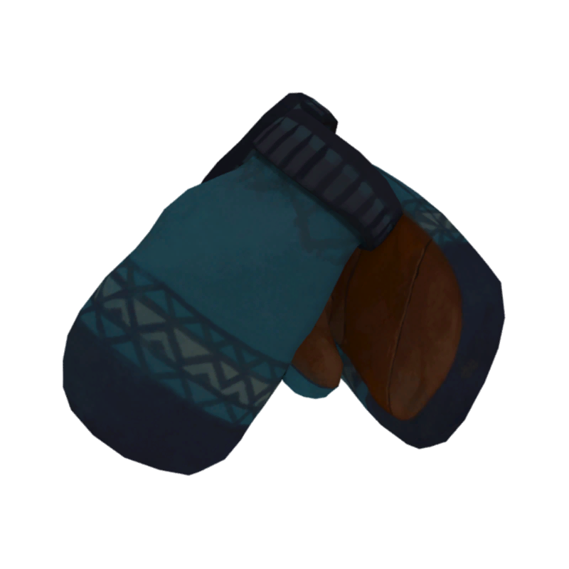

# Wool Mittens

**Categories:** Clothing, Pages with update history · **Source:** [Fandom](https://thelongdark.fandom.com/wiki/Wool_Mittens)

**Wool Mittens**

_Wool\_Mittens\_icon.png_

**General**

**Item Type:** Clothing

**Renewable:** Yes

**Clothing Slot:** Hands

**Statistics**

**Weight:** 0.10 kg(0.22 lbs)

**Warmth bonus:** 1.0 °C(1.8 °F)

**Windproof bonus:** 0.5 °C(0.9 °F)

**Waterproof bonus:** 20%

**Protection:** 1%

**Mobility:** 0%

**Harvest:** 1 × [Cloth](./Cloth.md) / 10 minutes

**Repair:** 1 × [Cloth](./Cloth.md) / 30 minutes / 65% condition

> “**Wool mitts with a reinforced palm. Will keep your fingers nice and toasty.**”
>
> — In-game description

**Wool Mittens** are a type of [clothing](./Clothing.md) in _[The Long Dark](./The%20Long%20Dark.md)_.

Wool mittens have the best warmth-to-weight ratio of any pair of gloves and are easy to maintain, however they offer little protection against animal attacks.

_Clothing model_

_Clothing model damaged_

## Update history

- UPDATE **19 December 2016 ([Update](./The%20Long%20Dark%20%E2%80%94%20Early%20Access%20Changelog.md#0.386)):**
  - Added to game
