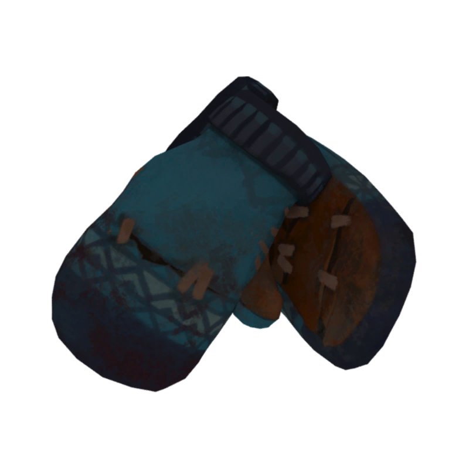

# Wool Mittens

**Wool Mittens**

| Property | Details |
| --- | --- |
|  |  / *Wool\_Mittens\_icon.png* |
| **General** |  |
| Item Type | Clothing\|- |
| Renewable | Yes |
| Clothing Slot | Hands |
| **Statistics** |  |
| Weight | 0.10 kg(0.22 lbs) |
| Warmth bonus | 1.0 °C(1.8 °F) |
| Windproof bonus | 0.5 °C(0.9 °F) |
| Waterproof bonus | 20% |
| Protection | 1% |
| Mobility | 0% |
| Harvest | 1 × [Cloth](./Cloth.md) / 10 minutes |
| Repair | 1 × [Cloth](./Cloth.md) / 30 minutes / 65% condition |

> “**Wool mitts with a reinforced palm. Will keep your fingers nice and toasty.**”
>
> — In-game description

**Wool Mittens** are a type of [clothing](./Clothing.md) in *[The Long Dark](./The%20Long%20Dark.md)*.

Wool mittens have the best warmth-to-weight ratio of any pair of gloves and are easy to maintain, however they offer little protection against animal attacks.

| Column 1 | Column 2 |
| --- | --- |
|  / *Clothing model* |  / *Clothing model damaged* |

## Update history

- UPDATE **19 December 2016 ([Update](./The%20Long%20Dark%20%E2%80%94%20Early%20Access%20Changelog.md#0.386)):**
  - Added to game

**Lua execution error in Module:Navbox function navbox** [ru:Шерстяные варежки](ru:%D0%A8%D0%B5%D1%80%D1%81%D1%82%D1%8F%D0%BD%D1%8B%D0%B5_%D0%B2%D0%B0%D1%80%D0%B5%D0%B6%D0%BA%D0%B8)
