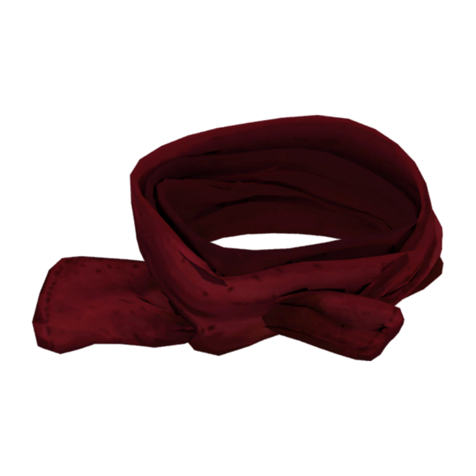

# Wool Scarf

**Categories:** Clothing, Pages with update history · **Source:** [Fandom](https://thelongdark.fandom.com/wiki/Wool_Scarf)

**Wool Scarf**

| Property | Details |
| --- | --- |
|  |  / _Wool\_Scarf\_icon.png_ |
| **General** |  |
| Item Type | Clothing\|- |
| Clothing Slot | Head |
| **Statistics** |  |
| Weight | 0.10 kg(0.22 lbs) |
| Warmth bonus | 1.0 °C(1.8 °F) |
| Windproof bonus | 0.5 °C(0.9 °F) |
| Waterproof bonus | 20% |
| Protection | 1% |
| Mobility | 0% |
| Harvest | 1 × [Cloth](./Cloth.md) / 10 minutes |
| Repair | 1 × [Cloth](./Cloth.md) / 30 minutes / 60% condition |

> “__A hand-knit thick wool scarf. Nice and warm.__”
>
> — In-game description

The **Wool Scarf** is a type of headgear in _[The Long Dark](./The%20Long%20Dark.md)_.

## Overview

The Wool Scarf has identical stats to the [Cotton Toque](./Cotton%20Toque.md), with the exception of being 10% more waterproof.

It shares the the highest warmth-to-weight ratio of any headgear with the Cotton Toque, [Improvised Hand Wraps](./Improvised%20Hand%20Wraps.md), and [Mackenzie's Toque](./Mackenzie%27s%20Toque.md)/[Astrid's Toque](./Astrid%27s%20Toque.md).

As of the [Resolute Outfitter](./The%20Long%20Dark%20%E2%80%94%20Early%20Access%20Changelog.md#0.386) update, the Wool Scarf was moved to the headgear slot (it was formerly an accessory).

## Gallery

_Model icon_

_Model icon damaged_

_Old model._

## Update history

- UPDATE **19 December 2016 ([Update](./The%20Long%20Dark%20%E2%80%94%20Early%20Access%20Changelog.md#0.386)):**
  - Renamed from _Basic Wool Scarf_ to _Wool Scarf_
