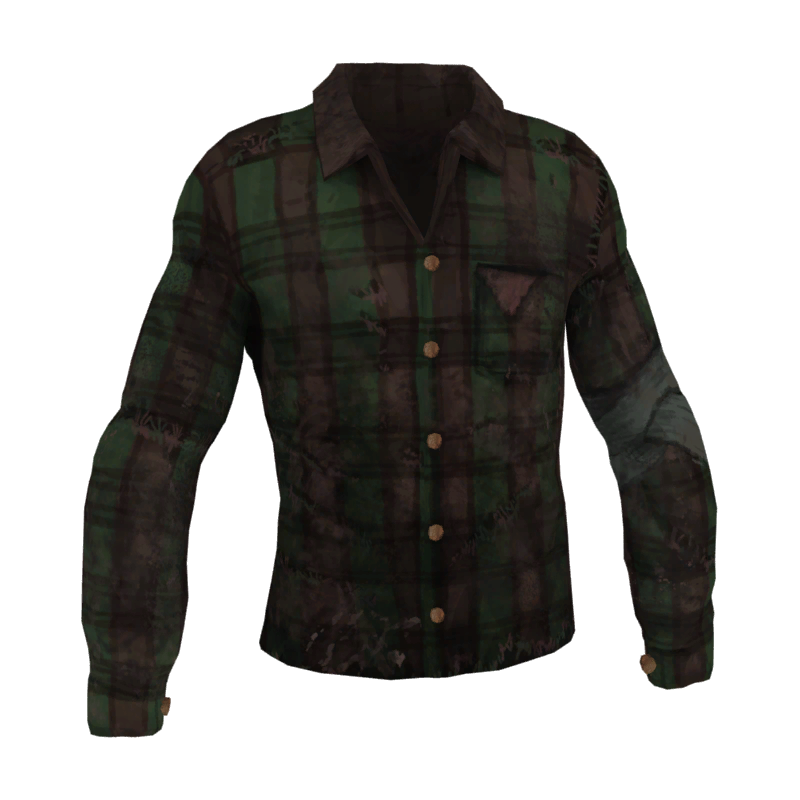

# Wool Shirt

**Categories:** Clothing, Pages with update history · **Source:** [Fandom](https://thelongdark.fandom.com/wiki/Wool_Shirt)

**Wool Shirt**

_Wool\_Shirt\_icon.png_

**General**

**Item Type:** Clothing

**Clothing Slot:** Inner torso

**Statistics**

**Weight:** 0.25 kg(0.55 lbs)

**Warmth bonus:** 1.0 °C(1.8 °F)

**Windproof bonus:** 0.5 °C(0.9 °F)

**Waterproof bonus:** 40%

**Protection:** 2%

**Mobility:** 0%

**Harvest:** 1 × [Cloth](./Cloth.md) / 10 minutes

**Repair:** 1 × [Cloth](./Cloth.md) / 30 minutes / 35% condition

> “**A heavy insulated wool shirt designed to keep you warm in the Winter. Retains good warmth when wet.**”
>
> — In-game description

The **Wool Shirt** is a type of [clothing](./Clothing.md) in _[The Long Dark](./The%20Long%20Dark.md)_.

## Overview

The Wool Shirt's stats are nearly identical to the [Thin Wool Sweater](./Thin%20Wool%20Sweater.md), but it is more waterproof and faster to repair. It can be found in residential locations and other clothing spawns, and is somewhat rare.

The Wool Shirt is not available in [Interloper](./Interloper.md) difficulty.

_Clothing model icon_

_Clothing model icon damaged_

## Update history

- UPDATE **19 December 2016 ([Update](./The%20Long%20Dark%20%E2%80%94%20Early%20Access%20Changelog.md#0.386)):**
  - Added to game
