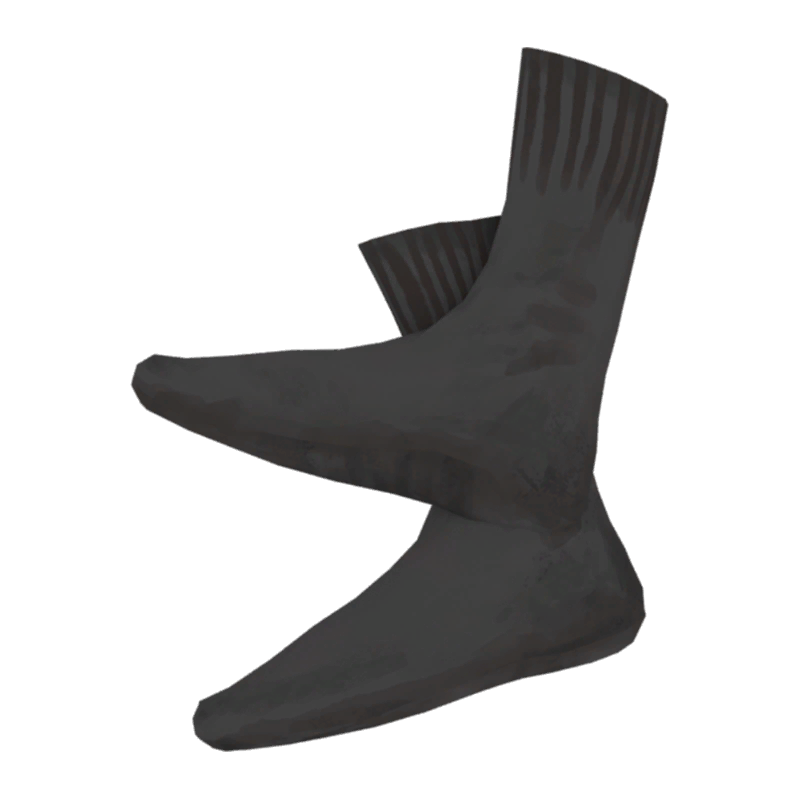

# Wool Socks

**Categories:** Clothing · **Source:** [Fandom](https://thelongdark.fandom.com/wiki/Wool_Socks)

**Wool Socks**

**General**

**Item Type:** Clothing

**Clothing Slot:** Inner feet

**Statistics**

**Weight:** 0.25 kg(0.55 lbs)

**Warmth bonus:** 0.5 °C(0.9 °F)

**Windproof bonus:** 0.0 °C(0 °F)

**Waterproof bonus:** 20%

**Protection:** 0%

**Mobility:** 0%

**Harvest:** 1 × [Cloth](./Cloth.md) 20 minutes

**Repair:** 1 × [Cloth](./Cloth.md) 45 minutes 55% condition

> “**Wool socks. Tough and warm. Try to keep a couple of pairs handy.**”
>
> — In-game description

**Wool Socks** are a type of Footwear [Clothing](./Clothing.md) in _The Long Dark_.

## Usefulness

Wool Socks are mid-tier socks. They providing double the warmth and weight of [Sports Socks](./Sports%20Socks.md) and decay slower than them, but decay faster than [Climbing Socks](./Climbing%20Socks.md) and have inferior stats.

Wool Socks are the best available socks in [Interloper](./Interloper.md)/ [Misery](./Misery.md) mode.

## Gallery

