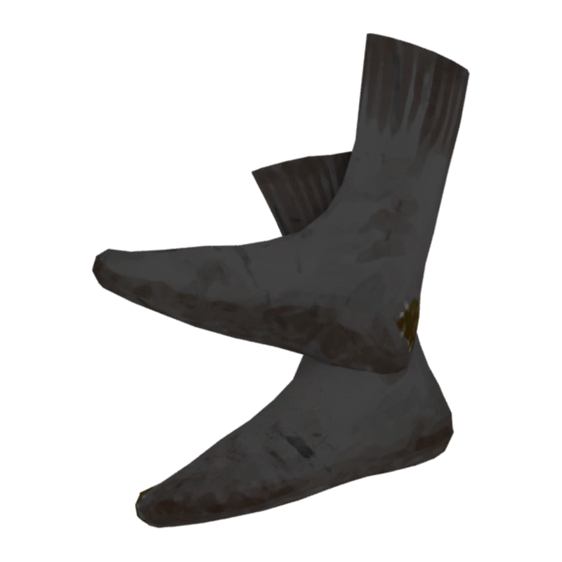

# Wool Socks

<table class="infobox">
<caption>Wool Socks</caption>
<colgroup>
<col style="width: 50%" />
<col style="width: 50%" />
</colgroup>
<tbody>
<tr>
<td colspan="2"><figure>

<figcaption>Wool_Socks_icon.png</figcaption>
</figure></td>
</tr>
<tr>
<td colspan="2" class="section">
<strong>General</strong>
</td>
</tr>
<tr>
<td>
Item Type
</td>
<td>
Clothing|-
</td>
</tr>
<tr>
<td>
Clothing Slot
</td>
<td>
Inner feet
</td>
</tr>
<tr>
<td colspan="2" class="section">
<strong>Statistics</strong>
</td>
</tr>
<tr>
<td>
Weight
</td>
<td>
0.25 kg(0.55 lbs)
</td>
</tr>
<tr>
<td>
Warmth bonus
</td>
<td>
0.5 °C(0.9 °F)
</td>
</tr>
<tr>
<td>
Windproof bonus
</td>
<td>
0.0 °C(0 °F)
</td>
</tr>
<tr>
<td>
Waterproof bonus
</td>
<td>
20%
</td>
</tr>
<tr>
<td>
Protection
</td>
<td>
0%
</td>
</tr>
<tr>
<td>
Mobility
</td>
<td>
0%
</td>
</tr>
<tr>
<td>
Harvest
</td>
<td>
1 × <a href="./Cloth.md" class="wikilink" title="Cloth">Cloth</a> 
20 minutes
</td>
</tr>
<tr>
<td>
Repair
</td>
<td>
1 × <a href="./Cloth.md" class="wikilink" title="Cloth">Cloth</a> 
45 minutes 
55% condition
</td>
</tr>
</tbody>
</table>

<table>
<colgroup>
<col style="width: 33%" />
<col style="width: 33%" />
<col style="width: 33%" />
</colgroup>
<tbody>
<tr>
<td style="vertical-align: top; font-size: 3em; color: #5d5980; padding-right: 10px">
“
</td>
<td>
Wool socks. Tough and warm. Try to keep a couple of pairs handy.

&#10;

In-game description

</td>
<td style="vertical-align: bottom; font-size: 3em; color: #5d5980; padding-left: 10px">
”
</td>
</tr>
</tbody>
</table>

**Wool Socks** are a type of Footwear <a href="./Clothing.md" class="wikilink" title="Clothing">Clothing</a> in *The Long Dark*.

## Usefulness

Wool Socks are mid-tier socks. They providing double the warmth and weight of <a href="./Sports%20Socks.md" class="wikilink" title="Sports Socks">Sports Socks</a> and decay slower than them, but decay faster than <a href="./Climbing%20Socks.md" class="wikilink" title="Climbing Socks">Climbing Socks</a> and have inferior stats.

Wool Socks are the best available socks in <a href="./Interloper.md" class="wikilink" title="Interloper">Interloper</a>/ <a href="./Misery.md" class="wikilink" title="Misery">Misery</a> mode.

## Gallery

<table class="gallery">
<colgroup>
<col style="width: 33%" />
<col style="width: 33%" />
<col style="width: 33%" />
</colgroup>
<tbody>
<tr>
<td><figure>

<figcaption>Old model.</figcaption>
</figure></td>
<td><figure>

<figcaption>Clothing model icon</figcaption>
</figure></td>
<td><figure>

<figcaption>Clothing model icon damaged</figcaption>
</figure></td>
</tr>
</tbody>
</table>

**Lua execution error in Module:Navbox function navbox** <a href="ru:%D0%A8%D0%B5%D1%80%D1%81%D1%82%D1%8F%D0%BD%D1%8B%D0%B5_%D0%BD%D0%BE%D1%81%D0%BA%D0%B8" class="wikilink" title="ru:Шерстяные носки">ru:Шерстяные носки</a>

