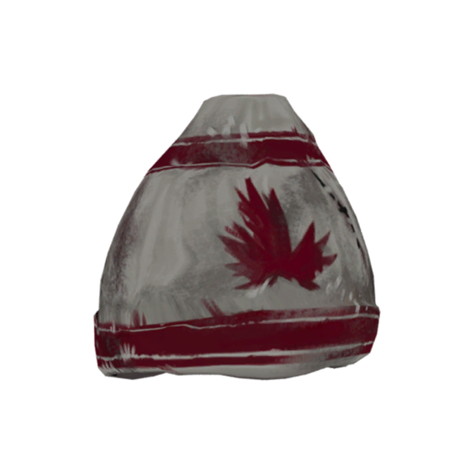

# Wool Toque

**Contents**

- [Overview](#Overview)
- [Trivia](#Trivia)
- [Gallery](#Gallery)
- [Update history](#Update_history)

<table class="infobox">
<caption>Wool Toque</caption>
<colgroup>
<col style="width: 50%" />
<col style="width: 50%" />
</colgroup>
<tbody>
<tr>
<td colspan="2"><figure>

<figcaption>Wool_Toque_icon.png</figcaption>
</figure></td>
</tr>
<tr>
<td colspan="2" class="section">
<strong>General</strong>
</td>
</tr>
<tr>
<td>
Item Type
</td>
<td>
Clothing|-
</td>
</tr>
<tr>
<td>
Renewable
</td>
<td>
Yes
</td>
</tr>
<tr>
<td>
Clothing Slot
</td>
<td>
Head
</td>
</tr>
<tr>
<td colspan="2" class="section">
<strong>Statistics</strong>
</td>
</tr>
<tr>
<td>
Weight
</td>
<td>
0.25 kg(0.55 lbs)
</td>
</tr>
<tr>
<td>
Warmth bonus
</td>
<td>
2.0 °C(3.6 °F)
</td>
</tr>
<tr>
<td>
Windproof bonus
</td>
<td>
1.0 °C(1.8 °F)
</td>
</tr>
<tr>
<td>
Waterproof bonus
</td>
<td>
30%
</td>
</tr>
<tr>
<td>
Protection
</td>
<td>
2%
</td>
</tr>
<tr>
<td>
Mobility
</td>
<td>
0%
</td>
</tr>
<tr>
<td>
Harvest
</td>
<td>
1 × <a href="./Cloth.md" class="wikilink" title="Cloth">Cloth</a> 
10 minutes
</td>
</tr>
<tr>
<td>
Repair
</td>
<td>
1 × <a href="./Cloth.md" class="wikilink" title="Cloth">Cloth</a> 
30 minutes 
75% condition
</td>
</tr>
</tbody>
</table>

<table>
<colgroup>
<col style="width: 33%" />
<col style="width: 33%" />
<col style="width: 33%" />
</colgroup>
<tbody>
<tr>
<td style="vertical-align: top; font-size: 3em; color: #5d5980; padding-right: 10px">
“
</td>
<td>
Knitted wool cap. Canadian style. Pronounced: "tuke".

&#10;

In-game description

</td>
<td style="vertical-align: bottom; font-size: 3em; color: #5d5980; padding-left: 10px">
”
</td>
</tr>
</tbody>
</table>

The **Wool Toque** is a type of headgear in *<a href="./The%20Long%20Dark.md" class="wikilink" title="The Long Dark">The Long Dark</a>*.

## Overview

One of the best hats in the game for both Inner (left) and Outer (right) hat slots. It is tied as the best inner hat with the <a href="./Balaclava.md" class="wikilink" title="Balaclava">Balaclava</a> for Warmth, but decays faster. As an outer hat Toques have similar stats to a <a href="./Rabbitskin%20Hat.md" class="wikilink" title="Rabbitskin Hat">Rabbitskin Hat</a> (0.5°C less windproof bonus, but only needs cloth to repair). <a href="./Wolfskin%20Hat.md" class="wikilink" title="Wolfskin Hat">Wolfskin Hat</a> and <a href="./Cougar%20Hide%20Wrap.md" class="wikilink" title="Cougar Hide Wrap">Cougar Hide Wrap</a> provides much more warmth but are 300% as heavy (1kg).

It also has the second highest warmth-to-weight ratio; tying with the <a href="./Balaclava.md" class="wikilink" title="Balaclava">Balaclava</a>.

The <a href="./Wool%20Scarf.md" class="wikilink" title="Wool Scarf">Wool Scarf</a> may have a higher warmth-to-weight ratio but offers 1°C less warmth and 0.5°C less windproof rating, for being only 0.15kg lighter. Compared to other pieces of clothing, that's a very small amount of weight saved for a relatively large loss in warmth and windproof rating.

## Trivia

- The description of this item is potentially a reference to YouTube creator SplatterCatGaming, who made a series on The Long Dark and pronounced "toque" incorrectly throughout. However, it may also be there just to help people who have never heard the word before pronounce it correctly, as it has a rather nonintuitive pronunciation.

## Gallery

<table class="gallery">
<colgroup>
<col style="width: 33%" />
<col style="width: 33%" />
<col style="width: 33%" />
</colgroup>
<tbody>
<tr>
<td><figure>

<figcaption>Old model.</figcaption>
</figure></td>
<td><figure>

<figcaption>Clothing menu model</figcaption>
</figure></td>
<td><figure>

<figcaption>Clothing menu model damaged</figcaption>
</figure></td>
</tr>
</tbody>
</table>

## Update history

- UPDATE **19 December 2016 (<a href="./The%20Long%20Dark%20%E2%80%94%20Early%20Access%20Changelog.md#0.386" class="wikilink" title="Update">Update</a>):**
  - Renamed from *Toque* to *Wool Toque*

**Lua execution error in Module:Navbox function navbox** <a href="ru:%D0%A8%D0%B5%D1%80%D1%81%D1%82%D1%8F%D0%BD%D0%B0%D1%8F_%D1%88%D0%B0%D0%BF%D0%BA%D0%B0" class="wikilink" title="ru:Шерстяная шапка">ru:Шерстяная шапка</a>

