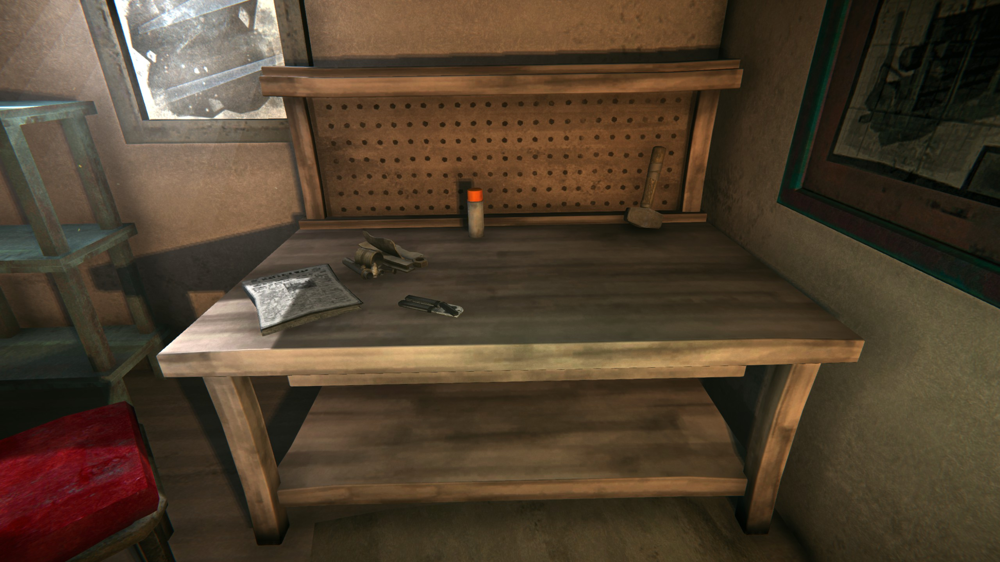

# Work Bench

**Categories:** Interactable Objects, Story items · **Source:** [Fandom](https://thelongdark.fandom.com/wiki/Work_Bench)

**Contents**

- [Overview](#overview)
- [Craftable Items](#craftable-items)
- [Craftable Decorations Work Bench](#craftable-decorations-work-bench)
- [Harvesting](#harvesting)
- [Gallery](#gallery)

**Work Bench**

\[\[File:

250px\]\]

**General**

Item Type

Item

Wintermute

Yes|-

**Statistics**

Weight

5.00 kg(11 lbs)

Harvest

Metal 1 x  [Workbench Vice](./Workbench%20Vice.md) 10 x  [Scrap Metal](./Scrap%20Metal.md) 4 hours

Wood 1 x  [Workbench Vice](./Workbench%20Vice.md) 8 x  [Reclaimed Wood](./Reclaimed%20Wood.md) 3 hours

Craftable 1 x  [Workbench Vice](./Workbench%20Vice.md) 10 x  [Cedar Firewood](./Cedar%20Firewood.md) 1.45 hours

A **Work Bench** is an Interactable Object used for [Crafting](./Crafting.md) new items, and is found across many locations in [_The Long Dark_](./The%20Long%20Dark.md).

## Overview

The Work Bench is a dedicated workspace that makes use of a [Workbench Vice](./Workbench%20Vice.md) to create more useful items that cannot normally be created by hand. 2 versions can be found across [Great Bear Island](./Great%20Bear%20Island.md), a metal or wood version. The metal one has a [Drawer](./Drawer.md), while the wood version does not.

Different tools can be used to create different items. Higher quality tools (such as knives, hatchets, and Sewing Kits) can speed up the creation process (providing up to a 50% time discount) compared to their makeshift counterparts (improvised tools/Fishing Tackles).

- A [Sewing Kit](./Sewing%20Kit.md) or [Fishing Tackle](./Fishing%20Tackle.md) is required for crafting any piece of fur clothing
- A [Hunting Knife](./Hunting%20Knife.md)/[Hatchet](./Hatchet.md) is required to craft bear-skin bedrolls, wolf-skin coats, simple arrows, a survival bow, or arrow shafts.
- Sometimes, items do not require any tools to craft, but using [Simple Tools](./Simple%20Tools.md)/[Quality Tools](./Quality%20Tools.md) can speed up the creation process.

Since some of these items require a considerable amount of time to complete, the work can be done in intervals without losing any progress. The minimum amount of time to spent is half an hour. According to the overall progress the required materials will be consumed and the semi-finished product will appear in the player's inventory.

Note - [Fishing Tackles](./Fishing%20Tackle.md), [Bandages](./Bandage.md), [Old Man's Beard Wound Dressings](./Old%20Man%27s%20Beard%20Wound%20Dressing.md), [Tinder Plugs](./Tinder%20Plug.md), and [Torches](./Torch.md) do not need a Work Bench. They can normally be crafted anywhere, but the option to create them will still appear while using a Work Bench.

## Craftable Items

Only one item of each type can be worked on at any given time. Optional tools that can be used below are in _Italics_:

| Recipe | Materials | Time | Tools Needed |
| --- | --- | --- | --- |
| 3x[Arrow Shaft icon](../assets/Arrow_Shaft_icon.png) [Arrow Shaft](./Arrow%20Shaft.md) | 1x[Cured Birch Sapling icon](../assets/Cured_Birch_Sapling_icon.png) [Cured Birch Sapling](./Cured%20Birch%20Sapling.md) | 30 to 60 Min | - [Hunting Knife icon](../assets/Hunting_Knife_icon.png) [Hunting Knife](./Hunting%20Knife.md); - [Improvised Knife icon](../assets/Improvised_Knife_icon.png) [Improvised Knife](./Improvised%20Knife.md); - [Cougar Claw Knife icon](../assets/Cougar_Claw_Knife_icon.png) [Cougar Claw Knife](./Cougar%20Claw%20Knife.md); - [Survival Knife icon](../assets/Survival_Knife_icon.png) [Survival Knife](./Survival%20Knife.md); - [Hatchet icon](../assets/Hatchet_icon.png) [Hatchet](./Hatchet.md); - [Improvised Hatchet icon](../assets/Improvised_Hatchet_icon.png) [Improvised Hatchet](./Improvised%20Hatchet.md) |
| [Bear Hide Rug icon](../assets/Bear_Hide_Rug_icon.png) [Bear Hide Rug](./Bear%20Hide%20Rug.md) | - 1x[Cured Deer Hide icon](../assets/Cured_Deer_Hide_icon.png) [Cured Deer Hide](./Cured%20Deer%20Hide.md); - 1x[Cured Black Bear Hide icon](../assets/Cured_Black_Bear_Hide_icon.png) [Cured Black Bear Hide](./Cured%20Black%20Bear%20Hide.md); - 2x[Cured Gut icon](../assets/Cured_Gut_icon.png) [Cured Gut](./Cured%20Gut.md) | 8 Hours | [Quality Tools icon](../assets/Quality_Tools_icon.png) [Quality Tools](./Quality%20Tools.md) |
| [Bear Skin Bedroll icon](../assets/Bear_Skin_Bedroll_icon.png) [Bear Skin Bedroll](./Bear%20Skin%20Bedroll.md) | - 2x[Cured Black Bear Hide icon](../assets/Cured_Black_Bear_Hide_icon.png) [Cured Black Bear Hide](./Cured%20Black%20Bear%20Hide.md); - 5x[Cloth icon](../assets/Cloth_icon.png) [Cloth](./Cloth.md); - 6x[Cured Gut icon](../assets/Cured_Gut_icon.png) [Cured Gut](./Cured%20Gut.md) | 17 Hours 30 Min to 35 Hours | - [Hunting Knife icon](../assets/Hunting_Knife_icon.png) [Hunting Knife](./Hunting%20Knife.md); - [Improvised Knife icon](../assets/Improvised_Knife_icon.png) [Improvised Knife](./Improvised%20Knife.md); - [Cougar Claw Knife icon](../assets/Cougar_Claw_Knife_icon.png) [Cougar Claw Knife](./Cougar%20Claw%20Knife.md); - [Survival Knife icon](../assets/Survival_Knife_icon.png) [Survival Knife](./Survival%20Knife.md); - [Hatchet icon](../assets/Hatchet_icon.png) [Hatchet](./Hatchet.md); - [Improvised Hatchet icon](../assets/Improvised_Hatchet_icon.png) [Improvised Hatchet](./Improvised%20Hatchet.md) |
| [Bearskin Coat icon](../assets/Bearskin_Coat_icon.png) [Bearskin Coat](./Bearskin%20Coat.md) | - 2x[Cured Black Bear Hide icon](../assets/Cured_Black_Bear_Hide_icon.png) [Cured Black Bear Hide](./Cured%20Black%20Bear%20Hide.md); - 4x[Cured Gut icon](../assets/Cured_Gut_icon.png) [Cured Gut](./Cured%20Gut.md) | 30 to 60 Hours | - [Hunting Knife icon](../assets/Hunting_Knife_icon.png) [Hunting Knife](./Hunting%20Knife.md); - [Improvised Knife icon](../assets/Improvised_Knife_icon.png) [Improvised Knife](./Improvised%20Knife.md); - [Cougar Claw Knife icon](../assets/Cougar_Claw_Knife_icon.png) [Cougar Claw Knife](./Cougar%20Claw%20Knife.md); - [Survival Knife icon](../assets/Survival_Knife_icon.png) [Survival Knife](./Survival%20Knife.md); - [Hatchet icon](../assets/Hatchet_icon.png) [Hatchet](./Hatchet.md); - [Improvised Hatchet icon](../assets/Improvised_Hatchet_icon.png) [Improvised Hatchet](./Improvised%20Hatchet.md) |
| [Bushcraft Bow icon](../assets/Bushcraft_Bow_icon.png) [Bushcraft Bow](./Bushcraft%20Bow.md) (requires [Bushcraft Bow Blueprint Card](./Bushcraft%20Bow%20Blueprint%20Card.md)) | - 2x[Green Birch Sapling icon](../assets/Green_Birch_Sapling_icon.png) [Green Birch Sapling](./Green%20Birch%20Sapling.md); - 2x[Cured Gut icon](../assets/Cured_Gut_icon.png) [Cured Gut](./Cured%20Gut.md) | 5 hours | - [Hunting Knife icon](../assets/Hunting_Knife_icon.png) [Hunting Knife](./Hunting%20Knife.md); - [Improvised Knife icon](../assets/Improvised_Knife_icon.png) [Improvised Knife](./Improvised%20Knife.md); - [Cougar Claw Knife icon](../assets/Cougar_Claw_Knife_icon.png) [Cougar Claw Knife](./Cougar%20Claw%20Knife.md); - [Survival Knife icon](../assets/Survival_Knife_icon.png) [Survival Knife](./Survival%20Knife.md); - [Hatchet icon](../assets/Hatchet_icon.png) [Hatchet](./Hatchet.md); - [Improvised Hatchet icon](../assets/Improvised_Hatchet_icon.png) [Improvised Hatchet](./Improvised%20Hatchet.md) |
| [Cougar Hide Wrap icon](../assets/Cougar_Hide_Wrap_icon.png) [Cougar Hide Wrap](./Cougar%20Hide%20Wrap.md) (Blueprint doesn't appear on [Pilgrim](./Pilgrim.md)) | - 1x[Cured Cougar Hide icon](../assets/Cured_Cougar_Hide_icon.png) [Cured Cougar Hide](./Cured%20Cougar%20Hide.md); - 2x[Cured Gut icon](../assets/Cured_Gut_icon.png) [Cured Gut](./Cured%20Gut.md) | 11 Hours 40 Min to 23 Hours 20 Min | - [Sewing Kit icon](../assets/Sewing_Kit_icon.png) [Sewing Kit](./Sewing%20Kit.md); - [Fishing Tackle icon](../assets/Fishing_Tackle_icon.png) [Fishing Tackle](./Fishing%20Tackle.md) |
| [Deerskin Boots icon](../assets/Deerskin_Boots_icon.png) [Deerskin Boots](./Deerskin%20Boots.md) | - 2x[Cured Deer Hide icon](../assets/Cured_Deer_Hide_icon.png) [Cured Deer Hide](./Cured%20Deer%20Hide.md); - 4x[Cured Gut icon](../assets/Cured_Gut_icon.png) [Cured Gut](./Cured%20Gut.md) | 12 Hours 30 Min to 25 Hours | - [Sewing Kit icon](../assets/Sewing_Kit_icon.png) [Sewing Kit](./Sewing%20Kit.md); - [Fishing Tackle icon](../assets/Fishing_Tackle_icon.png) [Fishing Tackle](./Fishing%20Tackle.md) |
| [Deerskin Pants icon](../assets/Deerskin_Pants_icon.png) [Deerskin Pants](./Deerskin%20Pants.md) | - 3x[Cured Deer Hide icon](../assets/Cured_Deer_Hide_icon.png) [Cured Deer Hide](./Cured%20Deer%20Hide.md); - 4x[Cured Gut icon](../assets/Cured_Gut_icon.png) [Cured Gut](./Cured%20Gut.md) | 12 Hours 30 Min to 25 Hours | - [Sewing Kit icon](../assets/Sewing_Kit_icon.png) [Sewing Kit](./Sewing%20Kit.md); - [Fishing Tackle icon](../assets/Fishing_Tackle_icon.png) [Fishing Tackle](./Fishing%20Tackle.md) |
| [Fishing Lure (Acorns) icon](../assets/Fishing_Lure_%28Acorns%29_icon.png) [Fishing Lure (Acorns)](./Fishing%20Lure%20%28Acorns%29.md) | - 1x[Scrap Metal icon](../assets/Scrap_Metal_icon.png) [Scrap Metal](./Scrap%20Metal.md); - 1x[Crow Feather icon](../assets/Crow_Feather_icon.png) [Crow Feather](./Crow%20Feather.md); - 1x[Acorns icon](../assets/Acorns_icon.png) [Acorns](./Acorns.md) | 25-50 Minutes | - _[Simple Tools icon](../assets/Simple_Tools_icon.png) [Simple Tools](./Simple%20Tools.md)_; - _[Quality Tools icon](../assets/Quality_Tools_icon.png) [Quality Tools](./Quality%20Tools.md)_ |
| [Fishing Lure (Revolver Shell Casing) icon](../assets/Fishing_Lure_%28Revolver_Shell_Casing%29_icon.png) [Fishing Lure (Revolver Shell Casing)](./Fishing%20Lure%20%28Revolver%20Shell%20Casing%29.md) | - 1x[Scrap Metal icon](../assets/Scrap_Metal_icon.png) [Scrap Metal](./Scrap%20Metal.md); - 1x[Crow Feather icon](../assets/Crow_Feather_icon.png) [Crow Feather](./Crow%20Feather.md); - 1x[Revolver Shell Casing icon](../assets/Revolver_Shell_Casing_icon.png) [Revolver Shell Casing](./Revolver%20Shell%20Casing.md) | 25-50 Minutes | - _[Simple Tools icon](../assets/Simple_Tools_icon.png) [Simple Tools](./Simple%20Tools.md)_; - _[Quality Tools icon](../assets/Quality_Tools_icon.png) [Quality Tools](./Quality%20Tools.md)_ |
| [Fishing Lure (Wire Bundle) icon](../assets/Fishing_Lure_%28Wire_Bundle%29_icon.png) [Fishing Lure (Wire Bundle)](./Fishing%20Lure%20%28Wire%20Bundle%29.md) | - 1x[Scrap Metal icon](../assets/Scrap_Metal_icon.png) [Scrap Metal](./Scrap%20Metal.md); - 1x[Crow Feather icon](../assets/Crow_Feather_icon.png) [Crow Feather](./Crow%20Feather.md); - 1x[Wires icon](../assets/Wires_icon.png) [Wires](./Wires.md) | 25-50 Minutes | - _[Simple Tools icon](../assets/Simple_Tools_icon.png) [Simple Tools](./Simple%20Tools.md)_; - _[Quality Tools icon](../assets/Quality_Tools_icon.png) [Quality Tools](./Quality%20Tools.md)_ |
| [Fishing Tip Up icon](../assets/Fishing_Tip-Up_icon.png) [Fishing Tip-Up](./Fishing%20Tip-Up.md) | - 2x[Stick icon](../assets/Stick_icon.png) [Stick](./Stick.md); - 1x[Cloth icon](../assets/Cloth_icon.png) [Cloth](./Cloth.md); - 1x[Scrap Metal icon](../assets/Scrap_Metal_icon.png) [Scrap Metal](./Scrap%20Metal.md); - 1x[Fishing Tackle icon](../assets/Fishing_Tackle_icon.png) [Fishing Tackle](./Fishing%20Tackle.md) | 20-40 Min | - _[Simple Tools icon](../assets/Simple_Tools_icon.png) [Simple Tools](./Simple%20Tools.md)_; - _[Quality Tools icon](../assets/Quality_Tools_icon.png) [Quality Tools](./Quality%20Tools.md)_ |
| 3x[Hook icon](../assets/Hook_icon.png) [Hook](./Hook.md) | 1x[Scrap Metal icon](../assets/Scrap_Metal_icon.png) [Scrap Metal](./Scrap%20Metal.md) | 10-20 Min | - _[Simple Tools icon](../assets/Simple_Tools_icon.png) [Simple Tools](./Simple%20Tools.md)_; - _[Quality Tools icon](../assets/Quality_Tools_icon.png) [Quality Tools](./Quality%20Tools.md)_ |
| [Improvised Crampons icon](../assets/Improvised_Crampons_icon.png) [Improvised Crampons](./Improvised%20Crampons.md) | - 4x[Scrap Metal icon](../assets/Scrap_Metal_icon.png) [Scrap Metal](./Scrap%20Metal.md); - 2x[Cured Leather icon](../assets/Cured_Leather_icon.png) [Cured Leather](./Cured%20Leather.md) | 2-4 Hours | - _[Simple Tools icon](../assets/Simple_Tools_icon.png) [Simple Tools](./Simple%20Tools.md)_; - _[Quality Tools icon](../assets/Quality_Tools_icon.png) [Quality Tools](./Quality%20Tools.md)_ |
| 2x[Line icon](../assets/Line_icon.png) [Line](./Line.md) | 1x[Cured Gut icon](../assets/Cured_Gut_icon.png) [Cured Gut](./Cured%20Gut.md) | 15 Min | None |
| [Moose Hide Cloak icon](../assets/Moose-Hide_Cloak_icon.png) [Moose-Hide Cloak](./Moose-Hide%20Cloak.md) | - 1x[Cured Moose Hide icon](../assets/Cured_Moose_Hide_icon.png) [Cured Moose Hide](./Cured%20Moose%20Hide.md); - 4x[Cured Gut icon](../assets/Cured_Gut_icon.png) [Cured Gut](./Cured%20Gut.md) | 16 Hours 40 Min to 33 Hours 20 Min | - [Hunting Knife icon](../assets/Hunting_Knife_icon.png) [Hunting Knife](./Hunting%20Knife.md); - [Improvised Knife icon](../assets/Improvised_Knife_icon.png) [Improvised Knife](./Improvised%20Knife.md); - [Cougar Claw Knife icon](../assets/Cougar_Claw_Knife_icon.png) [Cougar Claw Knife](./Cougar%20Claw%20Knife.md); - [Survival Knife icon](../assets/Survival_Knife_icon.png) [Survival Knife](./Survival%20Knife.md); - [Hatchet icon](../assets/Hatchet_icon.png) [Hatchet](./Hatchet.md); - [Improvised Hatchet icon](../assets/Improvised_Hatchet_icon.png) [Improvised Hatchet](./Improvised%20Hatchet.md) |
| [Moose Hide Satchel icon](../assets/Moose-Hide_Satchel_icon.png) [Moose-Hide Satchel](./Moose-Hide%20Satchel.md) | - 1x[Cured Moose Hide icon](../assets/Cured_Moose_Hide_icon.png) [Cured Moose Hide](./Cured%20Moose%20Hide.md); - 2x[Cured Gut icon](../assets/Cured_Gut_icon.png) [Cured Gut](./Cured%20Gut.md) | 10 to 20 Hours | - [Sewing Kit icon](../assets/Sewing_Kit_icon.png) [Sewing Kit](./Sewing%20Kit.md); - [Fishing Tackle icon](../assets/Fishing_Tackle_icon.png) [Fishing Tackle](./Fishing%20Tackle.md) |
| [Rabbitskin Hat icon](../assets/Rabbitskin_Hat_icon.png) [Rabbitskin Hat](./Rabbitskin%20Hat.md) | - 3x[Cured Rabbit Pelt icon](../assets/Cured_Rabbit_Pelt_icon.png) [Cured Rabbit Pelt](./Cured%20Rabbit%20Pelt.md); - 1x[Cured Gut icon](../assets/Cured_Gut_icon.png) [Cured Gut](./Cured%20Gut.md) | 3 Hours 30 Min to 7 Hours | - [Sewing Kit icon](../assets/Sewing_Kit_icon.png) [Sewing Kit](./Sewing%20Kit.md); - [Fishing Tackle icon](../assets/Fishing_Tackle_icon.png) [Fishing Tackle](./Fishing%20Tackle.md) |
| [Rabbitskin Mitts icon](../assets/Rabbitskin_Mitts_icon.png) [Rabbitskin Mitts](./Rabbitskin%20Mitts.md) | - 4x[Cured Rabbit Pelt icon](../assets/Cured_Rabbit_Pelt_icon.png) [Cured Rabbit Pelt](./Cured%20Rabbit%20Pelt.md); - 2x[Cured Gut icon](../assets/Cured_Gut_icon.png) [Cured Gut](./Cured%20Gut.md) | 5 to 10 Hours | - [Sewing Kit icon](../assets/Sewing_Kit_icon.png) [Sewing Kit](./Sewing%20Kit.md); - [Fishing Tackle icon](../assets/Fishing_Tackle_icon.png) [Fishing Tackle](./Fishing%20Tackle.md) |
| [Simple Arrow icon](../assets/Simple_Arrow_icon.png) [Simple Arrow](./Simple%20Arrow.md) | - 1x[Arrowhead icon](../assets/Arrowhead_icon.png) [Arrowhead](./Arrowhead.md); - 1x[Arrow Shaft icon](../assets/Arrow_Shaft_icon.png) [Arrow Shaft](./Arrow%20Shaft.md); - 3x[Crow Feather icon](../assets/Crow_Feather_icon.png) [Crow Feather](./Crow%20Feather.md) | 45 to 90 Min | - _[Simple Tools icon](../assets/Simple_Tools_icon.png) [Simple Tools](./Simple%20Tools.md)_; - _[Quality Tools icon](../assets/Quality_Tools_icon.png) [Quality Tools](./Quality%20Tools.md)_ |
| [Simple Fishing Lure icon](../assets/Simple_Fishing_Lure_icon.png) [Simple Fishing Lure](./Simple%20Fishing%20Lure.md) | 1x[Scrap Metal icon](../assets/Scrap_Metal_icon.png) [Scrap Metal](./Scrap%20Metal.md) | 15-30 Min | - _[Simple Tools icon](../assets/Simple_Tools_icon.png) [Simple Tools](./Simple%20Tools.md)_; - _[Quality Tools icon](../assets/Quality_Tools_icon.png) [Quality Tools](./Quality%20Tools.md)_ |
| [Snare icon](../assets/Snare_icon.png) [Snare](./Snare.md) | - 1x[Cured Gut icon](../assets/Cured_Gut_icon.png) [Cured Gut](./Cured%20Gut.md); - 1x[Reclaimed Wood icon](../assets/Reclaimed_Wood_icon.png) [Reclaimed Wood](./Reclaimed%20Wood.md) | 15-30 Min | - _[Simple Tools icon](../assets/Simple_Tools_icon.png) [Simple Tools](./Simple%20Tools.md)_; - _[Quality Tools icon](../assets/Quality_Tools_icon.png) [Quality Tools](./Quality%20Tools.md)_ |
| [Survival Bow icon](../assets/Survival_Bow_icon.png) [Survival Bow](./Survival%20Bow.md) | - 1x[Cured Maple Sapling icon](../assets/Cured_Maple_Sapling_icon.png) [Cured Maple Sapling](./Cured%20Maple%20Sapling.md); - 2x[Cured Gut icon](../assets/Cured_Gut_icon.png) [Cured Gut](./Cured%20Gut.md) | 5 to 10 Hours | - [Hunting Knife icon](../assets/Hunting_Knife_icon.png) [Hunting Knife](./Hunting%20Knife.md); - [Improvised Knife icon](../assets/Improvised_Knife_icon.png) [Improvised Knife](./Improvised%20Knife.md); - [Cougar Claw Knife icon](../assets/Cougar_Claw_Knife_icon.png) [Cougar Claw Knife](./Cougar%20Claw%20Knife.md); - [Survival Knife icon](../assets/Survival_Knife_icon.png) [Survival Knife](./Survival%20Knife.md); - [Hatchet icon](../assets/Hatchet_icon.png) [Hatchet](./Hatchet.md); - [Improvised Hatchet icon](../assets/Improvised_Hatchet_icon.png) [Improvised Hatchet](./Improvised%20Hatchet.md) |
| [Travois Icon](../assets/Travois_Icon.png) [Travois](./Travois.md) | - 1x[Cured Deer Hide icon](../assets/Cured_Deer_Hide_icon.png) [Cured Deer Hide](./Cured%20Deer%20Hide.md); - 2x[Cured Gut icon](../assets/Cured_Gut_icon.png) [Cured Gut](./Cured%20Gut.md); - 4x[Cured Maple Sapling icon](../assets/Cured_Maple_Sapling_icon.png) [Cured Maple Sapling](./Cured%20Maple%20Sapling.md) | 3 to 6 Hours | - [Hunting Knife icon](../assets/Hunting_Knife_icon.png) [Hunting Knife](./Hunting%20Knife.md); - [Improvised Knife icon](../assets/Improvised_Knife_icon.png) [Improvised Knife](./Improvised%20Knife.md); - [Cougar Claw Knife icon](../assets/Cougar_Claw_Knife_icon.png) [Cougar Claw Knife](./Cougar%20Claw%20Knife.md); - [Survival Knife icon](../assets/Survival_Knife_icon.png) [Survival Knife](./Survival%20Knife.md); - [Hatchet icon](../assets/Hatchet_icon.png) [Hatchet](./Hatchet.md); - [Improvised Hatchet icon](../assets/Improvised_Hatchet_icon.png) [Improvised Hatchet](./Improvised%20Hatchet.md) |
| [Wolfskin Coat icon](../assets/Wolfskin_Coat_icon.png) [Wolfskin Coat](./Wolfskin%20Coat.md) | - 4x[Cured Wolf Pelt icon](../assets/Cured_Wolf_Pelt_icon.png) [Cured Wolf Pelt](./Cured%20Wolf%20Pelt.md); - 4x[Cured Gut icon](../assets/Cured_Gut_icon.png) [Cured Gut](./Cured%20Gut.md) | 25 to 50 Hours | - [Hunting Knife icon](../assets/Hunting_Knife_icon.png) [Hunting Knife](./Hunting%20Knife.md); - [Improvised Knife icon](../assets/Improvised_Knife_icon.png) [Improvised Knife](./Improvised%20Knife.md); - [Cougar Claw Knife icon](../assets/Cougar_Claw_Knife_icon.png) [Cougar Claw Knife](./Cougar%20Claw%20Knife.md); - [Survival Knife icon](../assets/Survival_Knife_icon.png) [Survival Knife](./Survival%20Knife.md); - [Hatchet icon](../assets/Hatchet_icon.png) [Hatchet](./Hatchet.md); - [Improvised Hatchet icon](../assets/Improvised_Hatchet_icon.png) [Improvised Hatchet](./Improvised%20Hatchet.md) |
| [Wolfskin Hat icon](../assets/Wolfskin_Hat_icon.png) [Wolfskin Hat](./Wolfskin%20Hat.md) (requires [Wolfskin Hat Blueprint Card](./Wolfskin%20Hat%20Blueprint%20Card.md)) | - 1x[Cured Wolf Pelt icon](../assets/Cured_Wolf_Pelt_icon.png) [Cured Wolf Pelt](./Cured%20Wolf%20Pelt.md); - 2x[Cured Gut icon](../assets/Cured_Gut_icon.png) [Cured Gut](./Cured%20Gut.md) | 17 hours | - [Hunting Knife icon](../assets/Hunting_Knife_icon.png) [Hunting Knife](./Hunting%20Knife.md); - [Improvised Knife icon](../assets/Improvised_Knife_icon.png) [Improvised Knife](./Improvised%20Knife.md); - [Cougar Claw Knife icon](../assets/Cougar_Claw_Knife_icon.png) [Cougar Claw Knife](./Cougar%20Claw%20Knife.md); - [Survival Knife icon](../assets/Survival_Knife_icon.png) [Survival Knife](./Survival%20Knife.md); - [Hatchet icon](../assets/Hatchet_icon.png) [Hatchet](./Hatchet.md); - [Improvised Hatchet icon](../assets/Improvised_Hatchet_icon.png) [Improvised Hatchet](./Improvised%20Hatchet.md) |
| [Wolfskin Pants icon](../assets/Wolfskin_Pants_icon.png) [Wolfskin Pants](./Wolfskin%20Pants.md) (requires [Wolfskin Pants Blueprint Card](./Wolfskin%20Pants%20Blueprint%20Card.md)) | - 4x[Cured Wolf Pelt icon](../assets/Cured_Wolf_Pelt_icon.png) [Cured Wolf Pelt](./Cured%20Wolf%20Pelt.md); - 3x[Cured Gut icon](../assets/Cured_Gut_icon.png) [Cured Gut](./Cured%20Gut.md) | 29 hours | - [Hunting Knife icon](../assets/Hunting_Knife_icon.png) [Hunting Knife](./Hunting%20Knife.md); - [Improvised Knife icon](../assets/Improvised_Knife_icon.png) [Improvised Knife](./Improvised%20Knife.md); - [Cougar Claw Knife icon](../assets/Cougar_Claw_Knife_icon.png) [Cougar Claw Knife](./Cougar%20Claw%20Knife.md); - [Survival Knife icon](../assets/Survival_Knife_icon.png) [Survival Knife](./Survival%20Knife.md); - [Hatchet icon](../assets/Hatchet_icon.png) [Hatchet](./Hatchet.md); - [Improvised Hatchet icon](../assets/Improvised_Hatchet_icon.png) [Improvised Hatchet](./Improvised%20Hatchet.md) |
| [Noisemaker icon](../assets/Noisemaker_icon.png) [Noisemaker](./Noisemaker.md) (Wintermute [EP4](./Episode%204%20-%20Fury%2C%20Then%20Silence.md) only) | - 1x[Recycled Can icon](../assets/Recycled_Can_icon.png) [Recycled Can](./Recycled%20Can.md); - 1x[Cloth icon](../assets/Cloth_icon.png) [Cloth](./Cloth.md); - 0.10kg x[Can of Gunpowder icon](../assets/Can_of_Gunpowder_icon.png) [Can of Gunpowder](./Can%20of%20Gunpowder.md) | 30 Min | None |

## Craftable Decorations Work Bench

 A craftable [Decorations](./Decorations.md) Work Bench is a wooden variant of the common wooden Work Bench, albeit without the Drawer. This allows the player to craft a Work Bench at [Safehouse](./Safehouse.md) locations that do not normally contain one, providing better Crafting opportunities and requiring less traveling to dangerous locations.

A player made Work Bench can be crafted at a [Furniture Workbench](./Furniture%20Workbench.md), but requires [Woodworking Tools](./Woodworking%20Tools.md) and a [Workbench Vice](./Workbench%20Vice.md). Progress for Crafting this item will be stored in the Furniture Workbench's container inventory, rather than the player's inventory. Once crafted, the item can be automatically placed in the Safehouse. Canceling this prompt will force the item back into the Furniture Workbench's container inventory. The Work Bench can only be placed on a wide, clear space on the floor or a flat surface when in Customization Mode.

Despite having a Backpack carry weight value of 5.00 kg, a player made Work Bench cannot be picked up and placed back into the player's inventory once crafted, and so it cannot be carried from one base to another. The only option is to move, harvest, or destroy it (destroying the Work Bench will yield no resources, so consider the material cost/time investment before creating this item).

**WARNING! Using the Destroy option on any Work Bench will PERMENANTLY destroy the Workbench Vice!!!** If you wish to rebuild the Work Bench somewhere else, always choose the Harvest option when outside of Safehouse Customization mode to safely destroy the Work Bench.

**Workbench**

1080 minutes (18 hour 0 minutes)

[Workbench Vice](./Workbench%20Vice.md)

1

**Requirements**

**Item:** [Cedar Firewood](./Cedar%20Firewood.md)

**Quantity:** 15

## Harvesting

Destroying a Work Bench allows the player to craft a new wooden Work Bench elsewhere as part of the [Safehouse Customization](./Safehouse%20Customization.md) feature.

- A Metal Work Bench can be harvested with a [Hacksaw](./Hacksaw.md) to produce a [Workbench Vice](./Workbench%20Vice.md) and 10 [Scrap Metal](./Scrap%20Metal.md) in 4 hours.
- A Wooden Work Bench can be harvested with a Hacksaw to produce a Workbench Vice and 8 [Reclaimed Wood](./Reclaimed%20Wood.md) in 3 hours.
- The player crafted Work Bench can be harvested with a [Hatchet](./Hatchet.md) to produce a Workbench Vice and 10 [Cedar Firewood](./Cedar%20Firewood.md) in 1.45 hours.

There are currently 50 Work Benches found in the game, producing a limited amount of Vices to prevent the player from easily crafting infinite Work Benches.

_For a full list of locations with a Work Bench, see :Category:Locations with a workbench._

## Gallery

