# Work Bench

**Contents**

- [Overview](#Overview)
- [Craftable Items](#Craftable_Items)
- [Craftable Decorations Work Bench](#Craftable_Decorations_Work_Bench)
- [Harvesting](#Harvesting)
- [Gallery](#Gallery)

<table class="infobox">
<caption>Work Bench</caption>
<colgroup>
<col style="width: 33%" />
<col style="width: 33%" />
<col style="width: 33%" />
</colgroup>
<tbody>
<tr>
<td colspan="2">
[[File:

<table class="gallery">
<colgroup>
<col style="width: 33%" />
<col style="width: 33%" />
<col style="width: 33%" />
</colgroup>
<tbody>
<tr>
<td><figure>
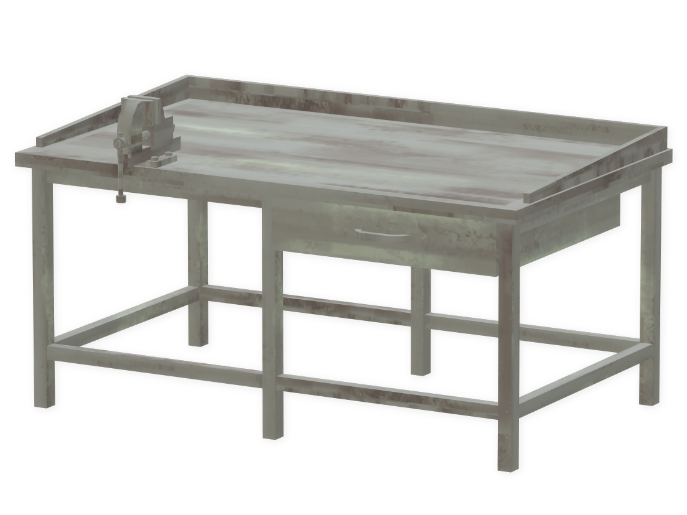
<figcaption>Metal</figcaption>
</figure></td>
<td><figure>
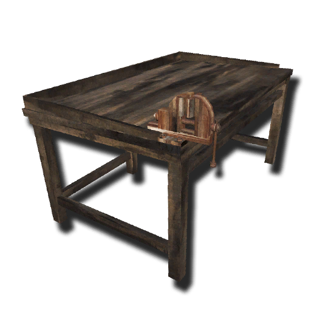
<figcaption>Craftable</figcaption>
</figure></td>
<td><figure>
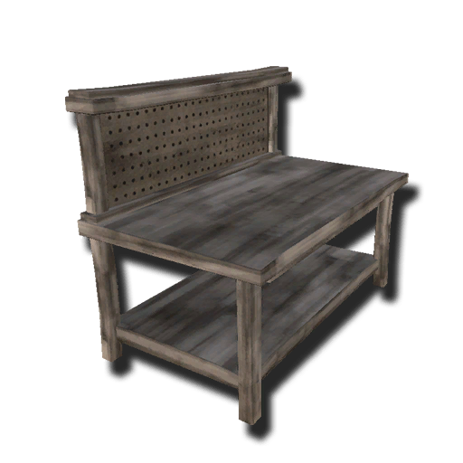
<figcaption>Wood</figcaption>
</figure></td>
</tr>
</tbody>
</table></td>
<td>
250px]]
</td>
</tr>
<tr>
<td colspan="2">
<strong>General</strong>
</td>
<td></td>
</tr>
<tr>
<td>
Item Type
</td>
<td>
Item
</td>
<td></td>
</tr>
<tr>
<td>
Wintermute
</td>
<td>
Yes|-
</td>
<td>
<strong>Statistics</strong>
</td>
</tr>
<tr>
<td>
Weight
</td>
<td>
5.00 kg(11 lbs)
</td>
<td></td>
</tr>
<tr>
<td>
Harvest
</td>
<td>
Metal 1 x 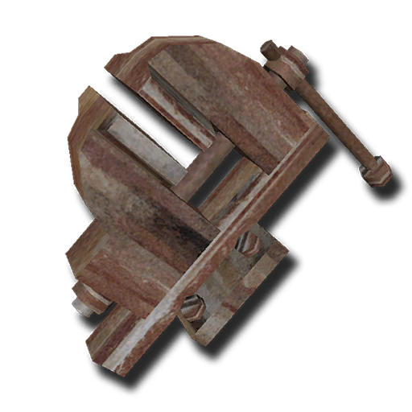 <a href="./Workbench%20Vice.md" class="wikilink" title="Workbench Vice">Workbench Vice</a> 10 x  <a href="./Scrap%20Metal.md" class="wikilink" title="Scrap Metal">Scrap Metal</a> 4 hours

Wood 1 x  <a href="./Workbench%20Vice.md" class="wikilink" title="Workbench Vice">Workbench Vice</a> 8 x  <a href="./Reclaimed%20Wood.md" class="wikilink" title="Reclaimed Wood">Reclaimed Wood</a> 3 hours

Craftable 1 x  <a href="./Workbench%20Vice.md" class="wikilink" title="Workbench Vice">Workbench Vice</a> 10 x  <a href="./Cedar%20Firewood.md" class="wikilink" title="Cedar Firewood">Cedar Firewood</a> 1.45 hours
</td>
<td></td>
</tr>
</tbody>
</table>

A **Work Bench** is an Interactable Object used for <a href="./Crafting.md" class="wikilink" title="Crafting">Crafting</a> new items, and is found across many locations in <a href="./The%20Long%20Dark.md" class="wikilink" title="The Long Dark"><em>The Long Dark</em></a>.

## Overview

The Work Bench is a dedicated workspace that makes use of a <a href="./Workbench%20Vice.md" class="wikilink" title="Workbench Vice">Workbench Vice</a> to create more useful items that cannot normally be created by hand. 2 versions can be found across <a href="./Great%20Bear%20Island.md" class="wikilink" title="Great Bear Island">Great Bear Island</a>, a metal or wood version. The metal one has a <a href="./Drawer.md" class="wikilink" title="Drawer">Drawer</a>, while the wood version does not.

Different tools can be used to create different items. Higher quality tools (such as knives, hatchets, and Sewing Kits) can speed up the creation process (providing up to a 50% time discount) compared to their makeshift counterparts (improvised tools/Fishing Tackles).

- A <a href="./Sewing%20Kit.md" class="wikilink" title="Sewing Kit">Sewing Kit</a> or <a href="./Fishing%20Tackle.md" class="wikilink" title="Fishing Tackle">Fishing Tackle</a> is required for crafting any piece of fur clothing
- A <a href="./Hunting%20Knife.md" class="wikilink" title="Hunting Knife">Hunting Knife</a>/<a href="./Hatchet.md" class="wikilink" title="Hatchet">Hatchet</a> is required to craft bear-skin bedrolls, wolf-skin coats, simple arrows, a survival bow, or arrow shafts.
- Sometimes, items do not require any tools to craft, but using <a href="./Simple%20Tools.md" class="wikilink" title="Simple Tools">Simple Tools</a>/<a href="./Quality%20Tools.md" class="wikilink" title="Quality Tools">Quality Tools</a> can speed up the creation process.

Since some of these items require a considerable amount of time to complete, the work can be done in intervals without losing any progress. The minimum amount of time to spent is half an hour. According to the overall progress the required materials will be consumed and the semi-finished product will appear in the player's inventory.

Note - <a href="./Fishing%20Tackle.md" class="wikilink" title="Fishing Tackles">Fishing Tackles</a>, <a href="./Bandage.md" class="wikilink" title="Bandages">Bandages</a>, <a href="./Old%20Man%27s%20Beard%20Wound%20Dressing.md" class="wikilink" title="Old Man&#39;s Beard Wound Dressings">Old Man's Beard Wound Dressings</a>, <a href="./Tinder%20Plug.md" class="wikilink" title="Tinder Plugs">Tinder Plugs</a>, and <a href="./Torch.md" class="wikilink" title="Torches">Torches</a> do not need a Work Bench. They can normally be crafted anywhere, but the option to create them will still appear while using a Work Bench.

## Craftable Items

Only one item of each type can be worked on at any given time. Optional tools that can be used below are in *Italics*:

<table>
<colgroup>
<col style="width: 25%" />
<col style="width: 25%" />
<col style="width: 25%" />
<col style="width: 25%" />
</colgroup>
<thead>
<tr>
<th>
Recipe
</th>
<th>
Materials
</th>
<th>
Time
</th>
<th>
Tools Needed
</th>
</tr>
</thead>
<tbody>
<tr>
<td>
3x <a href="./Arrow%20Shaft.md" class="wikilink" title="Arrow Shaft">Arrow Shaft</a>
</td>
<td>
1x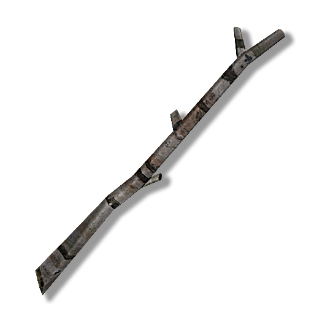 <a href="./Cured%20Birch%20Sapling.md" class="wikilink" title="Cured Birch Sapling">Cured Birch Sapling</a>
</td>
<td>
30 to 60 Min
</td>
<td><ul>
<li> <a href="./Hunting%20Knife.md" class="wikilink" title="Hunting Knife">Hunting Knife</a></li>
<li> <a href="./Improvised%20Knife.md" class="wikilink" title="Improvised Knife">Improvised Knife</a></li>
<li> <a href="./Cougar%20Claw%20Knife.md" class="wikilink" title="Cougar Claw Knife">Cougar Claw Knife</a></li>
<li> <a href="./Survival%20Knife.md" class="wikilink" title="Survival Knife">Survival Knife</a></li>
<li> <a href="./Hatchet.md" class="wikilink" title="Hatchet">Hatchet</a></li>
<li> <a href="./Improvised%20Hatchet.md" class="wikilink" title="Improvised Hatchet">Improvised Hatchet</a></li>
</ul></td>
</tr>
<tr>
<td>
 <a href="./Bear%20Hide%20Rug.md" class="wikilink" title="Bear Hide Rug">Bear Hide Rug</a>
</td>
<td><ul>
<li>1x <a href="./Cured%20Deer%20Hide.md" class="wikilink" title="Cured Deer Hide">Cured Deer Hide</a></li>
<li>1x <a href="./Cured%20Black%20Bear%20Hide.md" class="wikilink" title="Cured Black Bear Hide">Cured Black Bear Hide</a></li>
<li>2x <a href="./Cured%20Gut.md" class="wikilink" title="Cured Gut">Cured Gut</a></li>
</ul></td>
<td>
8 Hours
</td>
<td>
 <a href="./Quality%20Tools.md" class="wikilink" title="Quality Tools">Quality Tools</a>
</td>
</tr>
<tr>
<td>
 <a href="./Bear%20Skin%20Bedroll.md" class="wikilink" title="Bear Skin Bedroll">Bear Skin Bedroll</a>
</td>
<td><ul>
<li>2x <a href="./Cured%20Black%20Bear%20Hide.md" class="wikilink" title="Cured Black Bear Hide">Cured Black Bear Hide</a></li>
<li>5x <a href="./Cloth.md" class="wikilink" title="Cloth">Cloth</a></li>
<li>6x <a href="./Cured%20Gut.md" class="wikilink" title="Cured Gut">Cured Gut</a></li>
</ul></td>
<td>
17 Hours 30 Min to 35 Hours
</td>
<td><ul>
<li> <a href="./Hunting%20Knife.md" class="wikilink" title="Hunting Knife">Hunting Knife</a></li>
<li> <a href="./Improvised%20Knife.md" class="wikilink" title="Improvised Knife">Improvised Knife</a></li>
<li> <a href="./Cougar%20Claw%20Knife.md" class="wikilink" title="Cougar Claw Knife">Cougar Claw Knife</a></li>
<li> <a href="./Survival%20Knife.md" class="wikilink" title="Survival Knife">Survival Knife</a></li>
<li> <a href="./Hatchet.md" class="wikilink" title="Hatchet">Hatchet</a></li>
<li> <a href="./Improvised%20Hatchet.md" class="wikilink" title="Improvised Hatchet">Improvised Hatchet</a></li>
</ul></td>
</tr>
<tr>
<td>
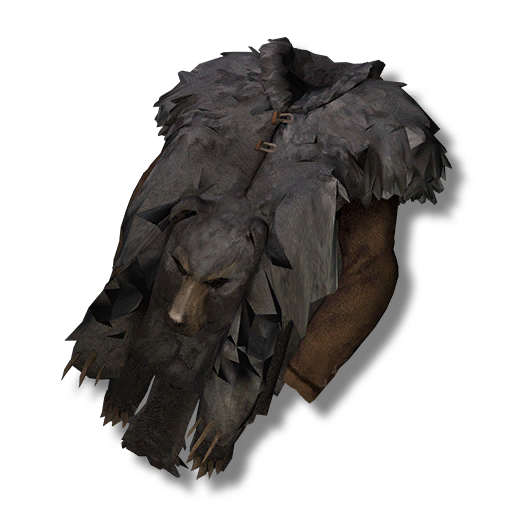 <a href="./Bearskin%20Coat.md" class="wikilink" title="Bearskin Coat">Bearskin Coat</a>
</td>
<td><ul>
<li>2x <a href="./Cured%20Black%20Bear%20Hide.md" class="wikilink" title="Cured Black Bear Hide">Cured Black Bear Hide</a></li>
<li>4x <a href="./Cured%20Gut.md" class="wikilink" title="Cured Gut">Cured Gut</a></li>
</ul></td>
<td>
30 to 60 Hours
</td>
<td><ul>
<li> <a href="./Hunting%20Knife.md" class="wikilink" title="Hunting Knife">Hunting Knife</a></li>
<li> <a href="./Improvised%20Knife.md" class="wikilink" title="Improvised Knife">Improvised Knife</a></li>
<li> <a href="./Cougar%20Claw%20Knife.md" class="wikilink" title="Cougar Claw Knife">Cougar Claw Knife</a></li>
<li> <a href="./Survival%20Knife.md" class="wikilink" title="Survival Knife">Survival Knife</a></li>
<li> <a href="./Hatchet.md" class="wikilink" title="Hatchet">Hatchet</a></li>
<li> <a href="./Improvised%20Hatchet.md" class="wikilink" title="Improvised Hatchet">Improvised Hatchet</a></li>
</ul></td>
</tr>
<tr>
<td>
 <a href="./Bushcraft%20Bow.md" class="wikilink" title="Bushcraft Bow">Bushcraft Bow</a> (requires <a href="./Bushcraft%20Bow%20Blueprint%20Card.md" class="wikilink" title="Bushcraft Bow Blueprint Card">Bushcraft Bow Blueprint Card</a>)
</td>
<td><ul>
<li>2x <a href="./Green%20Birch%20Sapling.md" class="wikilink" title="Green Birch Sapling">Green Birch Sapling</a></li>
<li>2x <a href="./Cured%20Gut.md" class="wikilink" title="Cured Gut">Cured Gut</a></li>
</ul></td>
<td>
5 hours
</td>
<td><ul>
<li> <a href="./Hunting%20Knife.md" class="wikilink" title="Hunting Knife">Hunting Knife</a></li>
<li> <a href="./Improvised%20Knife.md" class="wikilink" title="Improvised Knife">Improvised Knife</a></li>
<li> <a href="./Cougar%20Claw%20Knife.md" class="wikilink" title="Cougar Claw Knife">Cougar Claw Knife</a></li>
<li> <a href="./Survival%20Knife.md" class="wikilink" title="Survival Knife">Survival Knife</a></li>
<li> <a href="./Hatchet.md" class="wikilink" title="Hatchet">Hatchet</a></li>
<li> <a href="./Improvised%20Hatchet.md" class="wikilink" title="Improvised Hatchet">Improvised Hatchet</a></li>
</ul></td>
</tr>
<tr>
<td>
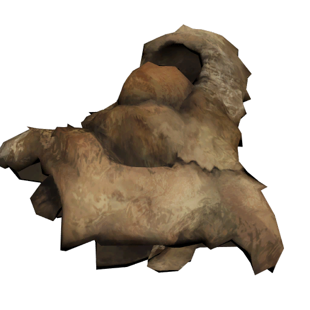 <a href="./Cougar%20Hide%20Wrap.md" class="wikilink" title="Cougar Hide Wrap">Cougar Hide Wrap</a> (Blueprint doesn't appear on <a href="./Pilgrim.md" class="wikilink" title="Pilgrim">Pilgrim</a>)
</td>
<td><ul>
<li>1x <a href="./Cured%20Cougar%20Hide.md" class="wikilink" title="Cured Cougar Hide">Cured Cougar Hide</a></li>
<li>2x <a href="./Cured%20Gut.md" class="wikilink" title="Cured Gut">Cured Gut</a></li>
</ul></td>
<td>
11 Hours 40 Min to 23 Hours 20 Min
</td>
<td><ul>
<li> <a href="./Sewing%20Kit.md" class="wikilink" title="Sewing Kit">Sewing Kit</a></li>
<li> <a href="./Fishing%20Tackle.md" class="wikilink" title="Fishing Tackle">Fishing Tackle</a></li>
</ul></td>
</tr>
<tr>
<td>
 <a href="./Deerskin%20Boots.md" class="wikilink" title="Deerskin Boots">Deerskin Boots</a>
</td>
<td><ul>
<li>2x <a href="./Cured%20Deer%20Hide.md" class="wikilink" title="Cured Deer Hide">Cured Deer Hide</a></li>
<li>4x <a href="./Cured%20Gut.md" class="wikilink" title="Cured Gut">Cured Gut</a></li>
</ul></td>
<td>
12 Hours 30 Min to 25 Hours
</td>
<td><ul>
<li> <a href="./Sewing%20Kit.md" class="wikilink" title="Sewing Kit">Sewing Kit</a></li>
<li> <a href="./Fishing%20Tackle.md" class="wikilink" title="Fishing Tackle">Fishing Tackle</a></li>
</ul></td>
</tr>
<tr>
<td>
 <a href="./Deerskin%20Pants.md" class="wikilink" title="Deerskin Pants">Deerskin Pants</a>
</td>
<td><ul>
<li>3x <a href="./Cured%20Deer%20Hide.md" class="wikilink" title="Cured Deer Hide">Cured Deer Hide</a></li>
<li>4x <a href="./Cured%20Gut.md" class="wikilink" title="Cured Gut">Cured Gut</a></li>
</ul></td>
<td>
12 Hours 30 Min to 25 Hours
</td>
<td><ul>
<li> <a href="./Sewing%20Kit.md" class="wikilink" title="Sewing Kit">Sewing Kit</a></li>
<li> <a href="./Fishing%20Tackle.md" class="wikilink" title="Fishing Tackle">Fishing Tackle</a></li>
</ul></td>
</tr>
<tr>
<td>
 <a href="./Fishing%20Lure%20%28Acorns%29.md" class="wikilink" title="Fishing Lure (Acorns)">Fishing Lure (Acorns)</a>
</td>
<td><ul>
<li>1x <a href="./Scrap%20Metal.md" class="wikilink" title="Scrap Metal">Scrap Metal</a></li>
<li>1x <a href="./Crow%20Feather.md" class="wikilink" title="Crow Feather">Crow Feather</a></li>
<li>1x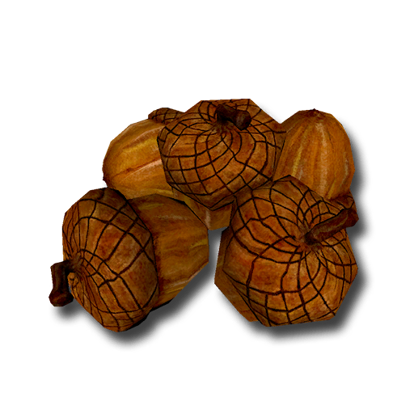 <a href="./Acorns.md" class="wikilink" title="Acorns">Acorns</a></li>
</ul></td>
<td>
25-50 Minutes
</td>
<td><ul>
<li><em> <a href="./Simple%20Tools.md" class="wikilink" title="Simple Tools">Simple Tools</a></em></li>
<li><em> <a href="./Quality%20Tools.md" class="wikilink" title="Quality Tools">Quality Tools</a></em></li>
</ul></td>
</tr>
<tr>
<td>
 <a href="./Fishing%20Lure%20%28Revolver%20Shell%20Casing%29.md" class="wikilink" title="Fishing Lure (Revolver Shell Casing)">Fishing Lure (Revolver Shell Casing)</a>
</td>
<td><ul>
<li>1x <a href="./Scrap%20Metal.md" class="wikilink" title="Scrap Metal">Scrap Metal</a></li>
<li>1x <a href="./Crow%20Feather.md" class="wikilink" title="Crow Feather">Crow Feather</a></li>
<li>1x <a href="./Revolver%20Shell%20Casing.md" class="wikilink" title="Revolver Shell Casing">Revolver Shell Casing</a></li>
</ul></td>
<td>
25-50 Minutes
</td>
<td><ul>
<li><em> <a href="./Simple%20Tools.md" class="wikilink" title="Simple Tools">Simple Tools</a></em></li>
<li><em> <a href="./Quality%20Tools.md" class="wikilink" title="Quality Tools">Quality Tools</a></em></li>
</ul></td>
</tr>
<tr>
<td>
 <a href="./Fishing%20Lure%20%28Wire%20Bundle%29.md" class="wikilink" title="Fishing Lure (Wire Bundle)">Fishing Lure (Wire Bundle)</a>
</td>
<td><ul>
<li>1x <a href="./Scrap%20Metal.md" class="wikilink" title="Scrap Metal">Scrap Metal</a></li>
<li>1x <a href="./Crow%20Feather.md" class="wikilink" title="Crow Feather">Crow Feather</a></li>
<li>1x <a href="./Wires.md" class="wikilink" title="Wires">Wires</a></li>
</ul></td>
<td>
25-50 Minutes
</td>
<td><ul>
<li><em> <a href="./Simple%20Tools.md" class="wikilink" title="Simple Tools">Simple Tools</a></em></li>
<li><em> <a href="./Quality%20Tools.md" class="wikilink" title="Quality Tools">Quality Tools</a></em></li>
</ul></td>
</tr>
<tr>
<td>
 <a href="./Fishing%20Tip-Up.md" class="wikilink" title="Fishing Tip-Up">Fishing Tip-Up</a>
</td>
<td><ul>
<li>2x <a href="./Stick.md" class="wikilink" title="Stick">Stick</a></li>
<li>1x <a href="./Cloth.md" class="wikilink" title="Cloth">Cloth</a></li>
<li>1x <a href="./Scrap%20Metal.md" class="wikilink" title="Scrap Metal">Scrap Metal</a></li>
<li>1x <a href="./Fishing%20Tackle.md" class="wikilink" title="Fishing Tackle">Fishing Tackle</a></li>
</ul></td>
<td>
20-40 Min
</td>
<td><ul>
<li><em> <a href="./Simple%20Tools.md" class="wikilink" title="Simple Tools">Simple Tools</a></em></li>
<li><em> <a href="./Quality%20Tools.md" class="wikilink" title="Quality Tools">Quality Tools</a></em></li>
</ul></td>
</tr>
<tr>
<td>
3x <a href="./Hook.md" class="wikilink" title="Hook">Hook</a>
</td>
<td>
1x <a href="./Scrap%20Metal.md" class="wikilink" title="Scrap Metal">Scrap Metal</a>
</td>
<td>
10-20 Min
</td>
<td><ul>
<li><em> <a href="./Simple%20Tools.md" class="wikilink" title="Simple Tools">Simple Tools</a></em></li>
<li><em> <a href="./Quality%20Tools.md" class="wikilink" title="Quality Tools">Quality Tools</a></em></li>
</ul></td>
</tr>
<tr>
<td>
 <a href="./Improvised%20Crampons.md" class="wikilink" title="Improvised Crampons">Improvised Crampons</a>
</td>
<td><ul>
<li>4x <a href="./Scrap%20Metal.md" class="wikilink" title="Scrap Metal">Scrap Metal</a></li>
<li>2x <a href="./Cured%20Leather.md" class="wikilink" title="Cured Leather">Cured Leather</a></li>
</ul></td>
<td>
2-4 Hours
</td>
<td><ul>
<li><em> <a href="./Simple%20Tools.md" class="wikilink" title="Simple Tools">Simple Tools</a></em></li>
<li><em> <a href="./Quality%20Tools.md" class="wikilink" title="Quality Tools">Quality Tools</a></em></li>
</ul></td>
</tr>
<tr>
<td>
2x <a href="./Line.md" class="wikilink" title="Line">Line</a>
</td>
<td>
1x <a href="./Cured%20Gut.md" class="wikilink" title="Cured Gut">Cured Gut</a>
</td>
<td>
15 Min
</td>
<td>
None
</td>
</tr>
<tr>
<td>
 <a href="./Moose-Hide%20Cloak.md" class="wikilink" title="Moose-Hide Cloak">Moose-Hide Cloak</a>
</td>
<td><ul>
<li>1x <a href="./Cured%20Moose%20Hide.md" class="wikilink" title="Cured Moose Hide">Cured Moose Hide</a></li>
<li>4x <a href="./Cured%20Gut.md" class="wikilink" title="Cured Gut">Cured Gut</a></li>
</ul></td>
<td>
16 Hours 40 Min to 33 Hours 20 Min
</td>
<td><ul>
<li> <a href="./Hunting%20Knife.md" class="wikilink" title="Hunting Knife">Hunting Knife</a></li>
<li> <a href="./Improvised%20Knife.md" class="wikilink" title="Improvised Knife">Improvised Knife</a></li>
<li> <a href="./Cougar%20Claw%20Knife.md" class="wikilink" title="Cougar Claw Knife">Cougar Claw Knife</a></li>
<li> <a href="./Survival%20Knife.md" class="wikilink" title="Survival Knife">Survival Knife</a></li>
<li> <a href="./Hatchet.md" class="wikilink" title="Hatchet">Hatchet</a></li>
<li> <a href="./Improvised%20Hatchet.md" class="wikilink" title="Improvised Hatchet">Improvised Hatchet</a></li>
</ul></td>
</tr>
<tr>
<td>
 <a href="./Moose-Hide%20Satchel.md" class="wikilink" title="Moose-Hide Satchel">Moose-Hide Satchel</a>
</td>
<td><ul>
<li>1x <a href="./Cured%20Moose%20Hide.md" class="wikilink" title="Cured Moose Hide">Cured Moose Hide</a></li>
<li>2x <a href="./Cured%20Gut.md" class="wikilink" title="Cured Gut">Cured Gut</a></li>
</ul></td>
<td>
10 to 20 Hours
</td>
<td><ul>
<li> <a href="./Sewing%20Kit.md" class="wikilink" title="Sewing Kit">Sewing Kit</a></li>
<li> <a href="./Fishing%20Tackle.md" class="wikilink" title="Fishing Tackle">Fishing Tackle</a></li>
</ul></td>
</tr>
<tr>
<td>
 <a href="./Rabbitskin%20Hat.md" class="wikilink" title="Rabbitskin Hat">Rabbitskin Hat</a>
</td>
<td><ul>
<li>3x <a href="./Cured%20Rabbit%20Pelt.md" class="wikilink" title="Cured Rabbit Pelt">Cured Rabbit Pelt</a></li>
<li>1x <a href="./Cured%20Gut.md" class="wikilink" title="Cured Gut">Cured Gut</a></li>
</ul></td>
<td>
3 Hours 30 Min to 7 Hours
</td>
<td><ul>
<li> <a href="./Sewing%20Kit.md" class="wikilink" title="Sewing Kit">Sewing Kit</a></li>
<li> <a href="./Fishing%20Tackle.md" class="wikilink" title="Fishing Tackle">Fishing Tackle</a></li>
</ul></td>
</tr>
<tr>
<td>
 <a href="./Rabbitskin%20Mitts.md" class="wikilink" title="Rabbitskin Mitts">Rabbitskin Mitts</a>
</td>
<td><ul>
<li>4x <a href="./Cured%20Rabbit%20Pelt.md" class="wikilink" title="Cured Rabbit Pelt">Cured Rabbit Pelt</a></li>
<li>2x <a href="./Cured%20Gut.md" class="wikilink" title="Cured Gut">Cured Gut</a></li>
</ul></td>
<td>
5 to 10 Hours
</td>
<td><ul>
<li> <a href="./Sewing%20Kit.md" class="wikilink" title="Sewing Kit">Sewing Kit</a></li>
<li> <a href="./Fishing%20Tackle.md" class="wikilink" title="Fishing Tackle">Fishing Tackle</a></li>
</ul></td>
</tr>
<tr>
<td>
 <a href="./Simple%20Arrow.md" class="wikilink" title="Simple Arrow">Simple Arrow</a>
</td>
<td><ul>
<li>1x <a href="./Arrowhead.md" class="wikilink" title="Arrowhead">Arrowhead</a></li>
<li>1x <a href="./Arrow%20Shaft.md" class="wikilink" title="Arrow Shaft">Arrow Shaft</a></li>
<li>3x <a href="./Crow%20Feather.md" class="wikilink" title="Crow Feather">Crow Feather</a></li>
</ul></td>
<td>
45 to 90 Min
</td>
<td><ul>
<li><em> <a href="./Simple%20Tools.md" class="wikilink" title="Simple Tools">Simple Tools</a></em></li>
<li><em> <a href="./Quality%20Tools.md" class="wikilink" title="Quality Tools">Quality Tools</a></em></li>
</ul></td>
</tr>
<tr>
<td>
 <a href="./Simple%20Fishing%20Lure.md" class="wikilink" title="Simple Fishing Lure">Simple Fishing Lure</a>
</td>
<td>
1x <a href="./Scrap%20Metal.md" class="wikilink" title="Scrap Metal">Scrap Metal</a>
</td>
<td>
15-30 Min
</td>
<td><ul>
<li><em> <a href="./Simple%20Tools.md" class="wikilink" title="Simple Tools">Simple Tools</a></em></li>
<li><em> <a href="./Quality%20Tools.md" class="wikilink" title="Quality Tools">Quality Tools</a></em></li>
</ul></td>
</tr>
<tr>
<td>
 <a href="./Snare.md" class="wikilink" title="Snare">Snare</a>
</td>
<td><ul>
<li>1x <a href="./Cured%20Gut.md" class="wikilink" title="Cured Gut">Cured Gut</a></li>
<li>1x <a href="./Reclaimed%20Wood.md" class="wikilink" title="Reclaimed Wood">Reclaimed Wood</a></li>
</ul></td>
<td>
15-30 Min
</td>
<td><ul>
<li><em> <a href="./Simple%20Tools.md" class="wikilink" title="Simple Tools">Simple Tools</a></em></li>
<li><em> <a href="./Quality%20Tools.md" class="wikilink" title="Quality Tools">Quality Tools</a></em></li>
</ul></td>
</tr>
<tr>
<td>
 <a href="./Survival%20Bow.md" class="wikilink" title="Survival Bow">Survival Bow</a>
</td>
<td><ul>
<li>1x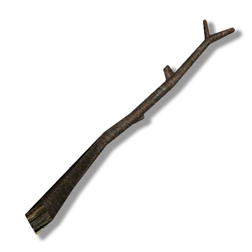 <a href="./Cured%20Maple%20Sapling.md" class="wikilink" title="Cured Maple Sapling">Cured Maple Sapling</a></li>
<li>2x <a href="./Cured%20Gut.md" class="wikilink" title="Cured Gut">Cured Gut</a></li>
</ul></td>
<td>
5 to 10 Hours
</td>
<td><ul>
<li> <a href="./Hunting%20Knife.md" class="wikilink" title="Hunting Knife">Hunting Knife</a></li>
<li> <a href="./Improvised%20Knife.md" class="wikilink" title="Improvised Knife">Improvised Knife</a></li>
<li> <a href="./Cougar%20Claw%20Knife.md" class="wikilink" title="Cougar Claw Knife">Cougar Claw Knife</a></li>
<li> <a href="./Survival%20Knife.md" class="wikilink" title="Survival Knife">Survival Knife</a></li>
<li> <a href="./Hatchet.md" class="wikilink" title="Hatchet">Hatchet</a></li>
<li> <a href="./Improvised%20Hatchet.md" class="wikilink" title="Improvised Hatchet">Improvised Hatchet</a></li>
</ul></td>
</tr>
<tr>
<td>
[Missing image: Travois_icon.png] <a href="./Travois.md" class="wikilink" title="Travois">Travois</a>
</td>
<td><ul>
<li>1x <a href="./Cured%20Deer%20Hide.md" class="wikilink" title="Cured Deer Hide">Cured Deer Hide</a></li>
<li>2x <a href="./Cured%20Gut.md" class="wikilink" title="Cured Gut">Cured Gut</a></li>
<li>4x <a href="./Cured%20Maple%20Sapling.md" class="wikilink" title="Cured Maple Sapling">Cured Maple Sapling</a></li>
</ul></td>
<td>
3 to 6 Hours
</td>
<td><ul>
<li> <a href="./Hunting%20Knife.md" class="wikilink" title="Hunting Knife">Hunting Knife</a></li>
<li> <a href="./Improvised%20Knife.md" class="wikilink" title="Improvised Knife">Improvised Knife</a></li>
<li> <a href="./Cougar%20Claw%20Knife.md" class="wikilink" title="Cougar Claw Knife">Cougar Claw Knife</a></li>
<li> <a href="./Survival%20Knife.md" class="wikilink" title="Survival Knife">Survival Knife</a></li>
<li> <a href="./Hatchet.md" class="wikilink" title="Hatchet">Hatchet</a></li>
<li> <a href="./Improvised%20Hatchet.md" class="wikilink" title="Improvised Hatchet">Improvised Hatchet</a></li>
</ul></td>
</tr>
<tr>
<td>
 <a href="./Wolfskin%20Coat.md" class="wikilink" title="Wolfskin Coat">Wolfskin Coat</a>
</td>
<td><ul>
<li>4x <a href="./Cured%20Wolf%20Pelt.md" class="wikilink" title="Cured Wolf Pelt">Cured Wolf Pelt</a></li>
<li>4x <a href="./Cured%20Gut.md" class="wikilink" title="Cured Gut">Cured Gut</a></li>
</ul></td>
<td>
25 to 50 Hours
</td>
<td><ul>
<li> <a href="./Hunting%20Knife.md" class="wikilink" title="Hunting Knife">Hunting Knife</a></li>
<li> <a href="./Improvised%20Knife.md" class="wikilink" title="Improvised Knife">Improvised Knife</a></li>
<li> <a href="./Cougar%20Claw%20Knife.md" class="wikilink" title="Cougar Claw Knife">Cougar Claw Knife</a></li>
<li> <a href="./Survival%20Knife.md" class="wikilink" title="Survival Knife">Survival Knife</a></li>
<li> <a href="./Hatchet.md" class="wikilink" title="Hatchet">Hatchet</a></li>
<li> <a href="./Improvised%20Hatchet.md" class="wikilink" title="Improvised Hatchet">Improvised Hatchet</a></li>
</ul></td>
</tr>
<tr>
<td>
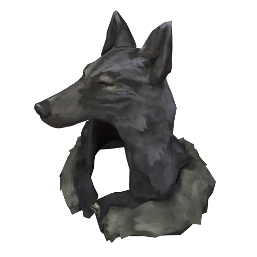 <a href="./Wolfskin%20Hat.md" class="wikilink" title="Wolfskin Hat">Wolfskin Hat</a> (requires <a href="./Wolfskin%20Hat%20Blueprint%20Card.md" class="wikilink" title="Wolfskin Hat Blueprint Card">Wolfskin Hat Blueprint Card</a>)
</td>
<td><ul>
<li>1x <a href="./Cured%20Wolf%20Pelt.md" class="wikilink" title="Cured Wolf Pelt">Cured Wolf Pelt</a></li>
<li>2x <a href="./Cured%20Gut.md" class="wikilink" title="Cured Gut">Cured Gut</a></li>
</ul></td>
<td>
17 hours
</td>
<td><ul>
<li> <a href="./Hunting%20Knife.md" class="wikilink" title="Hunting Knife">Hunting Knife</a></li>
<li> <a href="./Improvised%20Knife.md" class="wikilink" title="Improvised Knife">Improvised Knife</a></li>
<li> <a href="./Cougar%20Claw%20Knife.md" class="wikilink" title="Cougar Claw Knife">Cougar Claw Knife</a></li>
<li> <a href="./Survival%20Knife.md" class="wikilink" title="Survival Knife">Survival Knife</a></li>
<li> <a href="./Hatchet.md" class="wikilink" title="Hatchet">Hatchet</a></li>
<li> <a href="./Improvised%20Hatchet.md" class="wikilink" title="Improvised Hatchet">Improvised Hatchet</a></li>
</ul></td>
</tr>
<tr>
<td>
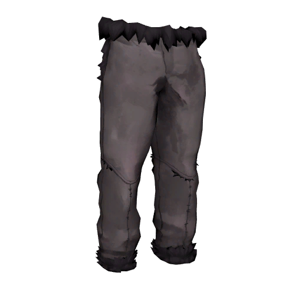 <a href="./Wolfskin%20Pants.md" class="wikilink" title="Wolfskin Pants">Wolfskin Pants</a> (requires <a href="./Wolfskin%20Pants%20Blueprint%20Card.md" class="wikilink" title="Wolfskin Pants Blueprint Card">Wolfskin Pants Blueprint Card</a>)
</td>
<td><ul>
<li>4x <a href="./Cured%20Wolf%20Pelt.md" class="wikilink" title="Cured Wolf Pelt">Cured Wolf Pelt</a></li>
<li>3x <a href="./Cured%20Gut.md" class="wikilink" title="Cured Gut">Cured Gut</a></li>
</ul></td>
<td>
29 hours
</td>
<td><ul>
<li> <a href="./Hunting%20Knife.md" class="wikilink" title="Hunting Knife">Hunting Knife</a></li>
<li> <a href="./Improvised%20Knife.md" class="wikilink" title="Improvised Knife">Improvised Knife</a></li>
<li> <a href="./Cougar%20Claw%20Knife.md" class="wikilink" title="Cougar Claw Knife">Cougar Claw Knife</a></li>
<li> <a href="./Survival%20Knife.md" class="wikilink" title="Survival Knife">Survival Knife</a></li>
<li> <a href="./Hatchet.md" class="wikilink" title="Hatchet">Hatchet</a></li>
<li> <a href="./Improvised%20Hatchet.md" class="wikilink" title="Improvised Hatchet">Improvised Hatchet</a></li>
</ul></td>
</tr>
<tr>
<td>
 <a href="./Noisemaker.md" class="wikilink" title="Noisemaker">Noisemaker</a> (Wintermute <a href="./Episode%204%20-%20Fury%2C%20Then%20Silence.md" class="wikilink" title="EP4">EP4</a> only)
</td>
<td><ul>
<li>1x <a href="./Recycled%20Can.md" class="wikilink" title="Recycled Can">Recycled Can</a></li>
<li>1x <a href="./Cloth.md" class="wikilink" title="Cloth">Cloth</a></li>
<li>0.10kg x <a href="./Can%20of%20Gunpowder.md" class="wikilink" title="Can of Gunpowder">Can of Gunpowder</a></li>
</ul></td>
<td>
30 Min
</td>
<td>
None
</td>
</tr>
</tbody>
</table>

## Craftable Decorations Work Bench

 A craftable <a href="./Decorations.md" class="wikilink" title="Decorations">Decorations</a> Work Bench is a wooden variant of the common wooden Work Bench, albeit without the Drawer. This allows the player to craft a Work Bench at <a href="./Safehouse.md" class="wikilink" title="Safehouse">Safehouse</a> locations that do not normally contain one, providing better Crafting opportunities and requiring less traveling to dangerous locations.

A player made Work Bench can be crafted at a <a href="./Furniture%20Workbench.md" class="wikilink" title="Furniture Workbench">Furniture Workbench</a>, but requires <a href="./Woodworking%20Tools.md" class="wikilink" title="Woodworking Tools">Woodworking Tools</a> and a <a href="./Workbench%20Vice.md" class="wikilink" title="Workbench Vice">Workbench Vice</a>. Progress for Crafting this item will be stored in the Furniture Workbench's container inventory, rather than the player's inventory. Once crafted, the item can be automatically placed in the Safehouse. Canceling this prompt will force the item back into the Furniture Workbench's container inventory. The Work Bench can only be placed on a wide, clear space on the floor or a flat surface when in Customization Mode.

Despite having a Backpack carry weight value of 5.00 kg, a player made Work Bench cannot be picked up and placed back into the player's inventory once crafted, and so it cannot be carried from one base to another. The only option is to move, harvest, or destroy it (destroying the Work Bench will yield no resources, so consider the material cost/time investment before creating this item).

**WARNING! Using the Destroy option on any Work Bench will PERMENANTLY destroy the Workbench Vice!!!** If you wish to rebuild the Work Bench somewhere else, always choose the Harvest option when outside of Safehouse Customization mode to safely destroy the Work Bench.

<table class="infobox">
<caption>Workbench</caption>
<tbody>
<tr>
<td colspan="2">
-
</td>
</tr>
<tr>
<td colspan="2">
-
</td>
</tr>
<tr>
<td colspan="2">
1080 minutes (18 hour 0 minutes)
</td>
</tr>
<tr>
<td colspan="2" class="section">
<strong>Requirements</strong>
</td>
</tr>
<tr>
<td>
Facility
</td>
<td>
<strong>Template:iconlink</strong>
</td>
</tr>
<tr>
<td>
Tool
</td>
<td>
<strong>Template:iconlink</strong>
</td>
</tr>
<tr>
<td colspan="2" class="section">
<strong>Materials</strong>
</td>
</tr>
<tr>
<td colspan="2" class="section">
<strong>Template:iconlink plain</strong>
</td>
</tr>
<tr>
<td>
Item
</td>
<td>
<a href="./Cedar%20Firewood.md" class="wikilink" title="Cedar Firewood">Cedar Firewood</a>
</td>
</tr>
<tr>
<td>
Quantity
</td>
<td>
15
</td>
</tr>
<tr>
<td colspan="2" class="section">
<strong>Template:iconlink plain</strong>
</td>
</tr>
<tr>
<td colspan="2">
<a href="./Workbench%20Vice.md" class="wikilink" title="Workbench Vice">Workbench Vice</a>
</td>
</tr>
<tr>
<td colspan="2">
1
</td>
</tr>
</tbody>
</table>

## Harvesting

Destroying a Work Bench allows the player to craft a new wooden Work Bench elsewhere as part of the <a href="./Safehouse%20Customization.md" class="wikilink" title="Safehouse Customization">Safehouse Customization</a> feature.

- A Metal Work Bench can be harvested with a <a href="./Hacksaw.md" class="wikilink" title="Hacksaw">Hacksaw</a> to produce a <a href="./Workbench%20Vice.md" class="wikilink" title="Workbench Vice">Workbench Vice</a> and 10 <a href="./Scrap%20Metal.md" class="wikilink" title="Scrap Metal">Scrap Metal</a> in 4 hours.
- A Wooden Work Bench can be harvested with a Hacksaw to produce a Workbench Vice and 8 <a href="./Reclaimed%20Wood.md" class="wikilink" title="Reclaimed Wood">Reclaimed Wood</a> in 3 hours.
- The player crafted Work Bench can be harvested with a <a href="./Hatchet.md" class="wikilink" title="Hatchet">Hatchet</a> to produce a Workbench Vice and 10 <a href="./Cedar%20Firewood.md" class="wikilink" title="Cedar Firewood">Cedar Firewood</a> in 1.45 hours.

There are currently 50 Work Benches found in the game, producing a limited amount of Vices to prevent the player from easily crafting infinite Work Benches.

  
*For a full list of locations with a Work Bench, see :Category:Locations with a workbench.*

## Gallery

<table class="gallery">
<colgroup>
<col style="width: 50%" />
<col style="width: 50%" />
</colgroup>
<tbody>
<tr>
<td><figure>

<figcaption>Trapper's Homestead work bench / Older version of the model</figcaption>
</figure></td>
<td><figure>
[Missing image: Work_Bench_Alt.jpg]
<figcaption>Less common work bench, without the drawer</figcaption>
</figure></td>
</tr>
</tbody>
</table>

**Lua execution error in Module:Navbox function navbox** <a href="ru:%D0%92%D0%B5%D1%80%D1%81%D1%82%D0%B0%D0%BA" class="wikilink" title="ru:Верстак">ru:Верстак</a> <a href="es:Banco_de_trabajo" class="wikilink" title="es:Banco de trabajo">es:Banco de trabajo</a>

