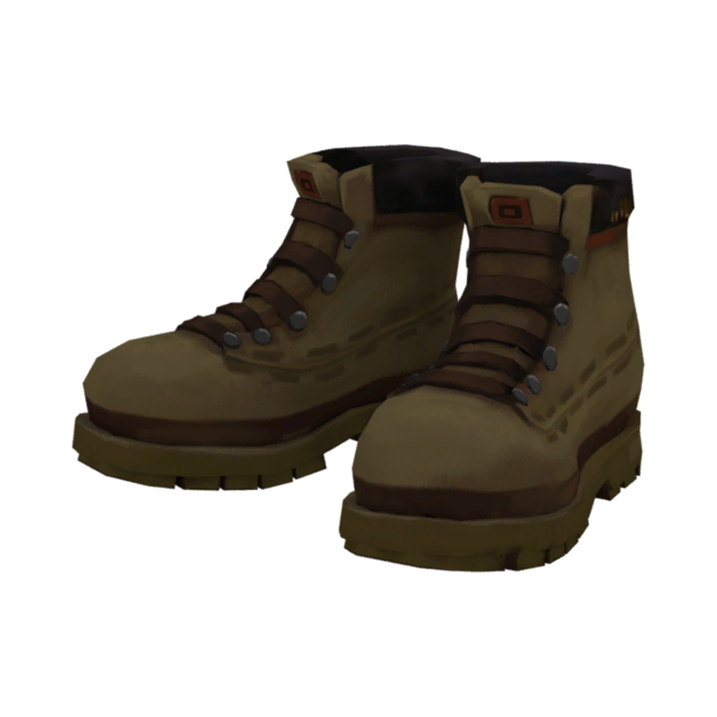

# Work Boots

**Categories:** Clothing · **Source:** [Fandom](https://thelongdark.fandom.com/wiki/Work_Boots)

**Work Boots**

**General**

**Item Type:** Clothing

**Clothing Slot:** Outer feet

**Statistics**

**Weight:** 1.50 kg(3.3 lbs)

**Warmth bonus:** 2.0 °C(3.6 °F)

**Windproof bonus:** 1.0 °C(1.8 °F)

**Waterproof bonus:** 5%

**Protection:** 7%

**Mobility:** -10%

**Harvest:** 2 × [Cured leather](./Cured%20Leather.md) 90 minutes

**Repair:** 1 × [Cured leather](./Cured%20Leather.md), 1 × [Cloth](./Cloth.md) 90 minutes 50% condition

> “**Steel-toed work boots. The kind you'd find on a construction site. Tough but not warm.**”
>
> — In-game description

**Work Boots** are a type of [footwear](./Clothing.md) in _The Long Dark_.

## Usefulness

Work Boots are mid-tier footwear and are much warmer than [Trail Boots](./Trail%20Boots.md) and starting footwear. They are also far more efficient to repair than other types of footwear, granting +50% more condition when successfully repaired for a single [cured leather](./Cured%20Leather.md) and [cloth](./Cloth.md). However, they have a large mobility penalty and aren't very waterproof.

## Gallery

