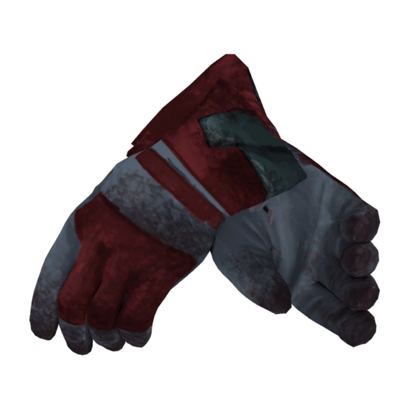
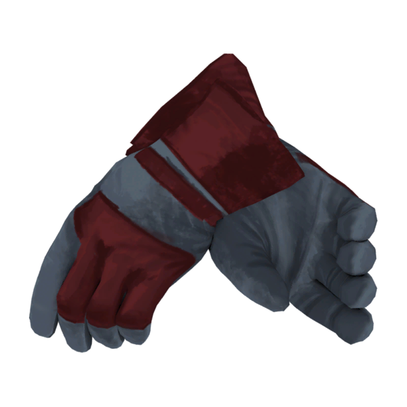

# Work Gloves

**Categories:** Clothing, Pages with update history · **Source:** [Fandom](https://thelongdark.fandom.com/wiki/Work_Gloves)

**Work Gloves**

_Work\_Gloves\_icon.png_

**General**

**Item Type:** Clothing

**Clothing Slot:** Hands

**Statistics**

**Weight:** 0.25 kg(0.55 lbs)

**Warmth bonus:** 1.0 °C(1.8 °F)

**Windproof bonus:** 0.5 °C(0.9 °F)

**Waterproof bonus:** 0%

**Protection:** 4%

**Mobility:** -2%

**Harvest:** 1 × [Cured leather](./Cured%20Leather.md) / 10 minutes

**Repair:** 1 × [Cured leather](./Cured%20Leather.md) / 30 minutes / 25% condition

> “**Heavy leather gloves designed to protect the hands on the worksite. Unfortunately, not really designed for warmth.**”
>
> — In-game description

**Work Gloves** are a type of [clothing](./Clothing.md) in _[The Long Dark](./The%20Long%20Dark.md)_.

## Overview

Work gloves have similar stats and appearance to the [Ski Gloves](./Ski%20Gloves.md), but provide more protection, less windchill bonus, and no waterproof bonus.

_Clothing model damaged_

_Clothing Model_

## Update history

- UPDATE **19 December 2016 ([Update](./The%20Long%20Dark%20%E2%80%94%20Early%20Access%20Changelog.md#0.386)):**
  - Added to game
