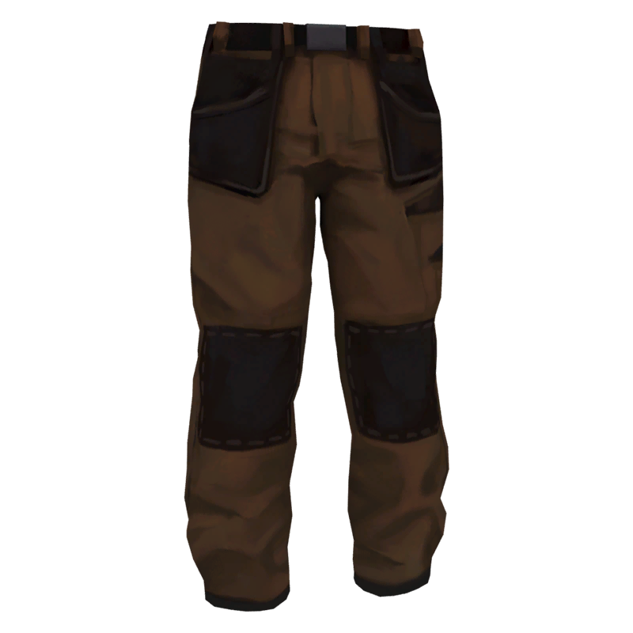
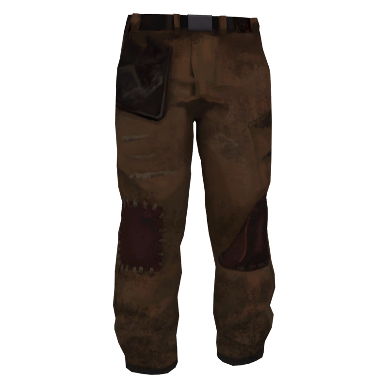

# Work Pants

**Categories:** Clothing, Pages with update history · **Source:** [Fandom](https://thelongdark.fandom.com/wiki/Work_Pants)

**Work Pants**

_Work\_Pants\_icon.png_

**General**

**Item Type:** Clothing\|-

**Clothing Slot:** Outer legs

**Statistics**

**Weight:** 1.50 kg(3.3 lbs)

**Warmth bonus:** 1.5 °C(2.7 °F)

**Windproof bonus:** 1.0 °C(1.8 °F)

**Waterproof bonus:** 10%

**Protection:** 8%

**Mobility:** -3%

**Harvest:** 1 × [Cloth](./Cloth.md) / 30 minutes

**Repair:** 1 × [Cloth](./Cloth.md) / 30 minutes / 30% condition

> “**A heavier duty type of jean, with some reinforced patches. Worn by construction workers the world round.**”
>
> — In-game description

**Work Pants** are a type of [clothing](./Clothing.md) in _The Long Dark_.

## Overview

High tier pants, Work Pants provide decent warmth and very good protection but are somewhat heavy. They pair well with [Snow Pants](./Snow%20Pants.md) until [Combat Pants](./Combat%20Pants.md) can be found which are generally superior.

_Clothing model icon_

_Clothing model icon damaged_

## Update history

- UPDATE **19 December 2016 ([Update](./The%20Long%20Dark%20%E2%80%94%20Early%20Access%20Changelog.md#0.386)):**
  - Added to game
