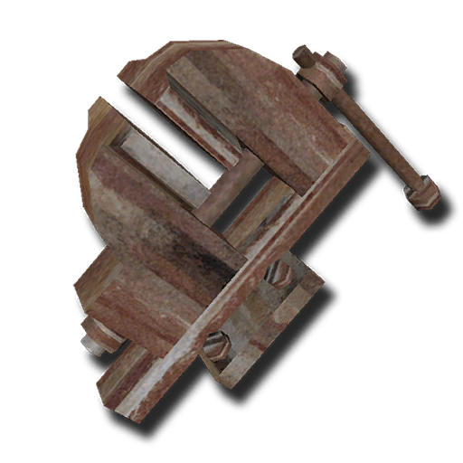

# Workbench Vice

<table class="infobox">
<caption>Workbench Vice</caption>
<colgroup>
<col style="width: 50%" />
<col style="width: 50%" />
</colgroup>
<tbody>
<tr>
<td colspan="2"><figure>

<figcaption>Workbench_Vice_icon.png</figcaption>
</figure></td>
</tr>
<tr>
<td>
Release
</td>
<td>
<a href="./The%20Long%20Dark%20%E2%80%94%20Changelog.md#2.33" class="wikilink" title="TFTFT Part 6 Broken Silence">TFTFT Part 6 Broken Silence</a>
</td>
</tr>
<tr>
<td colspan="2" class="section">
<strong>Properties</strong>
</td>
</tr>
<tr>
<td>
Item type
</td>
<td>
<a href="./Materials.md" class="wikilink" title="Materials">Materials</a>|-
</td>
</tr>
<tr>
<td colspan="2" class="section">
<strong>Values</strong>
</td>
</tr>
<tr>
<td>
Weight
</td>
<td>
2.00 kg (4.4 lbs)
</td>
</tr>
<tr>
<td colspan="2" class="section">
<strong>Actions</strong>
</td>
</tr>
<tr>
<td>
Backpack
</td>
<td>
Examine, Drop, Pick up
</td>
</tr>
</tbody>
</table>

A **Workbench Vice** is a <a href="./Materials.md" class="wikilink" title="Materials">Materials</a> obtained from <a href="./Harvesting.md" class="wikilink" title="Harvesting">Harvesting</a> a wooden or metal <a href="./Work%20Bench.md" class="wikilink" title="Work Bench">Work Bench</a>. It allows the player to create a new Work Bench as part of the <a href="./Safehouse%20Customization.md" class="wikilink" title="Safehouse Customization">Safehouse Customization</a> feature, and place it in any Safehouse.

## Overview

- <a href="./Harvesting.md" class="wikilink" title="Harvesting">Harvesting</a> a Metal <a href="./Work%20Bench.md" class="wikilink" title="Work Bench">Work Bench</a> with a <a href="./Hacksaw.md" class="wikilink" title="Hacksaw">Hacksaw</a> will produce 10 Scrap Metal and 1 Workbench Vice in 4 hours.
- Harvesting a Wooden Work Bench with a Hacksaw will produce 8 <a href="./Reclaimed%20Wood.md" class="wikilink" title="Reclaimed Wood">Reclaimed Wood</a> and 1 Workbench Vice in 3 hours.
- The player crafted Work Bench can be harvested with a <a href="./Hatchet.md" class="wikilink" title="Hatchet">Hatchet</a> to produce a Workbench Vice and 10 <a href="./Cedar%20Firewood.md" class="wikilink" title="Cedar Firewood">Cedar Firewood</a> in 1.45 hours.
- Workbench Vices cannot be created, only harvested from existing Work Benches.

There are currently 50 Work Benches found in the game, producing a limited amount of Vices to prevent the player from easily making infinite Work Benches.

  
*For a full list of locations with a Work Bench, see :Category:Locations with a workbench.*

## Products

## Game History

**Template:update historyLua execution error in Module:Navbox function navbox**

