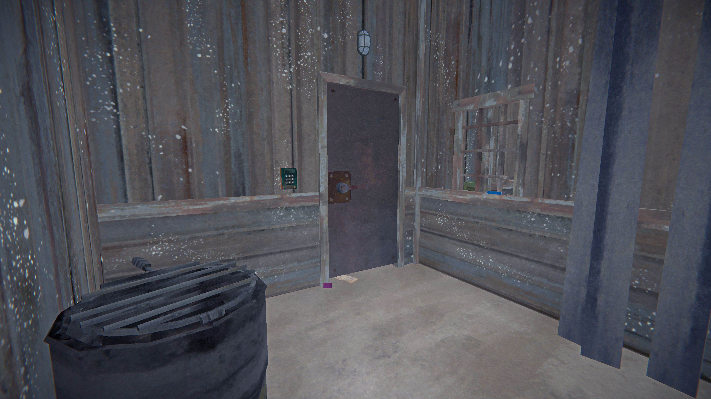
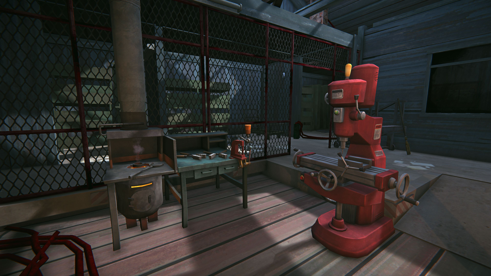

# Workshop

**Categories:** Indoor locations, Industrial locations, Locations, Locations in Bleak Inlet, Locations with a workbench · **Source:** [Fandom](https://thelongdark.fandom.com/wiki/Workshop)

**Workshop**

_SS-BI-Workshop01.jpg_

**Location**

_Workshop\_Location.png_

**Region:** [Bleak Inlet](./Bleak%20Inlet.md)

**General**

**Type:** Industrial

_bed\_icon.png_

_workbench\_icon\_green.png_

Has a workbench

## Workshop

_Locked door_The Cannery workshop is one of the two locations on [Great Bear Island](./Great%20Bear%20Island.md) that contains an [Ammunition Work Bench](./Ammunition%20Work%20Bench.md) and a [Milling Machine](./Milling%20Machine.md) (the other one being [Blackrock](./Blackrock.md)).

The workshop is challenging to reach; it is accessed via an [obstacle course](../assets/SS-BI-Cannery-ObstacleCourse.jpg) that starts with climbing the rope located in one of the warehouses on the opposite side of the entrance.

If you follow the linear course all the way through, you will reach the workshop. There is only one path to take, with no major side or alternate paths, and there is only one method to enter the course path. Essentially the only "obstacle" in the course is climbing the rope to start it. Balancing on the beams and rafters throughout the course is fairly easy. Note - the course winds through the complex and does not allow the player to backtrack after passing certain points.

After completing the course, the player can enter the pier warehouse's outer entryway. The way into the workshop is initially blocked by a locked door. The door can only be unlocked using the electronic keypad beside it, which requires a 3-digit code and electricity.

The workshop cannot be accessed through any alternate path, and the key-code cannot be guessed through trial and error. The player must read the Communication Report letter that is inside the [Echo One Radio Tower](./Echo%20One%20Radio%20Tower.md) in [Bleak Inlet](./Bleak%20Inlet.md). You do not need to take the report, but the player character must have seen the code document at least once.

The first time, the player will only be able to enter the workshop during an [Aurora](./Aurora.md) when the electronic keypad is active and the code can be entered to unlock the door.Once door is unlocked, entrance to the workshop remains unlocked.

Whenever the player passes through the workshop's door, there is a random chance of encountering a wolf. Once the wolf is dealt with, the player will be able to access the milling machine and the ammunition workbench. As the aurora appears frequently in this region, use caution around the live wires scattered about.

## Gallery

_Cannery Pier and the workshop_

_Workshop (inside)_

_Workshop (the ammunition workbench and milling machine )_
