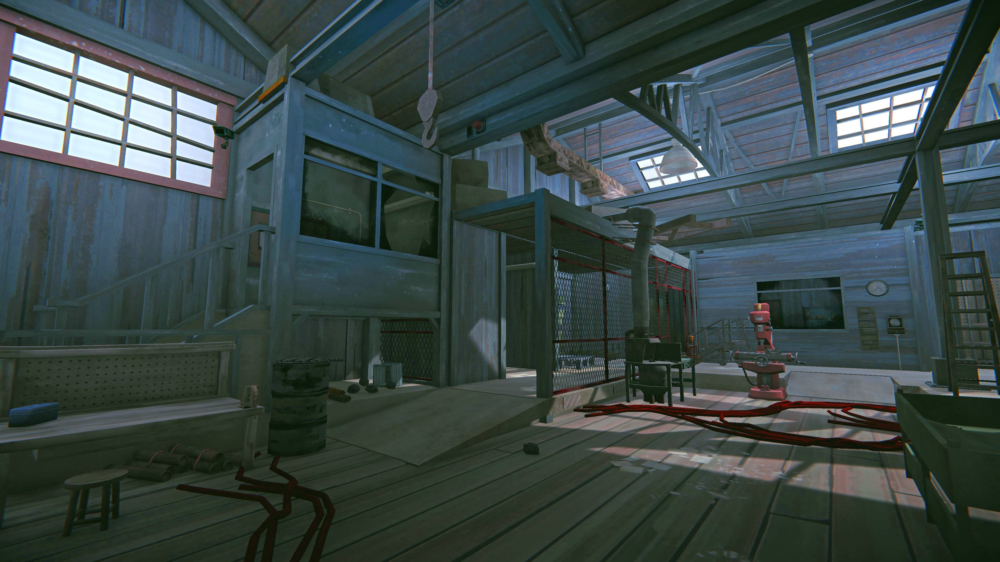

# Workshop

**Categories:** Indoor locations, Industrial locations, Locations, Locations in Bleak Inlet, Locations with a workbench · **Source:** [Fandom](https://thelongdark.fandom.com/wiki/Workshop)

**Workshop**

| Property | Details |
| --- | --- |
|  |  / _SS-BI-Workshop01.jpg_ |
| **Location** |  |
|  |  / _Workshop\_Location.png_ |
| Region | [Bleak Inlet](./Bleak%20Inlet.md)\|- |
| **General** |  |
| Type | Industrial\|- |
|  / _bed\_icon.png_ |  |
|  / _workbench\_icon\_green.png_ | Has a workbench\|- |
