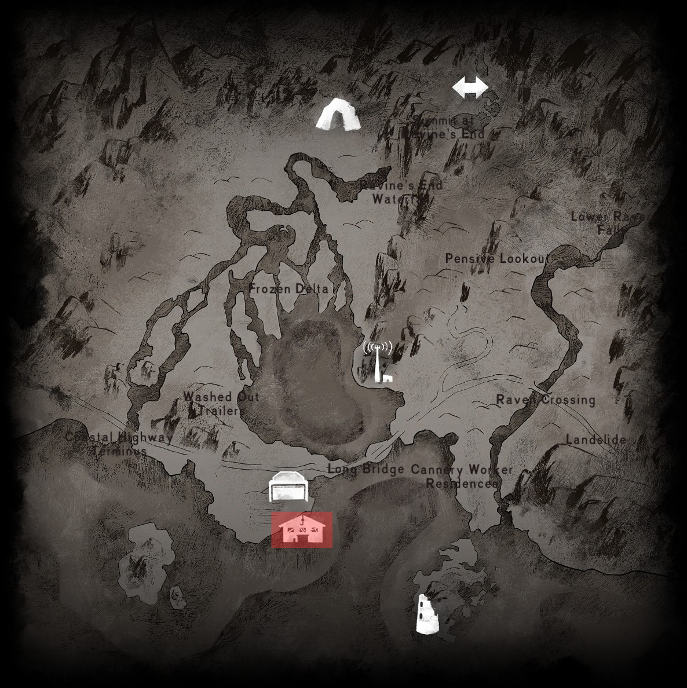

# Workshop

**Workshop**

| Property | Details |
| --- | --- |
|  |  / *SS-BI-Workshop01.jpg* |
| **Location** |  |
|  |  / *Workshop\_Location.png* |
| Region | [Bleak Inlet](./Bleak%20Inlet.md)\|- |
| **General** |  |
| Type | Industrial\|- |
|  / *bed\_icon.png* |  |
|  / *workbench\_icon\_green.png* | Has a workbench\|- |
