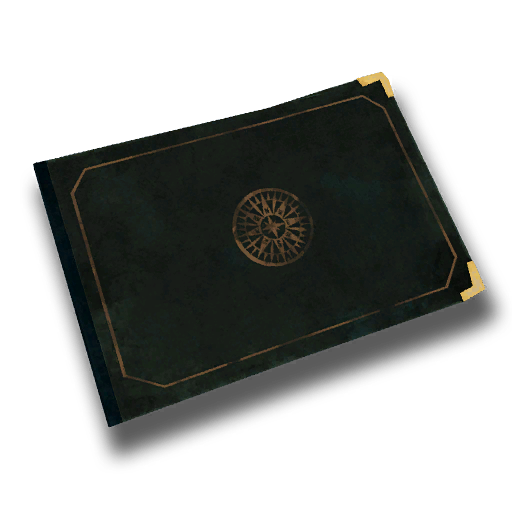

# Worn Logbook

<table class="infobox">
<caption>Worn Logbook</caption>
<colgroup>
<col style="width: 50%" />
<col style="width: 50%" />
</colgroup>
<tbody>
<tr>
<td colspan="2"><figure>

<figcaption>Worn_Logbook_icon.png</figcaption>
</figure></td>
</tr>
<tr>
<td>
Release
</td>
<td>
<a href="./The%20Long%20Dark%20%E2%80%94%20Changelog.md#2.52" class="wikilink" title="31 March 2026">31 March 2026</a>
</td>
</tr>
<tr>
<td>
Wintermute
</td>
<td>
<a href="./Episode%205%20-%20The%20Light%20At%20The%20End%20Of%20All%20Things.md" class="wikilink" title="Episode 5: The Light At The End Of All Things">Episode 5: The Light At The End Of All Things</a>
</td>
</tr>
<tr>
<td colspan="2" class="section">
<strong>Properties</strong>
</td>
</tr>
<tr>
<td>
Item type
</td>
<td>
<a href="./Collectibles.md" class="wikilink" title="Collectibles">Collectibles</a>|-
</td>
</tr>
<tr>
<td>
Stackable
</td>
<td>
No
</td>
</tr>
<tr>
<td>
Examine
</td>
<td>
Captain's Log
</td>
</tr>
<tr>
<td colspan="2" class="section">
<strong>Values</strong>
</td>
</tr>
<tr>
<td>
Weight
</td>
<td>
0.00 kg (0 lbs)
</td>
</tr>
<tr>
<td colspan="2" class="section">
<strong>Actions</strong>
</td>
</tr>
<tr>
<td>
Backpack
</td>
<td>
Examine
</td>
</tr>
<tr>
<td>
On ground
</td>
<td>
Take It, Read Text, Leave It
</td>
</tr>
</tbody>
</table>

**Worn Logbook** is a <a href="./Collectibles.md" class="wikilink" title="Collectibles">Collectibles</a> found in <a href="./Episode%205%20-%20The%20Light%20At%20The%20End%20Of%20All%20Things.md" class="wikilink" title="Episode 5">Episode 5</a> of the <a href="./Wintermute.md" class="wikilink" title="Wintermute">Wintermute</a> story. It is found inside the <a href="./Fukkatsu%20Maru.md" class="wikilink" title="Fukkatsu Maru">Fukkatsu Maru</a> during the main mission <a href="./A%20Cry%20For%20Help.md" class="wikilink" title="A Cry For Help">A Cry For Help</a>. It is found in the captain's quarters on the bridge, on top of the corpse of the Cargo Ship Captain.

The note is narrated by the Captain.

## Transcript

The following text is transcribed from **Worn Logbook**

They had jury-rigged some diesel contraption that kept the screw turning, but barely. Crazy, but smart as hell these guys. At least what's left of them after their old captain wandered overboard. And we keep coming across small boats with some survivors. They all have the same story. The lights showed up and their ships went dark. No power.

A few speak English, but they can't seem to tell me what the hell happened after the lights showed up. As much as I'm grateful they found me, they dropped me into a big mess by electing me captain. But I know these waters and based on how badly the crew is holding up I wouldn't trust them to find a port anyway.

Guys tied to their bunks, men throwing themselves into the sea, never seen or heard of things going sideways like this. No matter how long they've been out.

They keep jabbering about the "call of the lights" and a "burning fire." It's for sure a damn strong aurora some nights but I don't see what's so mystical about it all.

But we have enough food for now, calm seas, and a good course for landfall soon.

## Update history

\* UPDATE **31 March 2026 (<a href="./The%20Long%20Dark%20%E2%80%94%20Changelog.md#2.52" class="wikilink" title="Update">Update</a>):**

- - Added to game.

**Lua execution error in Module:Navbox function navbox**

