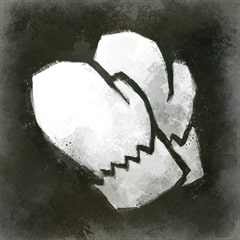

# Wrapped in Furs

**Wrapped in Furs**

| Property | Details |
| --- | --- |
|  |  / *Wrapped\_in\_Furs\_icon.png* |
| Description | Slept in a bearskin bedroll while wearing a wolfskin coat, deerskin boots, and rabbitskin mittens. |

**Wrapped in Furs** is an [achievement](./The%20Long%20Dark%20%E2%80%94%20Achievements.md) in *[The Long Dark](./The%20Long%20Dark.md)*.

## Guide

This achievement is obtained after [sleeping](./Sleep.md) in a [bear skin bedroll](./Bear%20Skin%20Bedroll.md) whilst wearing a [wolfskin coat](./Wolfskin%20Coat.md), [deerskin boots](./Deerskin%20Boots.md) and a pair of [rabbitskin mitts](./Rabbitskin%20Mitts.md).

This achievement require a great number of materials and time to complete. See the individual pages for the materials required to craft the respective items.

This achievement **does not** require the player to be wearing deerskin pants.

## Game history

This achievement was introduced on 1 April 2015 in [version 0.212](./The%20Long%20Dark%20%E2%80%94%20Changelog.md#0.212).

**Lua execution error in Module:Navbox function navbox**[ru:Достижения Steam](ru:%D0%94%D0%BE%D1%81%D1%82%D0%B8%D0%B6%D0%B5%D0%BD%D0%B8%D1%8F_Steam)
