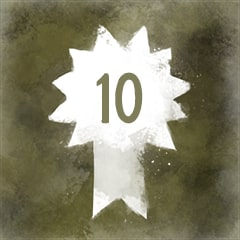

# You Made It\!

<table class="infobox">
<caption>You Made It!</caption>
<colgroup>
<col style="width: 50%" />
<col style="width: 50%" />
</colgroup>
<tbody>
<tr>
<td colspan="2"><figure>

<figcaption>You_Made_It!_icon.png</figcaption>
</figure></td>
</tr>
<tr>
<td colspan="2"></td>
</tr>
<tr>
<td>
Description
</td>
<td>
You survived 10 days in a single Survival mode game.
</td>
</tr>
</tbody>
</table>

**You Made It!** is an <a href="./The%20Long%20Dark%20%E2%80%94%20Achievements.md" class="wikilink" title="achievement">achievement</a> in *<a href="./The%20Long%20Dark.md" class="wikilink" title="The Long Dark">The Long Dark</a>*.

## Guide

This achievement is obtained after surviving for ten whole days in a single <a href="./Survival%20Mode.md" class="wikilink" title="Survival mode">Survival mode</a> game. It is most easily done on Pilgrim.

**Lua execution error in Module:Navbox function navbox**<a href="ru:%D0%94%D0%BE%D1%81%D1%82%D0%B8%D0%B6%D0%B5%D0%BD%D0%B8%D1%8F_Steam" class="wikilink" title="ru:Достижения Steam">ru:Достижения Steam</a>

