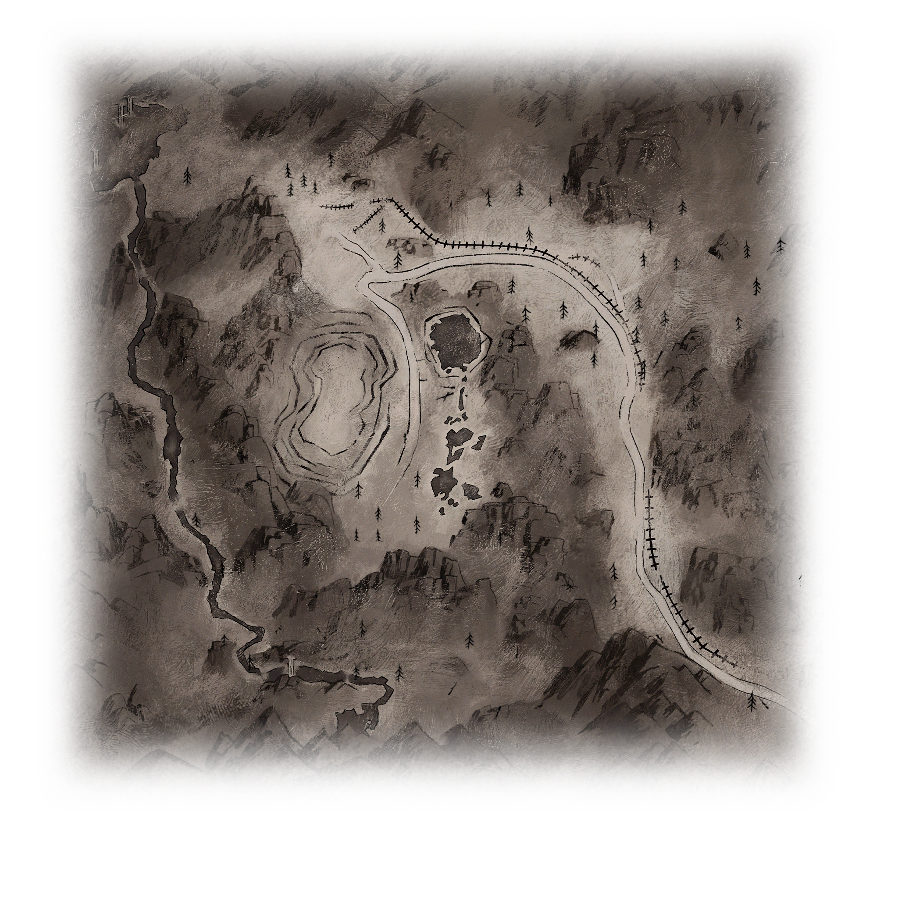
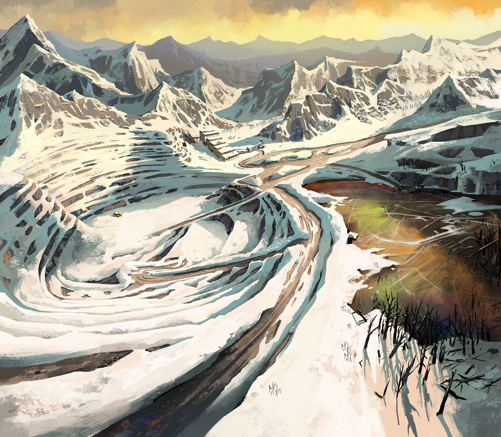
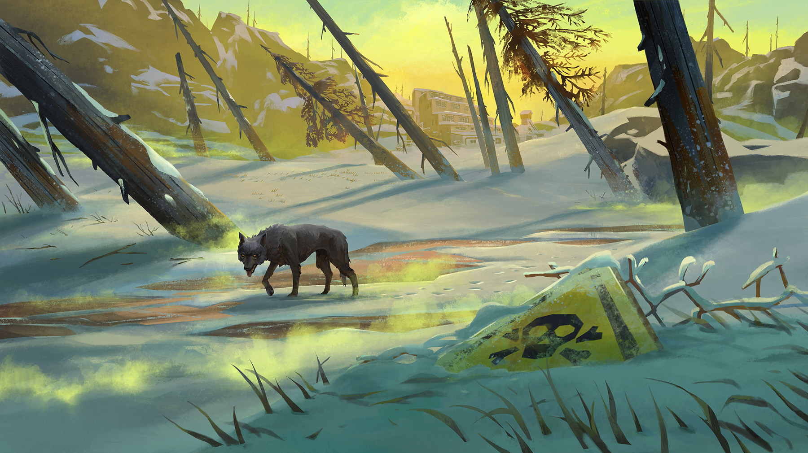
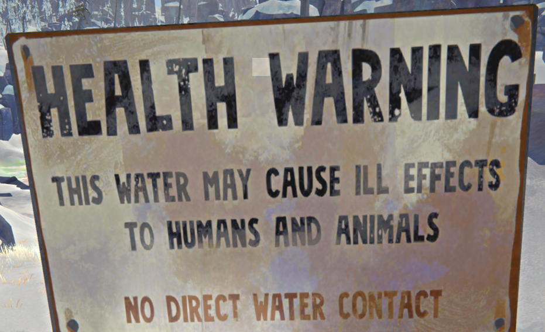

# Zone of Contamination

**Contents**

- [Overview](#Overview)
- [Survivability](#Survivability)
- [Locations](#Locations)
- [Maps](#Maps)
- [Trivia](#Trivia)
- [Game History](#Game_History)
- [Gallery](#Gallery)

<table class="infobox">
<caption>Zone of Contamination</caption>
<colgroup>
<col style="width: 50%" />
<col style="width: 50%" />
</colgroup>
<tbody>
<tr>
<td colspan="2"><figure>
[Missing image: Zone_of_Contamination.jpg]
<figcaption>Zone_of_Contamination.jpg</figcaption>
</figure></td>
</tr>
<tr>
<td colspan="2" class="section">
<strong>Location on <a href="./Great%20Bear%20Island.md" class="wikilink" title="Great Bear Island">Great Bear Island</a></strong>
</td>
</tr>
<tr>
<td colspan="2"><figure>
[Missing image: Zone_of_Contamination_Location.png]
<figcaption>Zone_of_Contamination_Location.png</figcaption>
</figure></td>
</tr>
<tr>
<td colspan="2"><figure>

<figcaption>Zone_of_Contamination_Region_map.png</figcaption>
</figure></td>
</tr>
<tr>
<td colspan="2" class="section">
<strong>Details</strong>
</td>
</tr>
<tr>
<td>
Description
</td>
<td>
A massive, open pit industrial mine abandoned due to highly hazardous toxic chemicals
</td>
</tr>
<tr>
<td>
Connecting Regions
</td>
<td>
<a href="./Transfer%20Pass.md" class="wikilink" title="Transfer Pass">Transfer Pass</a>,<a href="./Forsaken%20Airfield.md" class="wikilink" title="Forsaken Airfield">Forsaken Airfield</a> and <a href="./Sundered%20Pass.md" class="wikilink" title="Sundered Pass">Sundered Pass</a> (Via a transition cave)
</td>
</tr>
<tr>
<td>
TFTFT paid content
</td>
<td>
Yes
</td>
</tr>
<tr>
<td>
Difficulty
</td>
<td>
Advanced
</td>
</tr>
<tr>
<td>
Interloper Region Spawn
</td>
<td>
No
</td>
</tr>
<tr>
<td>
Locations
</td>
<td>
25
</td>
</tr>
<tr>
<td>
Date Added
</td>
<td>
Dec 5, 2023
</td>
</tr>
</tbody>
</table>

<table style="width:100%;">
<colgroup>
<col style="width: 16%" />
<col style="width: 16%" />
<col style="width: 16%" />
<col style="width: 16%" />
<col style="width: 16%" />
<col style="width: 16%" />
</colgroup>
<tbody>
<tr>
<td width="40px"><figure>
[Missing image: Ptarmigan_icon.png]
<figcaption>Ptarmigan_icon.png</figcaption>
</figure></td>
<td>
<strong>DLC-Exclusive content.</strong> 

This content requires the <a href="./Tales%20from%20the%20Far%20Territory.md" class="wikilink" title="Tales from the Far Territory">Tales from the Far Territory</a> addon to be installed before it can be seen or used in regular gameplay.

</td>
<td>
|}{| style="margin:auto"
</td>
<td style="vertical-align: top; font-size: 3em; color: #5d5980; padding-right: 10px">
“
</td>
<td>
An open-pit mine operation scars the landscape, with various outbuildings and mining apparatus pock-marked by pools of toxic chemicals and run-off. The mine may hide relics of the Far Territory's mysterious past.

&#10;

Official Hinterland Description

</td>
<td style="vertical-align: bottom; font-size: 3em; color: #5d5980; padding-left: 10px">
”
</td>
</tr>
</tbody>
</table>

<table>
<colgroup>
<col style="width: 33%" />
<col style="width: 33%" />
<col style="width: 33%" />
</colgroup>
<tbody>
<tr>
<td style="vertical-align: top; font-size: 3em; color: #5d5980; padding-right: 10px">
“
</td>
<td>
For advanced players. A Cold War relic of industrial hubris, the Zone is littered with Chemical Hazards and forgotten infrastructure. Its secrets remain hidden by environmental devastation. Prepare yourself, and take care.

Stay above ground and see the remnants, or dive into the deep mine, at your peril.

Connects to Sundered Pass, Forsaken Airfield, and Transfer Pass.

&#10;

In-game Description

</td>
<td style="vertical-align: bottom; font-size: 3em; color: #5d5980; padding-left: 10px">
”
</td>
</tr>
</tbody>
</table>

The **Zone of Contamination** or **ZOC** as its also known as, is the 15th <a href="./Region.md" class="wikilink" title="Region">Region</a> added to *<a href="./The%20Long%20Dark.md" class="wikilink" title="The Long Dark">The Long Dark</a>* that was released on the 5th of December in 2023 as part of the Part 4 "Buried Echoes" update to the <a href="./Tales%20from%20the%20Far%20Territory.md" class="wikilink" title="Tales from the Far Territory">Tales from the Far Territory</a> expansion. It is also the setting of the second Tale <a href="./Buried%20Echoes.md" class="wikilink" title="Buried Echoes">Buried Echoes</a>.

It connects to <a href="./Transfer%20Pass.md" class="wikilink" title="Transfer Pass">Transfer Pass</a> via the railroad at <a href="./Immutable%20Hesitation.md" class="wikilink" title="Immutable Hesitation">Immutable Hesitation</a> and <a href="./Forsaken%20Airfield.md" class="wikilink" title="Forsaken Airfield">Forsaken Airfield</a> via a large cave system near <a href="./Enduring%20Waterfall.md" class="wikilink" title="Enduring Waterfall">Enduring Waterfall</a>.

## Overview

Locally named the Langston Mine and built by the Langston Mining Corporation, the Zone of Contamination is an abandoned open-pit mine that is one of the most dangerous places to travel to on <a href="./Great%20Bear%20Island.md" class="wikilink" title="Great Bear Island">Great Bear Island</a>, due to the dead zone created by the extreme amount of toxic chemicals spilled throughout the center of the region.

Ponds are filled with a sickly orange toxic runoff previously pumped and dumped onto the surface, driving away all herbivorous wildlife and killing the nearby plants. Puddles of <a href="./Chemical%20Hazard.md" class="wikilink" title="toxic goo">toxic goo</a> are spread all over the surface of major roads and railroads due to mismanaged ruptured chemical barrels, requiring special <a href="./Chemical%20Boots.md" class="wikilink" title="Chemical Boots">Chemical Boots</a> to walk across without destroying footwear. Deep below the surface, the local mines are filled with caustic vapors, requiring a <a href="./Respirator.md" class="wikilink" title="Respirator">Respirator</a> to travel through safely to prevent <a href="./Suffocation.md" class="wikilink" title="Suffocation">Suffocation</a>. <a href="./Poisoned%20Wolf.md" class="wikilink" title="Poisoned wolves">Poisoned wolves</a> shamble in between chemical hazards desperately searching for anything to eat due to a lack of prey, and can give the player the <a href="./Chemical%20Poisoning.md" class="wikilink" title="Chemical Poisoning">Chemical Poisoning</a> <a href="./Afflictions.md" class="wikilink" title="affliction">affliction</a> if attacked.

Though thankfully not all areas of the Zone are so treacherous to the player's well-being. Sections of Great Bear Island's pristine beauty still shine through decay of the locally mismanaged industrialization, and can still be found to the south, north, and west of the map. The south and west still sees a great deal of thriving <a href="./Deer.md" class="wikilink" title="deer">deer</a>, <a href="./Bear.md" class="wikilink" title="bears">bears</a>, and <a href="./Rabbit.md" class="wikilink" title="rabbits">rabbits</a> to provide hunting opportunities for fresh meat and the hills to the north and east occasionally contain <a href="./Ptarmigan.md" class="wikilink" title="ptarmigan">ptarmigan</a> nests. The uncontaminated frozen hills also offer an unspoiled bounty of harvestable <a href="./Cat%20Tail.md" class="wikilink" title="cat tails">cat tails</a> and other plants to forage, and the north western corner of the map contains a pond large enough to freely fish in.

## Survivability

Surviving in the Zone of Contamination can be quite difficult without the right equipment, supplies, or strategy. Most supplies and shelters in the region are located in contaminated areas, creating an incentive to stay close to them for items needed for survival despite the danger. On the flipside, the nearby valleys and mountains, while pristine and full of healthy wildlife to hunt, contain no manmade shelters and very few caves to escape from the cold, creating a unique survival dichotomy only found within this region. One potential solution is to use a <a href="./Travois.md" class="wikilink" title="Travois">Travois</a> to haul more food from the valleys and mountains to the shelters per trip.

<a href="./Glimmer%20Fog.md" class="wikilink" title="Glimmer Fog">Glimmer Fog</a> returns from <a href="./Forsaken%20Airfield.md" class="wikilink" title="Forsaken Airfield">Forsaken Airfield</a> to frequently plague the area, but it can be more reliably escaped by hiding inside the local underground mine tunnels.

The region has 2 vista locations: one is located at a cliff with a picnic table at <a href="./Boss%27s%20Settlement.md" class="wikilink" title="Boss&#39;s Settlement">Boss's Settlement</a>, the other can be found on a cliff side close to <a href="./Welkin%27s%20Window.md" class="wikilink" title="Welkin&#39;s Window">Welkin's Window</a> overlooking the valley of Enduring Falls.

## Locations

There are a number of locations in the Zone of Contamination, including:

<table>
<colgroup>
<col style="width: 50%" />
<col style="width: 50%" />
</colgroup>
<tbody>
<tr>
<td><ul>
<li><a href="./Boss%27s%20Settlement.md" class="wikilink" title="Boss&#39;s Settlement">Boss's Settlement</a></li>
<li><a href="./Bountiful%20Overlook.md" class="wikilink" title="Bountiful Overlook">Bountiful Overlook</a></li>
<li><a href="./Concentrator.md" class="wikilink" title="Concentrator">Concentrator</a></li>
<li><a href="./Conveyor%20Room.md" class="wikilink" title="Conveyor Room">Conveyor Room</a></li>
<li><a href="./Craggy%20Passage.md" class="wikilink" title="Craggy Passage">Craggy Passage</a></li>
<li><a href="./Desperate%20Elevation.md" class="wikilink" title="Desperate Elevation">Desperate Elevation</a></li>
<li><a href="./Dubious%20Overlook.md" class="wikilink" title="Dubious Overlook">Dubious Overlook</a></li>
<li><a href="./Enduring%20Waterfall.md" class="wikilink" title="Enduring Waterfall">Enduring Waterfall</a></li>
<li><a href="./Flagman%27s%20Gap.md" class="wikilink" title="Flagman&#39;s Gap">Flagman's Gap</a></li>
<li><a href="./Forgotten%20Exploration.md" class="wikilink" title="Forgotten Exploration">Forgotten Exploration</a></li>
<li><a href="./Harrowed%20Residence.md" class="wikilink" title="Harrowed Residence">Harrowed Residence</a></li>
<li><a href="./Headframe%20Building.md" class="wikilink" title="Headframe Building">Headframe Building</a></li>
<li><a href="./Idle%20Camp.md" class="wikilink" title="Idle Camp">Idle Camp</a></li>
</ul></td>
<td data-valign="top" style="width: 50%"><ul>
<li><a href="./Indolent%20Hoppers.md" class="wikilink" title="Indolent Hoppers">Indolent Hoppers</a></li>
<li><a href="./Langston%20Mine.md" class="wikilink" title="Langston Mine">Langston Mine</a></li>
<li><a href="./Miner%27s%20Footpath.md" class="wikilink" title="Miner&#39;s Footpath">Miner's Footpath</a></li>
<li><a href="./Old%20Corral.md" class="wikilink" title="Old Corral">Old Corral</a></li>
<li><a href="./Overladen%20Pond.md" class="wikilink" title="Overladen Pond">Overladen Pond</a></li>
<li><a href="./Pump%20House.md" class="wikilink" title="Pump House">Pump House</a></li>
<li><a href="./Smoker%27s%20Cave.md" class="wikilink" title="Smoker&#39;s Cave">Smoker's Cave</a></li>
<li><a href="./Scaffolder%27s%20Hideout.md" class="wikilink" title="Scaffolder&#39;s Hideout">Scaffolder's Hideout</a></li>
<li>To Cave System (Region Transition to <a href="./Forsaken%20Airfield.md" class="wikilink" title="Forsaken Airfield">Forsaken Airfield</a>/<a href="./Sundered%20Pass.md" class="wikilink" title="Sundered Pass">Sundered Pass</a>)</li>
<li>To Transfer Pass (Region Transition to <a href="./Transfer%20Pass.md" class="wikilink" title="Transfer Pass">Transfer Pass</a>)</li>
<li><a href="./Turbulent%20Pasture.md" class="wikilink" title="Turbulent Pasture">Turbulent Pasture</a></li>
<li><a href="./Unquenched%20Extraction.md" class="wikilink" title="Unquenched Extraction">Unquenched Extraction</a></li>
<li><a href="./Welkin%27s%20Window.md" class="wikilink" title="Welkin&#39;s Window">Welkin's Window</a></li>
</ul></td>
</tr>
</tbody>
</table>

## Maps

<table class="gallery">
<colgroup>
<col style="width: 25%" />
<col style="width: 25%" />
<col style="width: 25%" />
<col style="width: 25%" />
</colgroup>
<tbody>
<tr>
<td><figure>
[Missing image: ZOC_map_default.png]
<figcaption>A detailed map of Zone of Contamination v2.35 (contains spoilers)</figcaption>
</figure></td>
<td><figure>
[Missing image: ZOC_map_loper.png]
<figcaption>A detailed map of Zone of Contamination v2.35 (Interloper/Misery edition, contains spoilers)</figcaption>
</figure></td>
<td><figure>

<figcaption>Map of the Zone of Contamination with all named locations, by Aiibees.</figcaption>
</figure></td>
<td><figure>

<figcaption>Map of the Zone of Contamination with all named locations and chemical spills, by Aiibees.</figcaption>
</figure></td>
</tr>
<tr>
<td><figure>

<figcaption>Map of the Zone of Contamination with all named locations and resources, by Aiibees.</figcaption>
</figure></td>
<td><figure>
[Missing image: Transition_cave_map_03_v1.jpg]
<figcaption>Map of the transition cave connecting Forsaken Airfield, Zone of Contamination and Sundered Pass</figcaption>
</figure></td>
<td><figure>
[Missing image: Langston_Mine_Fan_made_Map.jpg]
<figcaption>Fan made layout of all three floors of the Langston Mine</figcaption>
</figure></td>
<td></td>
</tr>
</tbody>
</table>

## Trivia

- The region was formerly announced as the Industrial Mine, but was renamed during its debut.
- The <a href="./Concentrator.md" class="wikilink" title="Concentrator">Concentrator</a>, <a href="./Conveyor%20Room.md" class="wikilink" title="Conveyor Room">Conveyor Room</a>, and <a href="./Headframe%20Building.md" class="wikilink" title="Headframe Building">Headframe Building</a> found above the mine form the largest interior building space found in the game to date. The previous holder of this title, the <a href="./Carter%20Hydro%20Dam.md" class="wikilink" title="Carter Hydro Dam">Carter Hydro Dam</a>, is significantly smaller in comparison.
- The Zone of Contamination is currently the only region to feature the <a href="./Haul%20Truck.md" class="wikilink" title="Earth Mover">Earth Mover</a> and <a href="./Poisoned%20Wolf.md" class="wikilink" title="Poisoned Wolf">Poisoned Wolf</a>.

## Game History

- Zone of Contamination was added to the game on 5 December 2023 in the <a href="./The%20Long%20Dark%20%E2%80%94%20Changelog.md#2.25_%28Steam%29" class="wikilink" title="TFTFT Chapter 4 Update">TFTFT Chapter 4 Update</a>.

## Gallery

<table class="gallery">
<colgroup>
<col style="width: 25%" />
<col style="width: 25%" />
<col style="width: 25%" />
<col style="width: 25%" />
</colgroup>
<tbody>
<tr>
<td><figure>
[Missing image: 20230520075647_1.jpg]
<figcaption>A sign in Transfer Pass directing motorists to the mine</figcaption>
</figure></td>
<td><figure>

<figcaption>Concept art of the Industrial Mine Region</figcaption>
</figure></td>
<td><figure>

<figcaption>A poisoned wolf concept art</figcaption>
</figure></td>
<td><figure>
[Missing image: Bountiful_Overlook_sign.jpg]
<figcaption>The sign leading to the open pit mine near Bountiful Overlook</figcaption>
</figure></td>
</tr>
<tr>
<td><figure>
[Missing image: Zone_of_Contamination_Open_Pit_Mine.jpg]
<figcaption>The open pit Langston Mine</figcaption>
</figure></td>
<td><figure>
[Missing image: Chemical_Spill.jpg]
<figcaption>A large Chemical Spill. Notice the dying trees.</figcaption>
</figure></td>
<td><figure>

<figcaption>Poisoned lakes</figcaption>
</figure></td>
<td><figure>

<figcaption>Health warning sign at the mine</figcaption>
</figure></td>
</tr>
<tr>
<td><figure>

<figcaption>View of the buildings of the mine</figcaption>
</figure></td>
<td></td>
<td></td>
<td></td>
</tr>
</tbody>
</table>

**Lua execution error in Module:Navbox function navboxLua execution error in Module:Navbox function navbox** <a href="ru:%D0%97%D0%BE%D0%BD%D0%B0_%D0%B7%D0%B0%D1%80%D0%B0%D0%B6%D0%B5%D0%BD%D0%B8%D1%8F" class="wikilink" title="ru:Зона заражения">ru:Зона заражения</a>

